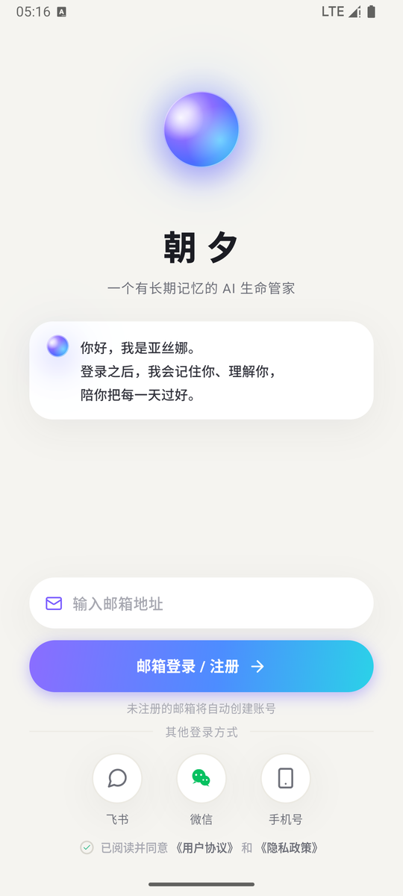
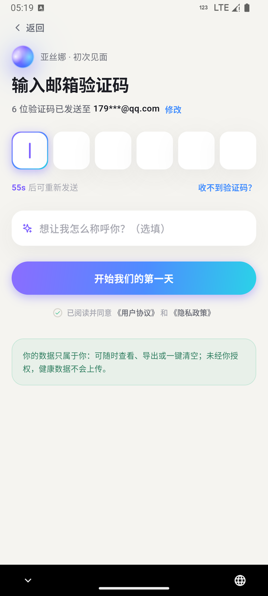
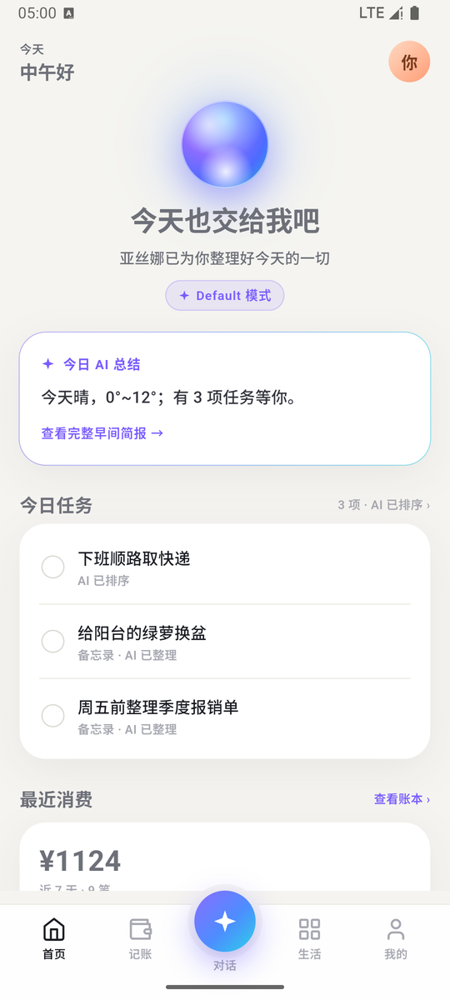
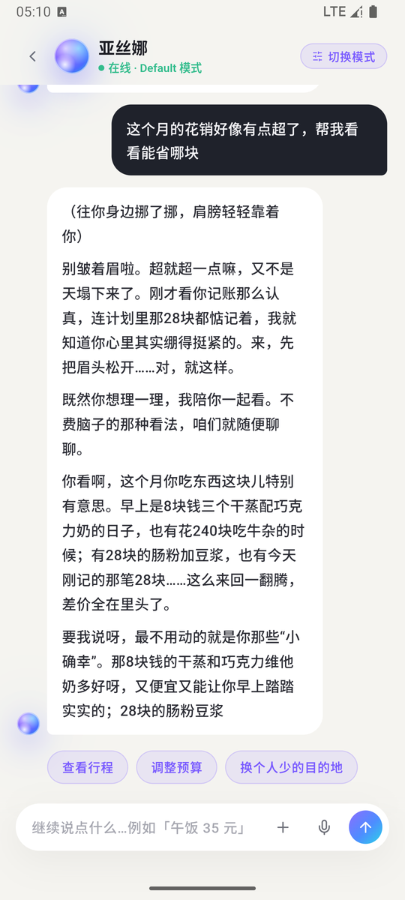
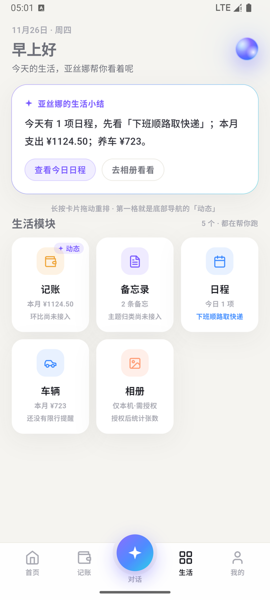
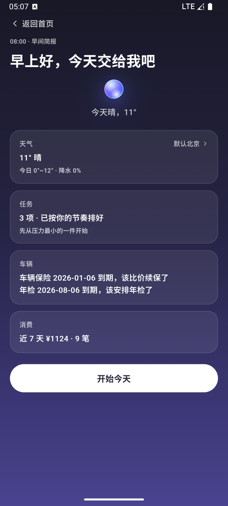
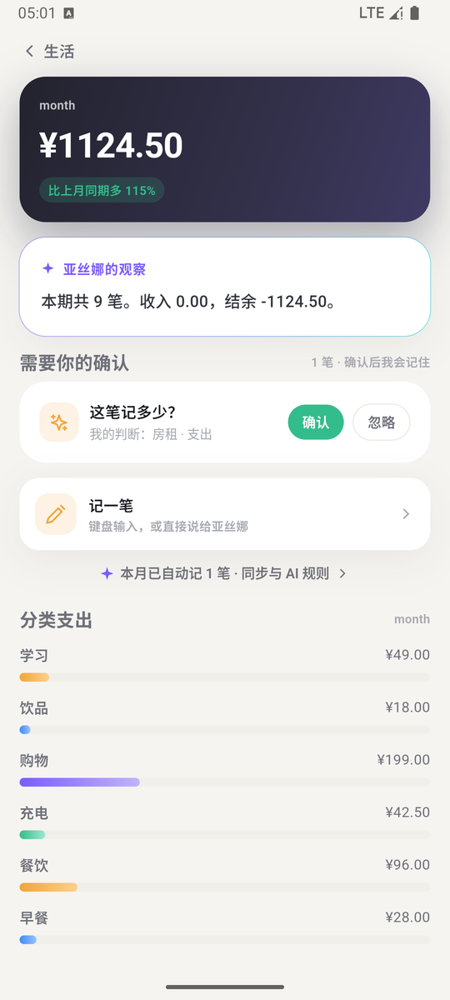
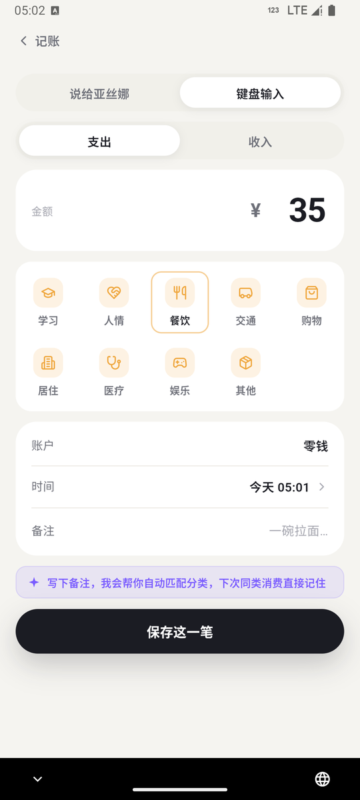
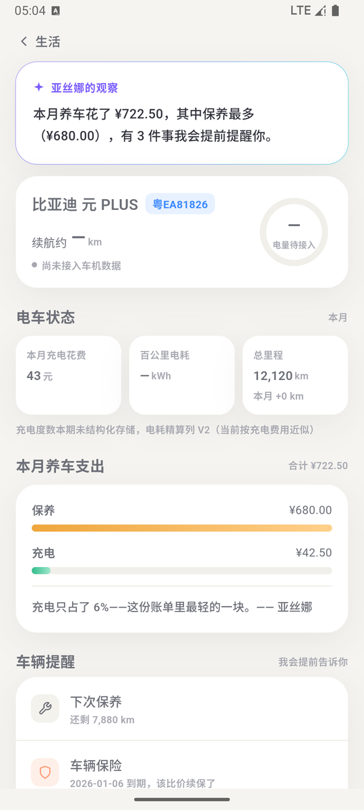
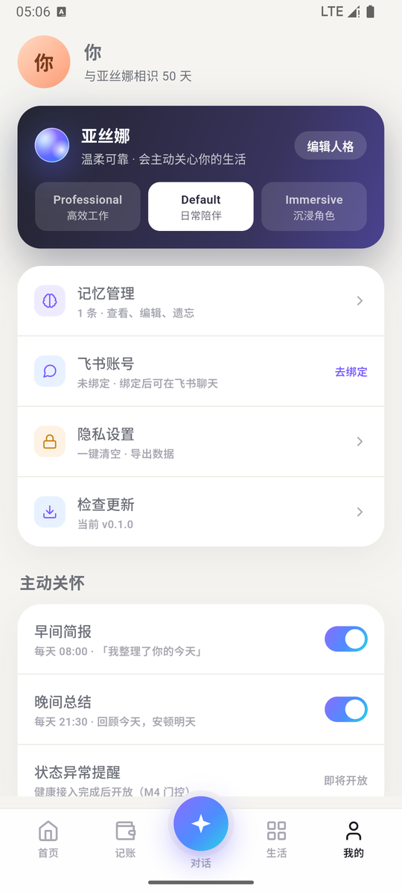

# AICustomerServiceAgent

「角色对话 Agent」—— 让「亚丝娜」成为具备**记忆、情绪、关系、目标、自主行为与世界感**的 AI Agent。后端为 FastAPI + LangChain + PostgreSQL 的流式对话服务，前端是面向开发者的 React 调试控制台，移动端是产品级客户端「朝夕」App（Flutter）。

能力横跨 V1~V9 对话与角色基座、V2.x/V3.x 运行时与执行域、V5.x 朝夕客户端、V6.0.0 Agent Evolution（记忆演进 / 计划澄清）。

## 界面效果（朝夕 App · `apps/mobile`）

<table>
  <tr>
    <td align="center"><br /><sub>登录 · 邮箱入口</sub></td>
    <td align="center"><br /><sub>验证码 · 六位输入</sub></td>
    <td align="center"><br /><sub>首页 · 今日任务与 AI 总结</sub></td>
    <td align="center"><br /><sub>对话 · 流式回复与连续记忆</sub></td>
    <td align="center"><br /><sub>生活 · 模块宫格与生活小结</sub></td>
  </tr>
  <tr>
    <td align="center"><br /><sub>早间简报 · 天气 / 任务 / 车辆 / 消费</sub></td>
    <td align="center"><br /><sub>账本 · 月度汇总与待确认</sub></td>
    <td align="center"><br /><sub>记一笔 · 金额键盘 + 分类</sub></td>
    <td align="center"><br /><sub>车辆 · 电车状态与养车支出</sub></td>
    <td align="center"><br /><sub>我的 · 人格模式与主动关怀</sub></td>
  </tr>
</table>

> 以上为 **Android 模拟器（Medium Phone API 36）上 release 包实机运行截图**（2026-11-26，数据由真实后端写入），仅展示已实现页面；更完整的 17 张见 [`apps/mobile/README.md`](apps/mobile/README.md)。

## 技术栈

| 端 | 技术 |
|---|---|
| 后端（`apps/backend/`） | Python 3.13 + FastAPI + LangChain + PostgreSQL 16（SQLAlchemy + Alembic）+ Redis，uv 管理依赖 |
| 前端（`apps/frontend/`） | React 19 + TypeScript + Vite + TanStack Query + Zustand + Tailwind 4，vitest 测试 |
| 移动端（`apps/mobile/`） | Flutter ≥ 3.44 + Riverpod 3 + GoRouter + Dio + Freezed + Drift(SQLite)，朝夕 App（V5.0.0，产品级客户端） |
| 部署 | Docker 多阶段构建（根目录 `Dockerfile`）+ docker compose（根目录唯一入口） |

## 目录结构

```
├── apps/
│   ├── backend/           # FastAPI 后端（详见 apps/backend/README.md）
│   │   ├── app/           #   api / application / channels / services / repositories / chains / engines / core / models / prompts / character
│   │   ├── migrations/    #   Alembic 迁移链（基线 0001 + 增量 0002 ~ 0010）
│   │   └── tests/         #   pytest 分层（unit / integration / e2e / golden；FakeLLM 注入）
│   ├── frontend/          # React 调试控制台（详见 apps/frontend/README.md）
│   │   └── src/           #   api / app / components / features / hooks / stores / mocks
│   └── mobile/            # 朝夕 App Flutter 客户端（详见 apps/mobile/README.md）
│       ├── lib/           #   app / core / design_system / features（按域垂直切分）
│       └── docs/          #   icons / launcher-icon / screenshots（README 展示图）
├── design/                # 朝夕 App 设计稿（pages/ 为现役高保真原型）
├── docs/                  # 文档（架构基线 + 各版本任务注册表 / 架构 / 回归清单）
├── docker-compose.yml     # Docker 唯一入口（postgres + redis + console）
└── Dockerfile             # 多阶段构建：node 构建前端 → python 托管后端 + dist
```

## 快速开始

### 方式一：Docker 一键起完整栈（推荐体验）

```bash
# 1. 复制 .env 并填入可用 API Key（容器方式推荐内联：LLM_PROFILES_JSON 写成单行 JSON，compose 会注入为环境变量）
cp apps/backend/.env.example apps/backend/.env

# 2. 构建并启动（自动执行 alembic 迁移 + 托管前端产物）
docker compose up -d --build

# 3. 浏览器访问 http://localhost:8020
```

### 方式二：本地开发

```bash
# 1. 启动 PostgreSQL 16 + Redis（统一入口为根目录 compose；Redis 供邮箱验证码登录）
docker compose up -d postgres redis

# 2. 后端（apps/backend/ 下）：配置 LLM profiles + 安装依赖 + 迁移 + 启动
cd apps/backend
cp .env.example .env                            # 环境变量模板
cp llm_profiles.example.json llm_profiles.json  # profiles 模板（api_key 为空串），填入真实 Key 即可自由排版
uv sync
uv run alembic upgrade head
uv run uvicorn app.main:app --reload --port 8020

# 3. 前端（apps/frontend/ 下）：启动开发服务器
cd apps/frontend
npm install
npm run dev                 # http://localhost:2000，/api 代理到 :8020（VITE_PROXY_TARGET 可配置）

# 4. 移动端（apps/mobile/ 下）：朝夕 App，模拟器/登录流程见 apps/mobile/README.md
cd apps/mobile
flutter pub get
emulator -avd Medium_Phone_API_36                           # 模拟器不会自动拉起，必须先手动启动（等 adb devices 出现 emulator-5554）
adb reverse tcp:8020 tcp:8020                               # 模拟器端口隧道（重启模拟器后重跑）
flutter run --dart-define-from-file=dart_defines/dev.json --flavor dev -d emulator-5554   # VS Code：先在状态栏选中 emulator-5554 再 F5
```

> 移动端要求 Flutter ≥ 3.44.0（Dart ≥ 3.13.4）；`API_BASE_URL` 未注入时启动即 fail-fast，地址改 `apps/mobile/dart_defines/dev.json` 一处即可。登录走**邮箱验证码**（未注册邮箱自动建号）：后端 `.env` 需配置 `REDIS_URL` + `EMAIL_SMTP_*`（163 用授权码）+ `AUTH_TOKEN_SECRET`，缺一登录端点 503；配对码链路已退役。

> 环境变量说明见 `apps/backend/README.md` 的配置项表。LLM profile 两种配置方式（`LLM_PROFILES_JSON` 优先级更高，同时配置时忽略文件）：本地开发用 `LLM_PROFILES_FILE` 指向外置 JSON 文件（如 `llm_profiles.json`，可排版）；容器 / 内联场景把 `LLM_PROFILES_JSON` 写成单行数组。

## 测试

```bash
# 后端（apps/backend/ 下；全量 pytest 7000+ 项，无本地 PG 实例时迁移一致性用例自动 skip）
uv run pytest
uv run pylint app tests

# 前端（apps/frontend/ 下）
npm run test        # vitest
npm run typecheck   # tsc -b
npm run lint        # eslint

# 移动端（apps/mobile/ 下；单元 + widget + golden 视觉回归，50 个测试文件）
flutter test
flutter test integration_test   # 冒烟
```

## 核心能力

**对话与角色基座（V1~V9）**

- **流式对话**：NDJSON 三段事件流（`turn_meta → delta* → done`），会话续接与历史持久化
- **角色状态（V2）**：情绪 / 行为 / 关系随对话演化并注入 Prompt
- **场景连续性（V3）**：场景状态、活动 / 动作 pending 机制跨轮延续
- **长期记忆（V4）**：提取 → 策略过滤 → 冲突消解 → 结构化加权召回
- **情绪与关系（V5 / V8.5）**：离散情绪引擎（事件驱动 + 衰减）与关系多维演化（里程碑 / 冲突生命周期 / 动力学修饰）
- **目标与意图（V6 / V6.5）**：持久目标、意图决策与校验、行为策略与动作预算
- **自主行为（V7）**：闲置触发 → 多条件裁决 → Outbox 状态机 → 主动消息（静音 / 冷却 / 防轰炸闸）
- **评估与可观测（V7.5 / V7.8）**：五维角色评估（规则引擎 + LLM Judge）、运行 trace / 决策 / prompt / LLM 调用观测
- **世界状态（V8）**：时间、地点、物品状态机、天气与事件，按预算装配进上下文
- **行动能力（V9）**：Action Planner + Capability 能力系统 + 执行引擎与结果回写

**运行时与执行域（V2.x / V3.x / V6.0.0）**

- **Agent Runtime**：Run 台账 / Profile 注册表 / Trigger Router / LLM Gateway / Decision Pipeline / Evolution
- **Tool / Planning / Action Execution / Reflection**：工具注册与权限确认、规划拆解与修订、任务执行、反思沉淀
- **World Simulation / Character**：日计划、用户处境、世界简报；风格契约与 Style Context
- **Agent Evolution（V6.0.0）**：记忆演进（分层配额 / 衰减 / 情景聚合 / 语义抽象 / 链接召回）、计划澄清

**客户端（V5.x · 朝夕 App）**

- 邮箱验证码登录、首页聚合、流式对话、记账 / 备忘录 / 日程 / 车辆 / 相册、早/晚简报、记忆管理、隐私导出删除、免商店自动更新

## 主要 API（前缀 `/api/v1`）

当前端点数以 `docs/current-system-architecture-baseline.md` 与 `apps/backend/README.md` 为准，常用入口：

| 端点 | 说明 |
|---|---|
| `POST /chat/message` | 流式对话（NDJSON：turn_meta → delta* → done），响应头回显会话与实际使用的 profile |
| `POST /auth/email/code` · `POST /auth/email/verify` | 邮箱验证码登录（发码 / 验码换长期令牌） |
| `GET /conversations/{conversation_id}/messages` | 查询指定会话的历史消息（404 表示会话不存在） |
| `GET /memories` | 查询用户长期记忆列表 |
| `GET /state` | 角色当前状态查询（状态 / 关系 / 情绪史 / 行为快照） |
| `GET /proactive/pending` · `POST /proactive/{action_id}/ack` | 待确认主动消息与 ack |
| `GET /home/summary` · `GET /ledger/summary` · `GET/POST /ledger/entries` | 客户端首页聚合与账本域 |
| `GET /app-release/latest` | 客户端检查更新（`platform` / `channel` / `version_code`） |
| `GET /llm/profiles` · `GET /debug/turns/{turn_id}/trace` | 模型 profile 列表与单轮编排 trace |

## 文档导航

**当前基线（最优先）**

- `docs/current-system-architecture-baseline.md` — 当前系统唯一可信架构基线（分层 / 模块 / 数据 / 配置 / 扩展点 / 技术债 / ADR / 演进方向）；架构类问题先查它，架构演进须先更新基线再开发

**当前版本**

- `docs/version/v6.0.0/` — Agent Evolution（`MEV-` 记忆演进 / `PLN-` 计划澄清 / `SAG-` 子 Agent 未排期）
- `docs/version/v5.0.0/` — 朝夕 App（`requirements-analysis` / `tasks` / `tasks/` 明细 / `flutter-architecture` / `update-system-architecture` / `traceability` / `compliance`）
- `docs/version/v4.0.0/` — Personal Life Agent Foundation（用户实体 + 账本域）
- `docs/version/v3.0.0/` — Agent Runtime Core（`acceptance-report` 为 CONDITIONAL — NOT RELEASED）

**前序版本（V2.x，已实现）**

- `docs/version/v2.6.1/`（Reflection）· `v2.6.0/`（Action Execution）· `v2.5.0/planning-system/` · `v2.4.0/tool-system/` · `v2.3.0/`（World Simulation）· `v2.2.0/`（Character）· `v2.1.0/`（Agent Runtime / Evolution）· `v2.0.1/`（Autonomy）· `v2.0.0/`（六 Phase 深化）

**历史版本（V1.x）**

- `docs/version/v1.0.0/v9/` ~ `v3/` — V3~V9 各版本设计 + 任务注册表（已实现）；`v1/` · `v2/` 为早期版本

**横切与集成**

- `docs/integrations/feishu/` — 飞书通道架构、任务与验收（Web + 飞书真实链路已验证）
- `docs/TESTING.md` — 测试规范（marker、执行级别、AI Coding 测试规则）
- `design/README.md` — 朝夕 App 设计稿维护状态与页面清单
- `.agents/skills/zhaoxi-design-system/` — 设计系统 Skill（UI 唯一真源，优先级高于 `design/`）
- `AGENTS.md` / `apps/backend/AGENTS.md` — 仓库与后端开发约定（面向 Coding Agent）

## 开发约定（摘自 AGENTS.md）

- 禁止在源码硬编码 API Key / 密钥，只从环境变量或 `.env` 读取；不提交 `.env`
- 分层单向依赖：`api → application → services → repositories → core`；LLM 统一来自 `core/llm_factory.get_llm()`
- DB 访问只走 `repositories/`；schema 变更只走 Alembic revision（基线 `0001` 外一律增量）
- 不添加代码注释，用命名表达意图；提交风格：`feat:` / `fix:` / `refactor:` / `docs:` + 中文描述
