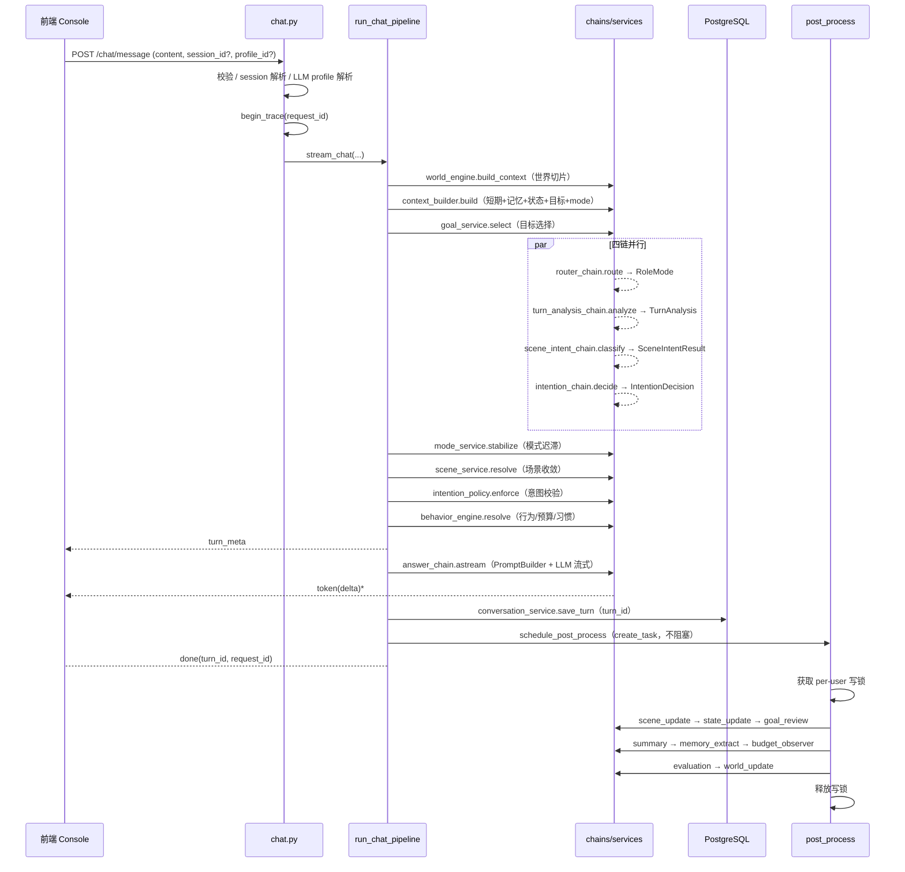

# `/chat/message` 请求链路分析

> 入口：`POST /api/v1/chat/message`（前端调试控制台即通过该端点发起对话）
> 本文档从 HTTP 入口逐层拆解到后台任务，覆盖预侧四链并行、流式回答、落库与 post_process 八步。
> 核心文件：`app/api/v1/chat.py` → `app/services/agent_service.py`（兼容壳）→ `app/application/chat_pipeline.py`（前台编排）＋ `app/application/post_process.py`（后台编排）。

---

## 一、整体架构与分层

```
┌─────────────────────────────────────────────────────────────────────────────┐
│  API 表现层  app/api/v1/chat.py                                               │
│  POST /chat/message → 参数校验 → LLM 注入 → StreamingResponse(NDJSON)         │
├─────────────────────────────────────────────────────────────────────────────┤
│  编排层 app/application/                                                      │
│  chat_pipeline.run_chat_pipeline（前台关键路径）                               │
│  post_process.run_post_process（后台任务，per-user 写锁内八步）                 │
│  world_engine / observability（旁路挂载）                                      │
├─────────────────────────────────────────────────────────────────────────────┤
│  服务层 app/services/                                                         │
│  context_builder / goal_service / scene_service / mode_service /              │
│  behavior_engine / state_service / memory_service / summary_service /         │
│  intention_policy / conversation_service / evaluation_engine                  │
├─────────────────────────────────────────────────────────────────────────────┤
│  链层 app/chains/                                                             │
│  router_chain / turn_analysis_chain / scene_intent_chain / intention_chain →  │
│  预侧四链（并行）；answer_chain → 流式回复；summary/extractor 后台链             │
├─────────────────────────────────────────────────────────────────────────────┤
│  数据层 app/repositories → PostgreSQL（Alembic 迁移）                           │
│  支撑核心 app: core(settings/llm_factory) / prompts / character / models       │
└─────────────────────────────────────────────────────────────────────────────┘
```

**分层依赖（单向）**：`api → application → services → repositories → core`；`models/prompts/character` 为共享支撑层；LLM 统一来自 `llm_factory` 或请求级注入。

---

## 二、请求入口（HTTP / 表现层）

文件：`apps/backend/app/api/v1/chat.py`

### 1. 路由与参数校验

```python
@chat_router.post("/chat/message")
async def chat_message(request, body: ChatRequest, llm=Depends(get_chat_llm)):
```

- 请求体 `ChatRequest`：`content`（必填用户消息）、`session_id`（续接会话）、`profile_id`（模型切换）。
- `content` 去空格后为空 → 直接 422。
- `session_id` 为空则生成新 UUID（`new_session=True`）；否则沿用（多轮续接）。

### 2. LLM 注入（多模型 Profile）

`deps.get_chat_llm` 按优先级解析要用的模型并注入整个链路：

```
body.profile_id > header["x-llm-profile"] > query param "profile_id"
```

匹配 profile 配置后调用 `llm_factory.get_llm(profile_id)`；选择失败抛 `SettingsError` → 400。

### 3. 运行时 Trace 建立

- `trace = trace_collector.get_trace_collector().begin_trace()`，生成 **request_id**。
- 响应头：`X-Session-Id`、`X-Request-Id`、新会话时附加 `X-Session-New=true`、`X-LLM-Profile`。
- 该 `trace` 贯穿前台与后台，所有步骤耗时/状态都被记录。

### 4. 返回流式响应

- `StreamingResponse(..., media_type="application/x-ndjson")`，协商 `generate()` 生成器。
- `generate()` 逐个事件转发到前端；`kind` 决定负载结构：
  - `turn_meta` → 角色模式/分析/场景/意图/目标/行为/模式回调
  - `token` → `{"delta": 文本片段}`
  - `done` → `{"done": true, "session_id", "turn_id", "request_id"}`
- 异常集中捕获（`openai.APIStatusError` / `EmptyLLMResponseError` / 兜底 `Exception`），以错误 JSON 单行结束流。

### 5. NDJSON 流协议

```
turn_meta（首 token 前，一次性）→ delta*（流式正文）→ done（收尾）
```

前端读取逻辑：`fetch → response.body.getReader()` 按 `\n` 切行 → 解析各事件；`AbortController` 实现「停止」。

---

## 三、前台关键路径 `chat_pipeline.run_chat_pipeline`

文件：`apps/backend/app/application/chat_pipeline.py`

> `agent_service.stream_chat` 仅是兼容壳：设置当前 trace（contextvar）后委托给 `run_chat_pipeline`。

编排整体时序如下（数字标注 trace step 名）：

```
世界装配(H1) → 上下文构建 → 目标选择 → 【四链并行】→ mode稳定
→ 场景收敛 → 意图策略 → 行为引擎 → 组装 turn_meta → 流式回答 → save_turn → 触发后台
```

### 步骤 0：世界上下文装配（H1，旁路）

```python
world_ctx = world_engine.build_context(user_id, session_id, trace=trace)
```

- 每 turn 有界只读世界切片（时间/地点/天气/附近物品/事件），失败降级 `None`（本轮无世界段）。
- `trace.record("world_context", ...)`。

### 步骤 1：构建对话状态（context_builder.build）

```python
state = await context_builder.build(session_id, user_id, content, trace=trace)
```

组装 `ConversationState`，一次性汇集本轮回话所需的全部上下文：

| 字段 | 来源 | 说明 |
|---|---|---|
| `messages` | `conversation_service.load_window` | 短期窗口（多轮历史，供最近上下文） |
| `summary` | `summary_service.get_summary` | 对话摘要（长会话压缩） |
| `memories` | `memory_service.retrieve + select_for_context` | 长期记忆结构化加权召回（V4） |
| `character_state` | `state_service.load_states` | 角色状态（情绪/体能） |
| `relationship_state` | `state_service.load_states` | 关系状态（四/六维 + stage） |
| `goals` | `goal_service.load_active` | 活跃目标 |
| `mode` / `mode_entered_at` | `conversation_row` | 会话级模式（V6.5 持久化） |

各来源均带降级（如记忆检索失败 → 空记忆、状态读取失败 → 默认状态）。

### 步骤 2：场景状态加载

```python
scene_state = scene_service.load(session_id)        # 当前房间/活动/待办动作
current_turn = 用户消息数 + 1                        # 当前轮次
```

### 步骤 3：目标选择（动机层）

```python
selected_goal = _select_goal(state, scene_state, user_id)
# 内部 goal_service.select(state.goals, tension, user_emotion,
#                          character_mood, character_intensity,
#                          scene_pending, late_night)
```

- 综合关系张力(关系演化后维度)、最近用户情绪、角色情绪、场景待办、是否深夜，选出当前目标。
- `/goal_selection` step；失败 → 空目标（动机层降级，V2 behavior 兜底）。

### 步骤 4：预侧四链并行（核心并发点）

```python
role_mode, analysis, scene_intent, intention_candidate = await asyncio.gather(
    _timed("role_router",  router_chain.route(content, llm=llm)),
    _timed("turn_analyzer", turn_analysis_chain.analyze(content, state, llm=llm)),
    _timed("scene_intent", scene_intent_chain.classify(content, llm=llm)),
    _timed("intention",    intention_chain.decide(content, state, selected_goal,
                                                   scene_state, llm=llm)),
    return_exceptions=True,
)
```

四个 LLM 结构化调用**并行**，墙钟≈单个链耗时（不劣化首字延迟）。各链职责与产物：

| 链 | trace step | 产物（Pydantic） | 判定内容 |
|---|---|---|---|
| `router_chain` | `role_router` | `RoleMode(mode, intent, confidence, reason)` | 本轮会话风格模式，如 casual / care / soft / professional |
| `turn_analysis_chain` | `turn_analyzer` | `TurnAnalysis(user_emotion, event, behavior)` | 用户情绪、触发事件、行为意图 |
| `scene_intent_chain` | `scene_intent` | `SceneIntentResult(intent, confidence, reason)` | 场景意图（chat/取物/移动/购买…） |
| `intention_chain` | `intention` | `IntentionDecision(intention, confidence, reason)` | 本轮角色意图（在目标约束下） |

结构化链封装：`structured.build_structured_chain` = `prompt | model.with_structured_output(schema)`，并附带 Pydantic 解析兜底 fallback（`with_fallbacks`），保证 LLM 输出非法时自动重解析。

**降级判定**（`return_exceptions=True` 使单链失败不拖垮其他）：
- role_router 失败或 `confidence < router_confidence_threshold(0.5)` → mark degraded
- turn_analyzer / intention 结果非预期类型 → mark degraded
- scene_intent 失败/非法/低置信 → `_degraded("chat")`（最安全默认，不触碰场景迁移）

### 步骤 5：模式稳定（V6.5 mode_service.stabilize）

```python
mode_decision = _stabilize_mode(role_mode, state, session_id)
```

- 路由候选经**迟滞/持久化**校准：连续 2 轮 + 置信度≥0.7 才切换；否则沿用已确认模式。
- 产出 `effective_mode`（路由失败时回落到已确认模式）。
- `/mode_stabilize` step。

### 步骤 6：结果解析与场景收敛

```python
turn = _resolve_analysis(analysis)                 # 失败 → TurnAnalysis() 默认
scene_intent_result = _resolve_scene_intent(scene_intent)  # 非法 → chat
resolved_state, directive = scene_service.resolve(intent, scene_state, current_turn)
```

确定性阶段（V3）：`scene_service.resolve` 依据场景意图 + 待办动作状态，收敛出本轮最终场景状态与动作指令（pending/completed/cancelled）。

### 步骤 7：意图校验（intention_policy.enforce）

```python
validated_intention = enforce_intention(
    intention_candidate, selected_goal, state, turn, now, scene_pending=...)
```

- 纯函数策略层，对 LLM 意图候选做**合法性校验/降级**（如与目标冲突、非法意图 → 回落 `continue_topic`）。
- `degraded` → `trace.mark_status("intention", "degraded")`。

### 步骤 8：行为引擎（V6.5 behavior_engine.resolve）

```python
unlocks = relationship_milestone_repository.list_unlocks(state.user_id)
relationship_ctx = RelationshipBehaviorContext(stage, comfort, respect, conflict_status, unlocks)
behavior_ctx = behavior_engine.resolve(validated_intention, state, scene_ctx,
                                       effective_mode, turn, relationship_ctx)
```

- 用纯函数渲染**行为方向**（strategy / budget / habits / activity），读取关系里程碑解锁上下文（V8.5）。
- 关系上下文读取失败 → `relationship_ctx=None`（不影响主流程）。
- `/behavior_engine` step，含 strategy/budget/habits/trace 元信息。

### 步骤 9：发送 turn_meta（首事件）

```python
yield {
  "kind": "turn_meta",
  "role_mode": effective_mode,      # 校准后的模式
  "analysis": turn,                 # 用户情绪/事件/行为
  "scene_intent": scene_intent_result,
  "scene_state": resolved_state,    # 收敛后的场景
  "intention": validated_intention,
  "current_goal": current_goal,
  "behavior": behavior_meta,        # strategy/budget/degraded
  "mode": mode_meta,                # confirmed/effective/switched
}
```

前端据此展示「为什么这样回答」的各维证据（Overview / State / Trace 面板）。

### 步骤 10：流式回答（answer_chain.astream）

```python
active_generations[user_id] = True      # 标记正在回复（V7 防主动轰炸）
async for token in answer_chain.astream(
    effective_mode, state, turn, llm, trace,
    scene_ctx, goal_ctx, behavior_ctx, world_ctx):
    yield {"kind": "token", "text": token}
```

`answer_chain` 内部：

1. **Prompt 组装** `PromptBuilder.build(mode, state, analysis, scene_ctx, goal_ctx, behavior_ctx, world_ctx)`
   - 组装大量 system 段：身份/人格/关系/行为（角色资产）→ 情绪(带强度档位) → 关系(stage) → 目标/意图 → 行为方向 → 记忆 → 摘要 → 场景 → 世界；穿插历史 Human/AI 消息。
   - 动态内容经 `_literal()` 转义花括号，防止模板注入（refactor P0 修复点）。
   - `_fit_variable_parts` 依据 `fixed_chars` 预算裁剪历史/记忆/摘要。
2. `prompt | model.bind(max_tokens=answer_max_tokens≈200)`
3. 流式产出文本；记录 `prompt_builder` step；首 token 前记录 `first_token_ms`。
4. 可观测：`prompt_capture` 采样快照（V7.8 M3）、`UsageCallbackHandler` 记录 tokens/usages、`llm` step 记耗时与状态。
5. 空输出检测：回答流零 token 产出（含 langchain `ValueError("No generation chunks were returned")`）→ 抛 `EmptyLLMResponseError`（返回明确错误提示）。

回答完成后清空 `active_generations` 标记。

---

## 四、响应落库与后台触发（前台收尾）

### 1. save_turn（持久化本轮会话）

```python
ai_message_id = conversation_service.save_turn(
    session_id, content, reply,
    mode_write_back=mode_decision.effective if mode_decision.write_back else None)
```

- 用户消息 + AI 回复写库，返回本轮 `turn_id`；模式在切换时同事务写回会话。

### 2. 主动行为复位

```python
conversation_service.reset_proactive_on_user_message(user_id)
```
清除「用户已发言」导致的主动冷却标记，避免主动消息与正常回复冲突；失败不影响对话。

### 3. 调度后台任务（生命周期分离点）

```python
post_process_task = schedule_post_process(...)
```

- `asyncio.create_task(run_post_process(ctx))` 挂入 `background_tasks` 集合并注册完成回调。
- **SSE 流式响应与此处之后立即返回**，后台任务与 `done` 事件并行（写路径不进关键路径，首字延迟零影响）。

### 4. 观测挂载（V7.8）

```python
collector.attach(trace, str(ai_message_id))          # trace 关联 turn_id
observability.on_turn_finished(...)                  # RuntimeTrace 持久化（write-behind）
observability.record_turn_decisions(...)             # Decision History（目标/意图/行为）
```

### 5. 发送 done

```python
yield {"kind": "done", "session_id", "turn_id", "request_id"}
```

—— 到此，`StreamingResponse` 结束 NDJSON 流，用户已看到完整回复。**后台八步此时仍在异步执行**。

---

## 五、后台任务 `post_process.run_post_process`

文件：`apps/backend/app/application/post_process.py`

- 先取 **per-user 写锁**（`get_user_write_lock`，asyncio.Lock，V7 Executor 复用同一把锁 → 主动消息与本轮状态写串行化）。
- 锁内**顺序**执行 `STEP_HANDLERS`（各步独立容错：异常仅 trace/log，绝不影响其余步骤）。

```
STEP_HANDLERS = (
    run_scene_update,      # (6) 场景状态迁移与持久化
    run_state_update,      # (7) 角色状态 + 情绪/关系演化与落库
    run_goal_review,       # (8) 目标评审（创建/完成/过期）
    run_summary,           # (9) 对话摘要（达阈值）
    run_memory_extract,    # (10) 长期记忆提取
    run_budget_observer,   # (11) 行为预算观测
    run_evaluation,        # (12) V7.5 角色评估（第 7 步）
    run_world_update,      # (13) V8 世界更新（第 8 步）
)
```

### 6) run_scene_update（V3）
`scene_service.update_and_persist(session, scene_state, intent, user_input, reply, turn, llm, trace)`
- LLM 判定场景迁移（拿/放/移/完成等），pending 动作更新；失败保持上一状态。

### 7) run_state_update（V2+V5+V8.5）
`state_service.apply_and_save(user_id, session_id, state, analysis, user_input, reply, llm, trace)`
- 确定性规则 + 事件检测，更新**情绪**（强度/衰减）、**体能 energy**、**关系维度**（含 tension/comfort/respect 动力学）与 stage 迟滞迁移。
- V8.5：此处同时是关系演化流水线的主入口（信号→事件→动力学→里程碑→冲突状态机→记忆投递）。
- 失败不影响本轮回答（状态停在上一轮）。

### 8) run_goal_review（V6）
`goal_service.review(user_id, session_id, analysis, executed, turn, character, relationship, scene)`
- 按目标策略完成/过期/创建当前目标；纯代码，可选 LLM 评估（P1）。
- `/goal_review` step。

### 9) run_summary（V1）
`message_count >= summary_threshold(40)` 时 `summary_service.update(...)` 滚动压缩长对话。

### 10) run_memory_extract（V4）
`memory_service.extract_and_save(user_id, user_input, reply, llm, trace, recent_context)`
- 取最近若干轮（`memory_recent_context_messages=4`）构造上下文 → extractor_chain 提取候选 → 策略过滤 → 冲突消解 → 落库（全部后台）。

### 11) run_budget_observer（V6.5）
`behavior_engine.observe_budget(reply, behavior.budget)`
- 统计本轮动作描写数量/接触等级是否越界，记录 `/budget_observer` violation。

### 12) run_evaluation（V7.5，第 7 步）
`evaluation_engine.run_turn_evaluation(ctx)`
- **锁内**收集 Context + 跑确定性 Rule Engine（毫秒级）；LLM Judge 采样命中时**派发锁外任务**，不延长写锁持有。
- 产出五维评分（Persona/Emotion/Memory/Behavior/Autonomy）+ Issue 清单落 `evaluation_reports`。

### 13) run_world_update（V8，第 8 步）
`world_engine.run_turn_update(user_id, user_input, trace)`
- 确定性规则解释器 `interpret(user_message, world, entities, events, now)`：
  - 解析动作/事件/地点/天气 → 创建/移动/消耗/丢弃对象、location 迁移、环境更新、事件创建/完成/取消。
  - 触发 due 事件、过期物品/事件、时段光照建议、notes 单轮回写。
- 模糊输入**零迁移**（宁可不迁、不造事实）；失败本轮零迁移。

> 补充：`autonomy_worker`（V7 主动行为）是独立 lifespan 任务，不在此 post_process 内；它在空闲/到点时触发 → 策略裁决 → Executor 生成主动消息，同样持 **同一把 per-user 写锁**，与回复互斥。

---

## 六、完整时序图（Mermaid）



---

## 七、关键设计点总结

1. **首字延迟优化**：四链 `asyncio.gather` 并行 + 结构化链 fallback，LLM 并发但不增墙钟。
2. **写路径与关键路径解耦**：`save_turn` 落库后立即返回；post_process 后台八步持 per-user 写锁异步跑，SSE 首字/流式零退化。
3. **降级矩阵**：每个 LLM/读写源都带兜底——路由失败保持模式、分析失败用默认、记忆/状态/目标/世界失败各自降级，绝不让某个坏点阻断回答。
4. **旁路观测**：`trace` 贯穿全程，V7.8 Observability（LLM 调用/Prompt 快照/决策/评估关联）+ V7.5 评估均只挂载不改行为、失败仅 log。
5. **多模型切换**：profile 优先级 body > header > query，贯穿预侧链与回答链。
6. **工程约束延续**：`LLM 只出语义、代码只算数`（状态/场景/意图/行为稳定全走纯函数）；黄金回归保证（能力关闭/空输入时从前的 Prompt 字节不变）。

---

*本文档基于 `apps/backend` 实际代码（API 表现层 → 编排层 → 服务层 → 链层 → 仓储）逐层分析整理。*