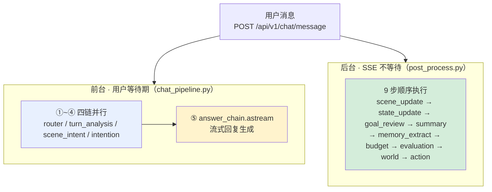
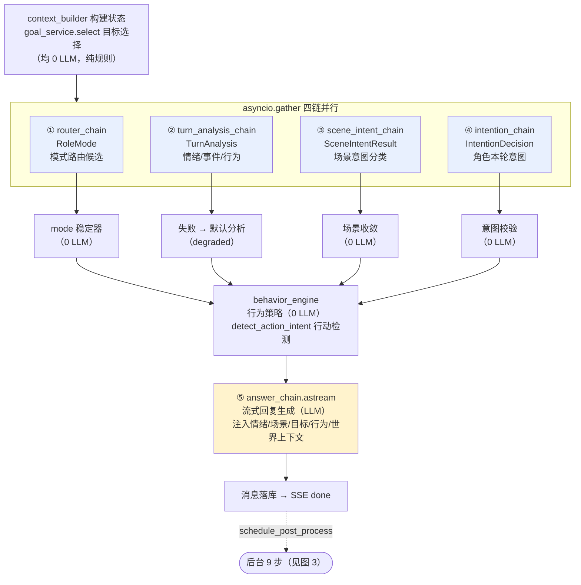
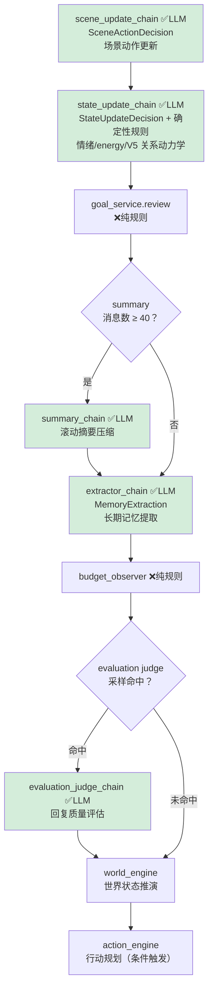

# LLM 调用链路图

> 一轮用户消息（`POST /api/v1/chat/message`）触发的全部 LLM 调用清单与流程。
> 代码入口：`apps/backend/app/application/chat_pipeline.py`（前台）、`apps/backend/app/application/post_process.py`（后台）。
> 设计原则（`docs/version/v2.0.0/architecture/llm-orchestration.md`）：规则 → 数据库查询 → Embedding → LLM；goal_review / mode 稳定 / behavior_engine / intention_policy 均为纯规则，零 LLM。

## 总览

| 阶段 | 调用数 | 说明 |
|---|---|---|
| 前台（用户等待期） | 4 并行 + 1 串行 = **5 次** | 4 个小链并行 + 回答流式生成 |
| 前台 fallback 放大 | **+0~4 次** | 结构化链主调用失败时走 PydanticOutputParser 兜底，重发完整请求 |
| 后台（SSE 不等待） | **0~5 次** | scene_update / state_update / summary（达阈值）/ memory_extract / evaluation judge（采样命中） |
| 非对话路径 | 按触发 | V7 主动行为 proactive_chain、V2 反思 reflector |

## 流程图

> 拆成 3 张图查看：图 1 全局骨架（最简）；图 2 前台详情；图 3 后台详情。

### 图 1 · 全局骨架



### 图 2 · 前台详情（4 并行 + 1 串行）



### 图 3 · 后台详情（9 步顺序执行，独立容错，失败不冒泡）



图例：🔵 淡蓝 = 前台四并行链；🟡 黄 = 回答生成；🟢 绿 = 后台 LLM 步骤；✅LLM / ❌纯规则 标注是否产生调用。

## 放大系数：结构化链 fallback

所有结构化链（① ② ③ ④ 及后台 B1/B2/B6）由 `chains/structured.build_structured_chain` 构建：

```
primary = prompt | model.with_structured_output(schema)
chain   = primary.with_fallbacks([fallback_prompt | model | PydanticOutputParser])
```

主链失败（解析失败 / `LengthFinishReasonError` 等）→ **立即重发一次完整请求**走兜底解析。
即：每次主链失败，该步骤的调用数 ×2。典型场景是思考型模型 `max_tokens` 过小导致 reasoning 耗尽预算被截断。

## 一轮的调用数速查

| 场景 | 调用数 |
|---|---|
| 最少（所有后台条件不命中、无失败） | 5 |
| 典型（scene_update + state_update + memory_extract） | 8 |
| 全触发（+summary 达阈值 + judge 采样命中） | 10 |
| 有 1 个结构化链失败走 fallback | +1/次失败 |
