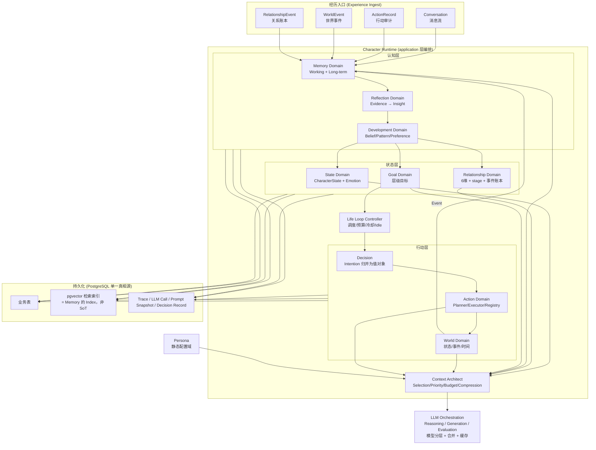
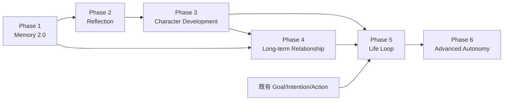

# v2.0.0 Persistent Character Runtime — 总体设计

> 状态：**设计完成，未实现（Architecture & Documentation only）**
> 前置：`docs/version/v1.0.0/` 全量审计完成（2026-09-04）
> 铁律：**`docs/version/v1.0.0/` 是历史归档，只读。** 本目录（v2.0.0）从零建立新的 Version → Phase → Architecture → Task 结构，不再使用 v1/V2/V3 的版本内编号方式。

---

## 1. v2.0.0 背景

v1.0.0 经过 V1～V9 九个迭代加一次 backend-refactor，已经把「角色能理解、能思考、能决定、能行动、能产生世界事件」做完了。但它本质上仍然是一个**单次交互存在**：角色每轮对话重新组装一次上下文，回答完即遗忘大半；关系、目标、情绪全部由阈值规则驱动，角色不会因为经历而成长，不会反思，也不会在用户不说话时持续生活。

v2.0.0 的目标只有一句话：

> **让角色从「单次交互存在」变成「持续存在」（Persistent Character Runtime）。**

即形成闭环：

```text
Experience → Memory → Reflection → Development → Goal
    → Decision → Action → World → Experience ↺
```

---

## 2. v1.0.0 当前能力（基于真实代码审计，非文档宣称）

> 审计方法：逐文件阅读 `apps/backend/app/`，以代码为准。已知文档状态标注滞后于代码（例如 AGENTS.md 称 V8.5「待实现」，但 `relationship_evolution.py` 已实现并经 `state_service` 接线；v9 tasks.md 自称「待实现」，但行动系统代码已全量落地）。**以下均为代码中真实存在的能力。**

### 2.1 技术栈与基础设施

| 项 | 真实状态 |
|---|---|
| 框架 | FastAPI + LangChain（Runnable chain ×11），SQLAlchemy 2.0 |
| 数据库 | PostgreSQL 16（docker-compose，`asuna` 库）；本地开发存在 SQLite 兜底；Alembic 迁移 0001–0021，30+ 表 |
| 向量库 / Embedding | **完全没有**（`grep embedding/vector/pgvector/cosine` 零命中） |
| 后台设施 | **纯单进程 asyncio**：`main.py` lifespan 起 5 个常驻循环（memory reclaim / autonomy worker 60s tick / observability retention / world maintenance / action retry）。无队列、无 Redis、无 APScheduler |
| LLM | OpenAI 兼容单通道（`llm_factory`，profile 默认 longcat），无多模型分层、无缓存 |
| 编排层 | `application/`（chat_pipeline 前台 + post_process 后台 + engines），backend-refactor 已落地 |

### 2.2 聊天主链路（每轮真实发生的事）

```text
用户消息
 → world_engine.build_context()        (规则，无 LLM)
 → context_builder.build()             (装载状态/目标/记忆/摘要/历史)
 → goal_service.select()               (确定性规则)
 → 4 链并行 asyncio.gather:            router / turn_analysis / scene_intent / intention  (LLM ×4)
 → mode / intention_policy / behavior  (规则)
 → action_detect                       (词表规则)
 → answer_chain.astream                (LLM ×1，流式)
 → 落库 + schedule_post_process
 后台 post_process（per-user 写锁内）:
   state_update (LLM) → memory_extract (LLM) → evaluation_judge (LLM, 采样)
   → scene_update (有场景时 LLM) → summary (≥40 条时 LLM) → world → action...
```

**每轮 LLM 调用 ≈ 8–10 次**，单模型，无批处理无缓存。

### 2.3 各域能力

- **Persona / Character**：`character/asuna/` 静态资产（identity、personality、behavior_instructions、modes、stages），配置域。
- **State / Emotion**：`CharacterState`（mood 8 值、energy、intensity、inner_state）+ 情绪/能量衰减；mood 由 `state_update_chain`（LLM）更新。
- **Memory**：`memories` 表 4 类（user_preference / user_fact / important_event / relationship_event），status ∈ active/superseded/invalidated，forget = 硬 DELETE；检索为**字符级 Jaccard 关键词 + importance/recency/type 加权 top-5**；只有 TTL 过期，无 merge / decay / consolidation / 语义检索；无 Working vs Long-term 分层。
- **Relationship**：V8.5 已实现——6 维（intimacy/trust/familiarity/respect/comfort/tension）+ stage 迟滞 + 信号启发式（`relationship_signal`）→ 纯函数演化引擎（D1 重复递减 / D2 饱和 / D3 信任不对称 / D5 显著度，三级限速，可 replay）+ relationship_events 账本 + 12 里程碑 + 冲突状态机 + snapshots。
- **Goal / Intention**：4 类 goal（确定性 service）；13 种 intention（LLM 候选 + 规则 Policy 校验）。
- **Autonomy**：60s tick → TriggerEvaluator（inactivity/followup/action_due，**注册表在内存 dict，重启即丢**）→ AutonomyPolicy 纯函数（cooldown/budget/静音时段/亲密度调制）→ proactive_chain（LLM）发消息。
- **World**：`worlds/world_entities/world_events/world_snapshots`，时间三种模式，规则解释器（LLM 辅助默认关）。
- **Action（v9）**：detector→planner→executor→registry + 6 能力（reminder/memory/world_action 真实现，search/notification 占位）+ ActionRecord 六态审计，**代码完整但 `action_enabled=False` 出厂关闭**。
- **Observability**：runtime_traces / llm_call_records（latency/tokens/cost）/ prompt_snapshots / decision_records + retention 清理，完整且持久化。
- **Evaluation**：V7.5 规则引擎（7 域纯函数）+ LLM Judge 采样，min 合并，只读旁路。

### 2.4 结论：v1.0.0 已经实现了怎样的 Character Runtime

> 一个**每轮反应式**的 Character Runtime：角色能理解话语（4 链并行）、能维持短期状态（情绪/场景/行为）、能按规则维持关系数值与目标、能受约束地主动说话、能执行行动（默认关）、能被完整观测。但它**不记得经历、不反思、不成长、不生活**——所有「长期性」都停留在数值与账本层面。

---

## 3. v1.0.0 当前架构问题

1. **Memory 是「扁平抽取器」而非「记忆系统」**：单表、关键词检索、无生命周期（无 reinforce/merge/decay/consolidation）、无语义召回、无 Working↔Long-term 分层。长期对话越多，记性越差。
2. **无 Reflection / Development**：关系 stage、goal、情绪全部是阈值规则驱动；角色不会从经历中形成认知，行为不随经历演化。经历（ActionRecord/WorldEvent/RelationshipEvent）沉淀为记忆的通道断裂。
3. **概念债 × 五种「意图/动作」模型**：Intention(V6) / ActionIntent(V9) / PendingAction(V3) / ProactiveAction(V7) / WorldEvent(V8) 并行，每版文档都要专章划边界。
4. **关系事实双真相源**：Memory 里的 `relationship_event` 类型 vs `relationship_events` 账本，靠「文本归 memory、数值归账本」的口头约定维系。
5. **LLM 调用面失控**：每轮 8–10 次、单模型、无分层、无缓存；小任务（路由/意图/抽取）与核心生成用同一个模型。
6. **后台基础设施不可持久化**：单进程 asyncio + 内存注册表（followup/action_due、EvidenceWindow、autonomy dedupe 重启即丢）；无幂等、无重试策略、无法水平扩展。
7. **Context 有预算无策略**：12000 字符总量 + 分段预算存在，但只有「装进来再裁剪」，没有按当轮需求的 Selection / Priority / Freshness 决策。
8. **评估体系线性堆积**：V7.5 五维 → V8.5 加 relationship → V9 加 action，每版追加 Rule 注册表；V7.5 evaluation 与 V7.8 trace/metrics 是两套质量平面。
9. **Feature Flag 纪律好但半成品多**：v9 / world_llm_assist / rel_signal_llm 等整链路默认关闭，能力「有代码、无运行」。

---

## 4. v2.0.0 为什么需要存在

把 v2.0.0 理解为「v1 + 更多 Prompt + 更多 Action + Vector DB」是错的。v2.0.0 的本质是给 Runtime 补上**时间维度**：

| | v1.0.0 | v2.0.0 |
|---|---|---|
| 存在方式 | 单次交互存在（每轮重装上下文） | 持续存在（Life Loop + 跨会话积累） |
| 记忆 | Working Memory + 扁平抽取 | Working + Long-term 双层，完整生命周期 |
| 认知 | 无（阈值规则） | Reflection → Insight → Belief/Pattern |
| 发展 | 无 | Experience 驱动的行为演化 |
| 关系 | 数值 Current State | State + History + Shared Experience + Patterns |
| 经历闭环 | Event 落库后断裂 | Action→World→Event→Experience→Memory 闭环 |
| LLM 定位 | 什么都问它 | Reasoning / Generation / Evaluation Engine |
| 用户不在线 | 只有 inactivity 触发 | 持续生命周期（受预算约束） |

**LLM 重新定位**：LLM 不是角色，Character Runtime 才是角色。LLM 只作为 Runtime 内部的三种引擎：Reasoning Engine（决策/反思）、Generation Engine（回答/主动行为）、Evaluation Engine（评估/记忆判定）。

```text
禁止：User → Huge Prompt → LLM → Character
正确：Character Runtime (Persona/State/Emotion/Memory/Reflection/Development/
      Relationship/Goal/Autonomy/Decision/Action/World) → 选择性调用 LLM
```

---

## 5. v1 → v2 核心变化（能力视角）

```text
v1: Character can act
v2: Character can remember / learn / develop /
    maintain relationships / reflect / live continuously / pursue goals
```

1. **Memory 2.0**：Experience → Candidate → Evaluate → Store → Retrieve → Rank → Context；pgvector 语义检索 + 结构化加权混合排序；完整生命周期（reinforce/merge/supersede/decay/forget）；用户显式 remember/forget 命令；Roleplay/Hypothetical 内容防护。
2. **Reflection**：基于 Evidence Window 的定期反思，产出带 confidence/source/scope 的 Insight，可 invalidated/superseded；严防 AI 自嗨（无证据不出结论）。
3. **Character Development**：Insight 沉淀为 Belief / Preference / Pattern，经 DevPolicy 调制 Behavior Policy / Response Style / Goal——记忆不直接改行为，必须经过 Insight。
4. **Long-term Relationship**：在 V8.5 数值引擎之上增加 Shared Experiences、Relationship Patterns、叙事级关系记忆；**统一关系事实真相源**（数值归账本，事实归 Memory，投影归 Snapshot）。
5. **Life Loop**：把 60s autonomy tick 升级为完整生命周期（Perception → State Update → Goal Evaluation → Memory Retrieval → Reflection Check → Decision → Action → World Event），持久化 Trigger Registry，预算/冷却/Idle 控制，成本封顶。
6. **Advanced Autonomy**：Goal 层级（Short/Long-term × Personal/Relationship/World）、Planning → Sub-Goal → Action → Observation → Adjustment、Goal 生命周期（persistence/failure/abandonment/conflict）。
7. **LLM Orchestration 重构**：模型分层（小模型承担路由/意图/抽取）、链合并、后台批处理、缓存；目标把每轮前台 LLM 从 5 次压到 4 次以内并持续压缩。
8. **Context Architecture**：从「预算裁剪」升级为「Selection + Priority + Budget + Compression + Freshness」五策略。
9. **可观测/可评估/可回滚**：Memory Trace / Reflection Trace / Goal Trace 补齐；统一质量平面（Evaluation v2）；全量 Feature Flag 灰度与迁移回滚方案。

---

## 6. v2.0.0 总体架构



---

## 7. Domain Boundary（概览）

完整版见 [architecture/domain-boundaries.md](architecture/domain-boundaries.md)。

| Domain | 定位 | 生命周期 | 关键裁决 |
|---|---|---|---|
| Persona | 静态配置 | 不变 | 不是运行时域 |
| State | 短期状态聚合（含 Emotion 值对象） | 分钟级，衰减 | Emotion 不独立成域 |
| Memory | 长期记忆（真域） | 天~永久，完整生命周期 | SoT = 业务表；pgvector 只是索引 |
| Reflection | 反思（真域） | 周期任务产出 | 无 Evidence 不出 Insight |
| Development | 角色发展（真域） | 慢变量 | Memory 不直接改行为，必经 Insight |
| Relationship | 关系（真域） | 慢变量 | 数值归账本、事实归 Memory、快照是投影 |
| Goal | 目标（真域） | 天~周 | Phase 6 扩层级 |
| Decision | 单轮决策 | 轮级 | Intention 降级为值对象 |
| Action | 行动执行（真域） | 事件级 | 复用 v9 完整实现，默认开 |
| World | 外部世界（真域） | 持续 | 与 Character 严格隔离（沿 V8 铁律） |
| Autonomy / Life Loop | 编排域（Service，非实体域） | 持续 | 只调度，不持有业务状态 |
| Experience | **不是域** —— Ingest 投影 | — | ActionRecord+WorldEvent+RelationshipEvent 的统一读取视图 |
| Working Memory / Context | **不是域** —— Runtime Context | 轮级 | 每轮重建 |

## 8. 六个 Phase

> **目录顺序调整说明**：任务书初稿建议 Phase 2 = Character Development、Phase 4 = Reflection。实际设计中 **Reflection 必须先于 Development**（Development 的输入是 Insight，Insight 的唯一来源是 Reflection；v2 无法先做「没有反思来源」的发展系统）。任务书 §三十六 的依赖图（Memory→Reflection→Development→Relationship→Life Loop→Autonomy）亦为此序，故按依赖真实顺序排列：
>
> **为什么调整**：消除 Development 无输入源的死锁。**解决什么问题**：每个 Phase 的产物都是下一 Phase 的直接依赖，可逐段交付验收。**对后续开发的影响**：Phase 2 落地前，Development/Relationship 的「演化类」需求全部冻结为 Phase 3/4 范围，Phase 2 之前只做 Memory 能力扩展，边界更干净。



| Phase | 主题 | 一句话目标 | 详细文档 |
|---|---|---|---|
| 1 | Memory 2.0 | 角色能记住（双层记忆 + 语义检索 + 完整生命周期） | [phases/phase-1-memory](phases/phase-1-memory/README.md) |
| 2 | Reflection | 角色能从经历形成认知（Evidence → Insight，防幻觉） | [phases/phase-2-reflection](phases/phase-2-reflection/README.md) |
| 3 | Character Development | 角色因经历而改变（Insight → Belief/Pattern → 行为演化） | [phases/phase-3-development](phases/phase-3-development/README.md) |
| 4 | Long-term Relationship | 关系从数值变历史（Shared Experience / Patterns / 统一真相源） | [phases/phase-4-relationship](phases/phase-4-relationship/README.md) |
| 5 | Life Loop | 角色持续生活（统一生命周期 + 持久化触发 + 成本封顶） | [phases/phase-5-life-loop](phases/phase-5-life-loop/README.md) |
| 6 | Advanced Autonomy | 角色追求目标（目标层级 + Planning + 观察调整） | [phases/phase-6-autonomy](phases/phase-6-autonomy/README.md) |

## 9. 依赖关系

- **P1 → P2**：Reflection 的 Evidence 全部来自 Memory 检索；没有 Memory 2.0 的语义召回与生命周期，反思只能拿关键词命中凑证据（= 幻觉温床）。
- **P2 → P3**：Development 的唯一合法输入是已验证的 Insight；没有 Reflection，Development 只能把数值阈值换个名字。
- **P1 → P4**：Shared Experience 与关系叙事记忆是 Memory 的类型与投影；P4 复用 P1 的生命周期与检索。
- **P2/P3/P4 → P5**：Life Loop 每个周期要调用 Memory 检索、Reflection 检查、Development 调制与关系评估；这些域不齐，Life Loop 只能还是 60s tick。
- **P5 → P6**：Planning/Sub-Goal/观察调整需要 Life Loop 提供的持续调度、预算与 Action 执行底座。
- **反向约束**：P5 起所有后台路径必须走持久化 Trigger Registry 与幂等 Job（P1 一并铺设基础 Job 表）；P1–P4 期间后台仍用现有 asyncio 循环，不阻塞交付。

## 10. 开发策略

1. **沿用既有铁律**：application 编排层最薄、规则做厚、LLM 只在必要处；「读取进链、写入出链」；单一真相源可重放。
2. **Feature Flag 逐 Phase 灰度**：`v2_memory_enabled` / `v2_reflection_enabled` / `v2_development_enabled` / `v2_relationship_evolved_enabled` / `v2_life_loop_enabled` / `v2_autonomy_advanced_enabled`——每 Phase 一个总闸 + 必要子闸，**禁止几十个碎闸**（方案见 [migration/v1-to-v2.md](migration/v1-to-v2.md)）。
3. **升级不重建**：v2 在 `application/` 编排层与既有 30+ 表之上增量演进，所有新表为新增迁移，不改 v1.0.0 表语义；不删列、不改列义，允许扩列。
4. **每 Phase 独立验收**：Phase 附 regression-checklist 思路的验收标准 + Evaluation 域指标（[architecture/evaluation.md](architecture/evaluation.md)）；Golden 行为在 Flag 关闭时字节级不变。
5. **LLM 成本红线**：每 Phase 交付时统计每轮 LLM 调用次数与 Token，不得高于 Phase 开始时基线（Phase 1/2 的后台调用豁免，但计入日预算）。
6. **后续开发节律**：`Version → Phase → Architecture → Task → Coding → Acceptance → Refactor → Next Phase`。

## 11. 风险（摘要，全文见 [architecture/risk.md](architecture/risk.md)）

| Top 风险 | 一句话缓解 |
|---|---|
| LLM 调用更多（反思/评估叠加） | 模型分层 + 批处理 + 全后台化 + 日预算熔断 |
| Memory 污染 / False Memory / 幻觉 | Candidate 评估门槛 + Evidence 强制 + 置信度 + invalidated 通道 |
| Reflection 幻觉写入真相 | Insight 无 Evidence 不入库、confidence 阈值、禁止直写 State/Relationship |
| Relationship↔Memory 循环依赖 | 依赖单向化：Relationship 读 Memory，Memory 不读 Relationship 数值 |
| Life Loop 成本失控 | Budget 熔断 + Cooldown + Idle 判定 + 全局每日 LLM 配额 |
| Context 无限增长 | 硬预算继承（12000）+ 五策略 + 分段硬上限 |
| 写放大 | 背景批处理、批量 embedding、快照降频 |
| v1→v2 迁移 | 增量迁移 + 双读双写窗口 + Flag + 回滚脚本，不破坏 v1 数据 |
| 单进程 asyncio 不持久 | P1 先落持久化 Job 表，P5 再换执行器；不引 Kafka/RabbitMQ |

## 12. 不做什么（v2.0.0 明确不做）

- 不引入独立 Vector DB / ES / Redis / Kafka / RabbitMQ（pgvector + Postgres 单库承载当前规模；触发重审的阈值见 phase-1 design）。
- 不做多用户/多角色租户化、分布式部署、水平扩展。
- 不做多模型自动路由平台（只做两档模型分层）。
- 不做 GUI 观测面板（沿用 debug API + 前端控制台）。
- 不重写 Persona/静态资产、不改 V8 World 域模型、不动 V8.5 数值引擎的数学。
- 不实现「角色自由成长」的无约束演化——一切变化必须可归因（Evidence/Insight/Task 链）。
- 本阶段**不写任何业务代码**。

## 13. 文档地图

```text
docs/version/v2.0.0/
├── README.md                      ← 本文件（审计 + 总览）
├── roadmap.md                     ← 六 Phase 规划
├── architecture/
│   ├── overview.md                ← 分层架构与运行视图
│   ├── domain-boundaries.md       ← Domain 裁决与依赖矩阵
│   ├── character-runtime.md       ← Runtime 组成与闭环设计
│   ├── context-architecture.md    ← Context 五策略
│   ├── llm-orchestration.md       ← LLM 任务清单与分层
│   ├── data-flow.md               ← 同步/异步边界 + 数据一致性
│   ├── evaluation.md              ← Evaluation v2
│   └── risk.md                    ← 风险登记册
├── phases/
│   ├── phase-1-memory/            (README / architecture / design / tasks)
│   ├── phase-2-reflection/        (README / architecture / tasks)
│   ├── phase-3-development/       (README / architecture / tasks)
│   ├── phase-4-relationship/      (README / tasks)
│   ├── phase-5-life-loop/         (README / tasks)
│   └── phase-6-autonomy/          (README / tasks)
└── migration/
    └── v1-to-v2.md                ← 增量迁移方案
```
