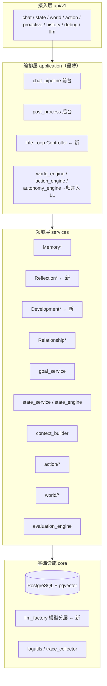
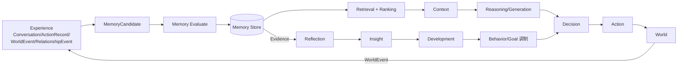

# v2.0.0 Architecture Overview

> 原则继承自 v1.0.0 backend-refactor：application 编排层最薄、规则做厚、LLM 边界干净、「读取进链、写入出链」、单一真相源可重放。

## 1. 分层视图



标 `← 新` 的为 v2.0.0 新增；其余全部复用 v1.0.0 实现。

## 2. 运行视图：一次用户消息（v2）

前台关键路径（同步、可流式，目标 ≤ 4 次 LLM，见 llm-orchestration.md 分层目标）：

```text
用户消息
 → LifeLoop.notify()                      (纯内存通知，0 LLM)
 → Context Architect.build()              (规则：检索记忆[向量+结构]、选片、按优先级装配)
 → 必要 Decision                           (规则优先；仅歧义时小模型 LLM)
 → answer_chain.astream                   (LLM ×1，主力模型)
 → 落库 → Experience 摄取队列 → 后台
```

后台处理（异步，Budget 约束）：

```text
post_process:
  情绪/状态更新(小模型) → Memory Candidate 评估(规则优先) → embedding 批处理(异步)
  → Evaluation 采样 → Summary(阈值触发) → World/Action 步骤
独立周期任务:
  Memory decay/consolidation → Reflection(证据足够才调 LLM) → Development 编译 → Life Loop tick
```

## 3. 闭环数据流



要点：
- **Experience 是投影不是域**：四种既有记录通过统一摄取接口生成 Candidate，v2 不新增「experience」表。
- **写入出链**：所有长期化写入（Memory/Insight/Development/Goal）发生在后台，前台只读。
- **每一步可归因**：Candidate 有 source、Insight 有 Evidence、Development 变更有审计、Decision 有 decision_records。

## 4. 与 v1.0.0 的结构差异清单

| v1.0.0 | v2.0.0 |
|---|---|
| context_builder「装进来再裁剪」 | Context Architect：Selection/Priority/Budget/Compression/Freshness 五策略 |
| 11 条 chain 单模型 | 模型两档（主力/轻量）+ 链合并 + 缓存（见 llm-orchestration.md） |
| autonomy_engine 60s tick 独立跑 | 归并入 Life Loop Controller，统一调度与预算 |
| Trigger Registry 内存 dict | trigger_registry 表（P5） |
| 记忆检索关键词 Jaccard | pgvector 语义 + 结构化混合（pgvector 是索引不是 SoT） |
| 无反思/发展 | Reflection / Development 两个新域 |
| 五种意图/动作模型并存 | Decision 域统一：Intention = Decision 的值对象输出；ActionIntent/PendingAction/ProactiveAction 归入 Action 域状态机；WorldEvent 保持 V8 语义（世界域事件） |

## 5. 扩展空间（面向 3.0）

- Domain 全部经接口对接编排层，3.0 可替换多角色（CharacterId 已贯穿）。
- LLM Orchestration 屏蔽模型细节，3.0 可插多模型路由平台。
- background_jobs / outbox 为 3.0 抽离独立 Worker 进程预留了协议（Job 表即协议）。
- Memory SoT 与 Index 分离，3.0 若规模升级可平滑换独立向量库而不动业务表。
