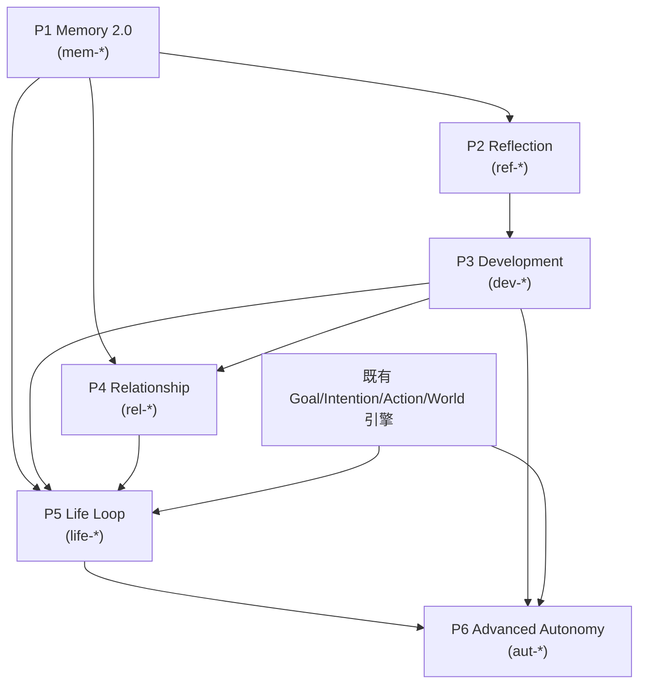
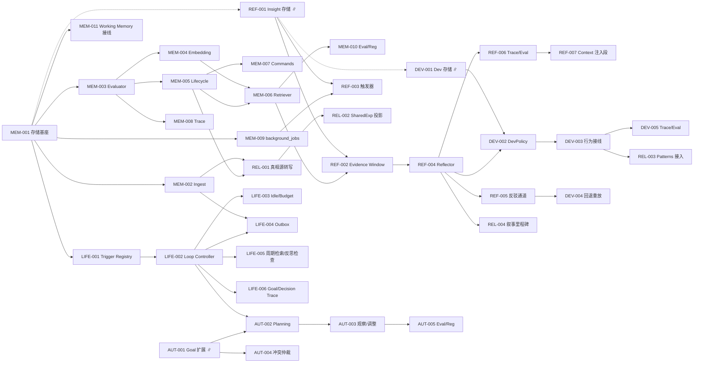
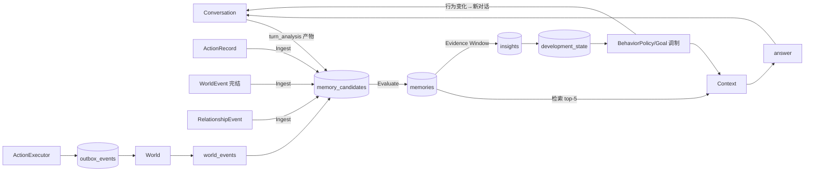
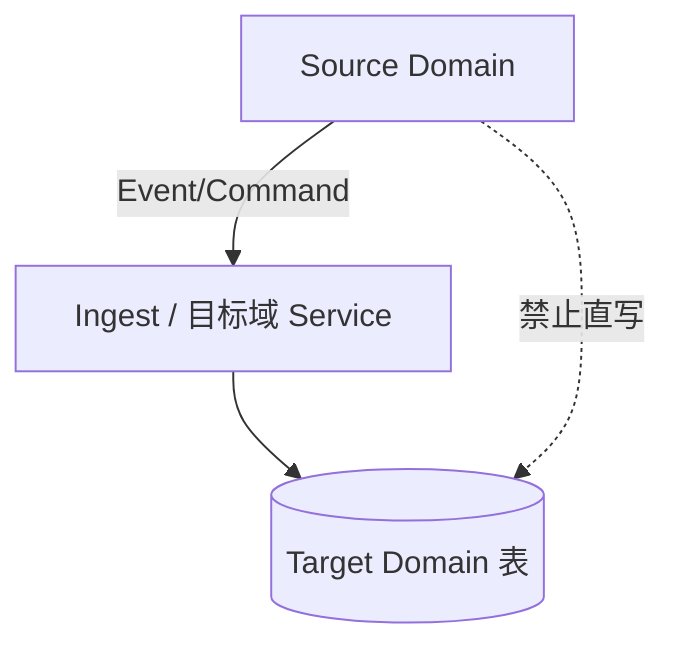

# v2.0.0 Dependency Graph

> 单一事实来源：所有 Task 的 `Dependencies` 字段必须与本图一致。图中 Task 编号见各 `phases/*/tasks.md`。

## 1. Phase Dependency Graph



**可并行矩阵**（Runtime Enablement = 代码合入但 Flag OFF；Enablement 顺序严格串行）：

| 可并行开发组 | 前置条件 | 说明 |
|---|---|---|
| P1 全部 ∥ REF-001 存储 ∥ DEV-001 存储 ∥ AUT-001 存储扩展 | 无 | 纯 DDL + 服务壳，互不依赖（schema 风格对齐 REF-001 评审） |
| REF-002~004 ∥ DEV-002~004（开发） | P1 MEM-006 语义检索可用 | DEV 只读 REF-001 表结构即可编译，启用依赖 REF-004 |
| P4 REL-001~002 ∥ P5 LIFE-001~003 | P1 完成 | Relationship 与 Life Loop 无表依赖交集 |
| Enablement 串行链 | 对应 Phase 验收过 | v2_memory → v2_reflection → v2_development → v2_relationship_evolved → v2_life_loop → v2_autonomy_advanced |

## 2. Task Dependency Graph（P0 主干）



实线 = 运行时启用依赖；虚线 `-.->` = 开发期结构依赖（可并行，启用需等上游）。

## 3. Runtime Dependency（调用方向，沿 domain-boundaries §3 矩阵）

```text
Life Loop(编排) → 调用所有域服务，不被业务域调用
Reflection → Memory(读)              Development → Reflection(读 Insight)
Relationship → State/Memory/Dev(读)   Goal → Dev/Rel/Memory(读)
Decision → Goal/State/Persona(读)     Action → Decision/World/Memory(读或经 Ingest)
World → 零入度                        Memory → State(读情绪信号)/Experience 投影(读)
禁止：Memory→Relationship；Relationship→Memory(直写)；任何人→World(写，除 Action 结果经 outbox)
```

## 4. Data Flow（闭环主链）



要点：`BP → 新对话 → C` 是 §十「反复行为→新经历→再反思」闭环的落点——调制结果改变对话行为，对话经 P1 Ingest 再变 Candidate，Dev 不自证。

## 5. Event Flow（跨域写入全部经 Ingest / Outbox，禁止直写）

```text
Action 成功 → 同事务(action_records + outbox_events) → WorldEngine 消费 → world_events
  → Memory Ingest → memory_candidates            【Action 永不直接 INSERT memories】
RelationshipEvent 变更 → Memory Ingest → relationship_fact 记忆   【Relationship 永不直写 memories】
Insight invalidated → Development 订阅 → development_changes 回退 【Reflection 永不直写 development_state】
用户消息 → chat_pipeline → 显式 remember/forget → Memory Commands   【chat_pipeline 永不直写 memories】
```

## 6. LLM Flow（前台 ≤4 次，其余后台/条件触发）

```text
前台: router+turn_analysis(合并, lite) → scene_intent(lite, 歧义时) → intention(lite, 歧义时) → answer(main, 流式)
后台即时: state_update(lite) → memory 评估兜底(lite, 灰区才调) → evaluation judge(采样)
后台批: embedding(非 chat) / judge 采样
后台周期: reflection(main, ≤1 次/日/用户, 门槛后才调) → goal planning(main, 每 goal ≤3 次/生命周期)
熔断: 全局日配额超限 → 后台降级为只记 Candidate；前台永不熔断
```

## 7. Cross-Domain Write Flow



合法写入路径共 5 条（见 §5），其余任何跨域写入在 Code Review 中按违规处理。
