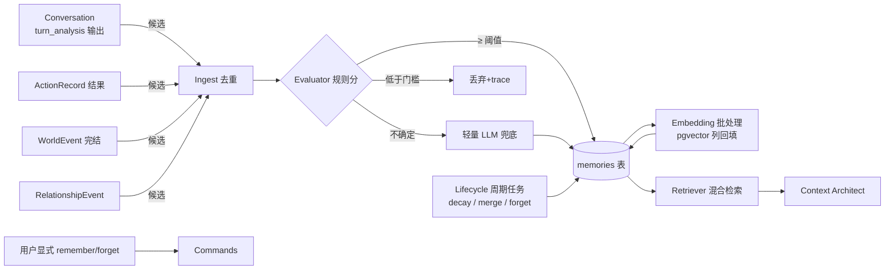

# Phase 1 Architecture — Memory 2.0

## 1. 模块结构（落位 apps/backend/app/services/）

```text
services/memory2/
├── ingest.py          摄取器：四源 → MemoryCandidate（幂等）
├── evaluator.py       评估：规则打分 → 转正/丢弃/待 LLM
├── lifecycle.py       状态机：reinforce/merge/supersede/decay/forget
├── retriever.py       检索：向量 + 结构混合、排序、去重
├── commands.py        显式 remember/forget
└── embeddings.py      批量向量化（攒批 32 条 / 60s）
```

既有 `memory_service/memory_policy/memory_conflict` 保留为 v1 路径；Flag 切换读取与写入入口，不删除旧代码（回滚即切回）。

## 2. 数据流



## 3. 接口边界（依 domain-boundaries 依赖矩阵）

- **被调用**：Context Architect（检索）、Reflection（证据检索）、Relationship（叙事事实读取）、chat_pipeline（显式命令识别后的指令）。
- **调用**：State（读取当前情绪作 salience 信号，只读）、LLM Orchestration（兜底判定、embedding 服务）。
- **禁止**：读 relationship_state 数值；写任何行为域；前台同步路径做 LLM 判定。

## 4. 与 v1 组件关系

| v1组件 | v2 处置 |
|---|---|
| memories 表 | 扩列不改义（design.md §2） |
| memory_conflict | 收编进 lifecycle.merge/supersede，逻辑保留 |
| memory_policy | 类型/预算策略沿用，新增 salience 维度 |
| extractor_chain | 保留，但前置规则预筛（显著度门槛，多数对话 0 调用） |
| post_process 步骤 | 摄取步骤替换为 ingest（幂等），其余步骤不动 |
| 200 条容量软上限（v4 文档宣称未实现） | 实现为 lifecycle.decay 的输入信号，不是硬截断 |
