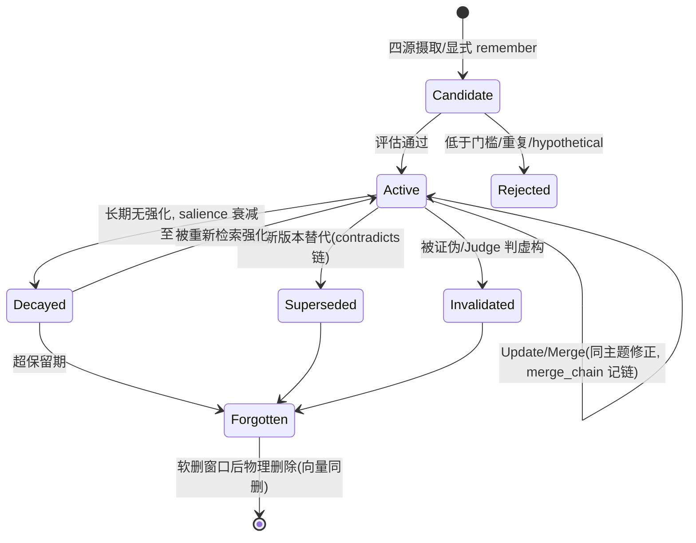

# Phase 1 Design — Memory 2.0

## 1. Memory ≠ RAG（先裁决定位）

| | RAG | v2 Memory |
|---|---|---|
| 数据 | 静态文档块 | 有生命周期的记忆行（状态/置信/强化/衰减） |
| 索引 | 一切 | 只是 Retrieval 的一部分（与结构化打分并行） |
| 写入 | 一次性灌入 | Candidate → Evaluate → Store，可更新/合并/遗忘 |
| 目标 | 找回内容 | 支撑角色认知（谁、何时、为何、多确信） |

**向量检索三问都答「否」时不得引入**：当前规模（单用户、单角色、记忆 ≤ 数千条）不需要独立向量库；运维成本不允许；一致性要求同事务。→ **选 pgvector（Postgres 16 扩展），单库承载**。重审触发条件：记忆 > 50 万条或检索 P95 > 200ms 或多角色共享索引时，再评估 Qdrant 独立库（协议不变：SoT 仍在业务表）。

## 2. 数据模型（增量迁移，不改既有列义）

`memories` 扩列：
```text
embedding        vector(768) NULL        -- NULL=待补齐，检索降级为结构化
salience         numeric  0~1            -- 显著度（衰减的乘数）
last_reinforced_at timestamptz
merge_chain      jsonb                   -- 被合并的旧记忆 id 链
source_ref       jsonb                   -- {source_table, source_id} 回指
visibility       text  normal|private|hypothetical
```
新表：
```text
memory_candidates(id, user_id, character_id, content, proposed_type, source,
                  source_ref, salience, status∈pending|approved|rejected|promoted,
                  reason, created_at)        -- 幂等键 (source_table, source_id)
memory_links(id, memory_id, related_memory_id, relation∈supersedes|merges|contradicts)
background_jobs(id, job_type, payload jsonb, status, attempts, run_at,
                idempotency_key UNIQUE, last_error, created_at)   -- P5 复用
```

## 3. Memory 类型（7 类封顶，类型裁决）

| 类型 | 来源 | 例 | 独立成类理由 |
|---|---|---|---|
| preference | user_stated / 行为归纳 | 「最喜欢西瓜」 | 检索亲和度最高，type_affinity 命中率高 |
| fact | user_stated | 「用户叫小王」 | 身份类事实需最高置信门槛 |
| experience | 事件沉淀 | 「第一次一起去看海」 | 叙事性，供 Shared Experience 投影 |
| relationship_fact | 事件/行动转写 | 「用户帮我修过电脑」 | **统一真相源裁决**：数值归账本、事实归这里（替代 v1 的 relationship_event 记忆类型） |
| commitment | 双方约定 | 「周末一起吃饭」 | 有时效与履行语义 |
| milestone_event | 里程碑转写 | 「关系升级为好友」 | 低频高价值，HARD 只增 |
| behavior_pattern | Reflection 供品（P3 前空置） | 「用户常加班到深夜」 | P2/P3 才有供给方，先占类型位 |

拒绝的类型：goal（v4 已裁决出记忆）、emotion（属 State）、scene（属 V3）。

## 4. 生命周期状态机



- **衰减公式**：`salience_t = salience_0 × exp(-λ·Δdays)`，λ 按类型（preference/fact 低衰减，experience 中，其余高）；重要事件 salience_0 上限更高。
- **遗忘**：显式 forget → 立即全通道不可见（状态置 forgotten + embedding 清空）→ 30 天物理删除；低 salience 自动遗忘仅 Decayed 状态。
- **冲突处理**：contradicts 链 + 保守原则——无法判定时两者并存并标 pending，由下次反思/用户澄清解决（禁止单跳双向丢弃，修 v4 遗留）。

## 5. 什么成为 Memory（评估规则优先序）

| 信号 | 处理 |
|---|---|
| 用户显式「记住」 | 直接 Active，salience=1.0，0 LLM |
| 用户显式「忘记」 | Commands 通道 |
| turn_analysis 抽出偏好/事实陈述 | 候选，规则分（显著度词表 + 新颖性 + 类型亲和）|
| 「拿块西瓜」类瞬时请求 | 不候选（动作短语词表拦截） |
| Roleplay/「假装/如果」 | visibility=hypothetical，永不入长期检索 |
| 重复出现同一主题 | Reinforce 现有条目而非新建 |
| 首次共同经历/承诺/重大关系事件 | 事件类转写，salience 上限高 |
| LLM 兜底 | 仅规则分落在灰色区间时调用一次（轻量模型） |

## 6. 检索与排序（Retrieval + Ranking）

```text
score = w1·semantic(cosine) + w2·structured(recency+importance+salience+type_affinity)
        - w3·penalty(recently_rejected, 被纠正未满24h)
top_k = 5（进 Context 合并预算 800 字符）
```
- semantic 缺席（embedding NULL）时仅结构化，结果照常可用。
- 检索附带 trace：命中原因（语义/结构各项分数）→ 回答「为什么召回这条/为什么没召回那条」。

## 7. 一致性（引 data-flow.md）

- Candidate 摄取幂等键 (source_table, source_id)；转正单事务（memories + links + trace）；embedding 延迟补偿（NULL → 批处理回填）。
- forget 与检索的竞争：状态先置 forgotten（同事务），检索过滤状态列，无窗口期。

## 8. Feature Flag 与回滚

- `v2_memory_enabled=False`：ingest/lifecycle 全跳过，检索走 v1 路径（旧代码保留）。
- `v2_memory_vector_enabled=False`：仅结构化打分（迁移期 embedding 未回填完成的保护闸）。
- 回滚 = 关 Flag + 停周期任务；扩列对 v1 代码不可见（新增列可 NULL）。
