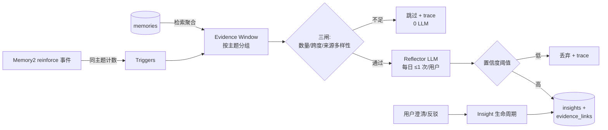

# Phase 2 Architecture — Reflection

## 1. 模块结构

```text
services/reflection/
├── evidence.py        Evidence Window 聚合（纯规则：检索+分组+计数）
├── triggers.py        触发器：周期调度 + 事件阈值（同主题 reinforce 计数）
├── reflector.py       反思执行（LLM Reasoning Engine 调用点）
└── lifecycle.py       Insight 生命周期（supersede/invalidate）
```

新表：
```text
insights(id, user_id, character_id, statement, type, confidence, scope,
         status∈active|superseded|invalidated, created_at, invalidated_at,
         invalidated_reason, superseded_by)
reflection_runs(id, trigger, evidence_summary, outcome, llm_used, created_at)
evidence_links(id, insight_id, memory_id, weight)
```

## 2. 数据流



## 3. 反思 Prompt 结构（Reasoning Engine 的职责边界）

输入：Evidence 组（每条含 memory 内容、时间、来源类型、权重）+ 类型约束说明。
输出（结构化）：候选 Insight 列表，每条含 statement / type / confidence / 引用的 evidence id / 反例说明（证据不支持什么）。
**LLM 无权**：决定 confidence 终值（代码按证据强度校准折算）、直写任何其他域、修改记忆。

## 4. 边界（依 domain-boundaries 矩阵）

- 只读 Memory（仅 active 且非 hypothetical）；只写 insights/reflection_runs/evidence_links。
- 被 Development（P3）、Goal（P6 调制）、Context（高置信 Insight 摘要段）读取。
- 禁止：写 Memory/State/Relationship；被 Relationship/State 调用（保持单向）。

## 5. 成本控制

- 规则三闸前置：绝大多数日子 0 调用。
- 每用户每日反思 LLM ≤ 1 次；事件触发共用当日额度。
- Evidence 组 token 上限（窗口内取 top 显著度记忆，超限截断）。
- Reflection Trace 全程记录（触发原因、证据、产出、置信度）——回答「为什么形成这个 Reflection」。
