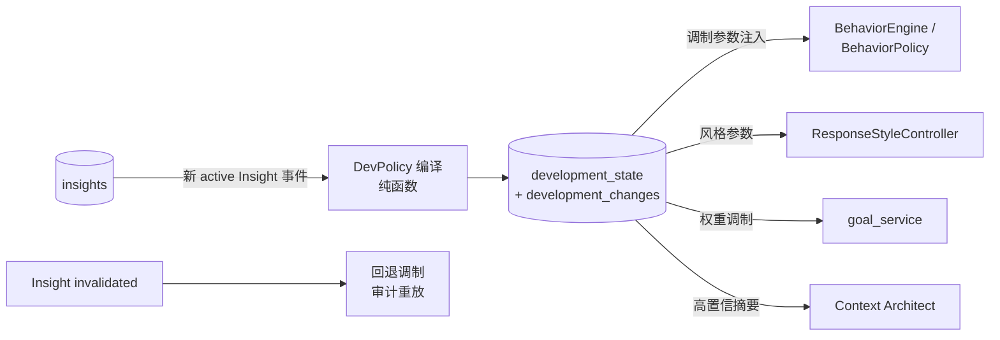

# Phase 3 Architecture — Character Development

## 1. 模块结构

```text
services/development/
├── aggregate.py    Development Aggregate 读写（beliefs/preferences/patterns）
├── policy.py       DevPolicy 编译器（Insight → 行为参数调制，纯函数）
└── audit.py        变更审计与重放
```

新表：
```text
development_state(id, user_id, character_id, kind∈belief|preference|pattern,
                  key, value jsonb, strength 0~1, source_insight_id,
                  status∈active|superseded|retired, created_at, updated_at)
development_changes(id, development_state_id, before jsonb, after jsonb,
                    insight_id, created_at)
```

## 2. 数据流



## 3. DevPolicy 编译规则（纯函数，确定性）

| Insight type | 调制目标 | 封顶 |
|---|---|---|
| preference | ResponseStyle 参数（长度/语气） | 强度 × 预设最大幅度 |
| belief | BehaviorPolicy 关心话题权重、habit 激活候选 | 不新增 habit，只置候选 |
| pattern | AutonomyPolicy 时间偏好调制、goal_service 权重 | 不突破 v7 预算/冷却硬顶 |

规则要点：
- 调制 = **参数注入**，实现为读取时的叠加层（v6.5 BehaviorPolicy 参数表 + development 覆盖层），不改静态资产文件。
- 同 key 冲突：confidence 高者生效；同 confidence 取新者；败者 status=superseded 留痕。
- Insight 失效 → 重放该 key 的调制历史，回退到次优或无调制。

## 4. 边界

- 只读 insights；只写 development_state/changes。
- 被 BehaviorEngine/goal_service/Context/AutonomyPolicy 读取。
- 禁止：直读 memories（必须经 Insight）；写 Persona；修改任何数值公式本体。

## 5. 成本

0 新增 LLM。编译与仲裁全为纯函数；审计重放离线可跑。
