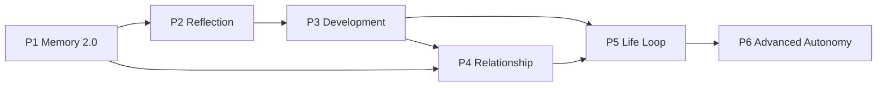

# v2.0.0 Roadmap

> 六个 Phase，严格按依赖顺序交付。每个 Phase 必须独立可验收、可灰度、可回滚。

---

## Phase 1 — Memory 2.0

| 项 | 内容 |
|---|---|
| **目标** | 把「扁平抽取器」升级为双层记忆系统：Working Memory（每轮重建）+ Long-term Memory（完整生命周期），语义检索上线 |
| **解决的问题** | v1 记忆无生命周期、无语义召回、无 merge/decay；长对话记性变差；Roleplay/假设内容被误存为事实 |
| **核心能力** | Candidate → Evaluate → Store → Reinforce → Merge/Supersede → Decay → Forget 全生命周期；pgvector + 结构化混合检索与排序；用户显式 remember/forget；Memory Candidate 摄取通道统一（Conversation/ActionRecord/WorldEvent/RelationshipEvent） |
| **依赖** | 无（v2 起点）；消费既有 memories 表与 post_process 通道 |
| **数据库影响** | memories 表扩列（embedding vector、salience、last_reinforced_at、merge_chain）；新增 memory_candidates、memory_links、background_jobs；pgvector 扩展 + HNSW 索引 |
| **LLM 影响** | 记忆判定规则优先、LLM 兜底（不确定性样本才调）；embedding 走批量异步；前台调用数不增 |
| **后台任务影响** | 新增 embedding 批处理循环 + decay/consolidation 周期任务；首次落地持久化 background_jobs 表（供 P5 复用） |
| **完成标准** | Flag `v2_memory_enabled` 下：跨会话语义召回可用；生命周期全链路有 trace；显式 remember/forget 生效；关闭 Flag 时行为与 v1 字节级一致；记忆评估指标（precision/recall/冲突处理）达标 |

## Phase 2 — Reflection

| 项 | 内容 |
|---|---|
| **目标** | 角色能从记忆中形成认知：Evidence → Reflection → Insight（带 confidence/source/scope，可 invalidated） |
| **解决的问题** | v1 无任何「经历→认知」通道；数值阈值驱动一切，角色没有「看法」 |
| **核心能力** | Evidence Window 聚合；周期/事件触发反思；防幻觉三闸（证据数量、置信度阈值、类型约束）；Insight 存储 + supersede/invalidated 生命周期；反思消费记忆但不写记忆 |
| **依赖** | P1（证据检索全靠 Memory 2.0） |
| **数据库影响** | 新增 insights、reflection_runs、evidence_links |
| **LLM 影响** | 反思为低频后台任务（默认每日 + 事件触发），每次 1 次调用；规则先行过滤（证据不足直接跳过，0 调用） |
| **后台任务影响** | 新增 reflection scheduler（复用 background_jobs） |
| **完成标准** | 给定构造的重复证据（如用户多次说累）能产出正确 Insight 且带证据引用；证据不足时产出为空；Insight 可被反驳失效；Flag 灰度可回滚 |

## Phase 3 — Character Development

| 项 | 内容 |
|---|---|
| **目标** | 角色因经历而改变：Insight → Belief / Preference / Pattern → 行为演化 |
| **解决的问题** | Development 与 Memory/Reflection 混淆的风险；角色行为永不随经历变化 |
| **核心能力** | Development Aggregate（beliefs/preferences/patterns，慢变量、变更审计）；Insight→DevPolicy 桥（确定性规则把 Insight 编译为行为参数调制，如 BehaviorPolicy 权重、Response Style、关心话题）；回滚与冲突（矛盾 Insight 处理） |
| **依赖** | P2（唯一合法输入是 Insight）；消费 V6.5 BehaviorPolicy 表现层 |
| **数据库影响** | 新增 development_state、development_changes（审计） |
| **LLM 影响** | 0 新增 LLM 链——DevPolicy 是纯函数；变化可解释可重放 |
| **后台任务影响** | 无新增（由 Insight 事件驱动） |
| **完成标准** | Insight 写入后行为参数变化可观测（trace 可见 before/after）；矛盾 Insight 触发仲裁而非同时生效；Flag 关闭时 Development 冻结 |

## Phase 4 — Long-term Relationship

| 项 | 内容 |
|---|---|
| **目标** | 关系从「数值 Current State」升级为「State + History + Shared Experience + Milestones + Patterns」 |
| **解决的问题** | 关系事实双真相源（memory 类型 vs relationship_events 账本）；关系没有「共同经历」叙事层 |
| **核心能力** | 统一真相源裁决落地（数值归账本、事实归 Memory `relationship_fact`、快照为投影）；Shared Experience 视图（共同事件投影，非新表）；Relationship Patterns（从 Insights 引导）；里程碑 v2（复用 V8.5 12 项 + Insight 触发的叙事里程碑） |
| **依赖** | P1（关系叙事记忆）、P3（Pattern 来源） |
| **数据库影响** | 0~1 张新表（relationship_shared_view 可为纯 SQL 视图）；relationship_state 只扩列不改列义 |
| **LLM 影响** | 0 新增链；LLM 关系 judge 保持 V8.5 留白（默认关） |
| **后台任务影响** | 无新增 |
| **完成标准** | 任一关系事实可回答「存在哪、为什么存在」（单一真相源）；共同经历数量随交互增长且可检索进上下文；数值引擎行为不变（D1/D2/D3/D5 数学零改动） |

## Phase 5 — Life Loop

| 项 | 内容 |
|---|---|
| **目标** | 角色持续存在：Perception → State Update → Goal Evaluation → Memory Retrieval → Reflection Check → Decision → Action → World Event 的完整生命周期，用户不说话也运转 |
| **解决的问题** | 60s autonomy tick 太粗；Trigger Registry 在内存重启即丢；后台一致性与成本无全局控制 |
| **核心能力** | 统一 Life Loop Controller（触发源：调度/事件/阈值）；持久化 Trigger Registry（消灭内存 dict）；Budget/Cooldown/Priority/Idle 四控制；每周期成本记账与熔断；Outbox 模式贯通 Action→World Event→Memory Candidate |
| **依赖** | P3/P4（周期内容）、P1 的 background_jobs；既有 Autonomy/Action/World 引擎全部复用 |
| **数据库影响** | trigger_registry、loop_runs、outbox_events |
| **LLM 影响** | 周期内 LLM 只在 Decision/Action 命中时发生；Idle 判定纯规则；全局每日 LLM 预算熔断上线 |
| **后台任务影响** | autonomy worker 重构为 Life Loop 执行器；现有 5 循环归并为统一调度 |
| **完成标准** | 重启后 pending trigger 不丢；连续 7 天运行 LLM 调用总量在预算内；每个周期有完整 trace；Idle 状态可进入可退出 |

## Phase 6 — Advanced Autonomy

| 项 | 内容 |
|---|---|
| **目标** | 角色追求目标：Short/Long-term × Personal/Relationship/World 目标层级，Planning → Sub-Goal → Action → Observation → Adjustment |
| **解决的问题** | v1 Goal 是扁平 4 类规则列表，无层级、无规划、无失败语义 |
| **核心能力** | Goal 层级与优先级仲裁、Goal Conflict 检测；Planning（LLM，低频）产出 Sub-Goal；执行观察与调整（完成/失败/放弃语义）；Goal 与 Development/Relationship 的调制闭环 |
| **依赖** | P5（调度与执行底座）、P3（Personal Goal 由 Belief/Pattern 供给） |
| **数据库影响** | goals 扩列（parent_goal_id、layer、domain、failure_reason）；goal_plans |
| **LLM 影响** | Planning 低频（goal 创建/重规划时），执行调度保持规则 |
| **后台任务影响** | 复用 Life Loop |
| **完成标准** | 长期目标可跨多轮拆解执行并被观察调整；冲突目标按优先级仲裁有 trace；失败/放弃路径有明确状态与用户可见影响 |

---

## 横切：每 Phase 的固定交付物

1. 代码（实现该 Phase tasks.md 全部 Task）
2. Feature Flag 总闸 + 子闸
3. Alembic 增量迁移（含回滚 downgrade）
4. Evaluation 指标接入（evaluation.md 对应维度）
5. Trace 扩展（memory/reflection/goal trace）
6. 回归清单更新（沿用 v1.0.0 各版 checklist 惯例，但放 v2.0.0 目录）
