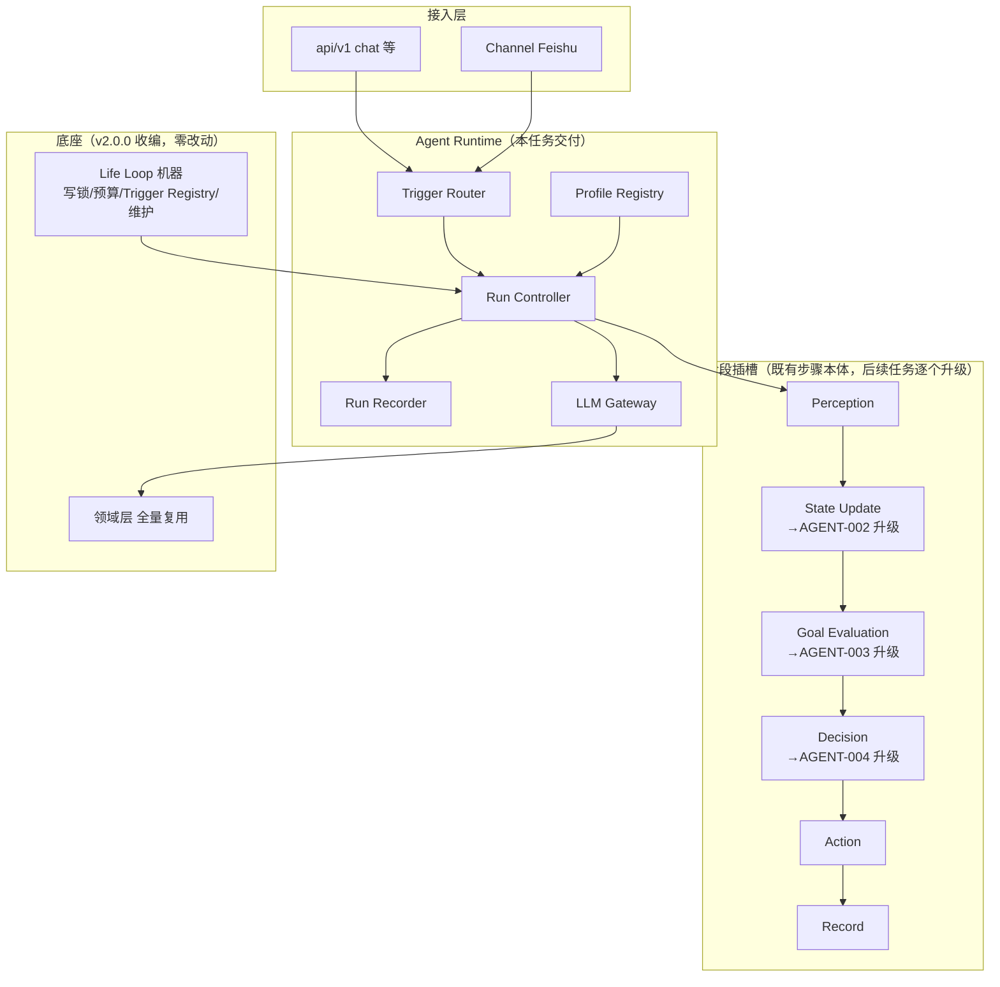

# AGENT-001 Task Detail — Agent Runtime Evolution

> 上游：[architecture.md](architecture.md) §1/§2/§8.3、[tasks.md](tasks.md) AGENT-001
> 状态：Task Detail（编码规范，未实现）；迁移自 **0038** 起编号
> 范围红线：不写代码级细节之外的实现；不设计 AGENT-002 及之后的插槽内容（State Snapshot / Goal Stack / 统一决策管线只定义插槽契约）

---

## 1. Background

**当前系统状态**：V2.0.0 之后角色行为由两条编排路径分别驱动——

| 路径 | 入口 | 特点 |
|---|---|---|
| 前台对话 | `application/chat_pipeline.run_chat_pipeline` | 消息驱动；自带决策/生成/落库/`schedule_post_process` 交接；前台 LLM 预算目标 ≤4 次 |
| 后台自主 | `application/life_loop.run_life_loop_worker → tick → _run_user_cycle` | 周期驱动；per-user 写锁 + 步骤管线 + `loop_runs` 台账 + LIFE-003 两道预算闸；维护步骤（world/action retry/outbox/trigger reconcile）另有 `loop_runs` 行 |

两条路径**各自记账、各自取状态、各自装配上下文**：前台对话不出现在 `loop_runs` 台账里；LLM 调用决策（是否/何时/哪档/花多少）散落在各 chain 调用点，只有后台受全局日配额熔断约束。v2.0.1 已完成双 tick 源去重（`autonomy_worker` 退化为 `v2_life_loop_enabled=False` 兜底）与主动投递闭环，但「前台 vs 后台是两套 Agent」的结构分裂仍在。

**为什么需要 Runtime Evolution**：V2.1.0 的目标（统一状态、目标、决策、成长）要求一切行为可归因到同一个 Run 模型，否则 AGENT-002 的状态快照、AGENT-004 的统一决策管线没有统一的挂载点。

**解决的问题**：
1. 前台行为无 Run 台账，无法与后台行为放在同一份预算与审计口径下。
2. LLM 调用无统一裁决面，能力级预算、降级、归因缺失。
3. 后续所有 V2.1.0 能力（状态/目标/决策/演化）缺少统一的生命周期插槽。

---

## 2. Goal

完成后，Agent Runtime 具备：

1. **统一 Run 模型**：前台消息、后台 tick、事件触发都表现为一次 Run（`run_kind` ∈ foreground_chat / autonomous_tick / event_driven），同一台账、同一生命周期（open → stages → close）、同一终态语义（done / aborted / degraded）。
2. **统一调度入口**：Run Controller 拥有 Run 生命周期与阶段编排权；`life_loop` 机器（Trigger Registry / 预算 / 写锁 / 维护）作为其底座被收编，不被重写。
3. **统一 LLM 调用面**：LLM Gateway 裁决「是否调用 / 何时调用 / 用哪档 / 花多少」，能力注册表管理既有 chain，run 级 + 全局日级两级记账，熔断联动既有 LIFE-003。
4. **降级总则生效**：architecture §2.7 五档失败路径全部有定义、有台账痕迹、无静默失败。

---

## 3. Scope

**包含：**

- **Runtime 生命周期**：Run Controller（open / stage 执行 / critical 语义 / close 终态）、Run Profile 注册表（三种 Profile 的阶段序列、预算档、critical 声明）。
- **模块调度**：Trigger Router 四类触发源归一（Channel 消息 / World 事件 / 调度 / 阈值状态）；阶段插槽契约（名称、输入输出、critical 标志、预算归属）。
- **输入输出流程**：RunContext（run 内状态载体）；`loop_runs` 台账扩列与写入；成本汇总回写。
- **状态传递**：Run 内 in-memory（RunContext + 既有 contextvar 通道）；跨 Run 状态仍由各域表承载（本任务不引入任何新状态存储）。
- **LLM Gateway**：能力注册表（代码级配置，形态对齐既有 chain 接线）、四问裁决、两级记账、熔断联动；后台调用点切换；前台调用点在 `v21_unified_run_enabled` 内最后切换（遗留问题 Q2 裁决：回复生成最后切）。

**不包含：**

- 新 Memory 系统、新 Agent 系统、替换任何已有模块本体（Memory / Reflection / Relationship / Action / World / chat_pipeline 步骤 / life_loop 引擎函数全部原样复用）。
- Agent State Assembler 与 Snapshot（AGENT-002）；Goal Stack（AGENT-003）；统一决策管线（AGENT-004）——本任务只保留这些阶段的插槽位置与契约。
- 主动消息投递语义（v2.0.1 交付，原样继承）。
- 预算数学、Idle 判定、Cooldown、Trigger Registry 表结构的任何变更。

---

## 4. Architecture Design

### 4.1 在系统中的位置



### 4.2 Evolution Loop 主流程

```text
User Input / Channel 消息 / World 事件 / 调度 tick / 阈值越限
        ↓
Trigger Router（分类 → run_kind + trigger_type，0 LLM）
        ↓
Agent Runtime（Run Controller）
        ↓
Run Open（loop_runs 记账 + 预算闸）
        ↓
Perception            （既有 collect_facts，0 LLM）
        ↓
Character State       （既有 state_update 步骤；AGENT-002 升级为 Snapshot）
        ↓
Goal Evaluation       （既有 goal_check/goal_supply/goal_advance；AGENT-003 升级为 Goal Stack）
        ↓
Decision              （既有 decision 步骤；AGENT-004 升级为统一管线）
        ↓
Action                （Action 域契约调用，检定六态不变）
        ↓
Record & Handoff      （decision_records / action_records / trace / post_process 交接）
        ↓
Reflection → Memory Update（后台通道，post_process / 独立周期任务，不变）
        ↓
Run Close（终态 done|aborted|degraded + 成本汇总）
```

### 4.3 三种 Run Profile

| Profile | 触发 | 阶段组成 | 预算档 | critical 步骤 |
|---|---|---|---|---|
| `foreground_chat` | Channel 用户消息 | 既有 chat_pipeline 全步骤（包裹为 Run） | 前台配额（≤4 次 LLM 目标不变） | 生成回复 |
| `autonomous_tick` | 调度 / 阈值 / 事件升级 | 既有 `_run_user_cycle` 九步骤原样 | 后台配额（LIFE-003 不变） | decision |
| `event_driven` | World 事件 / Channel 非消息事件 | 预闸（0 LLM）→ 多数终止；升级则按 autonomous_tick 阶段执行 | 事件配额（轻） | 无（默认全部可降级） |

---

## 5. Core Components

### 5.1 Run Controller（调度中枢）

**职责**：
- Run 生命周期唯一管理者：open（建 `loop_runs` 行）→ 按 Profile 声明顺序执行阶段 → close（终态 + 成本汇总回写）。
- 阶段执行器：同步阶段（既有 `_record_step` 语义）与异步阶段（`_record_step_async` 语义，含 critical 失败 → Run aborted）统一收编为通用执行原语。
- per-user 写锁持有（复用 `get_user_write_lock`，前台与后台 Run 对同一 user 串行）。
- 降级裁决入口（见 5.6）。

**职责边界**：不持有业务语义；不写业务域表（唯一写面 = `loop_runs` + 台账接口，与 v2.0.0 Controller 铁律一致）。

### 5.2 Trigger Router（触发路由）

**职责**：
- 把四类触发源归一为 `(run_kind, trigger_type)` 二元组：`channel_message`（来自 Channel/api）、`world_event`（来自 outbox pending）、`schedule`（来自 Trigger Registry due / 周期 tick）、`threshold`（来自状态/预算/评估越限）。
- 工作发现归口：现有 `_collect_work_users` 的四个来源保留，新增 channel 消息与事件升级两个来源；判定全部纯规则 0 LLM。
- 触发去重沿用 Trigger Registry 既有 claim/cooldown 语义；channel 消息天然幂等（一次消息一次 Run）。

### 5.3 Profile Registry（Profile 注册表）

**职责**：
- 代码级注册表（模块常量，非数据库）：声明每种 `run_kind` 的阶段序列、各阶段是否 LLM capable、critical 标志、预算档位。
- Run Open 时把实例化的 Profile 快照写入 `loop_runs.profile`（JSON），供回放与统计。
- 新 Profile 的加入点是本注册表，而不是新的编排代码路径（架构验收「无第二套 pipeline」的落点）。

### 5.4 LLM Gateway

**职责**：
- **能力注册表**（代码级）：既有每个 chain / LLM 调用点注册为命名 Capability，声明：能力名（= `llm_call_records.call_site` 值）、模型档位（主力/轻量，沿既有 llm_factory 分层）、预算类型（foreground/background/event）、可否降级为规则路径。
- **四问裁决**：调用前检查（1）run 级账户余额（2）全局日配额熔断状态（LIFE-003 既有函数，语义不变）→ 允许 / 拒绝（规则兜底）/ 降级。「何时调用、用哪档」由调用方按注册声明走，Gateway 不改既有触发时机判断逻辑。
- **两级记账**：调用照常落 `llm_call_records`（复用列，不扩列）；run 级汇总沿用既有窗口计数机制（`llm_call_repository` 时间窗 + `loop_runs.llm_call_count/token_total`），归因约定：后台 Run 调用点 `request_id = run_id`，前台保持 `turn_id`（遗留 Q：如 Detail 实施中发现窗口计数不足以支撑能力级统计，允许在 Detail 变更中申请扩列，不默认扩）。
- **熔断联动**：全局熔断开启时，所有 background/event 预算类型能力拒绝、degradable 能力走规则路径、foreground 能力按档位降级（主力→轻量→拒绝），行为全部留痕。

**职责边界**：不重写任何 chain；不改变 prompt 构造与解析；不引入新模型档位。

### 5.5 Run Recorder（台账）

**职责**：`loop_runs` 读写唯一入口封装：create_run / mark_step / finish_run（既有接口语义保持），新增 run_kind/profile 字段写入；close 时成本汇总（llm_call_count / token_total / budget_state 快照）。

### 5.6 Degradation Policy（降级总则）

| 失败点 | 行为 | 台账痕迹 |
|---|---|---|
| 触发风暴 | Trigger Registry 去重 + Cooldown（沿用） | trigger 行 attempt_count |
| 快照类步骤失败 | 降级为该步骤既有空包/跳过语义 | step status=error 或 skipped |
| 决策预算不足 | 全局熔断 → skip（quota_circuit_open）；周期预算耗尽 → skip（step_budget）——两道闸原样 | step skipped + skip_reason |
| Action 检定失败 | 六态审计照记，Run 不 abort | action_records |
| Gateway 熔断 | LLM 能力拒绝/降级，规则路径兜底，Run 标记 degraded | finish_run status=degraded |

---

## 6. Data Model

**不新增表、不新增域**。仅扩列一处（迁移 **0038**）：

### Entity: LoopRunRow（`loop_runs`，既有表扩列）

| 字段 | 类型 | 说明 |
|---|---|---|
| `run_kind` | String, nullable | 本任务新增：foreground_chat / autonomous_tick / event_driven；NULL = 既有维护类行（world_maintenance / action_retry / outbox_consume / trigger_reconcile，语义不变）；存量 `kind='autonomy'` 行回填 autonomous_tick |
| `profile` | JSON, nullable | 本任务新增：Run Open 时的 Profile 实例化快照（阶段序列 / 预算档 / critical 声明），回放与统计用 |

既有列（kind / trigger_id / trigger_type / reason / status / current_step / steps / llm_call_count / token_total / budget_state / started_at / finished_at）语义零改动。触发源归一复用既有 `trigger_type` 列（channel_message / world_event / schedule / threshold）。

### Entity: LLM Capability Registry（代码级配置，非数据库）

| 属性 | 说明 |
|---|---|
| name | 能力名，写入 `llm_call_records.call_site`（既有列） |
| tier | 主力 / 轻量（沿 llm_factory 既有两档） |
| budget_type | foreground / background / event |
| degradable | 熔断时可否规则兜底 |

### Relation

- `loop_runs.run_kind` 无外键约束（枚举语义列）；`llm_call_records.request_id`（既有列）按约定挂 `loop_runs.id`（后台 Run），前台继续挂 turn 语义。
- 其余数据关系全部维持 V2.0.0 现状。

---

## 7. Runtime Flow

### Flow A：前台对话 Run（`v21_unified_run_enabled=True`）

```text
Step 1  输入消息：Channel → api/v1 → Trigger Router 判定 run_kind=foreground_chat,
        trigger_type=channel_message
Step 2  Run Open：loop_runs 建行（run_kind/profile/trigger_type）+ 前台预算档账户建立
Step 3  执行既有 chat_pipeline 步骤本体：Context 装配 → 决策（既有）→ answer 生成
        → 落库；LLM 调用经 Gateway（前台档记账）；流式行为不变
Step 4  后台交接：schedule_post_process 照旧（Experience 摄取 → Memory Candidate 不变）
Step 5  Run Close：终态 + 成本汇总回写 loop_runs
```

### Flow B：后台自主 Run（收编既有 `_run_user_cycle`）

```text
Step 1  触发：tick 内 Trigger Router 工作发现（due trigger / goal work /
        inactivity / goal catchup），判定 run_kind=autonomous_tick
Step 2  Run Open：loop_runs 建行 + 两道预算闸检查（全局熔断 / 周期 LLM 预算）
Step 3  持 per-user 写锁，按 Profile 顺序执行既有九步骤（perception →
        state_update → goal_check → goal_supply → goal_advance →
        memory_retrieval → reflection_check → decision → world_experience）；
        decision 为唯一 critical 步骤，内部 LLM 经 Gateway（后台档）
Step 4  记录结果：步骤条目逐个 mark_step；decision/action 输出照旧落
        decision_records / action_records / trace
Step 5  Run Close：done | aborted（critical 失败）| degraded（熔断降级完成），
        成本汇总回写
```

### Flow C：事件驱动 Run

```text
Step 1  触发：World 事件（outbox pending）/ Channel 非消息事件 / 阈值越限
Step 2  预闸（0 LLM）：按 Profile 规则判定——无需角色反应 → 直接终止（0 run 行
        或轻量 run 行，Detail 定）；需要反应 → 升级为 autonomous_tick 阶段序列，
        trigger_type 记 world_event / threshold
Step 3~5 同 Flow B Step 2~5
```

### Flow D：维护步骤（不进入 Run 模型）

world_maintenance / action_retry / outbox_consume / trigger_reconcile 维持既有独立 `loop_runs` 行（run_kind=NULL），仅改由 Run Controller 所在模块统一持有调度入口，判定与间隔逻辑零改动。

---

## 8. Integration Design

| 系统 | 连接方式 | 不变量 |
|---|---|---|
| **Memory System** | memory_retrieval 步骤照旧在 Run 内执行；Memory 域零感知 Runtime | Memory 2.0 全链、7 类封顶、摄取通道零改动 |
| **Reflection System** | reflection_check 步骤照旧（REF-003 触发器全链复用） | Evidence 三闸、日桶幂等零改动 |
| **Relationship System** | 本任务不新增连接；state_update 步骤内既有 load_states 继续工作 | D1/D2/D3/D5 数学、账本 SoT 零改动 |
| **Life Loop** | `run_life_loop_worker` 保留为调度外壳；`v21_agent_runtime_enabled=True` 时其 tick 内的 user cycle 交由 Run Controller 以 autonomous_tick Profile 执行（步骤函数被复用为阶段实现）；False 时走 v2.0.0 原路径 | Trigger Registry / 预算 / 写锁 / Idle 判定零改动 |
| **Autonomy** | autonomy_engine.tick 仍在 decision 步骤内部被调用，位置不变 | AutonomyPolicy 裁决逻辑、P0/P1 通道零改动 |
| **chat_pipeline / post_process** | Flag 内整链包裹为 foreground_chat Run；步骤本体与 `schedule_post_process` 交接不动 | 前台 ≤4 次 LLM 目标、流式行为不变 |
| **World / Action / Outbox** | perception / world_experience / maintenance 照旧；Outbox 事件成为 event_driven 触发源 | V8 域模型、Outbox 语义、六态审计零改动 |
| **Channel（Feishu）** | 用户消息触发前台 Run；投递链路沿用 v2.0.1 | delivered 两阶段语义、external_message_id 零改动 |
| **LLM Orchestration** | Gateway 作为 llm_factory 之上的门面；chain 注册为 Capability | 模型两档、链缓存、预算数学零改动 |

---

## 9. Implementation Plan

| Step | 交付内容（≈1 commit） | Flag 依赖 |
|---|---|---|
| **Step 1** | 迁移 0038（loop_runs 扩列 run_kind/profile）；Run Controller 骨架（open/stage/close + 写锁 + 终态）；Run Recorder；settings 新增 `v21_agent_runtime_enabled`（默认 off）。autonomous_tick 经新路径与旧路径行为等价（对照测试） | 总闸 |
| **Step 2** | Trigger Router（四类触发源归一 + 工作发现扩展）；Profile Registry（三 Profile 阶段/预算档/critical 声明）；Flow C 事件预闸与升级 | 总闸 |
| **Step 3** | LLM Gateway：能力注册表 + 四问裁决 + 两级记账 + 熔断联动；后台链路调用点（decision 步骤内 proactive 链、post_process 内 LLM 调用点）切换为经 Gateway | 总闸 |
| **Step 4** | 前台收编：settings 新增 `v21_unified_run_enabled`；run_chat_pipeline 包裹为 foreground_chat Run；前台调用点切 Gateway（answer_chain 最后切，遗留 Q2） | 总闸 + unified_run |
| **Step 5** | Degradation Policy 五档落地收口；观测补全（trace 步骤、run_kind 维度统计）；Flag off 全量回归核对；文档（本 Detail 回填实施记录） | — |

每步完成后均可独立合入且回滚（Flag off 即回 v2.0.0 行为）。

---

## 10. Acceptance Criteria

**功能验收**

1. 四类触发源均可开启 Run；前台消息与后台 tick 落同一 `loop_runs` 台账，`run_kind` 可区分、可统计（同一 user 的前台/后台 Run 经写锁串行）。
2. 三种 Profile 的阶段组成、预算档、critical 步骤按注册表执行；`profile` 快照可在台账中回放。
3. 全部 LLM 调用经 Gateway：`llm_call_records.call_site` 均为注册能力名；run 级 + 日级记账一致（窗口计数与逐调用汇总偏差在 Detail 定义的容差内）。
4. 熔断触发时：background/event 能力拒绝并走规则兜底（degradable=true 的能力），Run 终态 degraded，无静默失败；LIFE-003 既有熔断行为逐字节一致。
5. 维护步骤照常运行且 `run_kind=NULL`；Idle 短路（0 LLM、0 run 行）语义保持。

**架构验收**

6. 无第二套 Agent Pipeline：新 Profile 只能经 Profile Registry 声明；前台与后台 Run 共用同一 Run Controller / Gateway / Recorder 代码路径（代码级检查 + 测试证明）。
7. 域层零感知：Memory/Reflection/Relationship/Action/World 域代码无任何 `import` 指向 Runtime 模块（依赖方向测试）。

**边界验收**

8. `v21_agent_runtime_enabled=False` 时：全量回归与 v2.0.0/v2.0.1 行为一致（含既有 life_loop / chat_pipeline 测试套件全绿，零跳过）。
9. v2.0.0 Preserve 项零 diff：Trigger Registry / 预算数学 / Idle / 写锁 / Outbox / v2.0.1 投递链路 / 链本体无语义变更（代码评审清单核对）。
10. 迁移 0038 可空跑回滚；`loop_runs` 既有列与存量数据零变更（除回填 run_kind 外）。

---

## 11. Testing Plan

**Unit Test**

- Run Controller：open/close 终态矩阵（done / aborted / degraded）；critical 步骤失败 → aborted；阶段异常不中断后续非 critical 阶段。
- Profile Registry：三 Profile 的阶段序列 / 预算档 / critical 声明；未注册 run_kind 拒绝建 Run。
- Trigger Router：四类触发源 → `(run_kind, trigger_type)` 分类矩阵；工作发现各来源命中/不命中。
- LLM Gateway：四问裁决矩阵（余额充足/耗尽 × 熔断开/关 × degradable 真/假）；记账归因（call_site / request_id 约定）；熔断时 foreground 档降级路径。

**Integration Test**

- 台账一致性：一次完整 autonomous_tick 的 steps 序列、llm_call_count、budget_state 与回放快照一致。
- 写锁串行：同一 user 前台 Run 与后台 Run 并发到达时串行执行、无交叉写。
- 熔断联动：人为耗尽日配额 → 后台 Run decision skip（quota_circuit_open）→ 前台 Run 降档可用。
- 事件升级：outbox pending 事件 → 预闸 → 升级 Run 的 trigger_type / 阶段轨迹正确。

**Runtime Flow Test（端到端）**

- Flow A：消息进 → 回复出 → loop_runs 出现 foreground_chat 行 → post_process 交接发生 → 台账成本汇总正确。
- Flow B：due trigger → 完整九步骤 → decision 产出主动行为（或静默）→ Run done。
- Flow C：World 事件 → 预闸终止（0 LLM）/ 升级执行两分支。
- Flow D：维护步骤按各自间隔产生既有形态的 loop_runs 行。

**Regression**

- `v21_agent_runtime_enabled=False`（且 unified_run=False）：现有 V2.0.0 / V2.0.1 全部测试套件零跳过全绿。
- 迁移升级 + 回滚演练：0038 升级后旧数据可读、回滚后行为恢复。

---

## 12. 实施记录（Coding 回填）

> 以下为 AGENT-001 实现过程中对设计文档的增量澄清与已知范围注记，供 AGENT-007 收口核对。

1. **kind 值域扩展**：前台 Run 行落 `loop_runs.kind='chat'`（新增枚举值），后台 Run 沿用 `kind='autonomy'`；`run_kind` 列承载统一三值分类。迁移 0038 同步扩展 kind/status 两个 CheckConstraint（status 追加 `degraded` 终态）。
2. **前台收编形态**：Run 生命周期内联进 `run_chat_pipeline` 本体（try/finally + `run_ctx is not None` 守卫），未引入外层包装生成器——Flag 关闭时零额外生成器层、零可测开销（v7.8 观测开销预算测试口径下不可见）。
   *评审修复*：`autonomous_tick` 的阶段序列改为**由 Profile Registry 驱动**（controller 不再硬编码），声明补齐 `goal_stack`；后台 Run 结束经 finally 复位 Snapshot contextvar（与前台对称）；Gateway `acquire` 增 `account=False` 只问不记账，供决策风险闸预检。
3. **Gateway 裁决接线点**：后台 = decision 阶段第三道闸（`gateway_denied` skip，前两道既有闸不变）；前台 = `account_turn_decisions`（四条决策链记账）+ `resolve_answer_llm`（answer 放行→降档 light→enforced 拒绝）。post_process 内逐 chain 调用点的裁决切换按 §2.6「未切换的调用点行为不变」渐进迁移，本任务交付注册表覆盖（全部 CallSite 值已注册为能力）。
   *遗留（评审未收口）*：`scene_update`/`state_update`/`extractor`/`summary`/`judge`/`reflection` 六个调用点仍未接 Gateway，验收 3「全部 LLM 调用经 Gateway」按「注册表全覆盖 + 已接线点清单」理解。
4. **前台 Gateway 默认软模式**：`v21_foreground_gateway_enforced=false` 时超预算只记账并标记 Run degraded，不拒绝用户回复（避免 Chat 500）；enforced=true 才硬拒绝/降档。`v21_foreground_run_llm_budget=8` 为熔断上限而非目标值（前台 ≤4 次 LLM 目标仍由 v2.0.0 LLM 分层承载，AGENT-007 实测核对）。
5. **事件预闸**：`v21_event_escalation_types` 默认空 → `run_event_pregate` 零消耗直返（0 run 行、0 LLM）；配置白名单后升级为 autonomous_tick（trigger_type=world_event）。
6. **已知边界**：`GatewayDeniedError` 仅在 enforced 且无 light profile 时抛出；loop_runs 台账对前台 Run 不记逐阶段 steps（阶段轨迹在 turn trace 内，台账记 profile 快照与终态）。
