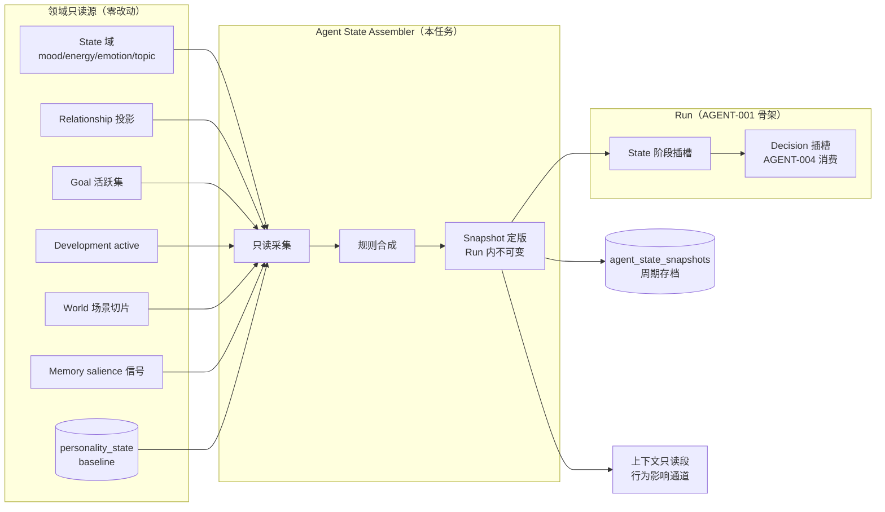

# AGENT-002 Task Detail — Character State System

> 上游：[architecture.md](architecture.md) §3/§8.2、[tasks.md](tasks.md) AGENT-002
> 状态：Task Detail（编码规范，未实现）；迁移 **0039**（两表一并）
> 范围红线：Snapshot 是投影不是真相源；人格轴只建表与基线，漂移写入属 AGENT-005；不设计决策侧消费（AGENT-004）

---

## 1. Background

**当前系统状态**：角色的内在状态分散在五个域，各自为政——

| 状态 | 现状 | 位置 |
|---|---|---|
| Mood / Energy / Emotion / current_topic / inner_state | 快变量，V5 衰减数学，`state_service.load_states` 读取 | State 域 |
| Relationship | V8.5 六维（intimacy / trust / tension / …）+ 快照投影 | Relationship 域 |
| 活跃目标 | `goal_repository.list_active`，仅 goal 相关步骤读取 | Goal 域 |
| Development 三元组 | belief / preference / pattern（active 行） | Development 域 |
| 世界场景 | `world_engine.collect_facts`，perception / supply 步骤各自采集 | World 域 |

问题：
1. **没有「角色此刻的完整意识状态」**：chat_pipeline 与 life_loop 各自按需读取上述数据，时点不一致，一次决策内的多次读取可能跨状态变更。
2. **缺 Interest 信号**：系统知道用户偏好（Development preference），但角色「当前对什么感兴趣」没有统一合成，话题选择靠散落的启发式。
3. **缺 Current Focus**：current_topic（State）+ 活跃目标（Goal）+ 进行中行动（Action）+ 注意力对象没有组合视图。
4. **缺 Personality State**：角色长期演化没有承载慢变量的状态位（Persona 是静态资产，Development 只有三元组）。

**解决的问题**：为 AGENT-003（目标驱动）、AGENT-004（state_fit / interest 决策维度）、AGENT-005（人格演化）提供统一、一致、廉价的 state 基座。

## 2. Goal

完成后：

1. 每个 Run 内可组装**一份时点一致的 Agent State Snapshot**（含 Mood/Energy/Emotion/Interest/Relationship State/Current Focus/Personality State 七组件 + interest_focus 主题榜），全程 0 LLM，成本在预算内。
2. Interest 信号按四来源规则加权合成，可在 Snapshot 与上下文中观测。
3. Current Focus 组合值对象每 Run 重算，行动开启/关闭即时反映。
4. `personality_state` 建表并按 Persona 声明完成基线导出（current = baseline，无漂移；唯一写入方 AGENT-005）。
5. Snapshot 以受控策略存档为 `agent_state_snapshots`，可按 run 回放。
6. 角色行为可感知状态影响：Snapshot 的状态行 / 兴趣行 / 焦点行以只读结构化段进入上下文装配（前台回复与后台 proactive 共用通道）。

## 3. Scope

**包含：**

- **涉及模块**：新增 `app/application/agent_state_assembler.py`（组装器）、`app/application/agent_state_archiver.py`（存档）、`app/repositories/personality_state_repository.py`、`app/repositories/agent_state_snapshot_repository.py`、`app/models/agent_state.py`（Snapshot / Interest / Focus 值对象）、`app/character/asuna/evolution.py`（新增 Persona 演化声明文件，见 Q1 裁决）、settings 扩展；AGENT-001 的 Run 状态阶段插槽接线。
- **新增能力**：七组件 Snapshot 值对象；Interest 四来源加权（目标域 / Development preference / 记忆 salience+recency / World 事件显著度）；Current Focus 组合规则；基线导出；存档策略（显著变化 + 每日保底 + 保留期）。
- **修改范围**：Run 的 state 阶段由「仅 state_update」升级为「state_update + Snapshot 组装」；上下文装配新增 Snapshot 只读段（追加段，不改动既有分段结构与 12000 预算分配的比例上限）。

**不包含：**

- 人格轴漂移的任何写入通路（AGENT-005）；`personality_state` 本任务 current 恒等于 baseline。
- 决策管线消费 Snapshot（AGENT-004 的 state_fit / interest 维度）。
- State 域数值数学、V5 情绪衰减、V8.5 关系引擎、Development 编译逻辑的任何修改。
- Snapshot 向任何域的写回（硬禁止）。
- 新 Memory 系统、新 Agent 系统。

## 4. Architecture Design

### 4.1 在系统中的位置



### 4.2 Snapshot 合成流程

```text
Run State 阶段开始（时点 T0，此后 Run 内 Snapshot 不可变）
        ↓
只读采集（6 读取点，各自域既有接口，0 LLM）
  state_service.load_states / goal_repository.list_active /
  development_state active 行 / relationship 投影 /
  world_engine.collect_facts / memory_repository.list_top_salience
        ↓
规则合成
  直取组件：mood / energy / emotion / relationship（投影）
  加权组件：interest（四来源 → 主题榜）
  组合组件：current_focus（topic+L1 目标+进行中行动+注意力对象）
  读取组件：personality_state（current 值，本任务=baseline）
        ↓
Snapshot 定版（snapshot_version 递增规则：任一组件值变化则 +1）
        ↓
消费：Decision 插槽（AGENT-004）/ 上下文只读段 / 台账（steps 记录组件摘要）
        ↓
存档判定（显著变化 ∧ 距上次 ≥ 最小间隔 → 写 agent_state_snapshots；每日保底 1 行）
```

## 5. Core Components

### 5.1 AgentStateAssembler

**职责**：
- Run 内单次组装；调用方仅限 Run Controller 的 state 阶段（AGENT-001 插槽契约）。
- 时点一致性：全部读取发生在 T0~T1 窗口内，快照定版后 Run 内不再重读。
- 成本控制：组装全程 0 LLM；单次 P95 ≤ 150ms，超限即降级最小快照（见 5.6）。
- 输出不可变 Snapshot 值对象（pydantic frozen），含 `interest_focus`（前 N 主题及分值，默认 N=3）与 `snapshot_version`。

### 5.2 InterestSignal

**职责**：
- 四来源合成每主题兴趣分：活跃目标域（L3/L2/L1 的 domain）、Development preference（active 行的 key/strength）、记忆信号（该主题相关记忆的 salience / recency，复用 `list_top_salience` 结果，不新增检索）、World 事件显著度（当前场景实体 / 近期事件）。
- 权重为 settings 常量（Q3 裁决：`v21_interest_weight_*` 四旋钮，默认等权起步，纳入评估回归观察）。
- 无来源主题不得上榜；来源数据缺失按 0 权重处理，不阻塞组装。

### 5.3 CurrentFocus

**职责**：
- 组合四元组：`current_topic`（State 域现值）+ 活跃 L1 目标（无则取 L2 摘要）+ 进行中行动（Action 域 planned/进行中记录）+ 注意力对象（最近交互的 user / 当前 channel）。
- 每 Run 重算；Action 域行动开启/关闭事件在下一 Run 自然反映（不引入事件监听，保持读侧简单）。

### 5.4 PersonalityStateStore

**职责**：
- `personality_state` 表读写唯一入口（本任务只读 + 建种子）。
- 基线导出（一次性种子逻辑）：读取 Persona 演化声明（Q1 裁决：新增 `app/character/asuna/evolution.py`，**新增文件不改既有资产**，声明轴集 / baseline / bound / 限速参数；未提供时 fallback 内置默认轴集：assertiveness / warmth / curiosity / patience）。导出在种子任务中执行并留痕，运行时不再读 Persona。
- 唯一约束 `(user_id, character_id, axis)`；`current` 初值 = baseline；除 AGENT-005 未来的编译写入外无任何写通路（本任务连管理接口都不提供）。

### 5.5 SnapshotArchiver

**职责**：
- 存档触发（Q4 裁决）：显著变化（interest_focus 榜首变化 / mood 变化 / relationship 数值跨过阶段阈值 / 活跃目标集变化）且距上次存档 ≥ 15 分钟；每日保底 1 行。
- 写 `agent_state_snapshots`（run_id 可回放对齐）；保留期 `v21_state_snapshot_retention_days`（默认 90，介于 trace 7 天与 action_record 180 天之间，服务演化回放与评估取材）。
- 存档失败不阻塞 Run（记 step error，下轮重试）。

### 5.6 降级

组装任一读取点失败 → 该来源按空值处理并继续；State 域本地读取也失败 → 返回最小快照（仅 mood/energy 默认值 + 空榜），step 记 error，Run 继续（不 abort）。

## 6. Data Model

迁移 **0039**（两表，均可空跑回滚；无其他表变更）：

### Entity: PersonalityStateRow（`personality_state`，新增）

| 字段 | 类型 | 说明 |
|---|---|---|
| id | String PK | |
| user_id / character_id | String | 演化按 (user, character) 粒度，与 development_state 对齐 |
| axis | String | 人格轴名（来自 Persona 演化声明或默认轴集） |
| baseline | Float | Persona 导出，种子后不可变 |
| current | Float | 当前值；本任务恒 = baseline |
| bound_min / bound_max | Float | 漂移硬边界（= baseline ± bound，导出时物化） |
| source_insight_id | String, nullable | 最近一次漂移来源；种子行为 NULL |
| version | Integer | 乐观锁版本，AGENT-005 单点写入用 |
| updated_at / created_at | DateTime | |

唯一约束：`(user_id, character_id, axis)`。

### Entity: AgentStateSnapshotRow（`agent_state_snapshots`，新增）

| 字段 | 类型 | 说明 |
|---|---|---|
| id | String PK | |
| run_id | String, nullable | 关联 loop_runs.id（回放锚点；前台 Run 同样有 run_id） |
| user_id / character_id | String | |
| snapshot | JSON | 七组件 + interest_focus + snapshot_version |
| version | Integer | 快照版本号 |
| created_at | DateTime | |

### Relation

- `agent_state_snapshots.run_id` → `loop_runs.id`（逻辑关联，不加外键，与既有台账习惯一致）。
- `personality_state` 与 `development_changes` 的审计关联在 AGENT-005 建立（本任务无变更记录）。
- **明确不建**：Interest 表（派生）、Current Focus 表（运行时）、Evolution Ledger（AGENT-005 投影视图）。

## 7. Runtime Flow

```text
Step 1  插槽接管：Run Controller 的 state 阶段执行既有 state_update 后，
        调用 Assembler.assemble(user_id, character_id, T0)
Step 2  只读采集：6 读取点并发/顺序执行（Detail 定：单连接串行为主，避免连接池放大），
        任一失败按空值降级，不阻塞
Step 3  规则合成：直取 / 加权（Interest）/ 组合（Focus）/ 读取（Personality）
        → Snapshot 定版（frozen），snapshot_version 判定
Step 4  行为影响（本任务唯一出口）：Snapshot 摘要以只读结构化段追加进上下文装配
        —— 状态行（mood/energy/emotion 一行）、兴趣行（interest_focus 榜）、
        焦点行（current_focus 一行）；前台 chat 与后台 proactive 共用
Step 5  台账：state 阶段 step 条目记录组件摘要（mood / focus 摘要 / interest 榜首），
        全量 Snapshot 不进 steps（体积控制，全量在存档表）
Step 6  存档：Archiver 判定显著变化 ∧ 最小间隔 → 写 agent_state_snapshots；
        每日保底行由周期维护触发
```

## 8. Integration Design

| 系统 | 连接方式 | 不变量 |
|---|---|---|
| **State 域** | `load_states` 只读；读即衰减行为保持现状（与 life_loop 现有语义一致） | V5 衰减数学、`character_state` 表零改动 |
| **Relationship** | 最新快照投影只读 | V8.5 引擎、账本 SoT 零改动 |
| **Goal** | `list_active` 只读（活跃集 + domain 供 Interest） | Goal 域零改动（Stack 属 AGENT-003） |
| **Development** | active 行只读（preference 供 Interest） | SoT、编译逻辑零改动 |
| **World** | `collect_facts` 只读（场景实体/事件显著度） | V8 域模型、零入度零改动 |
| **Memory** | `list_top_salience` 只读（不新增检索调用） | 检索路径、SoT 零改动 |
| **BehaviorEngine / DevPolicy** | 本任务不接线（Personality 输入扩展属 AGENT-005）；mood_modifiers 等既有调制照旧 | 定义期常量不修改 |
| **Run Controller（AGENT-001）** | state 阶段插槽实现；快照经 RunContext 传递 | 插槽契约、Run 模型零改动 |
| **上下文装配** | 新增只读追加段（三行摘要），超预算时优先裁剪该段（不挤占记忆/目标段） | 既有分段结构与 12000 预算分配不变 |

## 9. Implementation Plan

| Step | 交付内容（≈1 commit） | Flag 依赖 |
|---|---|---|
| **Step 1** | 迁移 0039（两表）；`evolution.py` 演化声明 + 基线导出种子任务（幂等，可重跑）；PersonalityStateStore；settings（`v21_interest_weight_*`、`v21_state_snapshot_*`） | 总闸 `v21_agent_runtime_enabled` |
| **Step 2** | Snapshot / Interest / Focus 值对象与 Assembler；Run state 阶段插槽接线；降级路径 | 总闸 |
| **Step 3** | SnapshotArchiver（显著变化判定 + 每日保底 + 保留期清理挂 observability 清理任务） | 总闸 |
| **Step 4** | 上下文只读段（行为影响通道）；观测（steps 摘要、组装耗时埋点）；Flag off 回归与对照用例 | 总闸 |

## 10. Acceptance Criteria

**功能验收**

1. 每 Run 产出时点一致 Snapshot：Run 内对同一组件的多次消费值相同；组装 0 LLM、P95 ≤ 150ms（超限降级路径生效且留痕）。
2. Interest 榜反映四来源加权（构造用例：有活跃目标 + 高 salience 记忆的话题分值显著高于无来源话题；来源缺失不阻塞组装）。
3. Current Focus 四元组正确：行动开启/关闭、目标激活/退役、话题切换在后续 Run 的 Focus 中可见。
4. `personality_state` 种子幂等：重跑不重复建行；baseline/bound 与 evolution 声明一致；全表 current = baseline；除种子任务外无写通路（防护测试：任何服务层写入即失败）。
5. Snapshot 存档：显著变化 + 最小间隔判定正确；每日保底行存在；保留期清理生效；run_id 可回放对齐。
6. 行为影响可观测：上下文出现状态/兴趣/焦点三行；同一场景下 Interest 榜首话题在回复内容中的出现率高于随机话题（评估用例）。

**架构验收**

7. Snapshot 为纯投影：对 Snapshot 值对象的任何写尝试在类型层不可行（frozen）；Assembler 对各域零写入（依赖方向测试：assembler 不 import 任何写接口）。
8. 七组件 SoT 全部留在原域；`agent_state_snapshots` 不被任何业务读取路径当作真相源。

**边界验收**

9. `v21_agent_runtime_enabled=False`：两表零写入零读取、上下文无新增段、行为与 v2.0.0 一致。
10. State/Relationship/Goal/Development/World/Memory 域代码零 diff；V5 衰减、V8.5 数学回归全绿。
11. 迁移 0039 可空跑回滚。

## 11. Testing Plan

**Unit Test**

- Interest 加权：四来源各自单独贡献、组合排序、缺失来源、全空来源；权重旋钮生效。
- Current Focus：各元组缺省组合（无 L1 目标 / 无进行中行动 / 空 topic）。
- 基线导出：evolution 声明解析、fallback 默认轴集、bound 物化、幂等重跑。
- Archiver：显著变化五类判据、最小间隔、每日保底、保留期清理。
- 降级：读取点失败矩阵 → 最小快照形状。

**Integration Test**

- Run 内一致性：state 阶段定版后，模拟同 Run 内 mood 变更请求，Snapshot 值不变。
- SoT 防护：对 `personality_state` 的非种子写入被仓储层拒绝。
- 存档回放：按 run_id 取快照与该 Run steps 摘要一致。

**Runtime Flow Test（端到端）**

- 前台 Run：消息 → Snapshot 组装 → 上下文三行出现 → 回复内容与 Interest 榜相关。
- 后台 Run：tick → Snapshot 组装 → proactive 上下文含焦点行。
- 组装超时注入 → 最小快照 → Run 正常完成（degraded 痕迹）。

**Regression**

- `v21_agent_runtime_enabled=False`：V2.0.0 / V2.0.1 与 AGENT-001 既有套件零跳过全绿。
- State 域数值回归（情绪衰减、idle_recovery）逐字节一致。

---

## 12. 实施记录（Coding 回填）

1. **人格轴种子**：`personality_state_repository.seed_if_absent/get_all_or_seed` 幂等播种（(user, character, axis) 唯一约束），bound 物化为 `round(baseline ± bound, 6)` 并钳制到 [0,1]；baseline 来自 `character/asuna/evolution.py`（新增文件，未改既有 Persona 资产）。AGENT-005 接管前无任何其他写路径。
2. **组装与激活分离**：`assemble_snapshot`（阻塞组装，供 `asyncio.to_thread`）+ `activate_run_state`（主协程上下文内激活 contextvar + 存档判定）。contextvar 复位用 `clear()`（`set(None)`）而非 Token——to_thread 线程内创建的 Token 无法在主上下文 reset（实测 `ValueError: different Context`）。
3. **Run 接线形态**：autonomous_tick Profile 新增 `state_snapshot` 阶段（位于 state_update 之后，controller 经 run_stage 调用）；前台无独立阶段，在 `run_chat_pipeline` 开头 to_thread 组装 + 主上下文激活，finally 中复位。
4. **上下文段裁决**：快照段只渲染**净新增**的兴趣/焦点两行——mood/energy/inner_state 已由既有 `【角色当前状态】` 段承载，避免 prompt 重复；注入点在 `PromptBuilder.build()` 的 development overlay 之后（前台 answer 与后台 proactive 共用通道），Flag 关闭或无来源时该段整体缺席（prompt 字节不变）。
5. **Interest 主题口径**：goal.description（权重×priority/5）/ preference.key（×strength）/ 记忆 content 前 24 字符（×salience）/ world 事件 title；四权重旋钮 `v21_interest_weight_*` 默认等权，`v21_interest_top_n=3`。
6. **存档策略落地**：显著变化（interest 榜首/mood/relationship/活跃 goal_id）∧ 距上次 ≥15min；同日无行时每日保底；内容不变沿用版本号，变化则 +1；存档时顺带清理保留期（90 天）外旧行。
7. **测试**：tests/v21/ 共 48 例（AGENT-001 32 + AGENT-002 16），含种子幂等、四来源加权、存档四分支、后台阶段集成、前台 prompt 段断言（按身份段过滤 answer prompt，排除 post_process 多消息 prompt 干扰）、Flag off 零写入。
