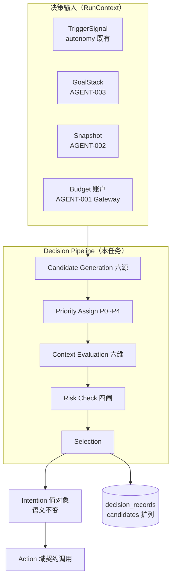

# AGENT-004 Task Detail — Decision Making System

> 上游：[architecture.md](architecture.md) §5/§8.3、[tasks.md](tasks.md) AGENT-004
> 状态：Task Detail（编码规范，未实现）；迁移 **0041**（decision_records 扩列）
> 范围红线：Intention 值对象与 13 值枚举、V9 检定六态、autonomy_policy 触发判定、v2.0.1 P0/P1 通道语义零改动；不实现目标/状态/演化的生成逻辑（只消费 AGENT-002/003 接口）

---

## 1. Background

**当前系统状态**：决策能力分散且形状不一——

| 路径 | 现状 |
|---|---|
| 前台 | chat_pipeline 内 router → mode → analysis → intention 链链相接，产出 `IntentionDecision/ValidatedIntention`；决策依据散在链间，无统一的候选/评分/风险审计 |
| 后台 | autonomy_engine：`trigger_evaluator`（due/followup/inactivity → TriggerSignal）→ `autonomy_policy.evaluate`（纯规则 verdict：act/skip + goal_id + intention）→ proactive 入队执行 |
| 候选 | `CapabilityRegistry`（Protocol + register_builtin：environment_query/memory/notification/reminder/search/world_action）只在 Action 域内消费，从不参与「选哪个行动」 |
| 审计 | `decision_records` 有 kind/trigger/input_snapshot/decision/reason/confidence/outcome；但无候选清单、无评分、无落选记录 |

**问题（「下一步应该做什么」没有统一答案）**：
1. 前台与后台是两条平行决策路径，规则互不可见、预算口径不同。
2. 候选从不比较：目标编译行动、能力注册行动、环境机会各自命中即执行，没有「多个候选里为什么选它」。
3. 风险闸散落（自主闸门、检定、预算各处各查），无固定顺序、无逐闸留痕。
4. 落选选项无记录，决策质量无从评估（AGENT-006 的 Decision Quality 缺数据）。

## 2. Goal

完成后：

1. 前台与后台共用**同一条五段决策管线**：Candidate Generation → Priority Assign → Context Evaluation → Risk Check → Selection；差异只在候选构成与约束档位。
2. 每次决策在 `decision_records` 可回答四问：候选从哪来（来源标签）、为什么赢（P 级 + 六维得分）、风险闸逐闸结果、落选清单。
3. 优先级铁律生效：P0 用户显式指令 > P1 承诺与投递 > P2 目标 > P3 社交 > P4 氛围；「静默」恒为合法候选。
4. 规则可决时 0 LLM；仅并列/低置信时经 Gateway 调轻量模型软排序，且受事件配额熔断。
5. autonomy 触发判定与 V9 检定原样保留，被管线按固定顺序复用。

## 3. Scope

**包含：**

- **涉及模块**：新增 `app/services/decision_pipeline.py`（管线主体：五段 + 值对象）、`app/models/decision.py`（Candidate/Score/GateResult 值对象）、`app/application/autonomy_engine.py`（decision 步骤内 `_process_user` 改调管线，evaluate/trigger_evaluator 本体不动）、`app/application/chat_pipeline.py`（前台决策段接入管线审计，链本体不动）、`app/repositories/decision_repository.py`、迁移 0041。
- **新增能力**：候选六源汇集；P0~P4 分配；六维评分（goal_alignment / state_fit / relationship_fit / timing / interest / cost）；四道风险闸固定顺序；选择与落选审计；软排序 LLM 能力（Gateway 注册）。
- **修改范围**：`decision_records` 扩列 `candidates`（JSON, nullable）；autonomy decision 步骤与前台决策段的调用方改造（步骤本体与链本体保留）。

**不包含：**

- 新增/修改 Intention 枚举值与 `INTENTION_GOAL_FIT` 映射语义。
- autonomy_policy.evaluate、trigger_evaluator 判定逻辑修改（作为管线的信号/过滤输入原样复用）。
- V9 Action 检定六态、capability 执行逻辑修改。
- v2.0.1 P0/P1 高优通道与投递链路修改。
- GoalStack / Snapshot 的生成逻辑（消费 AGENT-002/003 交付）。

## 4. Architecture Design

### 4.1 管线位置



### 4.2 五段流程

```text
① Candidate Generation（纯规则，多源汇集，候选 = {source 标签, payload, 类型}）
     chat_response(前台) / goal_compile(GoalStack→L1 计划) / capability(CapabilityRegistry)
     / autonomy_trigger(TriggerSignal 命中) / world_affordance(场景可供性) / silence(恒有)
        ↓
② Priority Assign（静态映射，规则）
     P0 用户显式指令 | P1 承诺与投递(v2.0.1 通道) | P2 目标驱动 | P3 社交与环境 | P4 氛围
        ↓
③ Context Evaluation（六维规则加权，每候选一分）
     goal_alignment(AGENT-003 接口) / state_fit(Snapshot) / relationship_fit(关系投影)
     / timing(冷却/静默时段/同类间隔) / interest(Snapshot.interest_focus) / cost(预算+检定预估)
        ↓ 并列/低置信 → 软排序 LLM（轻量档，事件配额内）
④ Risk Check（四闸固定顺序，逐闸留痕，任一拒绝 → 候选出局）
     1 Persona 一致性预检 → 2 Relationship 闸门(V9 语义) → 3 Action 检定(六态) → 4 预算/冷却硬闸
        ↓
⑤ Selection（确定性）
     P 级优先 → 同级综合分最高 → 确定性 tiebreak →（仍并列）软排序结果
     胜者 → Intention → Action 契约；全部候选 + 得分 + 闸结果 → decision_records
```

## 5. Core Components

### 5.1 DecisionPipeline（管线编排）

**职责**：
- `run(context, profile) -> DecisionResult` 唯一入口；前台（`foreground_chat`）与后台（`autonomous_tick`/`event_driven`）传不同 candidate provider 与约束档位，五段机器共用。
- 候选为空时返回 silence 候选胜出（Idle 语义）；管线自身 0 LLM（软排序例外，见 5.4）。
- 产出：胜者 Intention（类型仍限 13 值枚举 + fit 映射校验）+ 完整审计包。

### 5.2 CandidateCollector（候选六源）

| 源 | 内容 | 来源 |
|---|---|---|
| chat_response | 回复用户（前台必产，payload=意图/模式链结果） | 既有前台链 |
| goal_compile | L1/L2 主目标计划行动 | goal_execution 既有产出 |
| capability | 可执行原子行动（environment_query/memory/notification/reminder/search/world_action） | CapabilityRegistry 枚举 |
| autonomy_trigger | TriggerSignal 对应的主动意图（含 followup/reminder） | autonomy_policy verdict（act 时） |
| world_affordance | 场景可供性（地点/物品/时间窗） | World 切片规则 |
| silence | 什么都不做 | 恒在，P4 |

每候选携带 `source` 标签与 payload 快照；本任务不改任何源的**产出逻辑**，只做汇集与规范化。

### 5.3 PriorityAssigner

- 静态映射表（代码常量）：候选类型/来源 → P0~P4；P0/P1 语义对齐 v2.0.1 AUTO-003 通道（已承诺事项、待投递主动消息为 P1）。
- 用户显式指令识别规则：本轮消息中的明确请求（前台）；跨 Run 的用户请求型 commitment（后台）。
- 铁律不可被评分覆盖：② 的 P 级是硬序，③ 的综合分只在同级内生效（测试锁定）。

### 5.4 ContextScorer（六维评分）

| 维度 | 数据源 | 说明 |
|---|---|---|
| goal_alignment | AGENT-003 `goal_alignment.score` | 契约消费，空栈恒 0 |
| state_fit | Snapshot（mood/energy/emotion） | 规则映射（如 tired → 高耗能候选降分） |
| relationship_fit | Relationship 投影（阶段/张力） | 与闸门②同源不同用：闸门是硬拒，本维是软分 |
| timing | Trigger Registry 冷却 / World 时间 / 同类行为间隔 | 静默时段沿用既有 late_night 判据 |
| interest | Snapshot.interest_focus | 榜上主题加权 |
| cost | Gateway 账户余额 + 检定预估 | 低余额环境降成本候选加分 |

权重 `v21_decision_weight_*` settings 常量；综合分 = 规则加权和。**软排序**：同级并列（分差 < ε）或最高分置信不足时，取前 K 候选摘要经 Gateway 调轻量模型排序（Q5 裁决：仅并列触发 + 事件配额内熔断，熔断时按规则序取首个）。结果落审计，不改 Intention 类型。

### 5.5 RiskGate（四闸，顺序固定）

1. **Persona 一致性预检**：候选意图/能力 × Persona 行为说明 + BehaviorPolicy（stage/mood 维度）+ personality current（本阶段=baseline）矛盾 → 拒。规则映射表，无 LLM。
2. **Relationship 闸门**：V9 自主闸门语义原样复用（关系阶段不允许的行为不出线）。
3. **Action 检定**：capability 类候选走 V9 检定；检定失败照记六态，候选出局（不静默）。
4. **预算/冷却硬闸**：Gateway 账户不足 / Trigger Cooldown 未到期 → 拒。

每闸产出 `GateResult{gate, passed, reason}`；闸失败不中断管线（继续评其余候选）。

### 5.6 Selector

- 确定性：P 级 → 综合分 → tiebreak（timing 维 > capability 成本低者）→ 软排序。
- 胜者校验：Intention 过 `INTENTION_GOAL_FIT`/defaults 映射（既有校验复用）后才可执行。
- 审计：全部候选（含落选）+ 六维分 + 闸结果序列化进 `decision_records.candidates`；`input_snapshot/decision/reason/confidence/outcome` 语义不变。

## 6. Data Model

迁移 **0041**（仅 decision_records 扩列，可空跑回滚）：

### Entity: DecisionRecordRow（`decision_records`，既有表扩列）

| 字段 | 类型 | 说明 |
|---|---|---|
| `candidates` | JSON, nullable | 新增：`[{source, type, priority, scores{6维}, total, gates[{gate,passed,reason}], won}]`；NULL = 旧路径行（语义不变） |

既有列（kind/request_id/user_id/conversation_id/action_id/trigger/input_snapshot/decision/reason/confidence/outcome）零改动。

### Entity: DecisionCandidate / Score / GateResult（运行时值对象，不落表）

管线内存对象；唯一持久化面是 `candidates` JSON 与既有 decision_records 列。

## 7. Runtime Flow

### Flow A：后台自主决策（autonomous_tick 的 decision 插槽）

```text
Step 1  输入装配：TriggerSignal（trigger_evaluator 既有）+ GoalStack（AGENT-003）
        + Snapshot（AGENT-002）+ Gateway 账户（AGENT-001）；预算两道闸先过
        （quota_circuit_open / step_budget → skip 语义不变）
Step 2  候选汇集：六源规范化（autonomy_policy verdict=act 时其 goal_id/intention
        作为强候选注入；verdict=skip 时该源不出候选——判定本体零改动）
Step 3  P 级分配 → 六维评分 → 四闸 → 选择
Step 4  胜者 = silence → Run 记录后结束（Idle 语义）；否则产出 Intention
Step 5  Action 契约调用（proactive 检定/规划/执行链照旧；投递走 v2.0.1 链路）
Step 6  decision_records 落行（含 candidates JSON）+ trace；autonomy_policy 的
        verdict 记录格式保持（既有观测兼容）
```

### Flow B：前台决策（foreground_chat 的 decision 插槽）

```text
Step 1  既有链（router → mode → analysis → intention）照常执行，产出回复意图
Step 2  管线以 foreground profile 复审：chat_response 候选默认 P0（用户在场显式交互），
        其余源仅安全/承诺类可竞争；六维评分对回复候选照常计算（审计用）
Step 3  风险闸对回复候选只跑 Persona 预检与预算硬闸（检定仅对行动类候选）
Step 4  胜者照旧进入生成回复；decision_records 落行（前后台审计口径统一）
```

> Flow B 不改变前台回复的产生方式——管线在前台的首要价值是**统一审计口径**与**安全竞争**（P0 冲突时拦截），生成链本体零改动。

## 8. Integration Design

| 系统 | 连接方式 | 不变量 |
|---|---|---|
| **Autonomy** | trigger_evaluator / autonomy_policy 作为信号与过滤输入进管线；verdict 记录格式保留 | 判定纯函数、P0/P1 通道（v2.0.1）零改动 |
| **Action** | 胜者 Intention 按 AGENT-001 契约提交；capability 候选经 V9 检定 | 检定六态、执行链、registry 产出逻辑零改动 |
| **Goal（AGENT-003）** | goal_alignment 接口消费 + goal_compile 候选源 | 评分契约冻结；Goal 域零写 |
| **State（AGENT-002）** | Snapshot 的 state_fit / interest 维度消费 | Snapshot 投影铁律、零写回 |
| **Relationship** | 投影读取（软分 + 硬闸同源） | V8.5 数学、账本零改动 |
| **World** | 场景可供性候选（collect_facts 既有数据） | V8 域模型、零入度零改动 |
| **LLM Gateway（AGENT-001）** | 软排序注册为轻量能力（budget_type=event, degradable=true） | 两级记账、熔断联动 |
| **chat_pipeline** | 决策段接入管线审计（Flow B）；链本体不动 | 前台 ≤4 次 LLM、流式行为不变 |
| **Evaluation（AGENT-006 未来）** | candidates JSON 为 Decision Quality 提供数据面 | 只读旁路 |

## 9. Implementation Plan

| Step | 交付内容（≈1 commit） | Flag 依赖 |
|---|---|---|
| **Step 1** | 迁移 0041（candidates 列）；DecisionCandidate/Score/GateResult 值对象；PriorityAssigner（P0~P4 映射 + 铁律）；settings 权重旋钮 | 总闸 |
| **Step 2** | ContextScorer 六维（含 goal_alignment 接口消费）+ RiskGate 四闸（复用既有闸逻辑）+ Selector + 管线编排与审计落库 | 总闸 |
| **Step 3** | 后台接线：autonomy decision 步骤改调管线（Flow A）；capability/goal/world/trigger 候选源接入 | 总闸 |
| **Step 4** | 前台接线：Flow B 审计接入；软排序 LLM 能力注册与熔断（Q5）；观测（decision 四问查询面）+ 回归收口 | 总闸 |

## 10. Acceptance Criteria

**功能验收**

1. 前台与后台走同一管线代码路径：仅 candidate provider 与约束档位不同（构造用例证明同一 fixture 在两 Profile 下产出审计形状一致的记录）。
2. decision 四问可回答：任一决策行可从 `candidates` JSON 读出候选来源、胜出理由（P 级 + 六维分）、逐闸结果、落选清单。
3. 优先级铁律测试锁定：构造 P0 指令与高分 P2 候选竞争 → P0 必胜；P1 承诺投递不被 P2/P3 覆盖。
4. 纯规则可决时 0 LLM；并列才触发软排序且计入事件配额；Gateway 熔断时按规则序取首个（degraded 留痕）。
5. silence 候选可正当胜出（无信号/全闸拒绝/全部低分时），Idle 语义与 v2.0.0 一致。
6. 风险闸逐闸留痕：任一闸拒绝的候选出局且 reason 可读；检定失败照记六态、Run 不 abort。

**架构验收**

7. 无平行决策路径：新决策能力只能经管线五段接入；autonomy_policy/trigger_evaluator/检定逻辑本体零 diff（代码评审 + 回归证明）。
8. Intention 仍为 Decision 域值对象：13 值枚举、`INTENTION_GOAL_FIT`、`degraded` 语义不变；胜者必过既有 fit 校验。

**边界验收**

9. `v21_agent_runtime_enabled=False`（或未接线 Step 前）：前台/后台决策行为与 v2.0.0 逐字节一致；`decision_records.candidates` 无写入。
10. 迁移 0041 可空跑回滚；存量行零语义变更。
11. autonomy 既有观测（verdict trace / decision_records 旧列）保持兼容，既有测试零跳过。

## 11. Testing Plan

**Unit Test**

- PriorityAssigner：映射表全量、P0 识别规则、P1 承诺/投递对齐 v2.0.1 语义、铁律不可覆盖。
- ContextScorer：六维各自独立贡献、权重旋钮、缺数据维降 0 不阻塞、并列 ε 判定。
- RiskGate：四闸顺序固定、逐闸 reason、闸失败不中断其余候选、persona 映射表覆盖全部意图/能力类型。
- Selector：P 级 → 分 → tiebreak → 软排序四级次序；胜者 fit 校验失败时的兜底（次优候选）。
- 软排序：触发条件（仅并列/低置信）、前 K 摘要构造、熔断降级。

**Integration Test**

- 后台 E2E：TriggerSignal → 管线 → Intention → proactive 入队 → decision_records.candidates 完整。
- 前台 E2E：消息 → 链 → 管线审计 → 生成 → 落行；回复行为与 v2.0.0 对照一致。
- 熔断联动：日配额耗尽 → 后台 skip（既有语义）→ 前台降档可用 → 软排序拒绝。

**Runtime Flow Test（端到端）**

- 竞争场景：同一 Run 内目标候选 vs 能力候选 vs silence，按构造数据验证 winner 可解释。
- P0 冲突场景：用户显式拒绝类指令命中时，任何主动候选被拦截。
- 静默场景：无信号 Run 的 silence 胜出与 Idle 短路并存语义。

**Regression**

- `v21_agent_runtime_enabled=False`：autonomy / chat_pipeline / V9 全套件零跳过全绿。
- autonomy_policy 与 trigger_evaluator 本体 diff 审查为零（只允许调用方改造）。

---

## 12. 实施记录（Coding 回填）

1. **落库**：`decision_records.candidates` JSON（0041）；DecisionRecord 模型/仓储映射透传。
2. **管线**：`services/decision_pipeline.py` 五段（collect→priority→score→gates→select）；被闸拒绝的候选**出局**（非降分），全部出局时 silence 胜出；胜者 Intention 经 `INTENTION_GOAL_DEFAULTS/FIT` 既有校验映射。
3. **后台接线**：`autonomy_engine._pipeline_intention`（Flag=`v21_agent_runtime_enabled`）在 `_build_action` 前运行管线，胜者意图覆盖 verdict.intention、审计包落 `candidates`；管线异常回退 verdict 原值（零行为风险）。trigger_evaluator / autonomy_policy 本体零 diff。
4. **评分口径**：goal_alignment（AGENT-003 契约）+ state_fit/relationship_fit/timing/cost 规则常量 0.5 + interest（焦点目标命中 0.6）；等权 `v21_decision_weight=1.0`。P0/P1 静态映射已声明（chat_response/user_directive=P0、commitment_delivery=P1），P0 识别（用户显式请求）与 P1 投递候选接入随 AGENT-005/007 补全。
5. **前台**：turn 内四链记账已在 AGENT-001 Gateway 交付；前台 Flow B 的 candidates 审计暂记 trace（免热路径 IO），decision_records 前台行审计随 AGENT-007 收口裁决。
