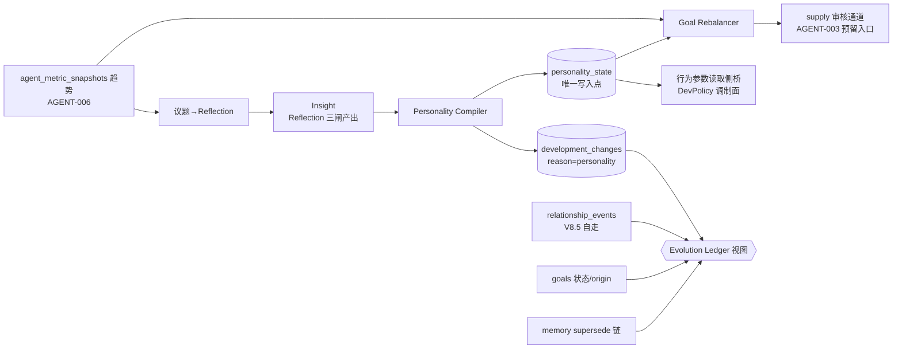

# AGENT-005 Task Detail — Evolution & Learning System

> 上游：[architecture.md](architecture.md) §6/§8.3、[tasks.md](tasks.md) AGENT-005
> 状态：Task Detail（编码规范，未实现）；迁移 **0042**（development_changes 扩展 + Evolution Ledger 视图）
> 范围红线：Persona 资产零写回；V8.5 关系数值零改动；Development「Insight 唯一合法输入」与既有审计/回滚模式零改动；Evolution Engine 是唯一演化写入点

---

## 1. Background

**当前系统状态**：演化能力有「前半段」没有「后半段」——

| 环节 | 现状 |
|---|---|
| 经历→认知 | Reflection 产 Insight（confidence / scope / status，supersede/invalidated 生命周期完整） |
| 认知→行为 | Development：`policy.compile_insight` → ModulationProposal → `apply_proposals`，`on_insight_created` 事件钩子 + `run_compile_jobs` 周期任务；`audit.rollback_for_insight` 可按 Insight 逆放 |
| 审计 | `development_changes`（before/after/insight_id/reason，CheckConstraint 限六值：compiled/arbitrated/arbitrated_lost/rolled_back/retired/replayed） |
| 关系成长 | V8.5 `relationship_evolution` 等服务族自走，账本即真相 |
| 目标演化 | 无维护机制（长期未推进目标靠既有超时；L3 无修订/退役通道） |
| 评估回流 | Evaluation 结果止步 trace，从不影响行为（AGENT-006 补前半，本任务补后半） |

**问题（「角色为什么变成这样」答不上来）**：
1. **Personality 维度缺失**：AGENT-002 建了 `personality_state`（current 恒 = baseline），没有任何编译通路让它动起来——「谨慎→更主动」的长期成长无法发生。
2. **演化审计割裂**：Development 有审计、关系有账本、目标有状态机，但没有统一视图回答「她的长期变化及来源」。
3. **目标栈无演化维护**：L3 措辞与焦点不随经历修正，长期目标会过时。
4. **评估→行为闭环断裂**：AGENT-006 的趋势议题没有消费端。

## 2. Goal

完成后：

1. **Personality 演化**：Insight 行为学证据由 Evolution Engine 周期编译为人格轴小幅漂移——带 source_insight_id、before/after、bound 硬钳制、周级限速、连续同向多窗口累积。
2. **偏好/行为模式通道收敛**：Development 机制不变，偏好与 Pattern 变化纳入 Evolution Ledger 统一呈现（读侧投影）。
3. **关系成长纯复用**：V8.5 引擎自走，关系轨迹作为演化结果在 Ledger 中可见。
4. **Goal Rebalance**：周期性依评估趋势与 Personality State 建议 L3 修订/退役、L2 供给调整，建议经 AGENT-003 supply 审核通道生效，0 直写 goals。
5. **Evolution Ledger**：跨域审计投影视图上线，任一长期变化可指认来源、可回放、可回滚。

## 3. Scope

**包含：**

- **涉及模块**：新增 `app/services/evolution/`（engine / personality_compiler / rebalancer / ledger_view 定义）、`app/repositories/personality_state_repository.py`（写入方首次落地，乐观锁）、`app/services/development/policy.py`（只增不改：personality 维度并入调制面读取侧）、`app/services/goal_planning.py`（`origin=evolution` 候选写入方激活）、迁移 0042。
- **新增能力**：人格轴编译（证据映射 → 漂移提案 → 限速/边界 → 写入 + 审计）；`development_changes` 扩展承载 personality 审计行；Ledger SQL 视图；Goal Rebalance 建议通道；personality→行为参数读取侧桥；回滚扩展（按 Insight 逆放 + 重置回 baseline）。
- **修改范围**：`development_changes` 表结构扩展（见 §6）；`personality_state` 新增写入通路（仅 Evolution Engine）；behavior 读取侧并入 personality 参数（不改 BehaviorPolicy 定义期常量与 mood_modifiers）。

**不包含：**

- Persona 静态资产（含 `evolution.py` 声明内容）的任何写回；baseline/bound 不可变。
- Reflection/Insight 生命周期、三闸、Development 编译规则的语义修改（本任务是其消费方）。
- V8.5 六维数学（D1/D2/D3/D5）、限速、迟滞、账本写入的任何改动。
- 评估指标计算（AGENT-006）；本任务只读其趋势快照。
- 新增演化相关业务表（Ledger 是视图；审计复用 development_changes 扩展）。

## 4. Architecture Design

### 4.1 演化闭环



### 4.2 人格轴编译流程

```text
周期编译任务（每日运行，复用 background_jobs；窗口按周计）
        ↓
收集窗口内新增 active Insight（行为学证据类；superseded/invalidated 排除）
        ↓
证据映射（规则表）：Insight 语义 × 轴 → 漂移提案（轴 / 方向 / 幅度 / 依据 insight 集合）
   例：「用户多次主动分享，角色回应积极且关系上行」 → assertiveness +δ
        ↓
限速裁决：单轴本周累计 |Δ| ≤ max_drift_per_week；
   连续同向漂移要求 ≥ N 个窗口均有证据（单窗口证据不足 → 本窗口不动）
        ↓
边界钳制：bound_min ≤ current + Δ ≤ bound_max（越界截断）
        ↓
写入（乐观锁 version）+ 审计行（reason=personality, before/after, insight_id）
        ↓
行为参数读取侧桥生效（下一 Run 的调制面反映新 current）
```

## 5. Core Components

### 5.1 EvolutionEngine（`services/evolution/engine.py`）

**职责**：演化唯一写入点与调度入口——周期任务编排（personality 编译 / rebalance）、与 background_jobs 既有机制对接、写入集中（天然限流，无并发写问题）。不持有业务判断（判断在 compiler/rebalancer）。

### 5.2 PersonalityCompiler

**职责**：
- 证据映射规则表：Insight type/statement 关键词 × 四轴（assertiveness/warmth/curiosity/patience）→ 漂移方向与基础幅度；规则可单测、可解释。
- 限速器：`v21_evolution_max_drift_per_week`（默认 0.05，轴归一化 0~1 刻度）、`v21_evolution_same_direction_windows`（默认 2）；窗口状态从审计行推算（不建新状态表）。
- 边界钳制与乐观锁写入；写入即审计（before/after/insight_id/窗口标识）。
- 回滚：`rollback_for_insight` 既有模式扩展——按 Insight 逆放该 Insight 引起的 personality 行；「重置回 baseline」为仓储管理操作（脚本级，非业务 API）。

### 5.3 GoalRebalancer

**职责**：
- 周期（与 Reflection 同量级，周级为主）读取：`agent_metric_snapshots` 趋势（Goal Progress 持续劣化、Relationship Quality 变化）+ personality current（轴显著漂移后目标域适配性）。
- 产出建议：L3 修订（新描述/退役）、L2 供给调整——以 `origin=evolution` 候选进入 AGENT-003 supply 审核队列（激活其预留入口，成为该 origin 唯一写入方）；审核规则与既有 supply 一致。
- 硬约束：0 直写 goals；建议留痕（trace），被拒建议可追溯。

### 5.4 EvolutionLedger（视图）

**职责**：
- SQL 视图 `v_evolution_ledger`（迁移 0042 创建，只读）：四源 UNION，统一列形（时间 / user / character / 变化类型 / before→after 摘要 / 来源引用）。
  1. `development_changes`（含 reason=personality 行）——belief/preference/pattern/personality 全量历史；
  2. `relationship_events`——关系账本（V8.5 自走）；
  3. `goals`（layer 非空行）——目标现状与 origin（现状呈现，非历史流；已知限制见 §10.7）；
  4. `memories` supersede/merge 链——记忆层演化。
- 只读消费方：评估取材（AGENT-006）、调试控制台、回放定位。**不作为任何域的真相源。**

### 5.5 PersonalityBehaviorBridge

**职责**：
- 读取侧规则函数：personality current → 行为参数调制（assertiveness→主动倾向权重、warmth→关心话题权重、curiosity→话题探索权重、patience→追问/重复耐心），并入 DevPolicy 既有调制面（与 development_weights 同一注入通道，AGENT-003 通道④/决策评分均可感知）。
- 不修改 `BehaviorPolicy` 定义期常量、不改 prompt 模板；调制幅度有上限（`v21_evolution_behavior_modulation_max`），保证「变了但没变一个人」。

## 6. Data Model

迁移 **0042**（可空跑回滚；视图随迁移创建/删除）：

### Entity: DevelopmentChangeRow（`development_changes`，既有表扩展）

| 变更 | 内容 | 说明 |
|---|---|---|
| `development_state_id` | NOT NULL → **nullable** | 旧行不受影响；personality 审计行该列为 NULL |
| `personality_state_id` | String, nullable | **新增**：personality 审计行引用 `personality_state.id`；与 development_state_id 二选一非空（CheckConstraint） |
| `reason` CheckConstraint | 值域追加 `'personality'` | 既有六值不动 |

（此为 architecture「development_changes 扩列 change_kind=personality」的落地形态：审计行二选一挂 development_state 或 personality_state。）

### Entity: v_evolution_ledger（SQL 视图，新增）

| 列 | 说明 |
|---|---|
| occurred_at / user_id / character_id | 统一时间与主体 |
| change_kind | development / personality / relationship / goal / memory |
| summary | before→after 摘要（JSON 提取） |
| source_ref | insight_id / evaluation 窗口 / 事件 id / goal id |

### 既有表确认不改

`personality_state`（AGENT-002 已建，本任务开始有写入方）、`insights`、`relationship_events`、`goals`（origin 列 AGENT-003 已备）、`memories`。不新增任何业务表。

## 7. Runtime Flow

```text
Step 1  触发：每日编译任务（background_jobs 既有机制）检查各轴窗口是否到期；
        窗口未到 → 直接结束（0 LLM、0 写入）
Step 2  证据收集：窗口内新增 active Insight（按 type/scope 过滤行为学证据类）
Step 3  证据映射：规则表产出漂移提案（轴/方向/幅度/依据集合）；无提案 → 结束
Step 4  限速与边界：周窗累计校验 → 连续同向窗口校验 → bound 钳制；
        任一不满足 → 提案留痕（trace）不写入
Step 5  写入与审计：乐观锁更新 personality_state.current →
        development_changes 审计行（reason=personality）
Step 6  桥接生效：下一 Run 的行为调制面读取新 current（读取侧，无推送）
Step 7  Rebalance（周级）：评估趋势 + personality 显著漂移 → evolution 建议
        → supply 审核队列；被拒/被采纳均留痕
Step 8  回滚通路：按 Insight 逆放（既有 rollback 作业扩展）；管理脚本支持
        重置回 baseline
```

## 8. Integration Design

| 系统 | 连接方式 | 不变量 |
|---|---|---|
| **Reflection** | 只读消费 active Insight；评估议题经 Reflection 产出的 Insight 进入编译（不自读评估原始数据绕过三闸） | 三闸、supersede/invalidated 生命周期零改动 |
| **Development** | 同一 Insight 流的并行消费方（编译规则独立，互不干扰）；rollback 模式扩展 | `compile_insight`/`apply_proposals`/审计语义零改动 |
| **AGENT-002 PersonalityStateStore** | 写入方首次落地（乐观锁 version）；baseline/bound 只读 | 种子幂等、除 Engine 外无写通路保持 |
| **AGENT-003 Goal** | Rebalance 建议经 `origin=evolution` supply 审核通道 | 0 直写 goals；审核规则一致 |
| **AGENT-006 Evaluation** | 只读 `agent_metric_snapshots` 趋势；议题→Insight 的通道属 006，本任务只消费其产物 | 只读旁路铁律 |
| **Relationship（V8.5）** | 零调用、零写入；账本作为 Ledger 视图数据源 | D1/D2/D3/D5、限速、迟滞零改动 |
| **BehaviorEngine / DevPolicy** | personality 参数并入读取侧调制（同 development_weights 注入通道） | BehaviorPolicy 定义期常量、prompt 模板零改动 |
| **Memory** | supersede/merge 链作为 Ledger 数据源（只读） | Memory 域零改动 |
| **AGENT-001 Runtime** | 编译/rebalance 挂 background_jobs 周期机制；trace 走既有体系 | Run 模型、预算零改动 |

## 9. Implementation Plan

| Step | 交付内容（≈1 commit） | Flag 依赖 |
|---|---|---|
| **Step 1** | 迁移 0042（development_changes 扩展 + Ledger 视图）；EvolutionEngine 骨架 + background_jobs 挂接；`v21_personality_evolution_enabled` settings | 总闸 + personality_evolution |
| **Step 2** | PersonalityCompiler：证据映射规则表 + 限速器 + 边界钳制 + 乐观锁写入 + 审计行 | 总闸 + personality_evolution |
| **Step 3** | PersonalityBehaviorBridge（读取侧调制并入 DevPolicy 通道）；回滚扩展（按 Insight 逆放 + 重置 baseline 脚本） | 总闸 + personality_evolution |
| **Step 4** | GoalRebalancer（评估趋势 + 漂移 → evolution 建议 → supply 通道激活）；Ledger 查询面与控制台消费确认；回归收口 | 总闸 + personality_evolution |

## 10. Acceptance Criteria

**功能验收**

1. 人格轴漂移仅可由携带 source_insight_id 的编译产生：构造 Insight → 窗口到期 → current 变化且方向/幅度与规则一致；无 Insight 直写通路被仓储层拒绝（防护测试）。
2. 限速与边界：单轴单窗累计漂移超上限被截断；单窗口证据在 `same_direction_windows≥2` 下不产生漂移；bound 越界钳制生效；全程提案留痕。
3. 审计完整：每次漂移在 `development_changes` 有 reason=personality 行，before/after/insight_id 可查；`rollback_for_insight` 逆放后 current 恢复且审计链完整（reason=rolled_back）。
4. Ledger 可解释：任一长期变化（belief/preference/pattern/personality/relationship/goal/memory）可在视图中按时间线指认来源；视图只读（无写权限）。
5. Goal Rebalance：构造趋势劣化 → evolution 建议进入 supply 审核队列 → 审核通过才成为目标；goals 表无直写路径（防护测试）；被拒建议留痕。
6. 行为调制生效且受限：personality 漂移后下一 Run 的行为参数可见 before/after（trace）；调制幅度不超过上限旋钮。

**架构验收**

7. 演化写入单点：全代码库对 `personality_state` 的写路径唯一（Evolution Engine）；Development/Reflection/Relationship 与 Engine 的输入输出边界符合 architecture §6.1 合法通道。
8. Evolution Ledger 为投影：任何域不把它当真相源；四源数据仍以各域原表为准。

**边界验收**

9. `v21_personality_evolution_enabled=False`：编译/回滚/Rebalance 全部不运行，`personality_state.current` 恒为 baseline，行为与 AGENT-002 交付态一致。
10. V8.5 关系全套件、Development 全套件零跳过全绿；`development_changes` 旧行（六值 reason）读写零变化。
11. 迁移 0042 可空跑回滚（含视图删除）；`development_state_id` 转可空后旧查询计划不劣化（EXPLAIN 核对）。

## 11. Testing Plan

**Unit Test**

- 证据映射表：各 Insight type/statement 模式 × 四轴的方向与幅度；无匹配 → 无提案。
- 限速器：窗口累计、同向多窗要求、窗口状态从审计行推算的正确性。
- 边界钳制：上界/下界截断、version 冲突重试。
- Rebalancer：趋势判读规则、建议生成、被拒留痕。
- Ledger 视图：四源列形一致、来源引用正确、空源不报错。

**Integration Test**

- 编译链 E2E：Insight 创建 → on_insight_created（既有钩子不触碰）→ 编译任务 → 写入 → 审计 → 行为调制读取。
- 回滚链 E2E：漂移 → rollback_for_insight → current 恢复 → Ledger 反映回滚。
- Rebalance 链 E2E：metric 趋势 → 建议 → supply 审核 → 目标创建（origin=evolution）→ Ledger 呈现。

**Runtime Flow Test（端到端）**

- 长期成长场景：连续多窗口构造同向证据 → assertiveness 分阶段爬升（每窗受限速）→ 主动行为率可观测上升 → Ledger 全程回放。
- 不变成另一个人场景：持续同向证据 → current 触达 bound → 停止；Persona 基线行为仍是主导。

**Regression**

- `v21_personality_evolution_enabled=False`：V2.0.0 P2/P3（Reflection/Development）与 AGENT-002/003/004 套件零跳过全绿。
- `development_changes` 存量行与既有六值 reason 全路径回归一致。

---

## 12. 实施记录（Coding 回填）

1. **审计扩展落地**：`development_changes.development_state_id` 转可空 + 新增 `personality_state_id`（subject 二选一 Check）；reason 约束追加 `personality`。SQLite 兼容要点：约束重建必须走 `batch_alter_table`（原生 `DROP CONSTRAINT IF EXISTS` 不支持）；**降级顺序**必须先 drop 引用 personality_state_id 的 subject 约束再 drop 列。
2. **Ledger 落地形态偏差**：架构 §6.5 的 SQL 视图改为仓储层只读查询（`evolution.ledger()`，跨 SQLite/PG 方言安全）。
   *评审修复*：补齐 relationship_events 与 memory supersede 两源（现为 personality/goal/relationship/memory 四源 + development 审计）；修掉 personality 变更查询**缺 user_id 过滤**导致的跨用户数据泄漏；条目补充 before/after。
3. **编译参数**：证据映射 = 关键词规则表（_AXIS_EVIDENCE_RULES）；基础幅度 0.02 × 证据数（封顶 3）；周窗累计限速 `v21_evolution_max_drift_per_week=0.05`；越界钳制到 bound。逆放 = `rollback_personality_for_insight`（恢复 before.current + rolled_back 审计行）。
4. **Rebalance 口径**：超 2× 中期窗口且 priority≤2 的 L2 目标 → abandoned + failure_reason="evolution_rebalance"（复用既有 finish_goal 出口，0 直写）；高优先目标豁免。
   *评审修复*：原阈值不可达——`goal_stack.retire_overdue` 的硬超时为 1× 窗口，2× 阈值的目标早已被硬超时退役，活跃集内永不命中。改为**半程窗口**（medium = days/2、short_term = hours/2，默认 4 天 / 12 小时），并拆分为「建议生成 `propose_rebalance`（纯读，0 写 goals）+ supply 审核侧应用 `apply_rebalance`」；应用点落在后台 `goal_stack` 阶段（`run_goal_stack_stage`），满足 §6.6「建议经 supply 审核后才成目标」。
5. **测试基建**：evolution 服务注册进 conftest `_SERVICE_DB_MODULES`（模块级 SessionLocal 才能被内存库替换——函数级 `from app.core.db import SessionLocal` 会绕过补丁连真实 PG 导致挂起）。
