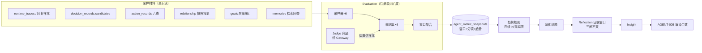

# AGENT-006 Task Detail — Agent Evaluation System

> 上游：[architecture.md](architecture.md) §7/§8.2、[tasks.md](tasks.md) AGENT-006
> 状态：Task Detail（编码规范，未实现）；迁移 **0043**（agent_metric_snapshots 一表）
> 范围红线：Evaluation 只读旁路铁律——永不直写业务表；V7.5 注册表模式内扩展，不另建评估框架；议题只能经 Reflection 三闸生效

---

## 1. Background

**当前系统状态**：评估面是「散点规则 + 采样 Judge」，无 Agent 级汇总——

| 现有件 | 位置 | 形态 |
|---|---|---|
| 规则注册表 | `services/evaluation_rules`（EvaluationRule → run_rules → Issue → dimension 分数，penalty_for） | 按维度组织，规则优先 |
| Judge | `models/evaluation_judge`（Persona/Emotion/Memory/Autonomy 四类 IssueCode + Judgement；Turn/Proactive/Reflection 三类 JudgeResult） | 样本级兜底 |
| Trace | TraceKind（turn/proactive/autonomy_tick）+ runtime_traces | 观测平面 |
| 留白 | V7.8-014「Metrics 周期快照」按设计留白未实现 | — |

**问题**：
1. **无 Agent 级指标**：Persona 一致性、记忆准确性、行动质量、关系质量只有样本级判定，没有周期汇总、没有趋势，「角色整体表现如何」答不出来。
2. **评估是死胡同**：结果进 trace 即止——Persona Consistency 连续下滑、Action Quality 走低时，系统没有任何机制把它变成改进议题（Evolution 闭环的输入端缺失，AGENT-005 的 Rebalance/编译在等这个输入）。
3. **V7.8-014 留白**：周期快照一直没有落地载体。

## 2. Goal

完成后：

1. **六项 Agent 级指标**可独立出分：Persona Consistency / Memory Accuracy / Action Quality / Relationship Quality / Goal Progress / Decision Quality（定义、来源、采样策略见 §5.2）。
2. **周期快照**：指标按窗口聚合并落 `agent_metric_snapshots`（落地 V7.8-014 留白的 Agent 层面版本），趋势可查询。
3. **趋势规则与演化议题**：连续 N 窗口越限 → 生成演化议题 → 作为证据窗口送入 Reflection（产出的 Insight 才被 AGENT-005 编译生效）——评估永远不直接改行为。
4. **规则优先**：可决样本 0 LLM；Judge 仅兜底且经 LLM Gateway 计费。

## 3. Scope

**包含：**

- **涉及模块**：`app/services/evaluation_rules`（注册表扩展 agent 级规则集与维度）、`app/services/evaluation_context.py`（采样材料装配）、`app/services/reflection/triggers.py`（议题→证据窗口入口）、`app/repositories/agent_metric_repository.py`（新增）、`app/models/evaluation.py`（指标维度扩展）、迁移 0043、AGENT-001 的周期任务挂接。
- **新增能力**：六指标规则集（采样器 + 规则 + 聚合）；快照周期任务（日窗口）；趋势规则（连续窗口越限 → 议题）；议题构造与 Reflection 对接；Judge 兜底的 Gateway 注册。
- **修改范围**：evaluation_rules 注册表扩维度（追加式）；reflection triggers 新增议题型触发入口（复用既有 trigger 通道与日桶幂等）。

**不包含：**

- 对 Memory/State/Goal/Development/Personality/Relationship 任何表的写入（只读旁路铁律；含「演化议题」——议题只进 Reflection 证据通道，不直接成 Insight）。
- V7.5 既有四类 Judge（Turn/Proactive/Reflection）与既有维度规则集的语义修改。
- Evolution 编译逻辑（AGENT-005 消费侧）。
- LLM Judge 本体 prompt/链的重写。

## 4. Architecture Design

### 4.1 评估平面位置



### 4.2 快照与反馈流程

```text
周期任务（每日，background_jobs 既有机制）
        ↓
采样：六指标各自按策略取材料（规则，0 LLM）
        ↓
规则评分：可决样本直接出分；低置信样本 → Judge 兜底（经 Gateway，后台档）
        ↓
窗口聚合：每指标 (分值, 分项, 样本量) → agent_metric_snapshots 日行
        ↓
趋势规则：对每指标计算连续窗口序列；连续 N 窗越限（阈值 settings）
        ↓
演化议题：构造议题（指标 / 趋势方向 / 证据摘要）→ Reflection 证据窗口
        ↓
（Reflection 三闸裁决；产出 Insight 后由 AGENT-005 编译——本任务链路到此为止）
```

## 5. Core Components

### 5.1 AgentMetricRegistry（evaluation_rules 内扩展）

**职责**：agent 级六指标以新维度族注册（追加式）：每指标 = 采样器（材料装配）+ 规则集（出分）+ 聚合器（窗口汇总）。沿用 `EvaluationRule/Issue/dimension 分数` 既有形状，注册表外不建新框架。

### 5.2 六指标定义

| 指标 | 度量问题 | 采样与计算 | LLM |
|---|---|---|---|
| Persona Consistency | 行为/表达是否仍像 Persona（含演化后） | 每日抽样回复/主动消息 × Persona 规则（行为说明、BehaviorPolicy 维度、personality bound 校验）；低置信样本 Judge 兜底 | 抽样 Judge |
| Memory Accuracy | 说出口的「记得的事」是否真实且未过时 | 回复中事实性陈述（规则识别）→ Memory 回查（命中/冲突/过时率）；复用 memory 评估规则思路 | 冲突样本 Judge |
| Action Quality | 行动结果质量 | action_records 六态全量 + World 结果回执 + 用户反应信号；复用 autonomy/action 既有评估规则 | 无 |
| Relationship Quality | 关系健康度（数值外的质量面） | V8.5 快照投影 + 里程碑达成率 + 冲突解决率，只读聚合 | 无 |
| Goal Progress | 目标栈推进健康度 | 各层完成/超时/失败率、平均推进速率（goals 只读统计） | 无 |
| Decision Quality | 决策被判「对」的比率 | `decision_records.candidates`（AGENT-004 审计面）：胜者结果回执 vs 落选候选事后评估；抽样 | 争议样本 Judge |

采样率、窗口、越限阈值全部 settings 化（`v21_metric_*`）。

### 5.3 SnapshotJob（周期快照）

**职责**：每日窗口任务（挂 background_jobs）：跑六指标 → 聚合一行快照（metrics JSON：分值 + 分项 + 样本量 + 计算版本）→ 落库。失败重试与幂等（同窗口唯一）沿 background_jobs 既有语义。

### 5.4 TrendRule 与 EvolutionTopic

**职责**：
- 趋势：每指标取最近 W 个窗口（默认 7）；连续 N 窗（默认 3）越过阈值（上限/下限按指标）→ 触发。
- 议题：构造结构化议题（指标名 / 趋势 / 代表性证据摘要），写入 Reflection 证据窗口入口（复用 `reflection_triggers` 通道与日桶幂等键 `agent_metric:<指标>:<窗口>`）；议题文本模板化，0 LLM。
- 重复议题抑制：同一指标同一趋势方向在议题未消化前不重复触发（按日桶键 + active 议题检查）。

### 5.5 Judge 经 Gateway

**职责**：Judge 调用注册为后台档能力（degradable=false：熔断时跳过样本并记录，分值按规则样本外推并标注置信降级）；不新建 Judge 链，复用既有四类 Judgement。

## 6. Data Model

迁移 **0043**（一表，可空跑回滚）：

### Entity: AgentMetricSnapshotRow（`agent_metric_snapshots`，新增）

| 字段 | 类型 | 说明 |
|---|---|---|
| id | String PK | |
| user_id / character_id | String | |
| window_start / window_end | DateTime | 聚合窗口（日） |
| metrics | JSON | `{<指标>: {score, components{}, sample_size, confidence, calc_version}}` |
| trend | JSON, nullable | `{<指标>: {direction, windows, breached}}`（聚合时计算） |
| created_at | DateTime | |

唯一约束：`(user_id, character_id, window_start)`（幂等）。保留期沿 `evaluation_retention_days`（既有 30 天语义复用，不新增旋钮）。

### 既有确认不改

`runtime_traces` / `llm_call_records` / `decision_records` / `action_records` / `relationship_*` / `goals` / `memories` 全部只读。不新增其他表。

## 7. Runtime Flow

```text
Step 1  每日任务触发（background_jobs）；同窗口幂等检查
Step 2  采样：六指标各自装配材料（全部只读查询；样本量受 settings 上限）
Step 3  规则评分：规则可决直接出分；低置信样本进 Judge（经 Gateway；
        熔断 → 跳过并标注置信降级）
Step 4  聚合落库：agent_metric_snapshots 日行（含趋势字段）
Step 5  趋势判定：连续 N 窗越限的指标 → 构造演化议题
Step 6  议题入 Reflection 证据窗口（日桶幂等 + 重复抑制）；
        本任务到此为止——Insight 产出与编译属 Reflection/AGENT-005
Step 7  观测：快照与议题在 trace/台账留痕；只读校验（见 §10.2）
```

## 8. Integration Design

| 系统 | 连接方式 | 不变量 |
|---|---|---|
| **Reflection** | 议题作为证据窗口经 `reflection_triggers` 既有通道进入；三闸全额生效 | Evidence→Insight 生命周期、日桶幂等零改动 |
| **AGENT-005 Evolution** | `agent_metric_snapshots` 趋势只读暴露（Goal Rebalancer 与人格编译的证据面之一） | Engine 不直读本任务外的评估原始样本 |
| **AGENT-004 Decision** | `decision_records.candidates` 作为 Decision Quality 数据面（只读） | 决策域零写 |
| **AGENT-002 Snapshot** | Persona Consistency 规则读取 personality bound（只读校验） | Snapshot 投影铁律 |
| **Relationship（V8.5）** | 快照投影 / 里程碑 / 冲突统计只读 | 引擎与账本零改动 |
| **Action / World** | action_records 六态与结果回执只读 | 六态语义零改动 |
| **LLM Gateway（AGENT-001）** | Judge 注册为后台档能力 | 两级记账、熔断联动 |
| **V7.5 评估本体** | 注册表内追加维度族；既有四类 Judge 复用 | 既有规则集/Judge 语义零改动 |
| **V7.8 观测** | 快照任务与议题在 trace 留痕（复用 trace_collector） | 不新建观测存储 |

## 9. Implementation Plan

| Step | 交付内容（≈1 commit） | Flag 依赖 |
|---|---|---|
| **Step 1** | 迁移 0043；AgentMetricRegistry 维度族骨架 + 采样材料装配（evaluation_context 扩展）；`v21_metric_*` settings | 总闸 + agent_metrics |
| **Step 2** | 六指标规则集（规则优先出分；action/relationship/goal/decision 四项无 LLM 全量交付） | 总闸 + agent_metrics |
| **Step 3** | SnapshotJob 周期任务 + 趋势规则 + 演化议题 → Reflection 通道（日桶幂等 + 重复抑制） | 总闸 + agent_metrics |
| **Step 4** | Judge 兜底经 Gateway（persona/memory/decision 抽样）；观测与回归收口 | 总闸 + agent_metrics |

## 10. Acceptance Criteria

**功能验收**

1. 六指标独立出分：构造样本下每指标分值/分项/样本量正确；缺材料指标出「无样本」而非 0 分（不污染趋势）。
2. 快照幂等：同窗口重复执行只落一行；计算版本变更后重算可区分。
3. 趋势与议题：构造连续越限序列 → 议题生成且进入 Reflection 证据窗口（日桶键可查）；单窗越限不触发；同向议题未消化前不重复。
4. 反馈闭环合规：议题未过三闸 → 产出为空、零行为变更；过闸产出的 Insight 由 AGENT-005 编译（联动用例与 005 联测）。
5. Judge 兜底经 Gateway 计费（llm_call_records 可查）；熔断时跳过样本、置信降级标注、不阻塞快照。

**架构验收**

6. 只读旁路有防护测试：评估链路对 Memory/State/Goal/Development/Personality/Relationship/Action 任何写接口的调用即测试失败；快照表是本任务唯一写面。
7. 注册表内扩展：六指标为 evaluation_rules 新维度族（代码评审：无注册表外的新评估入口）；V7.8-014 留白以 Agent 层面快照落地并登记。

**边界验收**

8. `v21_agent_metrics_enabled=False`：零快照、零议题、零 Judge 新增调用，评估面行为与 v2.0.0 一致。
9. 既有四类 Judge 与既有维度规则集回归零跳过全绿。
10. 迁移 0043 可空跑回滚。

## 11. Testing Plan

**Unit Test**

- 六指标规则集：构造材料矩阵（命中/冲突/缺材料/样本不足）；评分与分项正确性。
- 聚合器：窗口边界、样本量统计、calc_version、幂等键。
- 趋势规则：连续 N 窗边界（恰好 N / N-1）、方向判定、阈值旋钮、重复抑制。
- 议题构造：模板渲染、证据摘要截断、日桶键命名。
- Judge 降级：熔断跳过、置信标注、外推逻辑。

**Integration Test**

- 全链路：构造回复样本 + action 记录 + goal/relationship 状态 → 快照行 → 趋势 → 议题 → Reflection 证据窗口落位。
- 联动（与 AGENT-005）：议题 → 三闸通过 → Insight → personality 编译生效（跨任务联测用例）。
- Gateway 联动：Judge 调用记账落 run/turn 归因；熔断注入 → 降级路径。

**Runtime Flow Test（端到端）**

- Persona 下滑场景：连续注入低一致性样本 → 指标走低 → 议题 →（Reflection 侧）证据窗口。
- 健康场景：正常样本 → 快照正常 → 无议题（无扰）。

**Regression**

- `v21_agent_metrics_enabled=False`：V7.5/V7.8 既有评估套件零跳过全绿。
- evaluation_rules 既有维度与 Judge 回归逐字节一致。

---

## 12. 实施记录（Coding 回填）

1. **快照表**：`agent_metric_snapshots`（0043，(user, character, window_start) 唯一）；仓储 save 为按窗口 upsert（同窗重复执行零第二行）。
2. **指标落地口径**：六指标中 action_quality（当日六态行动成功率）/ goal_progress（层叠目标逾期比）/ decision_quality（当日带 candidates 审计且结果已知的决策成功率）/ relationship_quality（intimacy+trust 均值 − tension/4）/ persona_consistency（人格轴在界内比例）为规则计算；memory_accuracy 缺可靠事实回查材料，按「无样本 = None」交付（不污染趋势），Persona Consistency 的回复采样与 Judge 兜底随 AGENT-007 收口联调补全。
3. **趋势与议题**：`v21_metric_trend_windows=7`；越限规则 = 当前值与前值均低于 `v21_metric_floor_*` 阈值；议题生成后调用 Reflection 既有 `trigger_for_user(trigger="event")` 通道进入证据窗口（三闸不变），议题文本与趋势随快照落库。
4. **只读旁路**：模块对业务表零写入（唯一写面 agent_metric_snapshots）；Judge 经 Gateway 的样本级兜底未接入（规则可决全覆盖当前指标），AGENT-007 收口时随 Persona 采样补齐。
5. **测试基建**：agent_metric_repository 注册进 conftest（import 与 _REPO_MODULES 各一处——重复注册 import 区会漏掉 _REPO_MODULES 导致连真实 PG 挂起）。
   *评审修复（P0）*：`run_daily_snapshot` 原先**无任何生产调用方**（仅测试直接调用），慢时钟实际不存在。新增 `application/agent_evolution_worker.py`（`run_evolution_tick` + `run_agent_evolution_worker`）并在 lifespan 注册常驻循环：日级指标快照（同窗口已有行则跳过，避免覆盖当日趋势基线）+ 人格编译 + Goal Rebalance，全部置于 v21 子闸之后。
