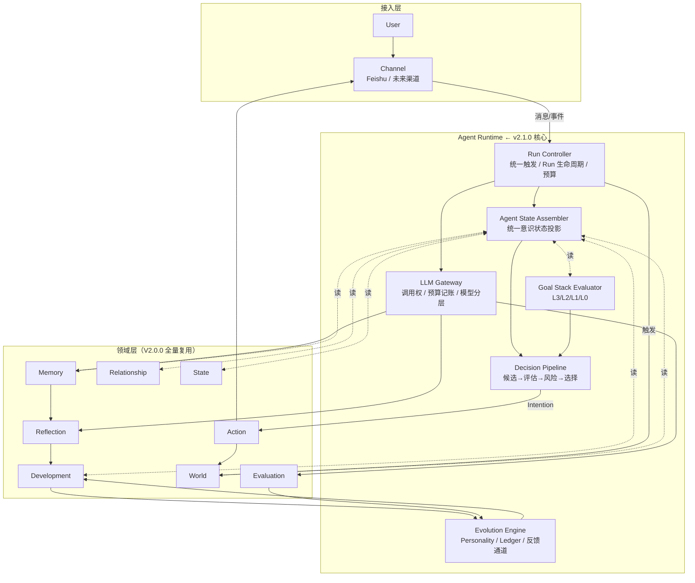
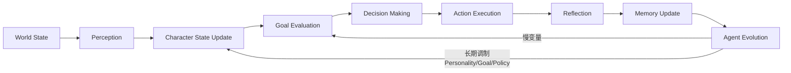

# v2.1.0 Agent Evolution Architecture

> 状态：**Architecture Design（仅设计，未实现）**
> 前置：`docs/version/v2.0.0/` 六 Phase 已实现（迁移链至 0035），`docs/version/v2.0.1/` 主动投递补丁已设计（迁移至 0037）
> 定位：把 V2.0.0 建成的「多个 AI 能力模块」整合为**具有统一意识状态与成长方向的单一 Agent**
> 本文档是后续 Phase Task 拆分的唯一上游输入；只做架构裁决，不含 Task、不含代码、不含实现细节

---

## 0. 版本定位与设计原则

### 0.1 核心判断

V2.0.0 已经建齐了 Agent 的全部「器官」：

| 能力 | 承载域 | 状态 |
|---|---|---|
| 长期记忆 | Memory（Memory 2.0 全生命周期） | 已实现 |
| 经历→认知 | Reflection（Evidence → Insight） | 已实现 |
| 认知→行为演化 | Development（Belief/Preference/Pattern → DevPolicy） | 已实现 |
| 关系成长 | Relationship（V8.5 六维引擎 + 里程碑 + 共同经历） | 已实现 |
| 主动行为 | Autonomy / Life Loop / Action（V9 体系） | 已实现 |
| 世界感知 | World（V8 时间/地点/物品/事件） | 已实现 |
| 目标 | Goal（层级雏形 + Planning + 仲裁） | 已实现（两层） |

但它们至今是**被两条不同编排路径分别驱动的**：前台 `chat_pipeline` 与后台 `life_loop`，各自取状态、各自装配上下文、各自决策；State / Goal / Development / Relationship 的读取散落在各处，没有一个统一的「角色此刻的完整意识状态」；评估结果（Evaluation）止步于 trace，从不回流为行为调整。这就是「模块组合」与「Agent」的差距。

**V2.1.0 = 一套神经系统的补全，不是任何器官的重造**：

1. **Agent Runtime**：Life Loop Controller 从「后台调度器」推广为「唯一行为入口」——前台用户消息与后台自主周期成为同一 Run 模型的两种触发方式。
2. **Character State System**：以「投影非真相源」方式聚合各域状态为统一的 Agent State Snapshot（新增 Interest、Personality State 两个缺口信号）。
3. **Goal Stack**：Goal 层级从两层扩为 Long/Medium/Short/Current Intent 四层，目标成为决策的一等驱动。
4. **Decision Pipeline**：前台与后台共用同一条 候选→评估→风险→选择 决策管线。
5. **Evolution Mechanism**：补全缺失的 Evolution 环节——Personality 演化（新增）+ Evolution Ledger（统一审计投影）+ Evaluation→Evolution 反馈通道。

### 0.2 四条铁律（对所有后续 Task 生效）

1. **不破坏 V2.0.0**：禁止重写 Memory / Reflection / Autonomy 的域模型与数学；禁止创建第二套 Agent；V8.5 关系数值（D1/D2/D3/D5）、V9 行动检定、Memory 2.0 生命周期零改动。所有复用/扩展/新增以 §1.3 裁决表为准。
2. **统一 Runtime**：一切角色行为（对话回复、主动消息、世界行动、后台整理）都必须表现为一次 Agent Runtime Run。任何域不得在 Run 之外自主发起「角色行为」。
3. **LLM 调用权收归 Runtime**：域服务不再自行决定「是否调用 LLM / 何时调用 / 用哪档模型 / 花多少预算」；这些决策属于 Agent Runtime 的 LLM Gateway。域保留「如何调用」（prompt 构造与解析，即既有 chain 本体），注册为 Gateway Capability。
4. **单一真相源 + 写入出链**：新增状态一律先问「SoT 在哪、谁可写」。快照/投影不落真相源职责；长期化写入仍只发生在后台，前台只读。

### 0.3 Non-Goals（本版本明确不做）

- 多 Agent / 多角色并行（CharacterId 贯穿已为 3.0 预留，本版本不启用）。
- World Simulation 升级（世界推演、NPC 行为）。
- 重写 Context Architect / 模型分层 / 预算数学。
- 关系数值引擎、行动检定六态、记忆 7 类封顶的任何语义变更。
- 前端控制台改版。

---

## 1. Overall Architecture

### 1.1 分层视图（V2.1.0 在系统中的位置）



读法：

- **Agent Runtime 是唯一的编排平面**：`chat_pipeline` 与 `life_loop` 的编排职责被收编为 Run Controller 的两种 Run Profile（详见 §2）；二者既有步骤本体保留，只换「由谁调用」。
- **领域层零新增域**：State/Memory/Reflection/Development/Relationship/Goal/Decision/Action/World 全部沿用 v2.0.0 域边界（`docs/version/v2.0.0/architecture/domain-boundaries.md`）；v2.1.0 新增的是 Runtime 平面的五个组件（Run Controller / State Assembler / Goal Stack / Decision Pipeline / LLM Gateway / Evolution Engine——前四者分别是 Life Loop、Context 读取、Goal Check、Decision 步骤的推广）。
- **依赖方向不变**：领域层仍然只向下依赖，Runtime 调用一切但不被业务域调用；唯一的例外是 Evolution Engine，它被显式授权读 Evaluation 结果并把编译产物写回 Development/Goal（经既有合法通道，见 §6/§7）。

### 1.2 Agent Evolution Loop（版本主图）

V2.1.0 的目标闭环，每一环标注归属与版本来源：



| 环节 | 归属 | V2.0.0 现状 | V2.1.0 增量 |
|---|---|---|---|
| World State | World 域 | 已实现（V8） | 无（Preserve） |
| Perception | Runtime Run 触发 + World/Channel 事件 | Life Loop 感知已有，前台消息另有入口 | **统一**：消息/事件/调度/阈值四类触发归一为 Run Trigger |
| Character State Update | State 域 + State Assembler | mood/energy/emotion 更新已有 | **聚合**为 Agent State Snapshot；新增 Interest、Personality State 信号 |
| Goal Evaluation | Goal 域 | 两层层级 + Goal Check 已有 | **扩为四层 Goal Stack**；目标驱动分数进入决策 |
| Decision Making | Decision 域 | 前后台各自决策、Intention 值对象 | **统一** Decision Pipeline（候选/评估/风险三段显式化） |
| Action Execution | Action 域 | V9 体系 + Outbox 已有 | 无（Preserve）；Runtime 只按契约调用 |
| Reflection | Reflection 域 | 已实现 | 无（Preserve）；新增消费 Agent Metric 证据 |
| Memory Update | Memory 域 | 已实现 | 无（Preserve） |
| **Agent Evolution** | **Evolution Engine（新）** | **缺失**（Development 只消费 Insight，Evaluation 只产 trace） | **本版本核心**：Personality 演化 + Evolution Ledger + Evaluation→Evolution 反馈 |

> 快时钟（每 Run：感知→状态→目标→决策→行动）与慢时钟（每日/每周：反思→记忆整合→演化）在时间尺度上分离；Evolution 属于慢时钟，但它的产物（Personality/Goal/Policy 调制）作用于之后每一次快时钟运转。

### 1.3 版本边界裁决表（对 v2.0.0 / v2.0.1 全模块）

裁决语义沿用 v2.0.0 version-boundary：**Preserve**（零改动）/ **Extend**（扩列/扩枚举，不改既有语义）/ **New**（新增）/ **收编**（编排权转移，步骤本体保留）。

| v2.0.0 / v2.0.1 模块 | 裁决 | v2.1.0 处置 |
|---|---|---|
| `character/asuna/` Persona 静态资产 | **Preserve** | 演化只允许在 Persona 导出的硬边界内漂移，永不写回文件本体（§6.1） |
| State 域（`character_state` + 情绪衰减） | **Preserve + Extend** | 数值数学不动；新增 Interest 读取信号与 Snapshot 组装入口 |
| Memory 2.0 全链 | **Preserve** | 零改动；仅新增「被 Evolution 读取」的只读消费方 |
| Reflection | **Preserve + Extend** | 反思触发器新增 `agent_metric` 证据源（Evaluation 趋势越限 → 反思窗口） |
| Development（aggregate/policy/audit） | **Preserve + Extend** | DevPolicy 输入端新增 Personality State；change_kind 枚举扩展 personality |
| Relationship（V8.5 引擎） | **Preserve** | 数值数学、限速、迟滞零改动；只作为 Snapshot 读取源与决策约束 |
| Goal（层级 + Planning + 仲裁） | **Extend** | GoalLayer 扩为四层（§4）；仲裁/状态机语义沿用 |
| Decision 域（decision_records / Intention） | **Preserve + Extend** | Intention 仍是值对象；decision_records 扩列候选评分（审计用） |
| Action（V9 全链 + Outbox） | **Preserve** | 零改动；Runtime 按 §2.5 契约调用 |
| World（V8） | **Preserve** | 零改动；Perception 的事件源语义不变 |
| Life Loop Controller / Trigger Registry / Budget | **收编 + Extend** | 推广为 Run Controller；loop_runs 扩列 run_kind/profile；预算数学沿用 |
| `chat_pipeline` / `post_process` | **收编** | 步骤本体保留，改由 Run Controller 以前台 Run Profile 调度（Flag 内渐进） |
| LLM Orchestration（llm_factory + 两档分层 + 链缓存） | **Extend** | 之上加 LLM Gateway 门面：能力注册 + run 级记账；chain 本体不动 |
| Evaluation（V7.5 规则 + Judge 注册表） | **Preserve + Extend** | 注册表新增 agent 级规则集；只读旁路铁律不变（§7） |
| V7.8 观测（runtime_traces 等） | **Extend** | 新增 agent_run / evolution trace 步骤，复用 trace_collector |
| Channel 投递（v2.0.1 补丁） | **Preserve** | delivered 两阶段语义、external_message_id 语义原样继承 |

---

## 2. Agent Runtime（统一调度中心）

### 2.1 定位

Agent Runtime **不是新 Agent**，而是 v2.0.0 Life Loop Controller 的推广：原本只服务后台自主周期的「触发→预算→步骤执行」机器，升级为同时服务前台对话与后台自主的**唯一 Run 载体**。Life Loop 的 Trigger Registry、Budget、Cooldown、Idle 判定、loop_runs 台账全部保留并成为 Runtime 的底座。

### 2.2 Run 模型

一次 Run 是角色行为的最小完整单位：

```text
Run = {
  run_id, user_id, character_id,
  trigger,          # 见 §2.3 四类触发源
  profile,          # foreground_chat | autonomous_tick | event_driven
  stages,           # 按profile实例化的阶段序列(见§2.4)
  budget_account,   # run 级预算账户(挂到全局日预算之下)
  record            # loop_runs 扩列后的台账行
}
```

三种 Run Profile 的差异只在**阶段组成与预算档位**，决策管线与状态组装完全同一套：

| Profile | 典型触发 | 阶段要点 | 预算档 |
|---|---|---|---|
| `foreground_chat` | 用户消息到达 | 感知 → 快照 → **对话决策**（回复候选为主）→ 生成回复 → 落库 → 后台交接 | 前台配额（沿用现有前台 ≤4 次 LLM 目标） |
| `autonomous_tick` | 调度周期 | 感知 → 快照 → 目标评估 → 主动决策 → 主动行动/投递 | 后台配额（LIFE-003 约束不变） |
| `event_driven` | World 事件 / Channel 事件 / 阈值越限 | 感知 → 快照 → 判定是否升级为完整 Run（多数事件到此即止，0 LLM） | 事件配额（轻） |

### 2.3 输入（触发源）

| 触发源 | 内容 | 来源 |
|---|---|---|
| Channel 消息 | 用户消息、已读回执等 | Feishu 等 Channel 适配器 |
| World 事件 | 世界域事件（Outbox 出口语义不变） | World 域 |
| 调度 | 周期 tick（含 Idle 心跳） | Trigger Registry（持久化，沿用） |
| 阈值/状态 | cooldown 到期、energy 越限、预算恢复、评估趋势越限 | State / Budget / Evaluation |

### 2.4 状态获取与决策流程（Run 内阶段）

```text
[Run Open] 记账台账(loop_runs) + 预算闸(全局日配额熔断语义沿用)
    ↓
[Perception] 收集本次触发相关增量：新消息 / 新 World 事件 / 状态越限 / 时间推进
    ↓
[State Snapshot] Agent State Assembler 组装统一意识状态(§3)  —— 规则投影,0 LLM
    ↓
[Goal Evaluation] Goal Stack 求当前活跃目标与驱动分数(§4)   —— 规则,0 LLM
    ↓
[Decision] 统一 Decision Pipeline(§5)
    ├─ 纯规则可决 → 直接产出 Intention                      —— 0 LLM
    └─ 歧义/生成型决策 → 经 LLM Gateway 调用(能力级预算内)
    ↓
[Action] 按 Decision 域输出调用 Action 域执行(§2.5 契约)
    ↓
[Record & Handoff] decision_records / action_records / trace 照旧落库;
                   后续 Experience 摄取 → Memory Candidate → post_process 通道不变
    ↓
[Run Close] 台账终态(done|aborted|degraded) + 成本记账
```

要点：

- **前台 Run 与后台 Run 的分叉点只在 Decision 阶段的候选构成与约束**（前台「回复用户」候选优先级最高），不在管线形状。
- **每阶段可独立降级**：预算不足 → degraded（跳过可选阶段）；决策失败 → critical 语义沿用（Run 终态 aborted）。
- **Run 内禁止跨域直调 LLM**：一切模型调用经 LLM Gateway（§2.6）。

### 2.5 Action 调用契约

Runtime 对 Action 域只有一种调用方式：提交 Decision 产出的 Intention（值对象），由 Action 域按既有 检定→规划→执行→六态审计 流程处理；Runtime 不绕过检定、不代写 action_records、不直接触碰 World 表。行动结果经既有 Outbox → World Event → Memory Candidate 通道回流，Runtime 只负责把 Outbox 消费纳入 Run 的收尾阶段（consumer 本体沿用）。

### 2.6 LLM Gateway（调用权收归）

- **能力注册**：现有各 chain（对话生成、情绪更新、反思、记忆判定兜底、主动生成、Judge 等）注册为命名 Capability，声明模型档位（主力/轻量）、预算类型（前台/后台）、可否降级为规则。
- **调用决策四问**（是否调用 / 何时调用 / 用哪档 / 花多少）由 Gateway 按 Run 预算与全局日预算裁决；域服务只发出「我需要能力 X」的请求并消费结果。
- **记账**：run 级账户 + 全局日账本两级记账（全局账本即 LIFE-003 既有熔断器，语义不变）。
- **迁移即注册**：不重写任何 chain；Flag 内逐个把既有调用点切到 Gateway，未切换的调用点行为不变。

### 2.7 失败与降级总则

| 失败点 | 行为 |
|---|---|
| 触发风暴（同源事件密集） | Trigger Registry 去重 + Cooldown（沿用） |
| 快照组装失败 | 降级为最小快照（State 域本地值），Run 继续 |
| 决策预算不足 | degraded：只执行规则候选中的最高优先项或直接跳过 |
| Action 检定失败 | 六态审计照记；Run 不 abort（行动失败 ≠ Run 失败） |
| Gateway 全局熔断 | 一切 LLM 能力拒绝，规则路径兜底，Run 标记 degraded |

---

## 3. Character State System

### 3.1 设计原则

1. **快慢分离**：快变量（mood/energy/emotion/current_topic）分钟级、事件驱动；慢变量（Personality/Preference/Relationship）天～月级、只走演化通道。
2. **投影非真相源**：统一的「角色意识状态」是一个**组装视图**（Agent State Snapshot），各组件的 SoT 仍在原域；Snapshot 不接收写入，写入永远回到各域合法通道。
3. **每 Run 重建、定期存档**：Snapshot 每 Run 现算（成本为纯规则读取），并按策略周期性持久化为 `agent_state_snapshots` 供回放与评估（§8）。

### 3.2 组件总表

| 组件 | 分类 | 真相源（SoT） | 数据来源 | 更新机制 | 生命周期 |
|---|---|---|---|---|---|
| Mood / Energy / Intensity / Inner State | 快变量 | `character_state` 表（State 域） | 交互事件、情绪衰减数学（V5 沿用） | 事件驱动 + 周期衰减，域内自足 | 分钟级 |
| Emotion | 快变量（State 域值对象） | 同上 | 同上 | 8 值 + intensity，沿用 | 分钟级 |
| **Interest**（新信号） | 快变量（派生，无独立 SoT） | 不落表，只存在于 Snapshot | 活跃目标域、Development preferences、相关记忆 salience/recency、World 事件显著度 | 每 Run 由 Assembler 规则合成（各来源加权） | Run 级 |
| Relationship State | 快照（投影） | `relationship_state/events`（V8.5，SoT 不变） | 关系数值 + 里程碑 + 共同经历投影 | V8.5 引擎自更新；Snapshot 只读最新投影 | 慢变量 |
| Current Focus | 快变量（运行时值对象） | 组合：`current_topic`（State）+ 活跃 L1 目标（Goal）+ 进行中 Scene/Action（World/Action）+ 当前注意力对象（用户/Channel） | 同左 | 每 Run 重算；行动开启/关闭事件即时刷新 | Run 级 |
| Personality State（新慢变量） | 慢变量 | `personality_state` 表（新增，§8） | Persona 静态资产导出的基线 + Insight 编译的漂移 | 仅 Evolution Engine 编译写入（§6.1）；带硬边界与限速 | 周～月级 |
| Development 三元组 | 慢变量 | `development_state`（既有 SoT） | Insight（唯一合法输入，沿用） | DevPolicy 编译，沿用 | 慢变量 |

### 3.3 Agent State Assembler（组装器）

- **输入**：State 域本地值、Relationship 最新投影、Goal Stack 活跃层、Development 当前参数、World 场景切片、最近记忆摘要信号。
- **输出**：一个不可变的 Snapshot 值对象，包含 §3.2 全部组件 + `interest_focus`（前 N 个兴趣主题及分值）+ `snapshot_version`。
- **成本**：全部为规则读取与内存合成，0 LLM；目标是单次组装 O(几十毫秒) 内。
- **一致性**：组装是多点只读，不做跨域写回；各域数据时点以 Run 开始时刻为准（Run 内快照不变，防止决策中途状态漂移）。

### 3.4 更新通路（谁在什么时机写什么）

```text
事件快路径(秒~分钟):
  用户消息 / 行动结果 / World 事件
    → State 域数值更新(现有数学) + Goal 状态迁移(现有状态机)
    → 下一 Run 的 Snapshot 自然反映

周期慢路径(小时~天):
  反思产 Insight → Development 编译(现有) 
  Evaluation 趋势越限 → Evolution Engine 编译 Personality/Goal 调整(新增,§6/§7)

禁止通路(硬约束):
  Snapshot 不可写回任何域;
  Memory/Reflection 不可直写 State/Relationship 数值(沿 v2.0.0 依赖矩阵);
  Personality 不可被任何单次交互直接修改。
```

---

## 4. Goal System

### 4.1 Goal Stack（四层目标栈）

GoalLayer 由现有 `short_term | long_term` 扩展为四层；既有两层的语义与状态机**原样保留**（v1 行 `layer NULL` 兼容逻辑不变），新增层只增不改：

| 层 | 名称 | 时间尺度 | 典型内容 | 主要来源 | 存储 |
|---|---|---|---|---|---|
| L3 | Long Term Goal | 周～月级 | 「成为用户信任的伙伴」「深入了解用户的某领域」 | Persona 长期设定 + Insight 编译 + 关系里程碑沉淀 | `goals`（layer=long_term，沿用） |
| L2 | Medium Goal | 天～周级 | 「本周了解用户的新工作」「完成承诺的资料整理」 | L3 分解（Planning 沿用）、commitment 记忆、User 显式请求 | `goals`（layer=medium，新增枚举值） |
| L1 | Short Goal | 小时～天级 | 「今晚问候用户」「整理昨天的对话要点」 | L2 分解、commitment、World 事件机会 | `goals`（layer=short_term，沿用） |
| L0 | Current Intent | 轮级（运行时） | 「回应这句问候」「继续没讲完的故事」 | Decision Pipeline 当前轮产物 | **不落表**：Intention 值对象（语义不变）+ Snapshot 内运行时字段 |

### 4.2 各层生命周期

- **产生（Supply）**：沿 v2.0.0 既有 goal supply 通道（Insight/commitment/事件）；L3 新增来源——Evolution Engine 的周期性 Goal Rebalance（§6.4）可依据 Personality/长期评估**建议**新 L3 或退役失活 L3（建议仍走 supply 审核规则，不直插）。
- **激活**：每 Run 的 Goal Evaluation 依据「时间窗 + 前置条件 + 状态许可（energy/scene）」选出活跃目标集；同一时刻每层至多一个活跃主目标。
- **推进**：L0 每轮由决策产生；L1 由 Planning 步骤产出行动建议（`goal_plans` 沿用）；L2/L3 通过下层完成度聚合推进。
- **完成/失败**：状态机语义沿用（含 failure_reason）；失败沉淀为反思证据（既有通道）。
- **冲突**：跨层/同层冲突沿用 v2.0.0 仲裁（migration 0032 语义不变）；L0 与 L1 冲突时 L1 让位于安全与用户显式指令（优先级铁律，见 §5.3）。

### 4.3 目标如何影响行为（四条影响通道）

| 通道 | 作用点 | 机制 |
|---|---|---|
| 上下文注入 | Context Architect | 活跃 L3/L2/L1 目标文本进入上下文装配（既有 goal 上下文段扩展为栈式呈现：L3 意图一句 + L2 当前一句 + L1 本轮一句） |
| 决策加权 | Decision Pipeline | 每个候选动作按「目标对齐度」计分（§5.4）；无目标驱动分数的候选只能靠环境/社交理由当选 |
| 行动候选 | Candidate Generation | L1 目标经 `goal_plans` 编译为具体行动候选（沿用 Planning→行动映射） |
| 对话风格 | BehaviorEngine / DevPolicy | 目标域（relationship/knowledge/care…）调制响应风格权重（既有 DevPolicy 调制面的目标维度） |

### 4.4 目标演化（Evolution 的目标面）

随时间推移目标栈整体漂移：L3 的措辞与焦点由 Personality State 与长期评估趋势缓慢修正；长期未推进的 L2/L1 依既有超时规则退役；新共同经历（Relationship Event）可触发 L3 修订建议。所有漂移可解释：每个变更可指认来源 Insight/Evaluation/Event（写入 Evolution Ledger，§6.5）。

---

## 5. Decision System

### 5.1 统一决策管线

前台与后台共用同一条五段管线；差异只体现在候选源与约束档位（§2.2）：

```text
Candidate Generation → Priority Assign → Context Evaluation → Risk Check → Selection
```

### 5.2 各段设计

**① Candidate Generation（候选生成）** —— 纯规则，多源汇集：

| 候选源 | 内容 | 来源域 |
|---|---|---|
| 对话响应 | 回复用户（前台 Run 必有） | chat 既有链路 |
| 目标编译 | L1 目标 → 计划行动 | Goal/Planning |
| 能力注册 | 角色可执行的一切原子行动 | Action capability registry（V9 沿用） |
| 自主触发 | Trigger Registry 命中的主动意图 | Autonomy（沿用） |
| 环境机会 | World 场景可供性（地点/物品/时间窗口） | World |
| 静默 | 「什么都不做」永远是合法候选（Idle 语义沿用） | Runtime |

**② Priority Assign（静态优先级）** —— 对齐 v2.0.1 已引入的 P0/P1 语义：

| 级 | 语义 | 例子 |
|---|---|---|
| P0 | 安全与用户显式指令 | 危险内容拒绝、用户明确要求 |
| P1 | 承诺与投递 | 已承诺事项、待投递主动消息（v2.0.1 通道） |
| P2 | 目标驱动 | L1/L2 目标编译行动 |
| P3 | 社交与环境 | 关系维护、场景互动 |
| P4 | 环境氛围 | 低价值背景行为、Idle |

**③ Context Evaluation（语境评估）** —— 确定性打分，每候选六维：

| 维度 | 含义 | 数据来源 |
|---|---|---|
| goal_alignment | 与活跃目标栈的对齐度 | Goal Stack |
| state_fit | 与 mood/energy/emotion 的匹配 | Snapshot |
| relationship_fit | 与当前关系阶段/边界的匹配 | Relationship 投影 |
| timing | 冷却/静默时段/上次同类行为间隔 | Trigger Registry + World 时间 |
| interest | 新颖度与兴趣信号 | Snapshot.interest + 记忆信号 |
| cost | 预算与执行风险成本 | Budget 账户 + Action 检定预估 |

综合分为规则加权和；**并列/低置信时**才经 LLM Gateway 调用轻量模型做软排序（v2.0.1 G5 遗留项的自然归宿，非新增链）。

**④ Risk Check（风险闸）** —— 全部为既有机制按序复用，顺序固定：

1. Persona 一致性预检（候选与 Persona + Development/Personality State 不矛盾）；
2. Relationship 闸门（V9 自主闸门语义沿用：关系阶段不允许的行为不出候选）；
3. Action 检定（V9 六态：通过/失败照记，不静默）；
4. 预算/冷却硬闸（LIFE-003 + Trigger Cooldown）。

**⑤ Selection（选择）** —— 确定性规则：P 级优先，同级取综合分最高；胜者产出 Intention（值对象语义不变）进入 Action 契约；落选候选连同各维得分写入 decision_records 扩列（审计与评估取材）。

### 5.3 优先级铁律

用户显式指令（P0）> 承诺（P1）> 目标（P2）> 社交（P3）> 氛围（P4）。任何目标驱动行为不得僭越用户显式表达；L0 恒为该轮最高决策产物，但不可违反 P0 约束。

### 5.4 可解释性

每次决策可回答四个问题：候选从哪来（源标签）、为什么赢（六维得分 + P 级）、风险闸结果（逐闸记录）、替代选项是什么（落选清单）。全部落 `decision_records` + runtime_traces，无新观测设施。

---

## 6. Evolution Mechanism（角色如何长期成长）

### 6.1 总原则

1. **慢变量**：一切演化以天～月为尺度；单次交互最多产生证据，不直接改变角色。
2. **合法通道**：演化唯一输入是「已验证的认知」——Insight（经 Reflection）与 Evaluation 趋势（经 §7）；原始记忆/单次事件禁止直接调制行为（沿 v2.0.0 三条单向约束）。
3. **硬边界**：任何演化量都被 Persona 基线导出的边界钳制——角色可以「越来越主动」，但不能变成另一个人。
4. **可回滚**：演化全部经审计投影（Evolution Ledger）可重放；支持按时间点回滚（复用 development_changes 审计模式）。

### 6.2 Personality Evolution（新增能力）

- **状态**：`personality_state`——从 Persona 静态资产导出的一组**有界人格轴**（如 assertiveness 主动性 / warmth 亲近性 / curiosity 求知性 / patience 耐性；轴集由 Persona 定义时声明，非全局固定）。每轴：`baseline`（Persona 导出，不可变）、`current`（当前值）、`bound`（±漂移上限，Persona 导出）。
- **演化通路**：Insight 携带的行为学证据（如「用户多次主动分享，角色回应积极且关系正向」）由 Evolution Engine 周期编译为轴上的小幅漂移；每次漂移必须携带 source_insight_id、before/after、限速校验。
- **限速**：单轴单位时间漂移上限（周级窗口）；连续同向漂移需要多窗口证据累积，防止单一证据链拉满边界。
- **作用点**：Personality State 作为 DevPolicy 的新输入维度参与行为参数调制（说话倾向、主动性阈值、关心话题权重）；不直接改写 Persona 文件与对话 prompt 模板。
- **示例（设计目标）**：早期 assertiveness=0.3（谨慎、少主动）；数月正向互动（用户响应率高、关系维度上行、多次「角色主动后获得积极反馈」类 Insight）→ assertiveness 缓慢漂移至 0.6（更主动发起话题、更敢表达观点），且全程可在 Evolution Ledger 回放「是哪些经历改变了她」。

### 6.3 Preference Learning（既有能力的通道收敛）

Development preferences（Development 域）仍是偏好唯一 SoT，机制不变；v2.1.0 增量仅在：偏好变化纳入 Evolution Ledger 统一呈现（读侧投影，不建新真相源）；Interest 信号读取偏好（§3.2），使「更了解用户习惯」体现在话题选择与主动内容上。

### 6.4 Relationship Evolution（纯复用）

V8.5 六维引擎、里程碑、共同经历零改动。演化语义上，Relationship 是演化结果的**呈现层**之一：Personality 漂移影响互动风格 → 影响关系事件流 → 引擎自然产出不同的关系轨迹。V2.1.0 不新增任何关系数学。

### 6.5 Evolution Ledger（统一演化审计投影）

- **形态**：**SQL 投影视图**（不建新表）——聚合 `development_changes`（扩列 personality 类 change_kind）+ `relationship_events` + goal 状态迁移 + memory supersede 链，按时间线呈现「角色的一切长期变化及来源」。
- **写入方**：仍是各域自己的审计写入（Development 审计、Relationship 账本等）；Ledger 只读。
- **用途**：可解释性（为什么她变了）、回滚定位、评估取材（§7 的 relationship/persona 指标证据）、调试控制台展示。

### 6.6 Goal Rebalance（目标栈的演化维护）

Evolution Engine 周期任务（与 Reflection 同量级，周级为主）：依据长期评估趋势与 Personality State 建议 L3 修订/退役、L2 供给调整；建议进入既有 supply 审核规则后才成目标。0 直接写入 goals 表。

### 6.7 演化速率与回滚

- 所有演化写入集中在 Evolution Engine 单点，天然限流（无并发写）。
- 回滚 = 按审计投影逆放（同 development_changes 既有回滚模式）；Personality 轴额外支持「重置回 baseline」管理操作。

---

## 7. Evaluation System

### 7.1 定位

沿 V7.5 铁律：**Evaluation 是只读旁路，不直写业务状态**。V2.1.0 的增量是把评估从「散点规则」升级为「Agent 级指标体系 + 趋势快照 + 唯一合法的演化反馈通道」。

### 7.2 指标体系（Agent Self-Evaluation）

| 指标 | 度量问题 | 计算来源 | 采样 |
|---|---|---|---|
| Persona Consistency | 行为/表达是否仍像 Persona（含演化后） | 采样回复/主动消息 vs Persona 基线 + Personality 边界校验；规则为主，样本级 Judge 兜底 | 每日抽样 |
| Memory Accuracy | 说出口的「记得的事」是否真实存在且未过时 | 回复中的事实性陈述回查 Memory（回查命中率 + 冲突率）；复用 memory 评估规则集 | 每日抽样 |
| Action Quality | 主动/目标行动的结果质量 | action_records 六态 + World 结果回执 + 用户反应信号；复用 action 评估规则集 | 全量行动 |
| Relationship Quality | 关系健康度（数值之外的质量面） | V8.5 快照投影 + 里程碑达成率 + 冲突解决率；只读 | 周期 |
| Goal Progress | 目标栈推进健康度 | 各层完成/超时/失败率、平均推进速率 | 周期 |
| Decision Quality | 决策被判「对」的比率 | 落选候选事后评估 + 决策后行为回执对比（复用 decision 评估规则集） | 抽样 |

### 7.3 快照与趋势

- 周期性将指标聚为 `agent_metric_snapshots`（窗口 + 分值 + 分项 + 趋势），同时落地 V7.8-014 遗留的 Metrics 周期快照留白（Agent 层面）。
- 趋势规则：连续 N 窗口越限（如 Persona Consistency 连续下滑、Action Quality 低于阈值）→ 触发**演化反馈**。

### 7.4 Evaluation → Evolution 反馈通道（本版本关键闭环）

```text
agent_metric_snapshots 趋势越限
    → Evolution Engine 生成「演化议题」(如: 主动性偏高但用户响应率下滑)
    → 议题作为证据窗口送入 Reflection(走既有 Evidence→Insight 三闸)
    → 产出的 Insight 才被 Development/Personality 编译生效
```

即：**评估永远不直接改行为**；它只能提出议题，认知与编译仍走 Reflection→(Development/Personality) 合法通道。这保持「防幻觉三闸」对一切行为变更的覆盖，包括来自评估的变更。

### 7.5 边界重申

- Evaluation 不写 Memory/State/Goal/Development/Personality 任何表（铁律不变）。
- Judge 调用经 LLM Gateway 计费（新增消费方，预算类型=后台）。
- 指标定义与规则进入 Evaluation 注册表（v2.0.0 已确立的注册表式扩展模式），不另建评估框架。

---

## 8. Data Model

### 8.1 实体关系（新增部分）

```mermaid
erDiagram
    personality_state ||--o{ development_changes : "变更审计(扩列change_kind)"
    character_state ||..|| agent_state_snapshots : "组装(投影,不落SoT)"
    goals ||..|| agent_state_snapshots : "活跃层投影"
    development_state ||..|| agent_state_snapshots : "参数投影"
    relationship_state ||..|| agent_state_snapshots : "投影"
    loop_runs ||--o{ agent_state_snapshots : "run时点存档"
    agent_metric_snapshots }o--|| characters : "周期指标"
    evolution_ledger_view ..> development_changes : "读侧投影"
    evolution_ledger_view ..> relationship_events : "读侧投影"
    evolution_ledger_view ..> goals : "读侧投影"
```

### 8.2 新增表（3 张）

| 表 | 职责 | 关键字段（语义级） | 写入方 | 备注 |
|---|---|---|---|---|
| `personality_state` | 人格轴当前值（慢变量 SoT） | user_id / character_id / axis / baseline / current / bound / source_insight_id / version / updated_at | 仅 Evolution Engine | 每角色每轴一行；baseline 与 bound 由 Persona 导出且不可变 |
| `agent_state_snapshots` | 统一意识状态时点存档 | run_id / user_id / character_id / snapshot(jsonb) / version / created_at | Run Controller（周期性/显著变化时） | 投影存档非真相源；供回放、评估、调试 |
| `agent_metric_snapshots` | Agent 级指标周期快照 | user_id / character_id / window / metrics(jsonb) / trend / created_at | Evaluation 周期任务 | 落地 V7.8-014 留白的 Agent 层面版本 |

### 8.3 扩展表（不改既有列义）

| 表 | 扩展 | 目的 |
|---|---|---|
| `goals` | layer 枚举扩展 `medium`；可选 `origin`（insight/commitment/user/world/evolution） | 四层 Goal Stack；来源可解释 |
| `loop_runs` | 扩列 `run_kind`（foreground_chat/autonomous_tick/event_driven）、`profile` 元数据 | 前台 Run 收编后统一台账 |
| `development_changes` | change_kind 枚举扩展 `personality` | Personality 漂移纳入既有审计 |
| `decision_records` | 扩列候选清单与六维得分（jsonb） | 决策可解释性与 Decision Quality 取材 |

### 8.4 明确不建的表

- **Current Intent**：运行时值对象 + Snapshot 字段，不落表（Intention 语义不变）。
- **Interest**：派生信号，只存在于 Snapshot。
- **Evolution Ledger**：SQL 投影视图，不建表（§6.5）。
- **Experience / evolution_events 等新域表**：无新增域，无新增事实类型。

### 8.5 迁移与回滚

- 迁移从 **0038** 起编号，沿用单链；三张新表均可空跑回滚（drop 即回 v2.0.0 形状），扩展列全部可空、旧逻辑不读。
- 全部变更置于 Flag 之后（§9.2）；Flag 关闭时新表零写入，行为与 v2.0.0 逐字节一致。

---

## 9. Integration Design

### 9.1 逐系统契约

| 系统 | V2.1.0 集成方式 | 提供给 Runtime | 从 Runtime 接收 | 永不改变 |
|---|---|---|---|---|
| Memory | 只读消费 + 既有摄取通道 | 检索/摘要信号（快照、决策、评估取材） | Experience 摄取（通道不变） | 7 类封顶、生命周期数学、SoT |
| Reflection | 只读消费 + 新证据源 | Insight（Development/Personality/Goal 编译输入） | 演化议题作为证据窗口；agent_metric 证据源 | Evidence 三闸、Insight 生命周期 |
| Development | 编译目标扩展 | Belief/Preference/Pattern → DevPolicy（行为调制） | Personality State 作为新增输入维度 | Insight 唯一输入、审计可重放 |
| Relationship | 只读投影 | 关系阶段/边界约束（决策闸、快照组件） | 无（引擎自走） | D1/D2/D3/D5 数学、账本 SoT |
| Life Loop / Autonomy | **收编为 Run Controller 底座** | Trigger Registry、预算、Cooldown、Idle 机器 | Run 模型统一（loop_runs 扩列） | 触发判定纯函数、预算数学 |
| Autonomy 决策逻辑 | 收编进 Decision Pipeline | 触发命中的主动候选 | 统一五段管线 | P0/P1 通道语义（v2.0.1） |
| World | 只读 + 行动回写（均既有） | 场景切片、事件流（Perception/Focus/Interest 取材） | 行动结果经 Action→Outbox（通道不变） | V8 域模型、零入度铁律 |
| Action | 契约调用（§2.5） | 能力注册表（候选源） | Intention 提交 | 检定六态、审计 |
| Channels（Feishu） | 投递出口（沿用 v2.0.1 补丁） | 用户消息触发、投递回执 | 主动消息投递 | delivered 两阶段语义 |
| Evaluation | 注册表扩展（§7） | 指标快照与趋势 | 采样材料（trace/records 读取） | 只读旁路铁律 |

### 9.2 灰度与 Flag 设计

| Flag | 控制 | 默认 |
|---|---|---|
| `v21_agent_runtime_enabled` | 总闸；关闭即整个 v2.1.0 失效 | off |
| `v21_unified_run_enabled` | 前台 chat_pipeline 收编为前台 Run Profile | off |
| `v21_goal_stack_enabled` | L2 层与目标驱动评分 | off |
| `v21_personality_evolution_enabled` | Personality 轴编译与漂移 | off |
| `v21_agent_metrics_enabled` | 指标快照与演化反馈通道 | off |

灰度策略沿用 v2.0.0 惯例：总闸 + 子闸双开才生效；子闸独立可回滚；每个子闸都有「关闭后行为与 v2.0.0 一致」的验收定义。建议开启顺序：unified_run → goal_stack → agent_metrics → personality_evolution（反馈通道先于它反馈的对象上线）。

### 9.3 边界不变量清单（评审清单，任何 Task 不得违反）

1. Snapshot 只读；写回必须走各域合法通道。
2. Personality 只被 Evolution Engine 写；只被 DevPolicy/Snapshot/评估读。
3. Evaluation 只产议题与快照，永不直写业务表。
4. LLM 调用四问（是否/何时/哪档/多少预算）只在 Gateway 裁决。
5. 前后台决策共用同一管线；不得再出现平行决策路径。
6. Memory/Reflection/Development/Relationship/Action/World 的域模型与数学零改动。
7. 一切长期变化可经 Evolution Ledger 指认来源并回放。

---

## 10. Future Extension（为 3.0 预留）

### 10.1 Multi Agent

- Run 模型与全部新表自设计起携带 `character_id`；Run Controller 天然可按 character 实例化多份 Run 流水（每角色独立预算账户、独立 Personality/Goal 栈）。
- 需要后补的部分：角色间 Run 协调（互不打断/协同话轮）、共享 World 的并发写仲裁。本版本不设计。

### 10.2 World Simulation

- Perception 触发源与 World 零入度设计允许未来把「世界自主事件流」升级为世界侧模拟时钟（NPC/环境按自身节拍产生事件），Runtime 无需改形——事件驱动 Profile 已是入口。
- agent_state_snapshots 的时点存档为未来「世界-角色联合回放」提供对齐锚点。

### 10.3 NPC System

- NPC 可实现为「轻量 Agent」：复用 Run 模型的 event_driven Profile + 精简 Decision Pipeline（无 Channel、无 L3/L2 目标、规则决策为主），Personality State 直接以配置为终态（不演化）。
- LLM Gateway 的能力注册与预算机制按调用方区分配额，NPC 接入不挤占主角色预算。

---

## 附：遗留问题登记（进入 Task 拆分时须逐项裁决）

| # | 问题 | 倾向 |
|---|---|---|
| Q1 | Personality 轴集是否随 Persona 定义文件声明（需 Persona 格式微扩）还是全局固定枚举 | 倾向 Persona 声明，但涉及静态资产格式变更，需评审 |
| Q2 | 前台 Run 收编后 chat_pipeline 内既有步骤的调用方迁移顺序 | Flag 内逐步骤切换，回复生成最后切 |
| Q3 | Interest 各来源权重初始值与调参方式 | 规则常量起步，纳入评估回归观察 |
| Q4 | agent_state_snapshots 的存档频率与保留期 | 显著变化触发 + 每日保底；保留期对齐 trace 策略 |
| Q5 | 软排序轻量模型 Judge 的成本上限 | 并列才调用 + 事件配额内熔断 |
