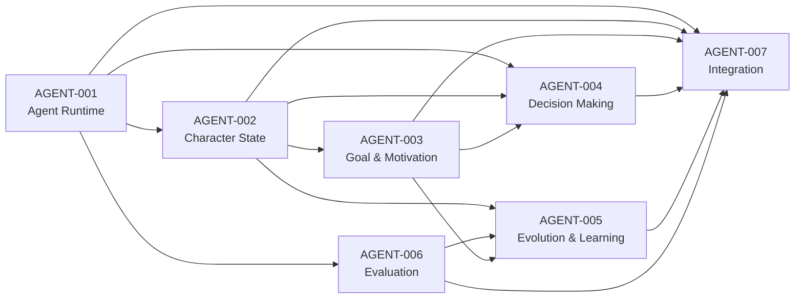

# v2.1.0 Task Registry

> 状态：**Task Registry（任务定义，未拆 Detail、未实现）**
> 上游输入：[architecture.md](architecture.md)（唯一架构依据；本注册表之外的任何能力均不得进入 Task Detail）
> 任务命名：`AGENT-001 ~ AGENT-007`；每个 Task 后续独立生成 Task Detail

---

## 1. 任务依赖图

主线：**001（调度中枢）→ 002（状态基座）→ 004（决策主干）** 为 P0 骨干；003/006 并行扩展；005 依赖 006 的反馈通道；007 收口。

## 2. 架构追溯

| Task | 对应 architecture.md 章节 | 交付 Flag |
|---|---|---|
| AGENT-001 | §2 Agent Runtime、§2.6 LLM Gateway | `v21_agent_runtime_enabled`、`v21_unified_run_enabled` |
| AGENT-002 | §3 Character State System、§8.2 新表 | `v21_agent_runtime_enabled`（快照随 Run） |
| AGENT-003 | §4 Goal System、§8.3 goals 扩列 | `v21_goal_stack_enabled` |
| AGENT-004 | §5 Decision System、§8.3 decision_records 扩列 | `v21_agent_runtime_enabled` |
| AGENT-005 | §6 Evolution Mechanism、§8.2 personality_state | `v21_personality_evolution_enabled` |
| AGENT-006 | §7 Evaluation System、§8.2 agent_metric_snapshots | `v21_agent_metrics_enabled` |
| AGENT-007 | §9.2 灰度顺序、§1.2 全环贯通 | 五 Flag 依序开启收口 |

建议开启顺序（architecture §9.2）：`unified_run → goal_stack → agent_metrics → personality_evolution`；反馈通道（006）先于它反馈的对象（005）上线。

## 3. 全局约束（对所有 Task 生效）

1. 遵守 architecture.md §0.2 四条铁律与 §9.3 七条边界不变量；违反即评审不通过。
2. v2.0.0 / v2.0.1 模块按 architecture §1.3 裁决表处置；Preserve 项零改动。
3. 每个变更置于对应 Flag 之后；Flag 关闭时行为与 v2.0.0 一致（验收必备项）。
4. 迁移从 **0038** 起编号，单链，可空跑回滚。
5. 遗留问题（architecture 附 Q1~Q5）随归属 Task 的 Detail 裁决，不在 Registry 展开。

---

# AGENT-001 Agent Runtime Evolution

## Priority

P0

## Goal

把 Life Loop Controller 推广为唯一行为入口的 Agent Runtime：前台用户消息与后台自主周期统一为同一 Run 模型，LLM 调用决策权收归 LLM Gateway。解决「两套编排路径各跑各的」的结构性分裂。

## Scope

- **涉及模块**：`application/life_loop`（推广为 Run Controller）、`application/chat_pipeline` / `post_process`（步骤本体保留，调用方迁移）、`llm_factory`（之上加 Gateway 门面）、`models`（loop_runs 扩列）、trace 体系。
- **新增能力**：
  - Run 模型（trigger / profile / stages / budget_account / record）与三种 Run Profile（`foreground_chat` / `autonomous_tick` / `event_driven`）。
  - 四类触发源统一接入（Channel 消息 / World 事件 / 调度 / 阈值状态）。
  - LLM Gateway：能力注册表（既有 chain 注册为命名 Capability）、调用四问裁决、run 级 + 全局日级两级记账。
  - 失败与降级总则（architecture §2.7 五档）。
- **修改范围**：`loop_runs` 扩列 `run_kind` / `profile` 元数据；Trigger Registry、Budget 数学、Cooldown、Idle 判定、熔断语义**零改动**，仅被收编调用。不引入任何新的 Agent Runtime 实体。

## Dependencies

- V2.0.0：Life Loop Controller（Trigger Registry / background_jobs / loop_runs / 预算熔断 LIFE-003）、chat_pipeline、post_process、llm_orchestration 两档分层、runtime_traces。
- 前置 Task：无（本版本起点）。

## Acceptance Criteria

1. 四类触发源均可开启 Run，且前台消息与后台 tick 落同一 `loop_runs` 台账，`run_kind` 可区分、可统计。
2. `v21_unified_run_enabled` 开启后，前台对话经 Run Controller 调度，既有步骤（Context→Decision→生成→落库→后台交接）行为不回归；关闭后调用路径与 v2.0.0 完全一致。
3. 全部 LLM 调用经 Gateway 发起并有两级记账；能力级预算熔断时规则路径兜底，Run 标记 degraded，无静默失败。
4. Run 内各阶段可独立降级；decision 阶段失败 → Run 终态 aborted 的既有语义保持。
5. 三种 Profile 的预算档互不挤占；全局日配额熔断行为与 LIFE-003 既有定义一致。

---

# AGENT-002 Character State System

## Priority

P0

## Goal

建立「角色此刻的完整意识状态」：以投影方式聚合各域状态为 Agent State Snapshot（每 Run 组装、0 LLM），补齐 Interest 与 Current Focus 两个缺口信号，落 `personality_state` 慢变量表（本任务只建基线，不演化）。让角色行为可被统一状态约束与解释。

## Scope

- **涉及模块**：`application`（新增 Agent State Assembler，供 Run 调用）、`services`（State/Goal/Development/Relationship/World 的只读读取接口）、`models`（新增 personality_state、agent_state_snapshots；含迁移 0038+）。
- **新增能力**：
  - Agent State Snapshot 值对象：Mood/Energy/Emotion/Interest/Relationship State/Current Focus/Personality State + `interest_focus` 前 N 兴趣主题 + `snapshot_version`；Run 内时点一致、不可变。
  - Interest 派生信号：活跃目标域 + Development preferences + 记忆 salience/recency + World 事件显著度的规则合成，不落独立 SoT。
  - Current Focus 组合值对象：current_topic + 活跃 L1 目标 + 进行中 Scene/Action + 注意力对象。
  - `personality_state` 建表：Persona 导出 baseline 与 bound（Q1：轴集由 Persona 声明还是全局枚举，Detail 裁决）；本任务 `current = baseline`，唯一写入方 Evolution Engine 属 AGENT-005。
  - `agent_state_snapshots` 存档：显著变化触发 + 每日保底（Q4 频率/保留期，Detail 裁决）。
- **修改范围**：State 域数值数学、V5 情绪衰减、V8.5 关系引擎、Development SoT **零改动**；所有域仅暴露只读组装入口。禁止 Snapshot 写回任何域。

## Dependencies

- V2.0.0：State 域（character_state/情绪衰减）、Relationship 投影、Development（development_state）、Goal（活跃目标读取）、World 场景切片、Memory 检索信号。
- 前置 Task：AGENT-001（Snapshot 在 Run 内组装）。

## Acceptance Criteria

1. 每 Run 组装 Snapshot，全程 0 LLM，成本在既定性能预算内（毫秒级规则读取，具体数值 Detail 定）。
2. Snapshot 各组件的 SoT 仍在原域：任何对 Snapshot 的写尝试被拒绝；State/Relationship/Development 的写入路径与 v2.0.0 逐字节一致。
3. Interest 能反映四来源加权（构造用例：有活跃目标 + 高 salience 记忆的话题得分高于无来源话题）。
4. `personality_state` 按（character_id, axis）唯一，baseline/bound 来自 Persona 且不可变；除 AGENT-005 未来的写入方外无任何写入通路。
5. Flag 关闭时：新表零写入、零读取，行为与 v2.0.0 一致；`agent_state_snapshots` 存档可按 run_id 回放对齐。

---

# AGENT-003 Goal & Motivation System

## Priority

P1

## Goal

把 Goal 从两层扩展为 Long/Medium/Short/Current Intent 四层 Goal Stack，打通目标影响行为的四条通道，使每个行为可回答「为什么做这个行为」。解决「目标存在但不驱动行为」的问题。

## Scope

- **涉及模块**：Goal 域（`models/goal.py`、`goal_service`、Planning、仲裁）、Context Architect（目标上下文段）、BehaviorEngine/DevPolicy（目标维度调制）、Run 的 Goal Evaluation 阶段（AGENT-001 提供的位置）。
- **新增能力**：
  - GoalLayer 扩展 `medium`；L0 Current Intent 为运行时值对象 + Snapshot 字段（不落表）。
  - `goals` 扩列：layer 枚举扩展 + 可选 `origin`（insight/commitment/user/world/evolution）。
  - 四层生命周期：Supply（L3 新增 Evolution 建议来源预留）/ 激活（时间窗 + 前置条件 + 状态许可，每层至多一个活跃主目标）/ 推进（下层完成度聚合）/ 完成失败退役。
  - 目标→行为四通道：上下文注入（栈式呈现 L3/L2/L1）、决策加权接口（评分维度供 AGENT-004 消费）、L1→行动候选编译（沿用 goal_plans）、对话风格调制。
- **修改范围**：既有 `short_term`/`long_term` 两层语义、状态机（含 v1 行 `layer NULL` 兼容）、0032 仲裁语义**零改动**；不写 Scene/World；不被 Memory 反向写（域边界不变）。

## Dependencies

- V2.0.0：goal_service（层级雏形 + Planning + 仲裁 0032）、commitment 记忆类型、BehaviorEngine 调制面。
- 前置 Task：AGENT-001（Goal Evaluation 作为 Run 阶段）、AGENT-002（活跃目标进入 Snapshot / Current Focus）。

## Acceptance Criteria

1. 四层目标可创建、激活、推进、退役；同一时刻每层至多一个活跃主目标；超时退役规则生效。
2. 活跃目标栈进入上下文装配（栈式三行呈现），且目标域参与响应风格权重调制，均可从 trace 观测。
3. 目标对齐度加权接口可被决策管线消费，评分在 `decision_records` 可见（本任务交付接口与记账，联动验收在 AGENT-004）。
4. 跨层/同层冲突走既有仲裁，语义与 0032 一致；L0/L1 冲突时用户显式指令优先。
5. 既有两层目标的行为回归零变化（含 `layer NULL` 旧数据路径）；Flag 关闭时 Goal Evaluation 行为与 v2.0.0 一致。

---

# AGENT-004 Decision Making System

## Priority

P0

## Goal

建立前后台共用的统一决策管线：候选生成 → 优先级 → 语境评估 → 风险闸 → 选择，使「下一步应该做什么」对前台回复与后台自主行为是同一条代码路径，且每次决策可解释（候选从哪来、为什么赢、风险闸结果、替代选项）。

## Scope

- **涉及模块**：Decision 域（管线主体）、Action capability registry（候选源）、Goal（对齐度维度，消费 AGENT-003 接口）、Autonomy 触发逻辑（收编）、`models`（decision_records 扩列）、LLM Gateway（软排序）。
- **新增能力**：
  - Candidate Generation 六源汇集（对话响应 / 目标编译 / 能力注册 / 自主触发 / 环境机会 / 静默候选）。
  - P0~P4 静态优先级（对齐 v2.0.1 P0/P1 通道语义；优先级铁律 §5.3）。
  - Context Evaluation 六维规则评分（goal_alignment / state_fit / relationship_fit / timing / interest / cost），并列或低置信时经 Gateway 调轻量模型软排序（Q5 成本上限，Detail 裁决）。
  - Risk Check 四闸固定顺序（Persona 一致性预检 → Relationship 闸门 → Action 检定 → 预算/冷却硬闸），逐闸留痕。
  - `decision_records` 扩列：候选清单 + 来源标签 + 六维得分（jsonb）。
- **修改范围**：Intention 仍为值对象，语义与 13 值枚举不变；Action 域检定六态、V9 引擎零改动（只按契约提交 Intention）；不出现第二条平行决策路径。

## Dependencies

- V2.0.0：Decision 域（decision_records / Intention）、Action capability registry 与检定、Autonomy 触发判定、Relationship 闸门、预算/Cooldown。
- 前置 Task：AGENT-001（管线在 Run 内运转）、AGENT-002（state_fit / interest 维度数据源）、AGENT-003（goal_alignment 维度与 L1 行动候选；接口可先以空权重接入）。

## Acceptance Criteria

1. 前台 Run 与后台自主 Run 走同一管线代码路径，仅候选构成与约束档位不同（构造用例可证明）。
2. 每次决策在 `decision_records` 可回答四问：候选来源、胜出理由（P 级 + 六维得分）、逐闸结果、落选清单。
3. 优先级铁律可测：P0 用户显式指令 > P1 承诺 > P2 目标 > P3 社交 > P4 氛围，任何目标候选不得僭越 P0。
4. 纯规则可决时 0 LLM；仅并列/低置信触发软排序且计入事件配额；熔断时退化到规则最高分。
5. 「静默」候选正常当选的路径存在（Idle 语义保持）；风险闸任一拒绝时行为照记不静默。

---

# AGENT-005 Evolution & Learning System

## Priority

P1

## Goal

建立 Evolution Engine，补全演化闭环：人格轴有界漂移（Insight 编译、限速、硬边界）、偏好/行为模式经既有 Development 通道收敛呈现、目标栈周期 Rebalance、统一 Evolution Ledger 审计投影。让「角色为什么变成这样」全程可解释、可回滚。

## Scope

- **涉及模块**：`services`（新增 Evolution Engine：唯一演化写入点）、Development（DevPolicy 输入扩展 + change_kind 扩列）、Reflection（消费演化议题）、Goal（Rebalance 建议进入 supply 审核）、Evaluation（读 agent_metric_snapshots 趋势）、SQL 投影视图（Evolution Ledger）。
- **新增能力**：
  - Personality 演化：Insight 行为学证据 → 人格轴小幅漂移；每次携带 source_insight_id + before/after；单轴单位时间漂移上限（周级窗口）+ 连续同向需多窗口证据；Persona 导出的 bound 硬钳制。
  - `development_changes` 扩列 `change_kind=personality`，Personality 漂移纳入既有审计与回滚模式。
  - Evolution Ledger：跨域审计投影视图（development_changes + relationship_events + goal 迁移 + memory supersede 链），只读、不建新表。
  - Goal Rebalance：周期性依长期评估趋势与 Personality State **建议** L3 修订/退役、L2 供给调整；建议经既有 supply 审核规则，0 直写 goals。
  - DevPolicy 输入端新增 Personality State 维度（行为参数调制：主动倾向、话题权重等）。
- **修改范围**：Persona 静态资产零写回；V8.5 关系数学零改动（关系轨迹作为演化结果自然呈现）；Development「Insight 唯一合法输入」不变；演化写入集中单点天然限流。

## Dependencies

- V2.0.0：Reflection（Evidence→Insight 三闸）、Development（aggregate/policy/audit 回滚模式）、Relationship（账本/里程碑，只读）、Goal supply 规则。
- 前置 Task：AGENT-002（personality_state 表与基线）、AGENT-003（Goal Stack 与 supply 通道）、AGENT-006（评估趋势议题作为反馈通道）。

## Acceptance Criteria

1. 人格轴漂移仅可由携带 source_insight_id 的编译产生；无 Insight 的写入通路不存在（含直接写表的防护测试）。
2. 漂移被 bound 硬钳制、被周级限速约束（构造用例：单一证据链无法在单窗口拉满边界）；连续同向漂移需多窗口证据。
3. Evolution Ledger 可对任一长期变化指认来源（Insight/Evaluation/Event）并按时间线回放；支持按审计逆放回滚与「重置回 baseline」。
4. Goal Rebalance 只产生建议且经 supply 审核生效，goals 表无直写路径。
5. 演化生效后行为参数变化在 trace 可见 before/after；Flag 关闭时 Development 冻结于 v2.0.0 行为。

---

# AGENT-006 Agent Evaluation System

## Priority

P1

## Goal

建立 Agent 级质量评价体系：六项指标 + 周期快照 + 趋势规则 + 唯一合法的演化反馈通道（评估只提议题，认知仍走 Reflection 三闸）。同时落地 V7.8-014 遗留的 Metrics 周期快照留白。

## Scope

- **涉及模块**：Evaluation（注册表式扩展 agent 级规则集，沿 V7.5 铁律）、`services/evaluation_rules`、`models`（新增 agent_metric_snapshots）、Reflection（议题→证据窗口）、LLM Gateway（Judge 计费）。
- **新增能力**：
  - 六指标规则集：Persona Consistency / Memory Accuracy / Action Quality / Relationship Quality / Goal Progress / Decision Quality（定义、来源、采样策略见 architecture §7.2；规则为主，样本级 Judge 兜底）。
  - `agent_metric_snapshots` 建表与周期快照任务（窗口 + 分项 + 趋势）。
  - 趋势规则：连续 N 窗口越限 → 生成「演化议题」→ 作为证据窗口送入 Reflection（产出的 Insight 才被 AGENT-005 编译生效）。
- **修改范围**：Evaluation 保持只读旁路——不直写 Memory/State/Goal/Development/Personality 任何表；V7.5 注册表模式内扩展，不另建评估框架；Judge 调用经 Gateway 计入后台预算。

## Dependencies

- V2.0.0：Evaluation Engine（V7.5 规则 + Judge 注册表）、runtime_traces / action_records / decision_records（采样材料）、Reflection（Evidence→Insight 通道）。
- 前置 Task：AGENT-001（周期任务挂靠 Run/Worker 体系、Judge 经 Gateway）。与 AGENT-003/004 并行开发，Goal Progress / Decision Quality 指标的数据依赖随对应 Flag 开启自然补齐。

## Acceptance Criteria

1. 六指标可独立出分；规则可决样本 0 LLM，Judge 仅兜底且经 Gateway 记账。
2. `agent_metric_snapshots` 周期落库，趋势可查询；快照本身为只读旁路产物（存在「评估写业务表即失败」的防护测试）。
3. 趋势越限正确生成演化议题并进入 Reflection 证据窗口；议题不满足三闸时产出为空、不产生任何行为变更。
4. Agent 层指标周期快照落地，V7.8-014 留白关闭。
5. Flag 关闭时零快照、零议题，评估面行为与 v2.0.0 一致。

---

# AGENT-007 Integration & Optimization

## Priority

P1

## Goal

把五项能力收口为一个可灰度、可回滚、性能达标的完整 Agent Evolution Loop：按建议顺序执行五 Flag 灰度、跑通全链路回归、核实性能预算、补齐观测与回归清单，形成上线判定。

## Scope

- **涉及模块**：全部 AGENT-001~006 交付物的集成面；`application`（Run 主干性能）、trace 体系（agent_run / evolution trace 步骤补全）、`docs`（regression checklist）。
- **新增能力**：无架构外能力——本任务只做整合、测试、性能与观测收口。
- **修改范围**：
  - Runtime Integration：五 Flag 依序（unified_run → goal_stack → agent_metrics → personality_evolution）开启验证，子闸独立回滚路径各验一次。
  - 全流程测试：前台对话 Run → State/Goal/Decision → Action → Outbox → Memory/Reflection → Evaluation → Evolution 反馈 → 下次 Run 行为可见变化的端到端闭环用例。
  - 性能优化：Snapshot 组装毫秒级预算、Run 固定开销、前台 ≤4 次 LLM 目标不回退、后台预算不越界（只测与调，不改架构）。
  - 观测补全：agent_run / evolution trace 步骤、决策四问可查、演化 Ledger 可回放，控制台消费确认。

## Dependencies

- V2.0.0：全部既有回归基线（V2.0.0 各 Phase checklist）。
- 前置 Task：AGENT-001 ~ AGENT-006 全部完成。

## Acceptance Criteria

1. 五 Flag 按序开启后全链路 E2E 绿：一次完整 Evolution Loop（World→感知→状态→目标→决策→行动→反思→记忆→演化）各环节在 trace/台账中可逐段指认。
2. 关闭全部 v2.1 Flag 后，前台与后台行为与 v2.0.0 逐字节一致（回归零差异）。
3. 性能预算达标：Snapshot 组装与 Run 固定开销在 Detail 定义的阈值内；前台 LLM 次数不高于 v2.0.0 基线；全局日预算熔断路径完好。
4. 三个长期成长场景有可复验用例：偏好跟随（话题选择随偏好变化）、人格缓变（有界漂移 + Ledger 回放）、评估反馈（趋势越限 → 议题 → Insight → 行为参数变化）。
5. 产出 `docs/version/v2.1.0/regression-checklist.md`（沿用各版本清单格式），明确人工回归范围与上线判定。
