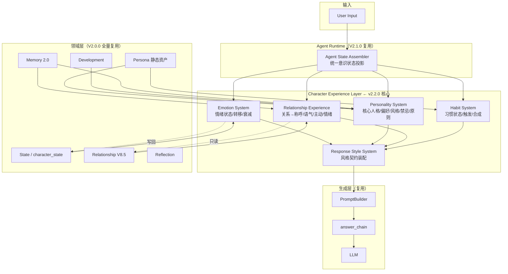
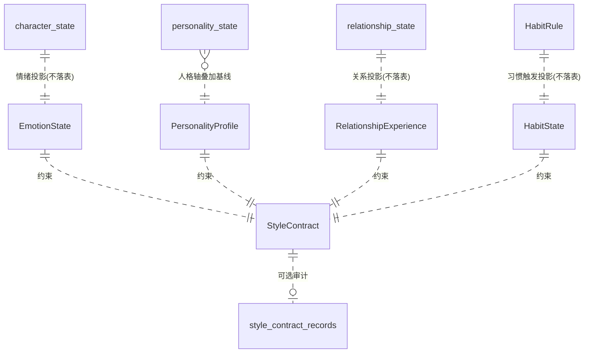

# V2.2.0 Character Experience Architecture

> 状态：**Architecture Design（仅设计，未实现）**
> 前置：`docs/version/v2.1.0/` Agent Evolution 架构已设计（Agent Runtime / Character State / Goal Stack / Decision Pipeline / Evolution Engine），`docs/version/v2.0.0/` 六 Phase 已实现
> 定位：**不再扩展 Agent 能力，而是补上「角色体验层」**——把已经建好的 Emotion / Personality / Relationship / Habit 静态资产，升级为真正驱动每一轮对话输出的运行时体验层
> 本文档是后续 Phase Task 拆分的唯一上游输入；只做架构裁决，不含 Task、不含代码、不含实现细节

---

## 1. Background

V2.0.0 建齐了 Agent 的「器官」，V2.1.0 补全了「神经系统」（统一 Runtime + 四层 Goal + 决策管线 + 演化机制），让角色从「模块组合」变成了「单一 Agent」。但两者解决的都是**能力完备性与成长方向**的问题，没有正面回答一个更朴素的问题：

**「她说话、回应、陪伴的方式，到底像不像亚丝娜本人？」**

当前链路在能力层面是完整的：

```text
用户输入 → Character → Memory → Reflection → Autonomy → Action
```

但在**体验层面**存在结构性缺口。角色拥有：
- 一套 8 值情绪状态（`character_state`，带衰减）
- 一段静态人格 Prompt（`identity.py` / `personality.py`）
- 一套六维关系数值引擎（V8.5 `relationship`）
- 一组硬编码的 HabitRule（`habits.py`）
- 一张关系词表（`relationship_lexicon.py`）

但这些资产**要么是配置期静态资产（只在 prompt 里贴一段字），要么是后台数值（算出来却不决定这句话怎么说）**。它们之间没有一层统一、确定、可解释的运行时机制，把「情绪此刻如何」「关系到了哪一步」「她有什么习惯」「她这个人怎么说话」合成到**同一次 LLM 调用**里。

结果就是五个体验问题（见 §2），而这些问题的根因不是「能力不够」，而是「缺少一个把已有能力翻译成『角色体验』的编排层」。

**V2.2.0 = 一张体验层的补全，不是任何器官或神经系统的重造。**

---

## 2. Problems

| # | 问题 | 现象 | 根因（指向现状） |
|---|---|---|---|
| P1 | 角色回复容易像普通 LLM | 长篇大论、列条目、客服腔、堆砌文案 | 人格/习惯只作为静态 prompt 文本贴入，缺乏**结构化的输出约束**；`BehaviorDirective` 已存在但未统一装配进生成层 |
| P2 | 情绪变化不自然 | 上一句还平静，下一句突然关切或冷淡；情绪跳变无过渡 | `character_state` 只有「当前值 + 简单衰减」，没有**情绪转移模型**与**变化速率钳制**；情绪事件（`EmotionEvent`）与回复的耦合是隐式的 |
| P3 | 长期关系感不足 | 关系数值在涨，但称呼、语气、主动程度变化不明显或突兀 | 关系六维数值是 SoT，但**没有一层「关系数值 → 表达方式」的显式映射**；`relationship_lexicon` 只覆盖尊重/舒适两维，称呼、语气、主动程度缺运行时映射 |
| P4 | 缺少角色个人习惯 | 习惯要么被忽略，要么生硬插入 | `HabitRule` 是静态清单，**无触发判定、无优先级合成、无与情境的冲突消解**；习惯没有进入 Character State 作为可查询状态 |
| P5 | 行为缺少人格影响 | 角色「做什么」与「是谁」脱节；不同用户看到的是同一个模板 | 人格作为 prompt 文本存在，但没有**人格轴 → 行为/表达参数的运行时调制**（V2.1.0 的 `personality_state` 只设计给 Evolution 读，尚未反向作用于生成） |

共性结论：**五个问题都指向同一件事——缺一个「LLM 输出之前的角色控制层」（Response Style System），把 Emotion / Personality / Relationship / Habit 四类信号，确定性地翻译成一次生成的「风格契约」。**

---

## 3. Design Goals

| 目标 | 含义 | 对应问题 |
|---|---|---|
| **角色真实感（Authenticity）** | 每句回复都像「这个人」说出来的，而不是「一个温柔 AI」说的 | P1、P5 |
| **长期一致性（Consistency）** | 同一角色跨时间、跨话题、跨关系阶段，人格与习惯稳定不漂移（演化只在硬边界内） | P3、P5 |
| **情感表现（Emotional Expression）** | 情绪变化有因、有过渡、有衰减，表达强度与状态匹配 | P2 |
| **人格稳定性（Personality Stability）** | 核心人格永不因单次交互改变；表达风格随关系/情绪在边界内调制，但不失真 | P1、P5 |

设计原则（对所有后续 Task 生效）：

1. **翻译层，不是新能力**：Experience Layer 不产生新的领域事实，只把已有域状态「翻译」成生成约束。
2. **确定性优先**：情绪/关系/人格/习惯 → 风格契约 的映射以规则与查表为主，0 额外 LLM；只有「歧义裁决」才允许经既有 LLM Gateway 调用轻量模型。
3. **不新增真相源**：Experience 层的产出是**投影与值对象**，不落业务 SoT（沿 V2.0.0 domain-boundaries 与 V2.1.0 §3 铁律）。
4. **只读 + 写入回原域**：Experience 层读 Emotion/Personality/Relationship/Habit，写回一律走各域既有合法通道（V2.1.0 §3.4）。
5. **对既有链路最小侵入**：以 `BehaviorDirective` / `PromptBuilder` / `answer_chain` 为既有接缝，渐进接入，不新建 Chat Pipeline。

---

## 4. Overall Architecture

### 4.1 组件关系图



### 4.2 分层读法

- **Experience Layer 位于 Runtime 与生成层之间**：输入是 Agent State Assembler 组装出的统一意识状态（含情绪、关系投影、人格状态、Development 参数），输出是一个**结构化的 `StyleContract`（风格契约）**，喂给 `PromptBuilder` 完成 prompt 装配。
- **四条信号源各自保持真相源不变**：Emotion 的 SoT 是 `character_state`；Personality 的 SoT 是 Persona 静态资产 + V2.1.0 `personality_state`（若已启用演化）；Relationship 的 SoT 是 V8.5 六维数值；Habit 的 SoT 是 Persona 资产中的 `HabitRule` 清单。Experience 层**只读**这些，产出投影。
- **输出是「契约」不是「文本」**：Experience 层不直接写回复文本，它产出一个可解释、可审计、可回放的结构化约束（称呼、语气强度、主动程度、情绪表达通道、习惯注入、禁止项），由 `PromptBuilder` 翻译成 prompt 注入，最终由 LLM 生成。
- **依赖方向不变**：Experience 层只向下读域状态、向上喂生成层，不反向写任何业务域（唯一例外是 Emotion System 的情绪状态更新，走既有 `state_service` 合法通道）。

### 4.3 与 V2.1.0 的位置关系

V2.1.0 回答「她**做什么**（Goal → Decision → Action）」，V2.2.0 回答「她**怎么说**（Emotion/Personality/Relationship/Habit → Style → Reply）」。两者共享同一个 Agent State Snapshot，是**同一个 Run 内、决策之后、生成之前**的两个正交切面：

```text
Perception → Snapshot → [Decision Pipeline → Action]      ← V2.1.0 行为切面
                     └→ [Experience Layer → StyleContract → Reply]  ← V2.2.0 表达切面
```

---

## 5. Core Components

### 5.1 Emotion System（情绪系统）

#### Responsibility

把 `character_state` 的 8 值情绪从「一个带衰减的数值」升级为「有状态、有过渡、能反向约束表达」的运行时情绪模型。解决 P2（情绪变化不自然）。

#### Data Model

沿用 `character_state` 的 `Mood`（happy/calm/worried/sad/shy/excited/tired/angry）与 `intensity`，**不新增真相源**。在其上叠加运行时投影（不落表）：

```text
EmotionState（投影，源自 character_state）
  primary: Mood           # 当前主情绪（SoT：character_state.mood）
  intensity: float 0..1   # 强度（SoT：character_state.intensity）
  transition: EmotionTransition  # 本次情绪事件触发的转移轨迹（Run 级）
  decay_schedule: DecaySchedule  # 衰减计划（由现有衰减数学导出，只读）
```

#### Runtime Flow

1. **情绪事件识别**（复用既有 `TurnAnalysis.emotion_event`，`EmotionEvent`：praise/comforted/criticized/teased/conflict/warm_moment/funny_moment/worrying_news/reunion + magnitude）：识别本轮用户消息触发了什么情绪事件。
2. **情绪转移（Emotion Transition）**：用一张**情绪转移表**（`EmotionTransitionMatrix`）确定「当前情绪 + 触发事件 → 目标情绪」，并给出**转移强度**。转移不是瞬跳，而是受 `intensity` 与 `magnitude` 钳制的有界变化：
   - 弱事件（`magnitude=weak`）不改变主情绪，只微调 `intensity`；
   - 强事件（`magnitude=strong`）可切换主情绪，但**单轮最多跨越一个情绪档位**（如 calm → worried 允许，calm → angry 需先经 worried/irritated 过渡，除非事件为 conflict 且 magnitude=strong）。
   - 变化速率钳制：`Δintensity` 单轮有上限，防止情绪突跳。
3. **情绪衰减（Emotion Decay）**：沿用既有衰减数学，但把衰减结果**显式暴露为 `DecaySchedule`**，供后续轮次预测（如「下次主动问候时她应该已经平静」）。
4. **情绪影响回复（Emotion → Expression）**：把 `EmotionState` 翻译为**表达约束**，交给 Response Style System（§5.5）：
   - `channel_bias`（动作/语言/平衡，复用 `MoodModifier.channel_bias`）；
   - `tone_directive`（语气指令，如 worried → 「语气带着关切但不慌张」）；
   - `expression_intensity`（情绪表达强度 subtle/natural/rich，映射自 `intensity`）。
5. **写回**：情绪状态的持久化走既有 `state_service.apply_and_save` 通道，Experience 层不直接写 `character_state` 表。

#### Dependencies

- 读：`character_state`（State 域）、`TurnAnalysis.emotion_event`（既有分析链输出）、Persona（情绪基线）。
- 写：经 `state_service`（既有通道）。
- 不依赖：Memory / Relationship 数值（情绪不读关系数值，避免与 Relationship Experience 形成循环；关系对情绪的影响经 §5.3 的「关系情绪调制」单向注入，见下）。

#### 设计目标示例

> 用户："最近工作很累"
> 事件：`worrying_news`（weak）+ `seek_help` 语义
> 情绪转移：calm → worried（intensity 0.3 → 0.55，单轮上限内）
> 表达约束：channel_bias=verbal，tone_directive="语气柔和、先倾听不急着给建议"，expression_intensity=natural
> 角色：先表达关心（受 Personality 的温柔倾向调制），行动建议后置（受 Habit「安慰先陪着」调制）

---

### 5.2 Personality System（人格系统）

#### Responsibility

把人格从「一段静态 Prompt」升级为「结构化的长期人格模型」，既作为生成约束的基线，又作为 V2.1.0 `personality_state`（人格轴）的作用点。解决 P1（像普通 LLM）与 P5（缺人格影响）。

#### Data Model

```text
PersonalityProfile（配置期，Persona 资产导出，只读）
  core_traits: list[CoreTrait]   # 温柔/坚强/可靠/偶尔撒娇/关心用户（源自 identity.py）
  behavior_preferences: BehaviorPreference[]  # 先行动后开口、先倾听后建议…
  language_style: LanguageStyle  # 简短口语化、1~3句、避免客服腔/梗/颜文字（源自 personality.py）
  forbidden_behaviors: ForbiddenBehavior[]  # 不无条件赞同、不越界、不表演
  principles: Principle[]        # 有自己的判断、冷静果断、守护亲近的人

PersonalityState（运行时投影；若 V2.1.0 演化已启用则叠加 personality_state 轴）
  axes: dict[str, PersonalityAxis]  # assertiveness/warmth/curiosity/patience…（V2.1.0 §6.2 复用）
  each axis: { baseline, current, bound }
```

#### Runtime Flow

1. **基线加载**：从 Persona 资产导出 `PersonalityProfile`（静态，每 Run 只读一次）。
2. **演化叠加**：若 V2.1.0 `v21_personality_evolution_enabled` 开启，读 `personality_state` 当前轴值，在 `bound` 内叠加到基线（轴值只调制强度，不改变 `core_traits` 与 `principles` 本身）。
3. **人格 → 表达调制**：把「当前人格状态」翻译为对 Response Style System 的调制参数：
   - `assertiveness` → 主动程度、建议的确定性语气；
   - `warmth` → 关心的显性程度、亲昵度；
   - `curiosity` → 提问倾向、追问深度；
   - `patience` → 倾听与给建议的先后权衡。
4. **禁止项硬约束**：`forbidden_behaviors` 与 `principles` 作为 Response Style System 的**不可协商约束**（不是「尽量」，是「必须」），进入 prompt 的硬性指令段。

#### Dependencies

- 读：Persona 静态资产（identity.py / personality.py）、`personality_state`（V2.1.0，可选）。
- 写：无（人格永不被单次交互写；演化写回走 V2.1.0 Evolution Engine，本层只读）。
- 不依赖：Memory 原始事实（人格不经 Memory 直接调制，沿 V2.0.0「Development ← Reflection 单向」约束）。

#### 设计目标示例

> 亚丝娜人格轴（当前）：
> assertiveness=0.3（谨慎、少主动）→ warmth=0.8（体贴）→ curiosity=0.6 → patience=0.7
> 对「用户工作累」的调制：
> 主动程度低 → 不抢话、先接住情绪；温暖度高 → 关心显性表达；耐性高 → 建议后置、倾听优先
> 结果与 Emotion System（worried + 先倾听）一致，形成「温柔、可靠、先陪你」的统一表达

---

### 5.3 Relationship Experience（关系体验）

#### Responsibility

在 V8.5 六维数值引擎之上，补一层**「关系数值 → 表达方式」的显式运行时映射**（Relationship 2.0 的体验面）。解决 P3（长期关系感不足）。

> 铁律：**不新增任何关系数学**。D1/D2/D3/D5 数值、里程碑、共同经历、冲突状态机零改动；本组件只读关系投影，做表达翻译。

#### Data Model

```text
RelationshipExperience（投影，源自 relationship_state 快照）
  stage: RelationshipStage        # stranger/friend/close_friend/partner
  dimensions: dict[str,float]     # intimacy/trust/familiarity/respect/comfort/tension
  conflict_status: ConflictStatus
  milestones: list[MilestoneRecord]  # 已达成的里程碑（读侧）

Addressing（称呼档）—— 新增运行时映射
  term: 用户称呼           # 陌生人=敬称/名字 → 亲密=昵称/专属称呼
  tone: 语气档             # 客气体贴 → 自然 → 亲昵/带撒娇
  initiative: 主动程度档    # 被动 → 响应 → 主动关心
  emotion_expressiveness: 情绪表达档  # 克制 → 自然 → 放开
```

#### Runtime Flow

1. **关系快照读取**：读 `relationship_state` 最新投影（SoT 不变），得到 stage、六维、冲突状态。
2. **档位映射（Addressing Resolver）**：用一张**「stage + 关键维度阈值 → 四维表达档」查表**（扩展既有 `relationship_lexicon.py` 的 `RESPECT_LEVEL_TEXTS` / `COMFORT_LEVEL_TEXTS` 模式），产出 `Addressing`：
   - `term`：称呼从敬称过渡到昵称（阈值由 `intimacy`/`familiarity` 驱动）；
   - `tone`：语气从「客气体贴」过渡到「自然亲昵」；
   - `initiative`：主动程度从「被动响应」过渡到「主动关心」；
   - `emotion_expressiveness`：情绪表达从「克制」过渡到「放开（可撒娇）」。
3. **冲突状态覆盖**：`conflict_status` 覆盖上述档位（复用 `CONFLICT_DIRECTIVES`：strain/conflict/cold/recovery 各自临时压低 tone 与 initiative），冲突期表达优先于常规档位。
4. **关系情绪调制（单向）**：`RelationshipExperience` 可向 Emotion System 提供「关系 → 情绪表达强度」的单向调制（如亲密阶段允许更高 `expression_intensity`），但**情绪不反向读关系数值**，避免循环依赖（沿 domain-boundaries「Relationship → Memory 单向」精神）。
5. **输出**：把 `Addressing` 交给 Response Style System。

#### Dependencies

- 读：`relationship_state` / `relationship_events` / `milestones` / `conflicts`（V8.5，只读）。
- 写：无。
- 不依赖：Memory 原始事实（称呼/语气由数值驱动，不由记忆内容直接驱动；记忆只提供「该提到什么」，见 §5.4 Habit 的 memory_light_touch）。

#### 设计目标示例

> 陌生阶段（stage=stranger）：
> term=「你」/名字，tone=客气体贴，initiative=被动，emotion_expressiveness=克制
> → "最近辛苦了，请多注意休息。"
>
> 亲密阶段（stage=partner，intimacy 高）：
> term=昵称，tone=亲昵，initiative=主动，emotion_expressiveness=放开
> → "今天是不是又忙到忘记休息了？不许再这样了哦。"

---

### 5.4 Character Habit System（角色习惯系统）

#### Responsibility

把 `habits.py` 里的静态 `HabitRule` 清单，升级为**「习惯状态 + 触发判定 + 优先级合成」**的运行时机制，让习惯真正进入 Character State 并反向约束生成。解决 P4（缺个人习惯）。

> 原则：**习惯是 Character State 的一部分，不是硬编码回复**。习惯提供「在这种情境下倾向于怎么做」，具体措辞仍由 LLM 在风格契约内生成。

#### Data Model

```text
HabitState（运行时投影，源自 HabitRule 清单）
  rules: list[HabitRule]          # id/domain/condition/priority/instruction（复用现有模型）
  triggered: list[TriggeredHabit] # 本轮命中的习惯（Run 级）
  domain: relate / express / pace # 习惯域（复用 HabitDomain）

TriggeredHabit
  rule_id: str
  priority: int
  instruction: str               # 该习惯的行为指令（≤40字，复用）
```

#### Runtime Flow

1. **触发判定**：根据本轮情境（用户消息、情绪事件、关系冲突状态、话题），对 `HabitRule.condition` 做**规则匹配**（关键词/情境标签，0 LLM），筛出本轮命中的习惯。
2. **优先级合成**：命中习惯按 `priority`（1~5）排序；**同优先级冲突时**（如「先行动后开口」与「先倾听」同时命中）按**习惯域消解规则**（relate > express > pace 的顺序，或按更具体规则优先）择优；仍难裁决时经 LLM Gateway 轻量模型兜底（预算内）。
3. **习惯状态暴露**：命中的 `TriggeredHabit` 作为 `HabitState` 进入 Style Contract，成为「行为指令」段，与人格、情绪约束并列。
4. **不硬编码**：`instruction` 只描述「倾向」，不写死句子；最终表达由 LLM 在契约内生成。

#### Dependencies

- 读：`HabitRule` 清单（Persona 资产 `habits.py`）、本轮情境（TurnAnalysis、RelationshipExperience.conflict_status）。
- 写：无（习惯清单属配置期资产，运行时只读）。
- 不依赖：Memory（`habit_memory_light_touch` 这类「记得但自然带过」习惯，仅以「是否提及记忆」为信号，不由 Memory 直接驱动措辞）。

#### 设计目标示例

> 用户："最近工作很累"
> 触发习惯：
> - `habit_comfort_companion_first`（安慰先陪着，priority=1）
> - `habit_listen_before_speak`（话没说完先回应，priority=2）
> - `habit_question_bounded`（一次只问一个，priority=3）
> 合成结果：先陪着 + 先接住情绪 + 最多问一个问题 → 与 Emotion（worried）、Personality（耐心高）叠加，输出统一为「先关心、少提问、建议后置」

---

### 5.5 Response Style System（回复风格系统）

#### Responsibility

Experience Layer 的**装配中枢**：把 Emotion / Personality / Relationship / Habit 四路投影，合成一个**结构化、可解释、可审计的 `StyleContract`**，交给 `PromptBuilder` 完成最终的 prompt 装配。这是「LLM 输出之前的角色控制层」，解决五个问题的共同根因。

#### Data Model

```text
StyleContract（值对象，Run 级，不落表）
  addressing: Addressing                 # 称呼/语气/主动/情绪表达档（§5.3）
  emotion_constraint: EmotionExpression  # 情绪通道/语气/强度（§5.1）
  personality_modulation: PersonalityModulation  # 人格轴调制参数（§5.2）
  habits: list[TriggeredHabit]           # 命中的习惯指令（§5.4）
  forbidden: list[ForbiddenBehavior]     # 禁止项（人格硬约束）
  principles: list[Principle]            # 角色原则（人格硬约束）
  style_hint: str                        # 合成后的风格一句话摘要（供调试/审计）
```

#### Runtime Flow（合成管线，确定性为主）

```text
① 输入收集：Agent State Snapshot + 本轮 TurnAnalysis
② 四路投影：Emotion System / Personality System / Relationship Experience / Habit System
   各自产出约束片段
③ 约束合并：按「硬约束 > 情绪 > 关系档位 > 人格调制 > 习惯」优先级合成
   - 冲突消解：硬约束（禁止项/原则）永不妥协；
     情绪与关系档位冲突时，情绪优先（当下感受 > 关系礼貌）；
     人格调制与习惯冲突时，人格基线优先（习惯在人格边界内生效）
④ 契约输出：StyleContract 交给 PromptBuilder
⑤ Prompt 装配：PromptBuilder 把 StyleContract 翻译为结构化的 prompt 注入段
   （新增/扩展 style 段，复用既有 behavior_ctx 通道）
⑥ LLM 生成：answer_chain 在契约约束下生成回复
```

#### 关键设计点

- **0 额外 LLM 主体**：合成全流程规则/查表，仅在「习惯同优先级冲突」等极少数歧义点经 LLM Gateway 轻量模型兜底（复用 V2.1.0 Gateway 预算）。
- **可解释**：`StyleContract` 的每一字段都能回答「为什么这么称呼 / 为什么这个语气 / 为什么提这句」；`style_hint` 用于调试控制台与评估。
- **可回放**：`StyleContract` 随 trace 记录（复用 `runtime_traces`），支持「这轮她为什么这么说话」的回放审计。
- **最小侵入**：作为 `PromptBuilder` 的**新输入通道**，与既有 `scene_ctx` / `goal_ctx` / `behavior_ctx` / `world_ctx` / `action_ctx` 并列，不新建 Chat Pipeline、不改 `answer_chain` 的模型调用本体。

#### Dependencies

- 读：四路投影 + Agent State Snapshot。
- 写：无（`StyleContract` 是值对象，随 trace 记录）。
- 不依赖：任何新的域状态。

---

## 6. Data Model

### 6.1 设计原则

沿 V2.1.0 §3 与 domain-boundaries：**Experience 层不新增真相源**。情绪 SoT 仍是 `character_state`，关系 SoT 仍是 V8.5 表，人格 SoT 仍是 Persona 资产 + `personality_state`，习惯 SoT 仍是 `HabitRule` 清单。Experience 层的所有产物是**投影与值对象**。

### 6.2 新增表（1 张，可选，仅审计用）

| 表 | 职责 | 关键字段（语义级） | 写入方 | 备注 |
|---|---|---|---|---|
| `style_contract_records` | 风格契约审计投影（可选落地） | run_id / user_id / character_id / turn_id / contract(jsonb) / created_at | Response Style System（随 trace 落库） | **可选**：若 `runtime_traces` 已能承载 StyleContract，则**不建此表**，直接复用 trace。倾向：复用 trace，不建新表 |

### 6.3 扩展表（不改既有列义）

| 表 | 扩展 | 目的 | 是否必须 |
|---|---|---|---|
| `character_state` | 无（零改动） | 情绪 SoT 不动，衰减数学不动 | — |
| `relationship_*` | 无（零改动） | 关系数学铁律不动 | — |
| `personality_state`（V2.1.0） | 无（读侧复用） | 人格轴作用点复用 | — |
| `HabitRule` 清单 | 可新增 `HabitRule` 条目 | 扩展习惯库（配置期，非迁移） | 否 |
| `relationship_lexicon` | 扩展档位文案/称呼词表 | 支撑 Addressing Resolver | 是（配置期资产扩展） |

### 6.4 明确不建的表

- **EmotionTransition**：情绪转移矩阵是**配置期常量/资产**（Persona 层），不落表。
- **Addressing / StyleContract**：值对象，不落表（审计走 trace）。
- **HabitState / HabitTrigger**：运行时投影，不落表（HabitRule 清单仍是唯一 SoT）。
- **任何「Experience 事件/事实」新域表**：无新增域，无新增事实类型（沿 V2.1.0 §8.4 精神）。

### 6.5 实体关系



---

## 7. Runtime Flow

一次聊天完整流程（前台 Run，V2.1.0 `foreground_chat` Profile 的**表达切面**）：

```text
① 用户消息到达
② Agent Runtime 触发前台 Run（V2.1.0 Run Controller）
③ Perception + State Snapshot（V2.1.0 State Assembler）
     └ 组装统一意识状态：情绪值 / 关系投影 / 人格状态 / Development 参数
④ [V2.1.0 行为切面] Decision Pipeline → Intention / Action
     （决定「做什么」，与表达切面正交，互不阻塞）
⑤ [V2.2.0 表达切面] Character Experience Layer
     ├ Emotion System：情绪事件识别 → 转移 → 衰减计划 → 表达约束
     ├ Personality System：基线 + 演化轴 → 人格调制 + 硬约束
     ├ Relationship Experience：关系快照 → Addressing（称呼/语气/主动/情绪表达）
     ├ Habit System：触发判定 → 优先级合成 → 习惯指令
     └ Response Style System：四路合成 → StyleContract
⑥ PromptBuilder：把 StyleContract + 既有 scene/goal/behavior/world/action 上下文
     装配为最终 prompt（StyleContract 作为风格段注入）
⑦ answer_chain → LLM 生成回复（在契约约束下）
⑧ 回复流式返回用户
⑨ [后台交接] post_process：State 更新（情绪写回走 state_service）→
     Memory 摄取 → Reflection → Development →（可选）Evolution
⑩ Run Close：StyleContract 随 trace 落审计（可选 style_contract_records）
```

关键时序说明：

- 第 ④ 与第 ⑤ 在同一个 Snapshot 之上，**行为切面决定「做不做动作」，表达切面决定「这句话怎么说」**，二者共享状态但互不等待对方的结果。
- 情绪写回（第 ⑨）发生在回复之后，**不影响本轮表达**（本轮表达用的是 Snapshot 的时点值，避免中途漂移，沿 V2.1.0 §3.3 一致性）。
- 前台 Run 的 Experience 层全流程**目标为 0 额外 LLM**（仅习惯冲突等歧义点经 Gateway 兜底）。

---

## 8. Integration

### 8.1 逐系统集成方式

| 系统 | V2.2.0 集成方式 | 提供给 Experience 层 | 从 Experience 层接收 | 永不改变 |
|---|---|---|---|---|
| **Chat Pipeline** | **不新建**；以 `PromptBuilder` 为接缝，新增 StyleContract 输入通道 | StyleContract 作为 prompt 风格段 | 无 | `answer_chain` 模型调用本体、流式输出 |
| **Memory** | 只读 + 既有摄取通道 | 「该提到什么」的记忆信号（供 Habit `memory_light_touch` 与表达上下文） | 无（摄取通道不变） | 7 类封顶、生命周期、SoT |
| **Reflection** | 只读 | 高置信 Insight（可入选表达上下文，沿 V2.0.0） | 无 | Evidence 三闸、Insight 生命周期 |
| **Autonomy / Decision** | **正交**；表达切面与行为切面共享 Snapshot，不干预决策 | Snapshot、Intention（供「这轮是否在行动中」的语境） | 无 | Decision Pipeline、P0/P1 语义 |
| **Character / Persona** | **读侧扩展**；Persona 资产新增情绪转移矩阵、称呼词表等配置 | PersonalityProfile、HabitRule、情绪转移矩阵 | 无（Persona 不被运行时写回） | 静态资产不可写回铁律 |
| **State** | 情绪写回走 `state_service`（既有通道） | `character_state` 情绪投影 | Emotion System 的情绪转移结果（经 state_service） | 8 值情绪、衰减数学 |
| **Relationship** | **只读投影**；Addressing Resolver 扩展 `relationship_lexicon` | 关系快照投影 | 无 | D1/D2/D3/D5 数学、账本 SoT |
| **Evolution（V2.1.0）** | `personality_state` 作为人格轴作用点（读侧） | 人格轴当前值 | 无（演化写回走 Evolution Engine） | 硬边界、限速、Ledger |

### 8.2 灰度与 Flag 设计

| Flag | 控制 | 默认 |
|---|---|---|
| `v22_experience_enabled` | 总闸；关闭即整个 V2.2.0 失效 | off |
| `v22_emotion_transition_enabled` | 情绪转移矩阵与速率钳制 | off |
| `v22_relationship_addressing_enabled` | 关系 → 称呼/语气/主动映射 | off |
| `v22_habit_runtime_enabled` | 习惯运行时触发与合成 | off |
| `v22_style_contract_enabled` | StyleContract 装配与 prompt 风格段注入 | off |

灰度策略沿用惯例：总闸 + 子闸双开才生效；每个子闸独立可回滚，关闭后行为与 V2.1.0 逐字节一致。建议开启顺序：`style_contract`（先让装配框架上线，风格段可先为空/降级）→ `emotion_transition` → `relationship_addressing` → `habit_runtime`。

### 8.3 边界不变量清单（评审清单，任何 Task 不得违反）

1. Experience 层不新增任何业务真相源；一切产物是投影与值对象。
2. 情绪写回只走 `state_service`；Experience 层不直写 `character_state` 表。
3. 关系数学（D1/D2/D3/D5）与账本零改动；Addressing 只读关系投影。
4. 人格硬约束（禁止项/原则）在合成中永不妥协；人格永不被单次交互写。
5. 习惯不硬编码回复；只提供行为指令，措辞由 LLM 在契约内生成。
6. 不新建 Chat Pipeline、不新建 Agent Runtime、不新建 Memory/Workflow Engine。
7. 全流程 0 额外 LLM（歧义裁决经既有 LLM Gateway，预算内）。
8. StyleContract 可解释、可回放（随 trace 记录）。

---

## 9. Boundary

**本版本明确不做（Non-Goals）：**

| 不做 | 原因 |
|---|---|
| 新 Agent Runtime | V2.1.0 Run Controller 已覆盖；体验层是 Run 内的一个切面 |
| 新 Memory / 记忆系统 | Memory 2.0 已完备；体验层只读记忆信号 |
| 新 Workflow Engine | 沿用 V2.1.0 Decision Pipeline 与 post_process 步骤编排 |
| 新 Chat Pipeline | 以 `PromptBuilder` / `answer_chain` 为既有接缝 |
| 重写关系数值引擎 / 行动检定 / 情绪衰减数学 | 铁律：域数学零改动 |
| 多角色 / 多 Agent 并行 | 沿 V2.1.0 §0.3 Non-Goals（CharacterId 贯穿已预留，本版本不启用） |
| World Simulation 升级 | 非本版本关注点 |

**与 V2.0.0 / V2.1.0 的边界裁决：**

| 既有模块 | 裁决 | V2.2.0 处置 |
|---|---|---|
| Emotion（State 域值对象） | **Preserve + Extend** | 数值与衰减数学不动；新增情绪转移投影（读侧） |
| Personality（Persona 静态 + personality_state） | **Preserve + Extend** | 静态资产与演化机制不动；新增人格调制投影（读侧） |
| Relationship（V8.5） | **Preserve** | 零改动；新增 Addressing 表达映射（读侧） |
| Habit（HabitRule 清单） | **Preserve + Extend** | 清单模型不动；新增运行时触发与合成 |
| BehaviorDirective / BehaviorPolicy | **Extend** | 作为 StyleContract 的输入来源之一，语义不变 |
| PromptBuilder / answer_chain | **Extend** | 新增 StyleContract 风格段输入，模型调用本体不动 |

---

## 10. Future Extension

### 10.1 多角色（Multi-Character）

- Experience 层的全部组件（情绪转移矩阵、PersonalityProfile、HabitRule、Addressing Resolver）都设计为**按 `character_id` 隔离的配置期资产**，换一个角色即换一套矩阵/人格/习惯/词表，无需改管线。
- `StyleContract` 天然携带 `character_id`，未来多角色并行时各自合成各自的契约。

### 10.2 多人格（Multi-Persona / 人格切换）

- `PersonalityProfile` 已结构化，未来支持「同一角色多套人格切片」（如剧情需要切换状态）时，只需替换 Profile 基线 + 轴值，体验层其余组件不变。
- 情绪转移矩阵也可按人格切片提供不同变体（如「黑化人格」的转移矩阵更陡）。

### 10.3 更复杂情绪模拟（Advanced Emotion Simulation）

- 当前情绪是**单一主情绪 + 强度**；未来可扩展为**多维情绪向量**（如 PAD 三维：愉悦度/唤醒度/支配度）或**混合情绪**（如「担心中带着欣慰」）。
- 情绪转移矩阵可从静态查表升级为**可学习的转移函数**（在既有「演化只经 Reflection」约束下，由 Development 编译情绪转移参数）。
- 情绪衰减可从固定速率升级为**事件敏感衰减**（重要事件后情绪持续更久）。

### 10.4 表达生成的后置润色（可选）

- 若未来需要更强的一致性，可在 `answer_chain` 之后增加**可选的后置风格校验**（复用 V7.5 Evaluation 只读旁路铁律，做「生成是否违背 StyleContract」的轻量检查），但不改变生成本体。

---

## 附：遗留问题登记（进入 Task 拆分时须逐项裁决）

| # | 问题 | 倾向 |
|---|---|---|
| Q1 | 情绪转移矩阵是「全局固定」还是「按 Persona 声明」 | 倾向按 Persona 声明（配置期资产），复用 V2.1.0 Q1 的评审结论 |
| Q2 | `style_contract_records` 是否建表，还是完全复用 `runtime_traces` | 倾向复用 trace 不建表，除非评估/调试需要结构化查询 |
| Q3 | Addressing Resolver 的称呼/语气/主动/情绪表达的档位阈值初始值 | 规则常量起步，纳入评估回归观察（沿 V2.1.0 Q3） |
| Q4 | 习惯同优先级冲突的消解规则（域顺序 vs 更具体优先） | 倾向「更具体条件优先 + 域顺序兜底」，需评审 |
| Q5 | StyleContract 的 prompt 注入段与既有 behavior_ctx 的关系（合并还是并列） | 倾向并列新增 style 段，behavior_ctx 保留；需评估 prompt 长度预算 |
| Q6 | 前台 Run 中 Experience 层与 Decision Pipeline 的执行顺序（串行/并行） | 倾向并行（共享 Snapshot 只读），失败降级为「无风格契约仍可回复」 |
