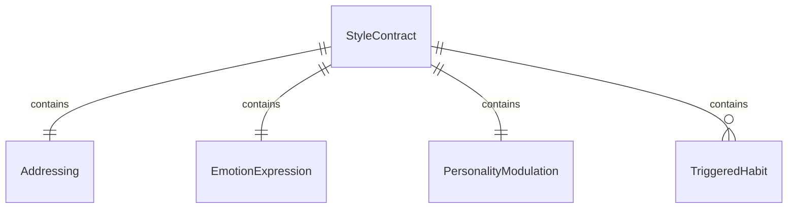

# CHAR-001 · StyleContract 数据模型

## Task Overview

### 为什么需要

Experience Layer 的四个组件（Emotion / Personality / Relationship / Habit）各自要把「域状态」翻译成「这一句该怎么说的约束」。如果四路信号各自为政、直接往 prompt 里贴文本，就会出现三种后果：

1. **不可解释**：无法回答「为什么这个称呼、为什么这个语气、为什么提这句习惯」——散落的字符串没有结构，评估和调试都无从下手。
2. **不可合成**：四路信号之间需要统一的冲突消解（硬约束 > 情绪 > 关系 > 人格 > 习惯），没有统一的容器就无法做优先级裁决。
3. **不可回放**：无法把「这一轮她为什么这么说话」作为结构化数据记录进 trace。

因此需要一个**统一的、纯数据的值对象**作为四路信号的汇流点。这个值对象就是 `StyleContract`。

### 解决什么问题

- 为 CHAR-002~007 提供**统一的类型底座**：所有组件产出同一套结构化字段，装配层（CHAR-006）只面对一个契约类型。
- 让「风格约束」成为**可解释、可审计、可回放**的一等公民，而非散落的 prompt 字符串。
- 通过 `Literal` 枚举 + `Field` 约束，把「非法风格状态」挡在类型系统之外（与既有 `BehaviorDirective` 的建模风格一致）。

## Architecture Position

`StyleContract` 位于 Experience Layer 的最底层，是**所有组件产出的汇聚点**，也是装配中枢（CHAR-006）的唯一输出：

```text
Emotion System ──┐
Personality ─────┤
Relationship ────┼──→ StyleContract ──→ PromptBuilder(style 段) ──→ LLM
Habit ───────────┘
```

- **上游**：四路投影组件（CHAR-002~005）各自产出 `StyleContract` 的子结构字段。
- **下游**：CHAR-006 装配出完整 `StyleContract`；CHAR-007 把它翻译为 prompt 文本并记录进 trace。
- **边界**：它**不是真相源**（不落业务表），**不是服务**（无 IO / 无 LLM），只是「运行时的结构化投影值对象」——与 `BehaviorDirective` 同层级。

## Responsibility

**负责：**
- 定义 `StyleContract` 及其四个子结构（`Addressing` / `EmotionExpression` / `PersonalityModulation` / `TriggeredHabit`）的字段、枚举、默认值与约束。
- 提供把契约「序列化为 prompt 文本行」的纯方法（`prompt_lines()`），以及「一句话摘要」的生成方法（`style_hint`）。
- 用 `Literal` + `Field` 保证非法状态在构造期即被拒绝。

**不负责：**
- 不做任何情绪/关系/人格/习惯的**计算或判定**（那是 CHAR-002~005 的职责）。
- 不做四路信号的**装配与冲突消解**（那是 CHAR-006 的职责）。
- 不落数据库表、不写 IO、不调用 LLM、不 import 任何域服务（`state_engine` / `behavior_engine` 等）。
- 不把契约翻译成最终 prompt 的**注入段落与预算控制**（那是 CHAR-007 的职责）。

## Data Model

### 设计原则

**纯值对象，零真相源**。`StyleContract` 不落任何业务表；审计走既有的 `runtime_traces`（裁决 Q2：**不建 `style_contract_records` 表**）。所有字段要么是 `Literal` 枚举，要么是带 `Field` 约束的标量，全部可 JSON 序列化（便于随 trace 落库为 jsonb）。

### 字段设计

**`Addressing`（关系→表达档，由 CHAR-004 产出）**

| 字段 | 类型 | 默认值 | 说明 |
|---|---|---|---|
| `term` | `Literal["respectful", "name", "affectionate", "intimate"]` | `"name"` | 称呼档：敬称→名字→昵称→专属称呼 |
| `tone` | `Literal["polite", "natural", "warm", "affectionate"]` | `"natural"` | 语气档：客气体贴→自然→亲昵→带撒娇 |
| `initiative` | `Literal["passive", "responsive", "proactive", "devoted"]` | `"responsive"` | 主动程度档 |
| `emotion_expressiveness` | `Literal["restrained", "natural", "open"]` | `"natural"` | 情绪表达档：克制→自然→放开 |

**`EmotionExpression`（情绪→表达约束，由 CHAR-002 产出）**

| 字段 | 类型 | 默认值 | 说明 |
|---|---|---|---|
| `channel_bias` | `Literal["action", "verbal", "balanced"]` | `"balanced"` | 表达通道偏向（动作/语言/平衡） |
| `tone_directive` | `str`（≤30 字） | `""` | 语气指令，如「语气柔和、先倾听」 |
| `expression_intensity` | `Literal["subtle", "natural", "rich"]` | `"natural"` | 情绪表达强度（映射自 intensity） |

**`PersonalityModulation`（人格→调制参数，由 CHAR-003 产出）**

| 字段 | 类型 | 默认值 | 说明 |
|---|---|---|---|
| `assertiveness` | `float`（0..1） | `0.3` | 主动性 |
| `warmth` | `float`（0..1） | `0.8` | 温暖/亲昵度 |
| `curiosity` | `float`（0..1） | `0.6` | 求知/追问倾向 |
| `patience` | `float`（0..1） | `0.7` | 耐性（倾听与给建议的先后） |
| `baseline` | `dict[str, float]` | `{}` | 各轴基线（Persona 导出，不可变） |
| `bound` | `dict[str, float]` | `{}` | 各轴漂移上限（Persona 导出，不可变） |

**`TriggeredHabit`（习惯→行为指令，由 CHAR-005 产出）**

| 字段 | 类型 | 默认值 | 说明 |
|---|---|---|---|
| `rule_id` | `str` | `""` | 命中习惯的 id |
| `priority` | `int`（1..5） | `3` | 习惯优先级 |
| `instruction` | `str`（≤40 字） | `""` | 行为指令（非硬编码回复，只描述倾向） |

**`StyleContract`（装配中枢产出）**

| 字段 | 类型 | 默认值 | 说明 |
|---|---|---|---|
| `addressing` | `Addressing` | `Addressing()` | 关系表达档 |
| `emotion_constraint` | `EmotionExpression` | `EmotionExpression()` | 情绪表达约束 |
| `personality_modulation` | `PersonalityModulation` | `PersonalityModulation()` | 人格调制参数 |
| `habits` | `list[TriggeredHabit]` | `[]` | 命中的习惯指令 |
| `forbidden` | `list[str]` | `[]` | 禁止项（人格硬约束） |
| `principles` | `list[str]` | `[]` | 角色原则（人格硬约束） |
| `style_hint` | `str` | `""` | 一句话风格摘要（调试/trace 用） |

### 关系



- `StyleContract` 是纯聚合根，四个子结构无相互引用（正交，避免循环依赖）。
- 无数据库表；随 `runtime_traces` 以 jsonb 形式记录（CHAR-007 负责，本 Task 只保证「可 JSON 序列化」）。

## Core Components

### 数据类（单一文件 `app/models/style_contract.py`）

| 组件 | 类型 | 职责 |
|---|---|---|
| `Addressing` | Pydantic `BaseModel` | 关系表达四维档（term/tone/initiative/emotion_expressiveness） |
| `EmotionExpression` | Pydantic `BaseModel` | 情绪表达约束三字段 |
| `PersonalityModulation` | Pydantic `BaseModel` | 人格四轴 + baseline/bound 元数据 |
| `TriggeredHabit` | Pydantic `BaseModel` | 单条命中的习惯指令 |
| `StyleContract` | Pydantic `BaseModel` | 聚合根；提供 `prompt_lines()` / `build_style_hint()` |

### 关键方法（纯函数，无副作用）

- `StyleContract.prompt_lines() -> list[str]`：把非空字段翻译为 prompt 文本行（如 `称呼：昵称`、`情绪：温柔地、关切地`、`习惯：先陪着再开口`、`禁止：不无条件赞同`）。空字段跳过。
- `StyleContract.build_style_hint() -> str`：按「情绪基调 + 关系基调 + 人格基调」拼接一句话摘要。
- 采用 `@model_validator(mode="after")` 对 `PersonalityModulation` 的四轴做 0..1 范围校验（沿 `behavior_strategy.py` 的校验风格）。

**无 Service / Interface / Repository**——本 Task 不引入任何运行时服务边界，仅数据定义。

## Runtime Flow

本 Task 无运行时流程（纯数据定义）。其「被使用」的流程如下（供理解，非本 Task 实现）：

```text
CHAR-002/003/004/005 产出子结构
        ↓
CHAR-006 聚合为完整 StyleContract
        ↓
CHAR-007 调 prompt_lines() → style 段注入 prompt → LLM
                      └→ 记录进 runtime_traces(jsonb)
```

## Integration

| 系统 | 集成方式 | 说明 |
|---|---|---|
| **Chat** | 无直接集成 | 经 CHAR-007 的 PromptBuilder 消费；本 Task 不碰 `answer_chain` |
| **Memory** | 无 | 不读记忆、不改记忆 |
| **Reflection** | 无 | 不产 Insight、不读 Insight |
| **Autonomy / Decision** | 无 | 与行为切面正交，只做表达侧的值对象 |
| **Behavior（BehaviorDirective）** | 并列共存 | 沿用 `behavior_strategy.py` 的建模风格，但**不修改** `BehaviorDirective`，二者是不同切面的输出 |

## Edge Cases

| 场景 | 处理 |
|---|---|
| 所有字段取默认值（空契约） | `prompt_lines()` 返回空列表或仅「风格：自然」，不抛错 |
| `PersonalityModulation` 轴值越界（<0 或 >1） | `Field(ge=0.0, le=1.0)` 在构造期拒绝 |
| 枚举字段收到未定义值 | `Literal` 校验拒绝（Pydantic `ValidationError`） |
| `habits` 为空 / `forbidden` 为空 | 正常合法状态，`prompt_lines()` 跳过对应段 |
| `instruction` 超 40 字 / `tone_directive` 超 30 字 | `Field(max_length=...)` 拒绝，防止 prompt 膨胀 |
| 后续 Task 传入非 `StyleContract` 对象 | 类型注解 + Pydantic 校验在装配层拦截（非本 Task 责任，但类型定义保证了这一点） |

## Implementation Plan

1. **Step 1**：新建 `app/models/style_contract.py`，定义五个 `BaseModel` 类与全部 `Literal` 枚举、`Field` 约束、默认值。
2. **Step 2**：实现 `prompt_lines()` 与 `build_style_hint()` 两个纯方法；实现 `PersonalityModulation` 的 `@model_validator` 范围校验。
3. **Step 3**：编写单测（默认构造、枚举合法/非法、字段长度约束、`prompt_lines`/`style_hint` 稳定性），`pytest` 全绿，`pylint` 不降级。

## Acceptance Criteria

- [ ] `app/models/style_contract.py` 可 import，`StyleContract` 带默认值可实例化。
- [ ] 所有枚举字段非法值被 Pydantic 拒绝；轴值越界被 `Field` 拒绝。
- [ ] `prompt_lines()` 输出为无花括号转义问题的纯文本列表，空字段跳过。
- [ ] `build_style_hint()` 输出稳定、可读。
- [ ] 不引入数据库表、不调用 LLM、不 import 任何既有域服务（`state_engine` / `behavior_engine` / `memory` 等）。
- [ ] 单测覆盖：默认构造、各字段合法/非法、长度约束、`prompt_lines`/`style_hint` 稳定。
- [ ] `pytest` 全绿；`pylint` 评分不低于基线。
