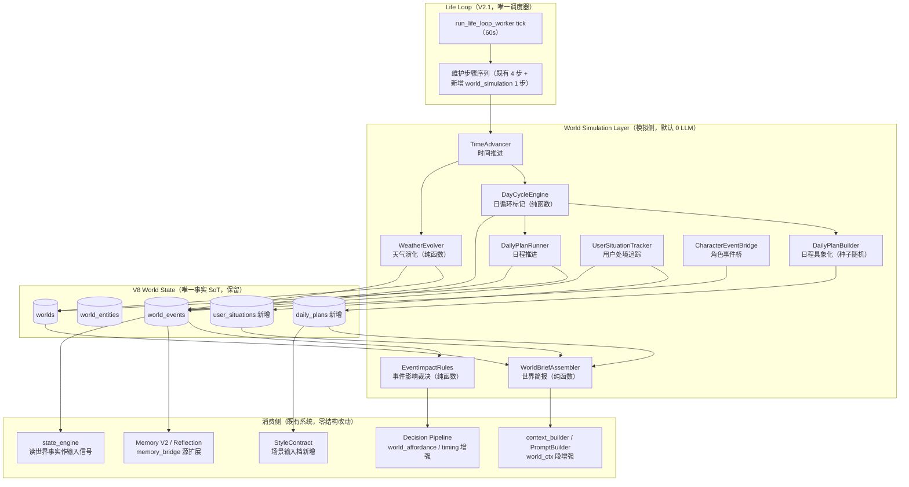
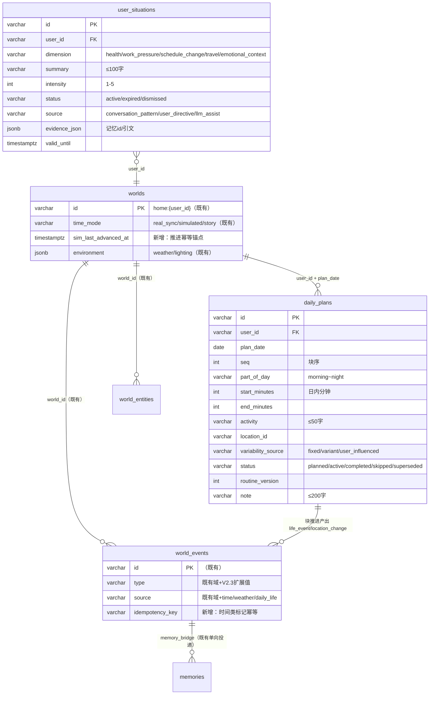

# V2.3.0 World Simulation Architecture

> **状态**：架构设计稿（仅设计，未排期、未实现）
> **前置**：V2.0.0 Memory V2 / Reflection / Life Loop；V2.1.0 Agent Runtime / Goal Stack / Decision Pipeline；V2.2.0 Character Experience；V1.0.0 V8 World State System（已实现）
> **定位**：World Simulation = **Context + Trigger Layer**。给既有 Runtime 提供"世界此刻在发生什么"的上下文与触发素材，不创建任何新的执行设施。
> **铁律**：零新建 Agent Runtime / Event Engine / Chat Pipeline；确定性优先、LLM 默认不参与；世界永不写 Character 域状态；全程 Flag 灰度，关闭时与 V2.2.0 逐字节一致。

---

## 1. Background

### 1.1 版本脉络

| 版本 | 主题 | 已有能力 |
|---|---|---|
| V2.0.0 | Memory & Reflection | Memory V2（候选→转正→衰减）、Reflection（每日+事件双触发三道闸）、Life Loop（trigger_registry 轮询 + outbox 一致性 + loop_runs 记账） |
| V2.1.0 | Agent Autonomy | Agent Runtime（三种 Run Profile）、Goal Stack（L3~L0 四层）、Decision Pipeline（九源候选 / P0~P4 / 六维评分 / 四风险闸）、Action Engine（九能力）、LLM Gateway |
| V2.2.0 | Character Experience | Emotion / Personality / Habit / Relationship Experience / Response Style（StyleContract 合成，零新表） |

当前对话链路：

```text
用户输入 → Context → Memory → Character Experience → Autonomy → Action → Response
```

角色已经有人格、有情绪、会主动。但这条链路里**没有世界**：角色飘在一个无时间、无天气、无日常的身外之境。

### 1.2 已有的世界基础（V8 事实盘点）

V8 World State System 已交付了"世界状态"的持久化底座，V2.3.0 **不再重建**：

- **四表**：`worlds`（time_mode = real_sync / simulated / story、sim_time、sim_rate、current_location、environment JSON 含 weather/lighting）、`world_entities`（物品状态机）、`world_events`（type / importance / status 状态机 / due_at / source）、`world_snapshots`。
- **TimeProvider**：三种时间模式，real_sync 读真实钟，simulated = sim_time + delta × sim_rate，story 原样；context 已含星期与 part_of_day。
- **编排**：`world_engine` 的 build_context（每轮世界切片，预算 600 字符）/ run_turn_update（确定性解释器）/ run_maintenance（到期触发、物品过期）/ collect_facts（part_of_day / location / weather / salient_events）。
- **既有出口**：WorldContext 进 Prompt（world_ctx 段）、world_facts 进 Autonomy（W1/W2/W3 修饰规则）、完结重要事件经 memory_bridge 单向投递记忆候选。

**V8 的边界**（V2.3.0 必须继承）：World 生产事实、Character 消费事实；World 对情绪/关系/记忆/目标/行为零写回；World 永远是旁路，失败只降级。

### 1.3 V2.1.0 预留的演进接口

V2.1.0 architecture §10.2 明确预留："把世界自主事件流升级为**世界侧模拟时钟**（环境按自身节拍产生事件），Runtime 无需改形——**event_driven Run Profile 已是入口**"。§10.1 同时指出多世界/多角色共享 World 的并发仲裁留待后续。

V2.3.0 即沿这条预留线落地：**世界从"被动账本"升级为"自主节拍器"**，但只产出事实与触发，不接管任何执行。

---

## 2. Problems

| # | 问题 | 现状证据 |
|---|---|---|
| P1 | **世界是账本不是世界**：sim_time 只能被显式 `advance_time` 推进，没有自主时间流逝；无按日/周的日程概念。角色"住"在一个静止的世界里 | TimeProvider 三模式齐备但无推进循环；全库无 schedule 表 |
| P2 | **角色没有生活**：凌晨 3 点与晚上 10 点角色状态等同；Habit 触发条件只有 keywords / user_emotions / user_events / emotion_events / conflict_statuses / memory_present 六类，**无任何时间维度** | `habit_triggers` 条件域无 time-of-day 字段 |
| P3 | **事件来源贫乏**：world_events 只有用户叙述（解释器）、提醒日程、角色动作（CAS）三类来源；没有天气变化、节日、用户处境、目标完成等自然事件流。主动行为的素材几乎完全依赖用户输入 | world_events.source 域现状；autonomy 素材依赖 trigger_registry 三类 |
| P4 | **场景单薄**：地点只有 home 静态层级；current_location 几乎不变化；场景不影响表达风格、行为候选与情绪基线 | `HOME_LOCATIONS` 代码资产；StyleContract 四路输入中无场景 |
| P5 | **时间与决策脱节**：Decision Pipeline 的 timing 维度只有 current_focus 在途判断，无日程感知；主动消息可能在任何时刻发出，缺乏"世界此刻在发生什么"的时机判断 | decision_pipeline 六维评分中 timing 的现状 |

一句话：**有人格、有情绪、会主动，但没有生活在一个持续运行的世界里。**

---

## 3. Design Goals

| # | 目标 | 判定标准 |
|---|---|---|
| G1 | **世界持续运行**：时间自行流逝，天气自行演化，不依赖用户是否在线 | 用户离线三天后回来，世界有连续的、可追溯的变化记录 |
| G2 | **角色有生活**：角色有按日具象化的作息，且可被观察、被感知 | Prompt 中能看到"她此刻在做什么"；主动消息能聊"她今天做了什么" |
| G3 | **事件自然涌现**：用户事件、世界事件、角色事件三源汇入唯一事件表 | 世界事件不依赖用户输入也会产生 |
| G4 | **场景塑造表达**：地点与情境进入风格与情绪的输入面 | 咖啡店与深夜卧室的回复风格可区分 |
| G5 | **零新建基础设施**：World Simulation 只作为 Context + Trigger Layer | 无新 Runtime / 新 Event Engine / 新 Pipeline / 新 Memory 系统（见 §9） |
| G6 | **确定性优先**：模拟默认 0 LLM，随机性可复现 | 每日计划由种子生成、可重放；LLM 辅助仅作为独立灰度项 |
| G7 | **全程灰度**：总闸 + 子闸，默认全关 | Flag off 时 prompt 与 V2.2.0 逐字节一致（含专项测试） |

核心判断：**V2.3.0 不给角色加新器官，而是给既有器官加"世界的输入信号"。** 影响一律走"世界广播事实，各系统在既有更新点拉取消费"的模式。

---

## 4. Overall Architecture

### 4.1 定位图

```text
用户输入 ─► Context ─► Memory ─► Character Experience ─► Autonomy ─► Action ─► Response
              ▲                                                          ▲
              │                 V2.3.0 World Simulation                   │
              └──────────── (Context + Trigger Layer) ───────────────────┘
                    世界简报进 Context          世界事件进 Autonomy 触发
```

### 4.2 组件总览



读法：

- **模拟侧**全部挂在 Life Loop 既有维护步骤上，产出只落世界域（worlds / world_events / 新表 daily_plans / user_situations）。
- **消费侧**全部是既有系统在既有更新点上**多读一份世界事实**，结构零改动。
- 唯一事件 SoT 仍是 `world_events`；唯一调度器仍是 Life Loop。

### 4.3 版本边界裁决表

| 裁决 | 对象 | 说明 |
|---|---|---|
| **Preserve** | V8 四表结构、TimeProvider 三模式、确定性解释器、WorldContextSelector、memory_bridge 单向投递、V3 scene_state 语义、decision_pipeline 五段与 P0~P4、Goal Stack 四层、Action Engine 九能力、Life Loop/trigger_registry/outbox/background_jobs 机制、StyleContract 优先级框架、character_goals/personality_state 等全部既有表 | 一律不动 |
| **Extend** | `worlds`（+1 列）、`world_events`（+1 列 + 类型域扩展）、`character_goals.origin`（值域 +world_event）、life_loop 维护步骤（+world_simulation）、context_builder 世界段（+WorldBrief）、style_assembler 输入（+场景档）、habit_triggers 条件（+时间维度）、interpreter（+用户处境模式）、memory_bridge（+新事件类型）、event escalation 白名单（+V2.3 事件类型）、decision timing/world_affordance 输入 | 全部为输入面/值域/装配面的扩展 |
| **New** | `daily_plans`、`user_situations` 两表；TimeAdvancer / DayCycleEngine / WeatherEvolver / DailyPlanBuilder / DailyPlanRunner / UserSituationTracker / CharacterEventBridge / EventImpactRules / WorldBriefAssembler 九个组件；RoutineAsset / CalendarAsset / LocationRegistry 扩展 / SceneProfile 四个角色资产 | 全部在世界域或角色资产层 |
| **收编** | outbox_events + escalation 白名单 + trigger_registry：作为世界事件的**唯一投递通道**（沿用，不新建事件总线） | 世界事件到达决策的路径与 V2.1 完全同构 |

### 4.4 与既有循环的关系

- Life Loop 是**唯一调度器**：时间推进是维护步骤序列中的第 5 步（world_simulation），不是新循环、不是新常驻 task，main.py lifespan 零新增。
- 时间推进是纯计算（0 LLM、几条索引查询），**不受 Idle 短路影响**——世界在用户离线时继续运转，这正是 G1 的本意；但仍受 loop_runs 记账与熔断保护。
- 模拟侧与 V8 的纪律一致：纯函数引擎（day_cycle / weather / plan_builder / event_impact）无 IO 无 LLM，与 state_engine / behavior_engine / autonomy_policy 同一工程标准。

---

## 5. Core Components

### 5.1 World State System（V8 扩展：WorldBrief）

**Responsibility**

在 V8 世界状态之上回答一个新问题："**此刻**世界整体处于什么状态"。V8 的 WorldContext 回答"世界上有什么"，WorldBrief 补充"世界上正在发生什么"：

- 时间：日期 / 星期 / part_of_day / 节气季节 / 节假日
- 地点：角色当前所在地（来自日程推进或解释器）
- 天气：当前天气与体感趋势（来自演化器）
- 当前事件：活跃 world_events 的显著切片 + 今日日程块 + 用户活跃处境

渲染示例（注入 prompt 的【当前世界】段增强形态）：

```text
2026-09-14 周一 晚间（22:00）晴天
她此刻在家·客厅，今天的晚间安排是阅读。
用户今天工作压力较大（下午检出）。
```

**Data Model**：值对象（不落表），输入 = worlds + daily_plans（当前块）+ user_situations（active）+ world_events（active 且显著）。

**Runtime Flow**

1. 前台 run_chat_pipeline 既有第 2 步 `world_engine.build_context` 内，Flag 开启时由 WorldBriefAssembler 合成 WorldBrief；
2. WorldBrief 与既有 WorldContext 切片合并渲染进 world_ctx 段；预算策略：新增 `world_brief_char_budget=400`，总闸开启时世界段预算 600 → 1000，关闭时维持 600 不变；
3. 纯函数装配，任何输入缺失降级为空段（World 旁路纪律不变）。

**Dependencies**：读 world_engine / time_provider / daily_plan / user_situation；被 context_builder / PromptBuilder 消费。

### 5.2 Time Simulation System（时间流逝）

**Responsibility**

让时间自主流动，并在时间边界上产生事件。三个子件：

| 子件 | 职责 | 形态 |
|---|---|---|
| **TimeAdvancer** | 按各 time_mode 推进世界时间：real_sync 读真实钟并做标记幂等核对；simulated 按真实流逝 × sim_rate 推进 sim_time（单次推进设上限防补帧风暴）；story 不自动推进（跟随叙事显式推进） | application 编排（挂在维护步骤） |
| **DayCycleEngine** | 给定 TimeContext，计算应发而未发的**日循环标记**：day_start / part_of_day 跃迁（晨/午/晚/夜）/ day_close / week_boundary / season_change | 纯函数 |
| **CalendarAsset / WeatherEvolver** | CalendarAsset：节假日与纪念日静态资产（角色资产层）；WeatherEvolver：按季节基线 + 转移概率表推进天气，种子 = (world_id, date)，确定性可重放；天气落 worlds.environment 并发 weather_change 事件 | 资产 + 纯函数 |

**Data Model**：产出 world_events（type=time_marker / weather_change，source=time / weather），以新增 `idempotency_key`（如 `day_start:2026-09-14`）保证同一标记只发一次。

**Runtime Flow**

1. Life Loop 维护步骤 world_simulation（独立 interval 节流，如 60s）；
2. TimeAdvancer 推进时间 → DayCycleEngine 比对已发标记（查 idempotency_key）→ 补发到期标记；
3. WeatherEvolver 每日 day_start 时演化一次天气；
4. day_start 标记触发 DailyPlanBuilder（见 5.3）；part_of_day 跃迁触发 DailyPlanRunner 的块切换。

**影响通道**（时间如何影响四个系统——世界只广播，各系统拉取）：

- **Emotion**：state_engine 在既有 idle_recovery / 情绪衰减点读 TimeContext（深夜 → energy 恢复偏向、表达欲下降信号）；
- **Habit**：habit_triggers 新增 time_of_day / part_of_day / day_type 条件类型，既有触发评估器拉取 TimeContext 判定；
- **Autonomy**：autonomy_policy 与 decision timing 读 part_of_day + 日程块（深夜抑制琐事类主动；timing 维度获得日程感知）；
- **Relationship**：纪念日 / 节日 / 长时间未见等时间事实经既有 relationship narrative listener 与 milestone 评估作为证据消费。

**Dependencies**：world_engine（挂载）、settings（interval / 推进上限 / 事件风暴上限）；被 daily_life / autonomy / state_engine / habit 消费。

### 5.3 Daily Life System（日常生活）

**Responsibility**

把"角色的一天"从无到有具象化：**Routine（模板）→ DailyPlan（当日计划）→ 块推进（事实与事件）**。

| 子件 | 职责 |
|---|---|
| **RoutineAsset** | 角色资产（代码/配置，与 HABIT_LIST 同层）：按日型（工作日 / 周末 / 节假日）× part_of_day 的活动块模板。每块含：activity、location_id、能量/情绪基线倾向、话题池、** variability（fixed 固定 / variant_weighted 加权随机 / 可被用户影响覆盖）** |
| **DailyPlanBuilder** | day_start 时将 Routine 具象化为当日计划：种子随机（seed = user_id + plan_date + routine_version，可重放）+ **用户影响**（用户处境 user_situations、承诺类记忆、显式请求 → 块替换/插入，如"用户生病"→ 晚间块变为探望陪伴；"明天陪我逛街"→ 次日下午块被用户块占据）。默认 0 LLM；LLM 辅助（如自然语言化当日安排）挂独立灰度闸 |
| **DailyPlanRunner** | part_of_day 跃迁时推进块状态：上一块 completed（发 life_event）→ 更新 worlds.current_location（地点变化时发 location_change 事件）→ 新块 active。被跳过块发 skipped 事件 |

**Data Model**：`daily_plans` 表（见 §6.2），status 状态机 planned → active → completed / skipped / superseded。

**Runtime Flow**

```text
day_start 事件 → DailyPlanBuilder 生成当日 N 块 → 落 daily_plans
part_of_day 跃迁 → DailyPlanRunner 块切换 → worlds.current_location 更新
             → life_event / location_change 事件 → 世界事件管线（5.4）
块完成 → 显著活动经 memory_bridge 成为记忆候选（"她今天去了咖啡店"）
```

**消费方式**：当前块进入 WorldBrief（"她此刻在做什么"）；decision timing 按块判断打断成本（工作中不打断琐事）；主动话题候选从"今日已完成块"取材；state_engine 读块的能量基线作 idle 恢复信号。

**设计要求对照**：固定习惯（fixed 块）✓ 随机变化（种子加权随机）✓ 用户影响（处境/承诺/显式请求绑定规则）✓。

**Dependencies**：RoutineAsset、user_situations、memory 命令面（读承诺）、CalendarAsset；产出被 WorldBrief / decision / state_engine / memory_bridge 消费。

### 5.4 Event System（世界事件）

**Responsibility**

三源汇入**唯一事件表 world_events**（不建第二事件引擎），并裁决事件对角色的影响权重。

**事件类型域扩展**（type 为既有自由域，只扩展取值，无结构变更）：

| 源 | 类型 | 示例 | 产生者 |
|---|---|---|---|
| 用户事件 | user_condition | 用户生病 / 工作压力增大 / 出差 | UserSituationTracker：post_process 第 8 步 world_update 扩展——解释器在既有确定性规则上新增处境模式（"我感冒了"→ health 维度），LLM 辅助提取挂独立灰度闸；处境落 user_situations 并发事件 |
| 世界事件 | time_marker / weather_change / calendar_event | 深夜来临 / 降温 / 节日 | DayCycleEngine / WeatherEvolver / CalendarAsset |
| 角色事件 | life_event / goal_completed / interest_emerged | 完成下午工作块 / 达成目标 / 产生新兴趣 | DailyPlanRunner / CharacterEventBridge（挂 goal 生命周期与 development/insight 产出的既有钩子，经 outbox 登记转 world_events） |
| 既有保留 | reminder / appointment / 角色动作事件 | 提醒到期 | 不变 |

**EventImpactRules（纯函数）**：输入事件（type / importance / payload），输出影响裁决包——urgency（是否值得打断）、care_relevance（是否关切用户）、topic_value（可聊性）、goal_opportunity（可否转化为目标机会）。这是世界事件进入决策的**唯一换算口径**，替换 V8 时代 W1/W2/W3 硬编码修饰的输入源（规则本身保留兼容）。

**Event Trigger / Processing（全部沿用既有机制，零新建）**：

| 通道 | 机制 | 用途 |
|---|---|---|
| 到期触发 | world_maintenance 到期检查 → trigger_registry（action_due） | 提醒/日程类 |
| 事件升级 | outbox + `v21_event_escalation_types` 白名单扩展（V2.3 类型受总闸门控）→ run_event_pregate → **event_driven Run** | 高重要性事件即时反应 |
| 闲置素材 | autonomous_tick 的 collect_facts / world_facts 叠加 EventImpact 输出 | 主动消息候选 |
| 记忆沉淀 | memory_bridge 单向投递（源域扩展） | 中长期记忆 |

**风暴防护**：单 tick 单用户产生事件数设上限（如 8 条），超出折叠为一条摘要事件（与长离线追赶共用语义，见 §7.4）。

**Dependencies**：post_process（第 8 步扩展点）、outbox_consumer、goal 生命周期钩子；被 decision_pipeline / autonomy / memory 消费。

### 5.5 Scene System（场景）

**Responsibility**

让"在哪里"参与塑造"怎么说话、做什么、什么心情"。

| 子件 | 职责 |
|---|---|
| **LocationRegistry 扩展** | 在既有 home 层级资产上扩地点集：学校 / 公司 / 咖啡店 / 公园 / 旅行地点等；保持静态角色资产形态（V8 惯例），含中文别名与可供性 |
| **SceneProfile** | 每地点的场景画像（角色资产）：atmosphere_tags、tone_bias、topic_affordances、expressiveness_cap、energy/mood 基线倾向 |
| **MovementResolver** | 位置变更的唯一裁决：日程块切换（模拟推进）/ 用户叙事迁移（既有解释器）/ 显式动作（预留 V9 move 能力，本版不实现）。三者的优先级与冲突消解：用户叙事 > 日程推进 |

**场景影响的三个消费面**（读路径，零写回）：

- **回复风格**：style_assembler 新增场景输入档。V2.2 优先级序扩展为：**硬约束 > 情绪 > 关系档位 > 场景 > 人格调制 > 习惯**——场景只提供 tone_bias / topic_affordance / 表达上限，永不产生 forbidden / principles 类硬约束，不覆盖情绪通道（Flag 关闭时恢复 V2.2 四路原序）；
- **行为选择**：topic_affordances 进入 behavior_engine 话题面与 decision 候选（咖啡店 → 更放松、更易聊天）；
- **情绪**：SceneProfile 的 energy/mood 基线倾向作为 state_engine 既有更新点的输入信号之一。

**与 V3 scene_state 的关系**：V3 是会话域叙事连续性（location 为叙事位置），World 是跨会话物理事实源——**语义保持独立**，WorldBrief 呈现时以 World 为准、Scene 仅作会话内修饰，不一致问题登记遗留 Q3。

**Dependencies**：LocationRegistry / SceneProfile（角色资产）、daily_plans（块 → 位置）、worlds.current_location；被 style_assembler / behavior_engine / state_engine 消费。

---

## 6. Data Model

### 6.1 ER 图



### 6.2 新增表

**`daily_plans`**（当日日程，世界域事实）

| 字段 | 类型 | 说明 |
|---|---|---|
| id | varchar PK | |
| user_id | varchar | 每用户世界，同 worlds 归属 |
| plan_date | date | 计划日 |
| seq | int | 块序号 |
| part_of_day | varchar | morning / noon / afternoon / evening / night |
| start_minutes / end_minutes | int | 日内分钟区间（模板 + 种子抖动） |
| activity | varchar(50) | 活动名，字段长度纪律同 V3（≤50 字） |
| location_id | varchar(50) | LocationRegistry id |
| variability_source | varchar | fixed / variant / user_influenced |
| status | varchar | planned / active / completed / skipped / superseded |
| routine_version | int | 生成所用模板版本 |
| note | varchar(200) | 用户影响来源备注 |
| created_at / updated_at | timestamptz | |

约束：`uq_daily_plans_user_date_seq (user_id, plan_date, seq)`；索引 `idx_daily_plans_lookup (user_id, plan_date, status)`。历史计划按日清理（复用 world_snapshots 式保留策略）。

**`user_situations`**（用户处境，角色视角下"用户的处境是世界事实"——不触碰 Character 域，V8 铁律不破）

| 字段 | 类型 | 说明 |
|---|---|---|
| id | varchar PK | |
| user_id | varchar | |
| dimension | varchar(30) | health / work_pressure / schedule_change / travel / emotional_context |
| summary | varchar(100) | |
| intensity | int | 1~5 |
| status | varchar | active / expired / dismissed |
| source | varchar | conversation_pattern / user_directive / llm_assist |
| evidence_json | jsonb | 关联记忆 id / 命中引文（证据可追溯，同 Insight 纪律） |
| detected_at / valid_until / updated_at | timestamptz | 到期由 world_simulation 维护步过期 |

索引：`idx_user_situations_active (user_id, status, valid_until)`。同维度新处境 supersede 旧处境（单一主处境纪律，同 V3 PendingAction 惯例）。

### 6.3 扩展表

| 表 | 变更 | 说明 |
|---|---|---|
| worlds | + `sim_last_advanced_at timestamptz null` | TimeAdvancer 幂等推进锚点；real_sync 不用 |
| world_events | + `idempotency_key varchar(100) null` + 部分唯一索引（WHERE idempotency_key IS NOT NULL） | 时间/天气标记防重发；一般事件为 NULL 不受约束 |
| character_goals | origin 值域 + `world_event` | 无迁移（varchar 值域扩展），事件转化目标可溯源 |
| trigger_registry / outbox_events | 无结构变更 | 仅 escalation 白名单配置扩展 |

### 6.4 明确不建的表

- **事件总线表 / 消息队列表**——outbox_events 已承担事务性投递；
- **日程模板表**——Routine 保持角色代码/配置资产（同 HABIT_LIST 惯例，人工审核可控）；
- **天气历史表**——天气现状在 worlds.environment，变化轨迹由 weather_change 事件天然留痕；
- **场景表**——LocationRegistry / SceneProfile 为角色资产；
- **世界侧角色状态表**——世界永不写 Character 域（铁律）；
- **新的记忆表**——memory_candidates / memories / insights 全复用。

### 6.5 迁移与回滚

- `0044_daily_plans_user_situations`：建两新表；
- `0045_world_simulation_extensions`：worlds / world_events 扩列 + 部分唯一索引；
- 线性 down_revision 链接 0043，逆放可执行纳入回归；SQLite 不支持的约束变更沿用 batch_alter_table 模式。

---

## 7. Runtime Flow

### 7.1 世界推进主循环（日常节拍，0 LLM）

```text
Life Loop tick（60s）
  ↓ 维护步骤 world_simulation（interval 节流）
TimeAdvancer：推进世界时间（real_sync 核对 / simulated 增量×rate / story 跳过）
  ↓
DayCycleEngine：计算到期标记（day_start / part_of_day 跃迁 / day_close / 周界 / 季节）
  ↓ 以 idempotency_key 去重后写入 world_events
day_start → WeatherEvolver 演化天气（weather_change 事件）
         → DailyPlanBuilder 生成当日 daily_plans（种子随机 + 用户影响）
part_of_day 跃迁 → DailyPlanRunner 块切换
         → 上一块 completed（life_event）→ current_location 更新（location_change 事件）
  ↓
世界变化沉淀为 world_events（唯一 SoT）
```

### 7.2 事件驱动链路（示例：天气变冷 → 主动提醒）

对应用户给定的主链路 **World State → Event Detection → Autonomy Runtime → Goal → Action**：

```text
WeatherEvolver：晴 → 降温（weather_change，importance=medium）
  ↓ EventImpactRules：urgency=low / care_relevance=high / goal_opportunity=保暖关怀
  ↓ 三条既有入口并行可达：
    ① escalation 白名单命中 → outbox 登记 → event_driven Run（V2.1 既有 Profile）
    ② 事件落 world_facts，等待 autonomous_tick 闲置轮询拾取
    ③ 素材进入 collect_facts，供下次决策候选
  ↓ Autonomy Runtime（event_driven Run / autonomous_tick）
Decision Pipeline：goal_compile / world_affordance 源产出候选
    "提醒用户添衣"（user_care，origin=world_event）
  ↓ 六维评分（timing 读日程块：晚间在家 → 合适）→ 四风险闸通过
  ↓ Goal 层：写入 character_goals（L1 short_term，origin=world_event）
  ↓ Action 层：proactive_executor 生成主动消息 → 两阶段投递
```

全程复用 V2.1 Runtime 形态，Runtime 零改动——只有候选素材变丰富了。

### 7.3 前台对话链路

```text
run_chat_pipeline
  第2步 world_engine.build_context
      → WorldBriefAssembler：时间/天气/当前日程块/活跃处境/显著事件 → WorldBrief
      → world_ctx 段（预算 1000，Flag 开启时）
  第5步 scene/意图链（不变）
  第6步 StyleContract：场景档插入（关系之后、人格之前）
      → behavior_engine：topic_affordances 扩充话题面
  answer_chain 生成（不变）
  post_process 第8步 world_update：
      既有解释器 + UserSituationTracker 处境检出（确定性模式优先）
  post_process 其余步骤不变（不新增步骤）
```

### 7.4 长时间离线的追赶语义（catch-up）

用户离线 N 天后首 tick：

- N ≤ 7：逐日补发 day 边界标记（每日折叠为一条 day_summary 事件，不重放每个 part 跃迁）；
- N > 7：折叠为单条"长时间过去"事件 + 当前世界快照重建（天气按 N 天演化落终态，日程只生成今天）；
- 记忆侧：day_summary 事件走既有 memory_bridge，低重要度自然被评估器过滤——世界连续，但记忆不被噪声淹没。

---

## 8. Integration

### 8.1 集成总则

**世界只广播事实（写世界域），各系统在既有更新点拉取消费（读世界域）。** 任何"世界直接修改角色状态"的实现都违反 V8 铁律，评审一票否决。

### 8.2 逐系统契约表

| 系统 | 提供给它 | 从它接收 | 永不改变 |
|---|---|---|---|
| **Memory（V2.0）** | world_events 新类型经 memory_bridge 投递记忆候选（源域扩展）；day_summary 作低权重候选 | memory_candidates 评估与转正（既有）；user_situations 的 evidence 引用记忆 id | memories/memory_candidates 表结构；五源评估机制；类型 7 类封顶 |
| **Reflection（V2.0）** | 世界事件摘要进入证据窗（如"多次雨天情绪低落"→ 用户偏好类 Insight；"连续一周加班"→ 处境类 Insight） | 反思三道闸与额度（既有）；Insight 反哺 DailyPlanBuilder 的用户影响 | 触发机制、防幻觉三闸、insights 表 |
| **Relationship（V2.0/2.2）** | 共同活动完成事件（一起吃晚饭）→ narrative listener 证据；节日/纪念日 → milestone 评估素材；长时间未见 → 关系事件 | relationship_state / milestones 既有更新链 | relationship_* 全部表结构；关系对情绪单向 boost 方向 |
| **Emotion / Character State（V2.2）** | TimeContext / SceneProfile / 日程块能量基线，作为 state_engine 既有 idle_recovery 与情绪衰减点的**输入信号** | character_state 既有更新链（情绪仍由状态服务自己写） | character_state / emotion_history 表；情绪唯一写面 |
| **Autonomy（V2.1）** | world_facts 叠加 EventImpact 裁决包；escalation 白名单新类型 → event_driven Run；goal 候选素材（origin=world_event）；timing 维度的日程感知 | decision_pipeline 五段与 P0~P4 既有裁决；四闸门既有否决权 | Runtime 三 Profile 形态；决策管线阶段；budget/cooldown 数学 |
| **Habit（V2.2）** | habit_triggers 新增时间条件类型 + TimeContext 供触发评估 | 既有候选推导与人工生效机制（habit 仍不入库） | HABIT_LIST 资产形态；V2.2 生效链 |
| **Response Style（V2.2）** | 场景输入档（tone_bias / topic_affordances / 表达上限） | StyleContract 既有合成与冲突消解框架 | 优先级框架（场景仅插入一档）；Flag off 恢复原序 |

### 8.3 World Memory Integration（短/中/长期分流）

| 层级 | 内容举例 | 载体 | 机制 |
|---|---|---|---|
| **短期**（轮~小时） | 今天天气、当前日程块、活跃处境 | WorldBrief（工作上下文） | 只进 prompt，**不落 memories** |
| **中期**（天~周） | 第一次旅行、生日、吵架、重要活动 | memories（既有类型域） | memory_bridge 既有单向投递 + 新事件类型；幂等（materialized 标记）沿用 |
| **长期**（周+） | 用户喜欢冬天、雨天情绪低落 | insights（反思产物） | 世界事件摘要作反思证据，经三道闸固化 |
| **处境类** | 用户生病（持续数日） | user_situations（非记忆） | 有效期内活跃；**结束后**若重要则转事件 → 走中期记忆路径 |

原则：**记忆只沉淀"对关系与人格有意义的世界事实"，不搬运世界的原始账本。**

### 8.4 Flag 设计

| Flag | 控制面 | 默认 |
|---|---|---|
| `v23_world_simulation_enabled` | 总闸：维护步骤注册、WorldBrief、事件类型扩展 | off |
| `v23_time_advance_enabled` | TimeAdvancer / DayCycle / Weather / Calendar | off |
| `v23_daily_life_enabled` | Routine / DailyPlanBuilder / Runner | off |
| `v23_event_detection_enabled` | UserSituationTracker / CharacterEventBridge / EventImpactRules / escalation 白名单扩展 | off |
| `v23_scene_expansion_enabled` | LocationRegistry 扩展 / SceneProfile / 场景风格档 | off |
| `v23_habit_time_enabled` | habit_triggers 时间条件维度 | off |
| `v23_world_llm_assist_enabled` | 处境提取 LLM 辅助、日程自然语言化（可选增强，默认路径永不依赖） | off |

启用链：子闸开启要求总闸开启；总闸关闭时全部模拟组件不注册、prompt 与 V2.2.0 逐字节一致（专项测试对齐 V2.2.0 验收口径）。

---

## 9. Boundary

### 9.1 Non-Goals

| 不做 | 理由 |
|---|---|
| 新 Agent Runtime / 新 worker 循环 / 新常驻 task | Life Loop 唯一调度器；模拟=维护步骤 |
| 新 Event Engine / 事件总线 / 消息队列 | world_events + outbox + trigger_registry 已构成完整事件通路 |
| 新 Chat Pipeline / 新 post_process 步骤 | 只扩展第 2 步与第 8 步内部 |
| 新 Memory 系统 / 新反思机制 | 只扩源与证据输入 |
| NPC 行为模拟、多角色世界 | 登记至 Future Extension |
| V9 move 类自主动作（角色自主搬家/出门决策） | 本版位置变化仅来自节律与叙事；自主迁移留给 Action 能力扩展 |
| 用户日程建模（用户日历/作息推测） | 超出"角色视角的世界事实"边界，涉及隐私面，登记遗留 Q2 |

### 9.2 三禁令的落实

- **不建第二套 Agent Runtime**：全部模拟逻辑运行在 life_loop 既有 per-user 周期与维护步骤内，受 loop_runs 记账、熔断、预算保护。
- **不建第二套 Event Engine**：三源事件全部写 world_events 唯一 SoT，投递全部走既有 outbox / trigger_registry / escalation 三通道。
- **不建新的 Chat Pipeline**：前台只增强 build_context 与 post_process 第 8 步的内部实现，管线形状（10 步）与阶段序列不变。

### 9.3 边界不变量清单（评审红线）

1. 世界事件唯一 SoT 是 world_events；出现任何第二事件存储即违规。
2. 世界写入面仅限：worlds / world_entities / world_events / world_snapshots / daily_plans / user_situations。触碰 character_state / personality_state / relationship_* / character_goals 的写路径即违规（goals 写入仍由 goal_service 在决策管线内完成）。
3. 模拟默认路径 0 LLM；一切 LLM 参与必须挂在独立子闸之下且失败可降级为纯规则结果。
4. 随机性必须可复现（显式种子），禁止无种子随机进入世界事实。
5. scene_state（V3）读写语义零改动。
6. Flag 全 off 时：prompt 逐字节一致、维护步骤序列与 V2.2.0 一致、迁移可逆放。
7. 时间推进单次模拟跨度有上限；事件单 tick 有风暴上限；长离线走 catch-up 折叠语义。
8. WorldBrief / 场景风格档只增输入不增硬约束优先级；StyleContract 的 forbidden / principles 产生权不变。

---

## 10. Future Extension

| 方向 | 预留点 |
|---|---|
| **多世界** | worlds 已按 user 隔离；多世界 = world_id 路由 + 跨世界事件隔离，模拟组件天然无状态可多实例化 |
| **多角色 / NPC System** | V2.1 §10.3 预留：NPC = event_driven Profile + 精简决策管线；V2.3 的 DailyLife/Event 三源模式可直接复用为 NPC 节律模板；NPC 间事件共享 world_events SoT |
| **社交关系网络** | world_entities 扩 category 或独立 NPC 实体表；角色事件与 NPC 事件在同一事件表汇流，决策管线候选天然纳入 |
| **长期剧情系统** | 在 time_marker / calendar_event 之上叠加 arc（剧情线）事件类型；daily_plans 的用户影响机制可复用为剧情分支输入 |
| **世界-角色联合回放** | world_snapshots + agent_state_snapshots（V2.1 既有）时间对齐，本版事件 idempotency_key 提供更密的对齐锚点 |
| **天气/事件叙事 LLM 化** | v23_world_llm_assist_enabled 预留位：天气播报文案、日 summary 叙事化 |

---

## 附：遗留问题登记

| # | 问题 | 登记理由 |
|---|---|---|
| Q1 | simulated 模式与 real_sync 的 catch-up 语义差异（sim_rate > 1 时 day 边界密度） | 进入 Task 拆分时定具体折叠算法 |
| Q2 | user_situations 涉及健康/情绪等敏感面：检出范围、dismiss 权与留存期限 | 需产品口径裁决后再定检测模式清单 |
| Q3 | daily_plans 位置与 scene_state.location（V3 叙事位置）不一致时的呈现口径 | WorldBrief 以 World 为准的规则需实测验证 |
| Q4 | 长离线追赶后 memory freshness 检索权重是否需要按世界时间校准 | 与 Memory V2 生命周期参数联动，独立评估 |
| Q5 | WorldBrief 预算（400）与 V2.2 style 段的 prompt 总预算竞争 | 压测后决定是否动态预算 |
| Q6 | CalendarAsset 节假日维护方式（代码资产 vs 配置文件 vs 年度更新机制） | 跟随 RoutineAsset 资产化方案一并裁决 |
