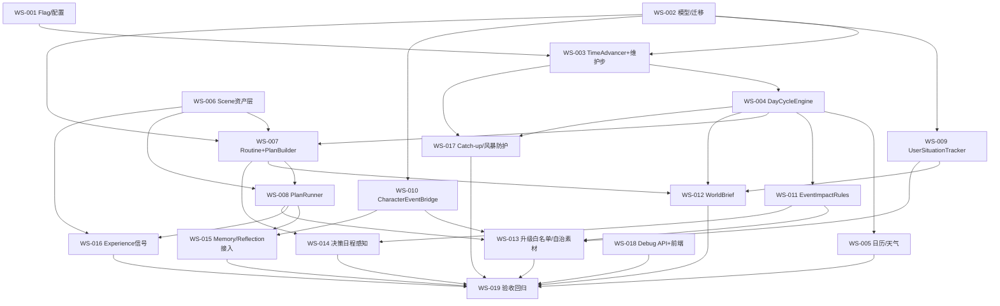

# V2.3.0 World Simulation System — Task Registry

> 上游：[../architecture.md](../architecture.md)（架构唯一依据，Task 不得超出其边界）
> 状态：WS-001 ~ WS-015、WS-017 ~ WS-019 **已完成**；WS-016 **部分完成**（见状态列注记）
> 全局红线：零新建 Runtime / Event Engine / Chat Pipeline；模拟默认路径 0 LLM；世界永不写 Character 域状态；`v23_*` 全部默认 off，总闸关闭时与 V2.2.0 逐字节一致。

## 任务索引

| ID | Task Name | Priority | Dependencies | Status |
|---|---|---|---|---|
| [WS-001](WS-001.md) | Flag 体系与世界模拟配置 | P0 | — | 已完成 |
| [WS-002](WS-002.md) | 数据模型与迁移（0044/0045） | P0 | — | 已完成 |
| [WS-003](WS-003.md) | TimeAdvancer 与 Life Loop 模拟维护步 | P0 | WS-001, WS-002 | 已完成 |
| [WS-004](WS-004.md) | DayCycleEngine 日循环标记 | P0 | WS-003 | 已完成 |
| [WS-005](WS-005.md) | CalendarAsset 与 WeatherEvolver | P1 | WS-004 | 已完成 |
| [WS-006](WS-006.md) | Scene 资产层（地点扩展/SceneProfile/MovementResolver） | P1 | — | 已完成 |
| [WS-007](WS-007.md) | RoutineAsset 与 DailyPlanBuilder | P1 | WS-002, WS-004, WS-006 | 已完成 |
| [WS-008](WS-008.md) | DailyPlanRunner 块推进与位置迁移 | P1 | WS-007, WS-006 | 已完成 |
| [WS-009](WS-009.md) | UserSituationTracker 用户处境追踪 | P1 | WS-002, WS-001 | 已完成 |
| [WS-010](WS-010.md) | CharacterEventBridge 角色事件桥 | P2 | WS-002 | 已完成 |
| [WS-011](WS-011.md) | EventImpactRules 事件影响裁决 | P1 | WS-004 | 已完成 |
| [WS-012](WS-012.md) | WorldBriefAssembler 与 Context 注入 | P0 | WS-004, WS-007, WS-009 | 已完成 |
| [WS-013](WS-013.md) | 事件升级白名单与自治素材增强 | P1 | WS-011, WS-009, WS-010 | 已完成 |
| [WS-014](WS-014.md) | 决策管线日程感知与世界目标机会 | P1 | WS-011, WS-007, WS-008 | 已完成 |
| [WS-015](WS-015.md) | World→Memory/Reflection 接入 | P1 | WS-004, WS-008, WS-010 | 已完成 |
| [WS-016](WS-016.md) | Character Experience 世界信号（Style/Emotion/Habit） | P1 | WS-006, WS-004, WS-008 | **部分完成**：SceneProfile 资产已就绪但未接入 brief/context（`v23_scene_expansion_enabled` / `v23_habit_time_enabled` 标记为 RESERVED） |
| [WS-017](WS-017.md) | Catch-up 追赶与事件风暴防护 | P1 | WS-003, WS-004 | 已完成 |
| [WS-018](WS-018.md) | 观测与调试（Debug API + 前端面板） | P2 | WS-002, WS-007, WS-009 | 已完成 |
| [WS-019](WS-019.md) | 全链路验收与逐字节一致性回归 | P0 | WS-001 ~ WS-018 | 已完成 |

## 依赖图

## 提交节奏（建议 5 个波次）

| 波次 | 内容 | Tasks | 建议提交 |
|---|---|---|---|
| W1 地基 | Flag/配置、模型迁移、Scene 资产 | WS-001, WS-002, WS-006 | 3 commits |
| W2 节律 | 时间推进、日循环、天气、处境、角色事件、影响裁决 | WS-003, WS-004, WS-005, WS-009, WS-010, WS-011 | 6 commits |
| W3 生活 | 日程资产/具象化/推进、世界简报、韧性 | WS-007, WS-008, WS-012, WS-017 | 4 commits |
| W4 消费 | 升级白名单/自治素材、决策感知、记忆接入、体验信号、调试 | WS-013, WS-014, WS-015, WS-016, WS-018 | 5 commits |
| W5 验收 | 全链路验收与逐字节一致性回归 | WS-019 | 1 commit |

提交信息风格：`feat:` / `fix:` / `test:` / `docs:` + 简短中文描述，单行 ≤ 30 字（如 `feat: WS-003 时间推进与模拟维护步`）。

## 全局约定

- 测试目录：`apps/backend/tests/v23/`（单元/集成/场景子目录自定）；对照回归复用既有全套件。
- 配置全部进入 `app/core/settings/world_simulation.py` + `enablement.py` 启用链校验；禁止散落魔法数。
- 每个涉及行为变更的 Task 必须包含「Flag off 时与上一版本行为一致」的对照测试。
- 结构变更只走 Alembic；SQLite 不支持的变更用 batch_alter_table 模式。
- 各 Task Detail 末尾「实施记录（Coding 回填）」在实现时补记偏差与裁决。
