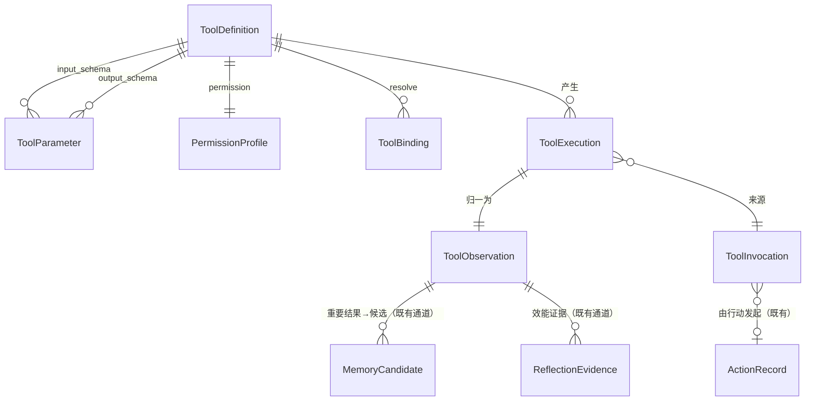

# V2.4.0 Tool System Architecture

> **状态**：架构设计稿（仅设计，未排期、未实现）
> **前置**：V2.0.0 Memory V2 / Reflection / Life Loop；V2.1.0 Agent Runtime / Decision Pipeline / Action Engine；V2.2.0 Character Experience；V2.3.0 World Simulation
> **定位**：Tool System = **能力治理层（Capability Governance Layer）**。它**不是**第二套 Action 引擎，而是 V9 Capability 之上补上「注册契约 + 权限闸 + 结果语义 + 扩展通道」四件事，让 Agent 的外部能力从"九个硬编码能力"升级为"可注册、可授权、可观测、可扩展的工具面"。
> **铁律**：零新建 Agent / Memory / Session / Event 系统；Action 仍是唯一执行编排器；世界仍由 `world_engine` 唯一写入；一切外部能力必须经 Tool Executor 且默认拒绝。

---

## 1. 背景与目标

### 1.1 为什么要做

前六个版本把角色的**内部**器官造齐了：

| 版本 | 能力 | 现状 |
|---|---|---|
| V2.0.0 | 长期记忆 + 反思 + 生命循环 | 角色记得住、想得通、有节拍 |
| V2.1.0 | Agent Runtime / Goal Stack / Decision Pipeline / Action Engine | 角色能决策、能自主、能执行九个内置能力 |
| V2.2.0 | 情绪 / 人格 / 习惯 / 关系体验 | 角色有表达质感 |
| V2.3.0 | 世界模拟（时间 / 日程 / 事件 / 场景） | 角色活在一个持续运行的世界里 |

但**外部世界**只开了一扇窗：

- **能力面是封闭的**：`ACTION_CAPABILITY_MAP`（`app/character/asuna/action.py`）把 9 个 ActionType 硬绑到 6 个 capability（`reminder` / `memory` / `world_action` / `environment_query` / `search` / `notification`），新增一个外部能力 = 改角色资产 + 改 planner + 改注册表，三处联动。
- **权限面是缺失的**：V9 六闸门（planner.md）判的是"能不能执行"（去重 / 配额 / 效果已满足），不判"**该不该授权**"。`send_notification`（发消息）、删除类操作与"查询天气"走同一条无差别通道。
- **结果语义是贫瘠的**：`CapabilityResult.payload` 是个自由 dict，`failure_kind` 只有 4 值。V2.3.0 的 `world_affordance` 候选、V2.1.0 的 `EventImpactRules` 都无从得知"这次调用到底产出了什么可消费的事实"。
- **扩展通道是占位的**：`search` 与 `notification` 两个能力实现体直接返回 `unavailable`，注释写着"接口预留"——**预留的就是本版本要做的东西**。
- **可观测性不足**：LLM 侧有 `llm_call_records`，决策侧有 `decision_records`，但"Agent 调了什么工具、花了多久、成功没有、被谁授权"没有统一台账。

一句话：**角色有手（Capability），但没有手掌（Tool System）——手指是焊死的，且分不清握拳和握刀的区别。**

### 1.2 目标

| # | 目标 | 判定标准 |
|---|---|---|
| G1 | **Agent 动态选择工具** | 工具集按 Run Profile / 场景 / 关系阶段动态投影进决策候选，而非固定词表；同一意图在不同工具集下选出不同工具 |
| G2 | **Tool 生命周期管理** | 每个工具可回答：谁注册的 / 何时启用 / 何时禁用 / 何时废弃 / 当前健康度；禁用即刻生效且可回滚 |
| G3 | **Tool 参数验证** | 声明式 input_schema 双层校验（结构校验 + 语义校验），校验失败在**执行前**拦下并产可读拒绝理由 |
| G4 | **Tool 执行结果反馈** | 结果结构化归一（status / effects / observations / failure_kind / usage），下游 Memory、Reflection、Autonomy 按统一契约消费 |
| G5 | **与 Memory / Reflection / Autonomy 集成** | 工具结果按「普通不保存、重要进候选」进入 Memory；Reflection 获得工具效能证据源；Autonomy 获得工具可及性事实 |
| G6 | **支持未来扩展第三方能力** | 新工具 = 声明 `ToolDefinition` + 实现 `execute` + 注册；**不改 planner、不改决策管线、不改 chat_pipeline** |
| G7 | **零新建基础设施** | 无新 Runtime / 新 Registry 表语义 / 新 Event 总线 / 新 Memory 系统（见 §9） |

### 1.3 与 V2.3.0 定位的对照

V2.3.0 的定位是"给既有器官加世界的输入信号"，本版本的定位是**"给既有器官加外部的手，并给这只手装权限锁"**。

| 维度 | V2.3.0 World Simulation | V2.4.0 Tool System |
|---|---|---|
| 层次 | Context + Trigger Layer | Capability Governance Layer |
| 加在哪 | 维护步骤 + Context 装配面 | Action 引擎的能力接线面（内层加固，不是并列层） |
| 产出 | world_events（事实） | ToolExecution（执行台账）+ ToolObservation（结果事实） |
| 铁律 | 世界只广播，各系统拉取 | 工具只执行，世界由世界侧唯一写入 |

---

## 2. 当前架构分析

### 2.1 可复用的既有设施（本版本的地基，一律不动）

```text
app/application/
├── action_engine.py        # V9 行动域唯一编排器（create → gates → plan → execute → integrate）
├── autonomy_engine.py      # V7 自治 tick（TriggerEvaluator → Policy → Executor）
├── chat_pipeline.py        # V2.1 前台关键路径（foreground_chat Run）
├── post_process.py         # 十步后处理（第 9 步 = 行动规划）
├── life_loop.py            # 唯一调度器（维护步骤序列）
├── outbox_consumer.py      # 跨域延迟投递消费器
├── world_engine.py         # V8/V2.3 世界唯一写面
└── agent_runtime/
    ├── controller.py       # Run 生命周期唯一管理者
    ├── profiles.py         # 三种 Run Profile 唯一声明处
    ├── llm_gateway.py      # LLM 预算闸门
    └── trigger_router.py   # 触发源归一 + escalation 白名单

app/services/action/
├── registry.py             # CapabilityRegistry（模块级单例，代码注册）+ Capability Protocol
├── planner.py              # 六闸门 + 计划装配
├── executor.py             # CapabilityExecutor（超时 + 异常归一 + usage）
├── detector.py             # 确定性意图检出（词表 + 参数抽取，零 LLM）
├── memory_bridge.py        # 行动 → 记忆候选（policy R1~R8）
├── relationship_bridge.py  # 行动 → 关系信号
└── capabilities/           # 6 个内置能力实现
```

**关键事实盘点**：

- `CapabilityRegistry` 已是"代码注册、运行期不增删"的单例，`describe()` 已能向 LLM 暴露能力清单——**Tool Registry 就是它的治理化外壳**，不需要新存储。
- `CapabilityExecutor.run()` 已做超时包裹、异常归一为 `failure_kind`、usage 计时长——**Tool Executor 是它的语义强化**。
- `action_records` 表已有 `steps`（含每步 capability/action/params/status/result）、`attempt`、`next_retry_at`——**工具执行台账已有落点，不需要新表承接执行态**。
- `decision_pipeline` 已有 `capability` 候选源（P3），且 `_CAPABILITY_TYPE_HINTS` 已建立 capability → goal type 的映射——**工具选择天然落在既有候选面上**。
- `memory_policy`（R1~R8）与 `memory_bridge` 已构成行动→记忆的唯一通道，`ActionRecord.result.effects` 的 `kind=memory` 已作幂等标记——**工具结果进记忆不需要新机制**。
- `reflection` 的证据窗由 `aggregate_evidence_windows` 聚合，source 已含 `action_records`——**工具效能进反思只需扩证据源**。
- `enablement.py` 已建立"总闸 + 子闸 + 串行链校验 + RESERVED 告警"的完整范式——**本版本照抄该范式**。

### 2.2 现有断层（本版本要补的洞）

| # | 断层 | 代码证据 | 影响 |
|---|---|---|---|
| B1 | 能力绑定是硬编码的 | `ACTION_CAPABILITY_MAP` 是静态 dict，`planner.assemble_plan` 直接查表；注册表 `register()` 拒绝重名但无版本、无别名、无分组 | 新增工具需改 3 处代码；无法按场景/关系裁剪工具面 |
| B2 | 参数校验是弱类型的 | `ActionSchema.validate()` 只查 required 非空 + 可选 validator；无类型约束、无枚举约束、无长度预算 | 参数错误在第 8 步才暴露，且错误信息不可读 |
| B3 | 无权限语义 | 六闸门里没有"授权"概念；`send_notification` 与 `query_environment` 同等对待 | 高风险动作不可控；违反 §9 安全原则 |
| B4 | 结果无消费契约 | `CapabilityResult.payload` 自由 dict；下游靠 `payload.get("world_event_id")` 之类的字符串键硬取 | 新工具接入即脆断（V9-013 存在的意义就在于收拾这个） |
| B5 | 两个能力是空壳 | `search.py` / `notification.py` 直接返回 `unavailable` | "支持第三方能力"没有可效仿的样板 |
| B6 | 无工具可观测面 | 无工具级调用台账（`llm_call_records` 只管 LLM，`decision_records` 只管决策） | 无法回答"哪个工具最常失败" |
| B7 | 自治侧工具面为空 | `decision_pipeline.run_pipeline(capabilities=...)` 参数存在，但 `autonomy_engine` 从未传入 | 自治决策感知不到可用工具 |

### 2.3 既有资产与本文档的对应关系

| 你要的设计 | 既有承载物 | 本版本动作 |
|---|---|---|
| Tool Model | `Capability` Protocol + `ActionSchema` + `CapabilityResult` | **扩展**（新增 ToolDefinition / ToolExecution / ToolObservation） |
| Tool Registry | `CapabilityRegistry` 单例 | **扩展**（加命名空间 / 状态 / 版本 / describe 增强） |
| Tool Executor | `CapabilityExecutor` | **强化**（加权限闸 + 结果归一） |
| Tool Decision | `decision_pipeline.collect_candidates(capabilities=...)` | **接线**（自治侧首次传入；工具面按 Profile 投影） |
| 权限层 | 无 | **新增**（`ToolPermissionGate` 纯函数） |
| 执行台账 | `action_records.steps` | **扩展**（steps 内加 tool_id / permission / observations） |
| 记忆集成 | `services/action/memory_bridge.py` | **泛化**（从 action_type 边界表升级为 tool_id 边界表） |
| 反思集成 | `services/reflection/evidence.py` | **扩源**（加 tool 效能证据窗） |

---

## 3. Tool System 总体架构

### 3.1 层图

```text
                    ┌──────────────────────────────────────────┐
                    │              Agent Core                  │
                    │  chat_pipeline（前台）/ life_loop（后台）  │
                    │  Run Profile 加载 → 阶段编排（V2.1 既有）  │
                    └────────────────────┬─────────────────────┘
                                         │ 需要外部能力
                                         ▼
                    ┌──────────────────────────────────────────┐
                    │        Tool Decision Layer               │
                    │  ToolSurfaceResolver（工具面投影，纯函数） │
                    │  Decision Pipeline.capability 候选源      │
                    │  ToolSelector（候选→选中工具，纯函数）     │
                    └────────────────────┬─────────────────────┘
                                         │ ToolInvocation（意图）
                                         ▼
                    ┌──────────────────────────────────────────┐
                    │            Tool Registry                 │
                    │  ToolDefinition 声明（代码注册，单例）      │
                    │  命名空间 / 状态 / 版本 / 能力域 / 健康度   │
                    └────────────────────┬─────────────────────┘
                                         │ 解析为 ToolBinding
                                         ▼
                    ┌──────────────────────────────────────────┐
                    │            Tool Executor                 │
                    │  PermissionGate（授权闸，纯函数）          │
                    │  ParamValidator（双层校验，纯函数）        │
                    │  Invoker（超时 / 异常归一 / usage）        │
                    └────────────────────┬─────────────────────┘
                                         │ ToolObservation（结果）
                                         ▼
                    ┌──────────────────────────────────────────┐
                    │        External Capability               │
                    │  内置 / Channel / External API / 自定义    │
                    └──────────────────────────────────────────┘
                                         │
              ┌──────────────────────────┴──────────────────────────┐
              ▼                          ▼                          ▼
       World State（经 world_engine）  Memory（经 policy R1~R8）  Reflection（经证据窗）
```

**五层职责**

| 层 | 职责 | 不做什么 | 实现形态 |
|---|---|---|---|
| **Agent Core** | 决定"这一轮要不要外部能力"；加载 Run Profile；编排阶段 | 不选具体工具、不校验参数、不直接调外部 API | V2.1 既有（零改动） |
| **Tool Decision Layer** | 按当前语境**投影出可用工具面**；把工具作为决策候选参与六维评分；选出获胜工具 | 不执行、不落库、不管权限细节 | 纯函数 + 既有决策管线 |
| **Tool Registry** | **声明与发现**：工具是什么、参数长什么样、属于哪个命名空间、当前什么状态 | 不执行、不判断能不能用（那是权限层的事） | 模块级单例（V9 惯例） |
| **Tool Executor** | **纪律**：授权闸 → 参数校验 → 超时调用 → 异常归一 → 结果结构化 | 不做重试决策（在 action_engine）、不做业务判断 | 编排 + 纯函数组件 |
| **External Capability** | 真正动手：写世界事件、发飞书消息、调第三方 API | 不知道自己被谁调用、不知道对话上下文（`ExecutionContext` 隔离，V9 纪律） | 各工具自带实现 |

### 3.2 关键设计裁决：Tool 与 Capability 的关系

**这是本版本最重要的一个裁决，必须先钉死。**

```text
Capability（V9，已存在）  =  能力的"实现体"：一组动作 + 执行逻辑 + 参数 schema
Tool（V2.4.0，新增）      =  能力的"对外名片"：语义身份 + 治理属性 + 消费契约
```

三层映射关系：

```text
ActionType（用户/决策层语义）    create_reminder
        │  ACTION_TOOL_MAP
        ▼
Tool（治理层身份）               tool:reminder.create
        │  ToolBinding
        ▼
Capability（执行层实现）          ReminderCapability.execute("create", params)
```

**为什么不能把 Tool 直接做成 Capability 的别名？**

因为二者生命周期与变更频率完全不同：

- Capability 是**代码**：随版本发布增删，运行期不变，需要重启才能换实现。
- Tool 是**契约**：可被动态投影（不同 Run Profile 给不同工具面）、可被单独禁用（风控熔断某个工具而不回滚代码）、可被单独计费/计量、可被第三方以自己的名义注册进**外部命名空间**。

**为什么不能新建一套 Tool 执行链路？**

因为那会与 `action_records` 的执行台账、六闸门、重试退避、outbox 投递全部重复实现一遍——这正是 §9 明令禁止的。

**结论（落点）**：

> **Tool 是 Capability 的治理外壳，不是它的替代品。Action 仍是唯一执行编排器，Tool Executor 是它的能力接线面。**

### 3.3 数据流全景（一次工具调用的完整路径）

```text
① 触发
   ├─ 前台：chat_pipeline → post_process 第 9 步 run_action_planning
   └─ 后台：autonomy_engine tick → _produce_autonomy_action
                    │
② 决策（Tool Decision Layer）
   ToolSurfaceResolver.resolve(run_kind, context) → ToolSurface（可用工具 id 集）
        │
   decision_pipeline.collect_candidates(capabilities=surface.tool_ids)
        │  capability 候选（P3）参与六维评分
   decision_pipeline.select() → winner
        │
   ToolSelector.select(intent, surface) → ToolBinding(tool_id, capability, action)
        │
③ 治理（Tool Registry）
   ToolRegistry.resolve(tool_id) → ToolDefinition
   ToolRegistry.status_of(tool_id) → enabled / disabled / deprecated
        │
④ 授权（Tool Executor.PermissionGate，纯函数）
   ToolPermissionGate.evaluate(defn, invocation, snapshot) → PermissionDecision
        │  allow / confirm_required / deny
        │  confirm_required → 生成确认请求 → 中断本轮（不执行）
        ▼
⑤ 校验（Tool Executor.ParamValidator，纯函数）
   input_schema.validate(params) → structural errors + semantic errors
        │  失败 → ToolObservation(status=invalid) 不触达外部能力
        ▼
⑥ 执行（Tool Executor.Invoker）
   capability.execute(action, params, ExecutionContext)
        │  asyncio.wait_for(timeout) / 异常归一 / usage 计时
        ▼
⑦ 结果归一（Tool Executor.ObservationNormalizer，纯函数）
   CapabilityResult → ToolObservation
        │  {status, effects[], observations{}, failure_kind, usage, redacted_fields}
        ▼
⑧ 回填与投递（既有通道，零新建）
   action_engine.execute_plan → record.steps[].result = observation
   action_engine.integrate_result → 四通道
        ├─ world  ：deferred_world_op → outbox_consumer → world_engine（唯一写面）
        ├─ memory ：memory_bridge 泛化版（policy R1~R8）→ memory_repository
        ├─ relationship：relationship_bridge
        └─ note   ：行动 note → 回复素材
        ▼
⑨ 反馈（下游拉取）
   ├─ Chat：ToolObservation.observations 进 reply 素材（工具结果如何影响回复内容）
   ├─ Autonomy：tool_facts（可用工具 / 最近成败）进 PolicySnapshot
   └─ Reflection：tool 效能证据窗 → Insight
```

### 3.4 异常处理总则

| 异常类别 | 发生位置 | 处理 | 是否重试 | 是否影响回复 |
|---|---|---|---|---|
| **工具未注册** | Registry.resolve | `status=unavailable`, `failure_kind=unavailable` | 否 | 否（回复照常，仅不带工具效果） |
| **工具已禁用** | Registry / Decision | 该工具**不进工具面**，等价于不存在 | 否 | 否 |
| **授权拒绝** | PermissionGate | `status=denied`，记 `gate_reason`，**不触达外部能力** | 否 | 否 |
| **需用户确认** | PermissionGate | `status=pending_confirmation`，登记确认请求，本轮中断 | 否（用户确认后作为新一轮触发） | 否（生成"要不要我帮你…？"式确认话术） |
| **参数校验失败** | ParamValidator | `status=invalid`，回传可读字段错误 | 否（`failure_kind=permanent`） | 否（角色可自然询问缺失参数） |
| **执行超时** | Invoker | `status=timeout`, `failure_kind=timeout` | 是（`action_retry_max_attempts` 既有退避） | 否 |
| **执行异常** | Invoker | 归一为 `failed`，`failure_kind` 由工具声明的 `error_map` 决定，默认 `transient` | 视 kind | 否 |
| **结果归一异常** | ObservationNormalizer | 降级为 `{status: succeeded, observations: {}, raw_error: "normalize_failed"}` | 否 | 否 |
| **下游投递失败** | memory_bridge / outbox | 只 log，**不回滚工具执行**（V9 既有纪律） | outbox 自身退避 | 否 |

**总原则（承 V9 + V8 纪律）**：

1. **工具失败永不静默假成功**——参照 `reminder.py` 的"世界写失败 = 行动失败"。
2. **工具失败永不阻塞回复**——回复质量优先于工具效果。
3. **所有异常必须落 execution 台账**——没有台账的失败无法被反思。
4. **Flaga 全 off 时**：ToolSystem 组件不注册，`ACTION_CAPABILITY_MAP` 原样生效，行为与 V2.3.0 逐字节一致。

---

## 4. 核心模块设计

### 4.1 Tool Decision Layer（工具决策层）

**Responsibility**：回答"此刻这个 Agent 手里有哪些工具可用，该用哪个"。

三个纯函数组件：

| 组件 | 输入 | 输出 | 职责 |
|---|---|---|---|
| **ToolSurfaceResolver** | `run_kind` + `RunContext` + `ToolContext`（场景 / 关系阶段 / 日时段 / 世界状态） | `ToolSurface`（工具 id 有序集 + 被裁剪原因） | 按 Profile 与语境**投影工具面**：前台不做静默类工具、深夜不推社交类工具、关系阶段不足不放亲密类工具 |
| **ToolSelector** | `ActionIntent` + `ToolSurface` | `ToolBinding(tool_id, capability_name, action, params)` | 把决策管线胜出的意图解析为具体工具绑定；一词多工具时按 `priority` + `tool_id` 字典序确定性 tiebreak（V9 纪律：可复现） |
| **ToolSurfaceExplainer** | `ToolSurface` + 裁剪日志 | 可观测条目 | 回答"为什么这个工具这轮不可用"（运维/调试面，落 `runtime_traces.steps` 既有通道） |

**ToolSurface 结构**

```text
ToolSurface
├── run_kind            : 前台 / 自治 / 事件驱动
├── tool_ids            : tuple[str, ...]     有序（按 priority + id）
├── excluded            : tuple[{tool_id, reason}]  被裁原因
└── surface_hash        : str                同输入同输出（可复现锚点）
```

**工具面投影规则表**（`ToolSurfacePolicy`，纯数据资产）

| 维度 | 规则示例 | 动机 |
|---|---|---|
| Run Profile | `autonomous_tick` 不含 `channel.*`（不可在没有用户在线的时刻主动发消息）；`event_driven` 只含只读工具 | 自治不得滥发 |
| 日时段 | `late_night` 剔除 `channel.feishu.*` 与 `world.social.*` | 不深夜打扰（与 V2.3.0 `PartOfDay` 联动） |
| 场景 | 咖啡店场景放开 `world.ambient.*`（闲聊型）；工作场景收紧 | 场景塑造可及性（与 V2.3 SceneProfile 联动） |
| 关系阶段 | `stage < friend` 时剔除亲密类工具 | 关系边界 |
| 世界可用性 | `world_enabled=False` 时剔除全部 `world.*` | V9 `world_gate` 同款前置 |
| 工具状态 | 非 `enabled` 一律剔除 | 生命周期 |

**关键约束**：ToolSurfaceResolver **只读不写、零 IO、零 LLM**，输入全部来自调用方预读快照——与 `planner.GateSnapshot` 同一工程标准。

---

### 4.2 Tool Registry（工具注册表）

**Responsibility**：工具的**声明与发现**。是"有哪些工具、长什么样"的唯一权威。

```text
ToolRegistry（模块级单例，V9 CapabilityRegistry 同款）
├── register(definition, capability)     声明 + 绑定实现
├── unregister(tool_id)                  测试与热修用（生产不建议）
├── resolve(tool_id) → ToolBinding       解析到具体实现
├── get(tool_id) → ToolDefinition        读声明
├── list(namespace=None, status=None, capability=None, tags=None)
├── describe(surface=None) → list[dict]  LLM 可读描述（决策层消费）
├── namespaces() → dict[str, list[str]]  命名空间索引
└── health() → dict[tool_id, ToolHealth] 运行期健康度（内存态）
```

#### 4.2.1 命名空间（Namespace）

工具身份采用**点分命名空间**：`<ns>.<group>.<action>`。

| 命名空间 | 归属 | 注册方式 | 示例 |
|---|---|---|---|
| `builtin.*` | 平台内置 | 代码注册（`register_builtin`） | `builtin.reminder.create` |
| `channel.*` | 通道能力 | 代码注册，由 Channel Adapter 提供 send 能力 | `channel.feishu.send` |
| `world.*` | 世界能力 | 代码注册，经 world_engine | `world.object.move`、`world.env.query` |
| `ext.api.*` | 外部 API | 代码注册（凭据走环境变量）+ 声明式配置 | `ext.api.weather.current` |
| `user.*` | 用户自定义 | 声明式注册（受限 DSL，见 §9.3） | `user.note.append` |

**纪律**：
- 命名空间前缀是权限分组的天然单位（权限规则按前缀匹配，见 §9）。
- `user.*` 与 `ext.api.*` 属于**不受信命名空间**：一律至少需要一次用户授权，且默认权限等级为 `high`。
- 内置命名空间不可被用户自定义覆盖（`register` 检测前缀冲突即抛错，V9 `register` 拒绝重名同款纪律）。

#### 4.2.2 注册方式

三种注册路径，共用同一个 `register()` 入口：

```text
路径 A｜代码注册（内置 / world / channel）
  register_builtin(registry)  ← V9 既有入口，扩展为注册 ToolDefinition + Capability
  时机：进程启动后首次 get_tool_registry() 惰性构建（与 get_capability_registry 同构）

路径 B｜声明式注册（ext.api.*）
  ToolManifest 文件（YAML/JSON）→ 启动时加载 → 校验 → register
  凭据一律从环境变量读取（AGENTS.md 全局约定：禁止硬编码密钥）
  时机：main.lifespan（与 settings 加载同阶段，失败只告警不阻塞启动）

路径 C｜用户自定义（user.*）
  API 注册（受 Flag 门控）→ 校验 DSL → register 进运行期注册表
  时机：运行期；需要重载才能生效（不引入热插拔的复杂度）
```

**注册校验（失败即拒绝，不降级）**：

| 校验 | 规则 |
|---|---|
| tool_id 格式 | `^[a-z][a-z0-9_]*(\.[a-z][a-z0-9_]*){1,3}$` |
| tool_id 唯一 | 重复即抛错（V9 同款） |
| 命名空间合法 | 必须属于已声明的命名空间白名单 |
| capability 存在 | 绑定的 `(capability, action)` 必须在 CapabilityRegistry 中可解析 |
| schema 自洽 | `input_schema` 与绑定的 `ActionSchema.required` 不得互相矛盾（required 必须是 input_schema 的子集） |
| permission 合法 | 必须是已声明的 PermissionProfile |
| 长度预算 | `description ≤ 120 字`、`when_to_use ≤ 80 字`（进 prompt/描述面的字段必须预算化） |

#### 4.2.3 生命周期

```text
         register
            │
            ▼
      ┌───────────┐  disable   ┌────────────┐  enable   ┌───────────┐
      │  enabled  │───────────►│  disabled  │──────────►│  enabled  │
      └─────┬─────┘            └────────────┘           └───────────┘
            │ deprecate                    │ deprecate
            ▼                              ▼
      ┌─────────────────────────────────────────────┐
      │                deprecated                   │
      │  不进新工具面；已存在的待执行引用可继续执行     │
      └────────────────┬────────────────────────────┘
                       │ retire（≥ 1 个版本窗口后）
                       ▼
                    removed
```

| 状态 | 进工具面 | 可执行 | 触发方式 | 语义 |
|---|---|---|---|---|
| `enabled` | ✅ | ✅ | 默认 | 正常 |
| `disabled` | ❌ | ❌ | 风控熔断 / 运维开关 / 健康度熔断 | 临时下线，可恢复 |
| `deprecated` | ❌ | ✅（存量） | 代码标注 | 保留兼容，不再新选 |
| `removed` | ❌ | ❌ | 代码删除 | 不存在 |

**状态存哪儿？**

- **代码态**（enabled / deprecated / removed）：写在 `ToolDefinition.status`，随版本发布，**不落库**。
- **运行期态**（disabled 的临时开关）：走 settings 的 `v24_tool_disabled_ids`（逗号分隔，与 `v23_event_escalation_types` 同款形态），**不落库**。
- **健康度**（连续失败计数 / 最近失败时间）：进程内存态（与 `autonomy_engine._ACTION_FACTS_CACHE`、`reflection.triggers._topic_buckets` 同款惯例），重启即清零。

> **不建 `tool_registry` 表的理由**：工具的权威定义是代码。建表会引入"库里的定义与代码不一致"的双源问题，且需要同步机制——违反"零新建基础设施"铁律与"声明式资产不落库"（V2.3.0 RoutineAsset 同款纪律）。运行期需要持久化的东西只有一件：**执行台账**，而它已有落点（`action_records.steps`）。

#### 4.2.4 查询方式

| 查询 | 用途 | 消费者 |
|---|---|---|
| `list(namespace=, status=, capability=, tags=)` | 按维度筛选工具 | ToolSurfaceResolver、调试端点 |
| `resolve(tool_id)` | 解析为可执行绑定 | Tool Executor |
| `get(tool_id)` | 读声明（schema / permission / lifecycle） | 权限层、校验层 |
| `describe(surface)` | 生成 LLM / 决策可读的工具清单 | `decision_pipeline`、prompt 装配 |
| `namespaces()` | 命名空间索引 | 权限规则、管理面 |
| `health()` | 健康度 | 熔断、调试 |

---

### 4.3 Tool Executor（工具执行器）

**Responsibility**：给执行装上**四道纪律**——授权、校验、超时、归一。它是 `CapabilityExecutor` 的强化版，**复用其调用实现，不复制其代码**。

```text
ToolExecutor
├── PermissionGate.evaluate(defn, invocation, snapshot) → PermissionDecision  【纯函数，§9】
├── ParamValidator.validate(defn, params) → ValidationReport                  【纯函数，§4.4】
├── Invoker.invoke(binding, params, ctx) → CapabilityResult                   【复用 CapabilityExecutor】
└── ObservationNormalizer.normalize(defn, result, meta) → ToolObservation     【纯函数，§5.5】
```

**执行顺序（固定，短路）**

```text
resolve(tool_id)
   │ 未注册/已禁用 → unavailable，终止
   ▼
PermissionGate  ── deny ────────────────────► status=denied，终止（零外部调用）
   │ confirm_required
   ├─────────────────────────────────────────► status=pending_confirmation，终止（零外部调用）
   │ allow
   ▼
ParamValidator ── 有错误 ──────────────────► status=invalid，终止（零外部调用）
   │ 通过
   ▼
Invoker（超时包裹 / 异常归一 / usage 计时）
   ▼
ObservationNormalizer → ToolObservation
   ▼
回填 record.steps[].result
```

**与 `CapabilityExecutor` 的关系**：

| 关注点 | `CapabilityExecutor`（V9 保留） | `ToolExecutor`（V2.4.0） |
|---|---|---|
| 超时包裹 | ✅ 已有 | **复用**（内层直接调它） |
| 异常归一 | ✅ 已有（4 值 failure_kind） | **复用** |
| usage 计时 | ✅ 已有 | **复用**，追加工具维度字段 |
| 授权闸 | ❌ | **新增（外层）** |
| 双层参数校验 | ❌（只有 ActionSchema 弱校验） | **新增（外层）** |
| 结果结构化 | ❌（自由 payload） | **新增（外层）** |

---

### 4.4 参数验证（ParamValidator）

双层校验，均为纯函数、零 IO：

**第 1 层｜结构校验（structural）**——`ToolParameter` 声明驱动：

| 校验项 | 说明 |
|---|---|
| required 存在 | 非 null、字符串非空白 |
| 类型匹配 | string / integer / number / boolean / datetime / enum / object / array |
| 枚举合法 | `enum` 声明的值集内 |
| 范围合法 | `min` / `max` / `min_length` / `max_length` |
| 格式合法 | `pattern`（正则）/ `format`（iso8601 / email / url / location_id） |
| 未知参数 | 严格模式下拒绝未声明字段（防 LLM 幻觉参数） |

**第 2 层｜语义校验（semantic）**——需要上下文的领域校验，由工具声明 `semantic_validators`（纯函数名注册）：

| 校验器 | 示例 |
|---|---|
| `future_datetime` | 提醒的 `due_at` 必须在未来（`reminder.create`） |
| `location_exists` | `move_object` 的 `location` 必须在 LocationRegistry 中 |
| `object_in_inventory` | `use_object` 的 `object` 必须存在于当前库存 |
| `recipient_authorized` | 消息收件人必须在已授权名单内 |
| `content_within_budget` | 内容长度 ≤ 声明预算 |

**ValidationReport 结构**

```text
ValidationReport
├── passed        : bool
├── structural    : [{param, code, message}]
├── semantic      : [{param, code, message}]
└── normalized    : dict     # 规范化后的参数（去空白、时间统一 ISO、枚举归一）
```

**设计要求对照（用户需求"Tool 参数验证"）**：

- ✅ 声明式（schema 驱动，新工具不改校验器代码）
- ✅ 执行前拦截（零外部调用）
- ✅ 可读错误（供角色生成"你几点想被提醒呀？"式追问，而非静默失败）
- ✅ 规范化产物（消除"20:00" / "晚上八点" / "8pm" 等价形式分歧）

---

## 5. 数据模型设计

### 5.1 模型总览



**分层归属**：

| 模型 | 层次 | 是否落库 | 说明 |
|---|---|---|---|
| `ToolDefinition` | 声明 | ❌ | 代码资产 |
| `ToolParameter` | 声明 | ❌ | 代码资产 |
| `PermissionProfile` | 声明 | ❌ | 代码资产 |
| `ToolSchema` | 声明 | ❌ | 声明聚合 |
| `ToolBinding` | 运行期 | ❌ | 解析产物 |
| `ToolInvocation` | 运行期 | ❌（进 record.params/steps） | 内存值对象 |
| `ToolExecution` | 运行期 | ✅（`action_records.steps`） | 执行台账 |
| `ToolResult` / `ToolObservation` | 运行期 | ✅（`action_records.steps[].result`） | 结果契约 |
| `ToolHealth` | 运行期 | ❌（内存态） | 健康度 |

> **零新建表的结论**：执行台账复用 `action_records`（V9 既有，`steps` JSON 列已承载每步 capability/action/params/status/result）。这是本版本最重要的边界裁决——**不为工具系统新建第二张执行表**。

### 5.2 ToolDefinition

| 字段 | 类型 | 必填 | 说明 |
|---|---|---|---|
| `id` | str | ✅ | 点分命名空间唯一 id，如 `builtin.reminder.create` |
| `name` | str | ✅ | 人类可读中文名（≤ 20 字），进描述面 |
| `description` | str | ✅ | 工具做什么（≤ 120 字），进 describe / prompt |
| `when_to_use` | str | ⭕ | 何时该用（≤ 80 字），决策层素材 |
| `when_not_to_use` | str | ⭕ | 何时不该用（≤ 80 字），抑制误用 |
| `namespace` | str | ✅ | `builtin` / `channel` / `world` / `ext.api` / `user` |
| `capability` | str | ✅ | 绑定的 Capability 名（必须已在 CapabilityRegistry） |
| `action` | str | ✅ | 绑定的 Capability 动作名 |
| `input_schema` | `ToolSchema` | ✅ | 输入契约（见 5.3） |
| `output_schema` | `ToolSchema` | ⭕ | 输出契约；未声明时按 `ToolObservation` 通约处理 |
| `permission` | `PermissionProfile` | ✅ | 权限画像（见 5.6 / §9） |
| `status` | `ToolLifecycle` | ✅ | `enabled` / `disabled` / `deprecated` / `removed` |
| `version` | str | ✅ | 语义化版本，用于演进与废弃窗口计算 |
| `side_effects` | tuple[str, ...] | ✅ | `read` / `write_world` / `write_memory` / `send_external` / `irreversible` |
| `idempotency` | str | ✅ | `natural`（幂等）/ `keyed`（需 dedupe_key）/ `none` |
| `timeout_seconds` | float | ⭕ | 覆盖全局 `action_execution_timeout_seconds` |
| `error_map` | dict[str, str] | ⭕ | 异常类 → `failure_kind`（默认 transient） |
| `tags` | tuple[str, ...] | ⭕ | 场景/能力域标签，供工具面投影筛选 |
| `priority` | int | ✅ | 一词多工具时的确定性排序位（默认 100） |
| `memory_policy_key` | str | ⭕ | 记忆沉淀边界表键（默认取 `id`） |
| `observability_fields` | tuple[str, ...] | ⭕ | 允许进台账的 payload 白名单键（其余脱敏） |

**设计的取舍说明（针对用户给定字段）**：

| 用户要求字段 | 本文档落点 | 补充理由 |
|---|---|---|
| `id` | 点分命名空间 | 加 namespace 才能支撑权限分组与第三方注册 |
| `name` | ✅ | 直接对应 |
| `description` | ✅ + `when_to_use` / `when_not_to_use` | 决策层需要"何时用/何时不用"才能动态选择 |
| `input_schema` | ✅ 升级为 `ToolSchema`（参数级结构） | 弱 schema 无法支撑 G3 |
| `output_schema` | ✅ 保留（可选） | 可选的收益是可校验的下游契约；必填的代价是写每个工具都要造 schema → 设为可选 |
| `permission` | ✅ 升级为 `PermissionProfile` | 单值等级不够，需"等级 + 授权范围 + 确认策略" |
| `status` | ✅ 升级为 `ToolLifecycle` 四态 | 二态（开/关）无法表达"废弃但存量可执行" |

### 5.3 ToolParameter 与 ToolSchema

**ToolParameter**

| 字段 | 类型 | 说明 |
|---|---|---|
| `name` | str | 参数名（snake_case） |
| `type` | str | `string` / `integer` / `number` / `boolean` / `datetime` / `enum` / `object` / `array` |
| `required` | bool | 是否必填 |
| `description` | str | ≤ 60 字，进参数说明 |
| `enum` | tuple | `type=enum` 时的值集 |
| `default` | Any | 默认值（required=False 时有意义） |
| `min` / `max` | number | 数值范围 |
| `min_length` / `max_length` | int | 字符串/数组长度 |
| `pattern` | str | 正则 |
| `format` | str | `iso8601` / `email` / `url` / `location_id` / `memory_id` |
| `sensitive` | bool | 是否敏感字段（进台账时脱敏） |
| `source_hint` | str | 参数从哪儿来的提示（`user_message` / `world_fact` / `memory` / `default`），供 LLM 生成参数与人工排障 |

**ToolSchema**

```text
ToolSchema
├── parameters   : list[ToolParameter]
├── strict       : bool          # 是否拒绝未声明字段（默认 True）
├── semantic_validators : tuple[str, ...]   # 注册的领域校验器名
└── json_shape() → dict           # 供 describe() 与 LLM 消费的投影
```

### 5.4 ToolInvocation（调用意图）

| 字段 | 类型 | 说明 |
|---|---|---|
| `tool_id` | str | 目标工具 |
| `params` | dict | 待校验参数（校验后替换为 normalized） |
| `rationale` | str | 选择理由摘要（≤ 80 字），落决策审计 |
| `source` | str | `conversation` / `autonomy` / `event_driven` |
| `intent` | `ActionIntent` | V9 既有意图（保留完整链路可追溯） |
| `goal_id` | str? | 关联目标（V2.1 Goal Stack） |
| `dedupe_key` | str | V9 既有幂等键（`make_dedupe_key`） |
| `run_id` | str? | 所属 Run（`loop_runs.id`） |
| `surface_hash` | str? | 来源工具面哈希（可复现审计） |

### 5.5 ToolExecution 与 ToolObservation（结果契约）

**ToolExecution**（落 `action_records.steps[]`）

| 字段 | 类型 | 说明 |
|---|---|---|
| `index` | int | 步骤序号（V9 既有） |
| `tool_id` | str | 工具身份（**新增**） |
| `capability` / `action` | str | 绑定实现（V9 既有，保留可追溯） |
| `params` | dict | 规范化参数（敏感字段按 `sensitive` 脱敏） |
| `status` | str | `succeeded` / `failed` / `timeout` / `unavailable` / `denied` / `invalid` / `pending_confirmation` |
| `permission` | dict | 权限裁决摘要 `{level, decision, reason, confirmed}`（**新增**） |
| `validation` | dict? | 校验报告（失败时（**新增**） |
| `result` | dict | **ToolResult**（归一后的结果契约） |
| `started_at` / `duration_ms` | — | 执行时刻与耗时 |

**ToolResult（结果契约，V2.4.0 定义的核心接口）**

| 字段 | 类型 | 说明 |
|---|---|---|
| `status` | str | 同 execution status（工具视角的终态） |
| `effects` | list[ToolEffect] | **结构化效果清单**（替代 V9 自由 payload 的字符串硬取） |
| `observations` | dict | **给下游消费的事实**（进回复素材 / 记忆候选 / 反思证据） |
| `failure_kind` | str? | `transient` / `permanent` / `timeout` / `unavailable` / `denied` / `invalid` |
| `error` | str? | ≤ 80 字可读错误 |
| `usage` | dict | `duration_ms` / `tool_id` / `external_calls` / `bytes` |
| `redacted` | list[str] | 被脱敏的字段名（审计透明） |
| `raw_error` | str? | 归一失败时的原始错误标记（不泄内容） |

**ToolEffect**

| 字段 | 类型 | 说明 |
|---|---|---|
| `kind` | str | `world` / `memory` / `relationship` / `note` / `external`（**V9 四通道 + external**） |
| `ref` | str | 效果引用 id（如 `world_event_id` / `memory_id` / `message_id`） |
| `detail` | str | ≤ 200 字说明 |
| `reversible` | bool | 是否可撤销（供高风险操作登记回滚线索） |

**ToolObservation 与 V9 `CapabilityResult` 的映射（兼容性护栏）**

| V9 payload 键（现存） | V2.4.0 observations 键 | 迁移策略 |
|---|---|---|
| `world_event_id` | `world.event_id` | 双写一个版本窗口，下游按新键优先、旧键兜底 |
| `memory_id` | `memory.id` | 同上 |
| `deferred_world_op` | 不进 observations（执行细节，留在 payload 内部） | 原样保留（outbox 依赖） |
| `failure_kind` | 提升为顶层字段 | 原位置保留（V9 代码读旧位置） |
| `cancelled` / `due_at` 等 | `world.cancelled_count` / `time.due_at` | 逐工具登记映射表 |

> **兼容铁律**：V9 既有读键一律保留到 V2.5.0，本版本只做**增量**，不做破坏性替换。Flag off 时 `CapabilityResult` 形态与 V2.3.0 完全一致。

### 5.6 PermissionProfile

| 字段 | 类型 | 说明 |
|---|---|---|
| `level` | str | `safe` / `normal` / `sensitive` / `dangerous`（四档，见 §9.2） |
| `scope` | tuple[str, ...] | 可访问范围：`self` / `world` / `memory` / `channel:<name>` / `external:<host>` |
| `confirm` | str | `never` / `first_time` / `always` / `out_of_scope` |
| `rate_limit` | dict? | 覆盖默认限流 `{per_window, window_seconds}` |
| `requires_online` | bool | 是否要求用户在线（发消息类） |
| `audit` | bool | 是否强制落审计（dangerous 恒 True） |
| `scope_grant_ref` | str? | 授权来源引用（用户授权记录 / 通道绑定） |

### 5.7 ToolHealth（内存态）

| 字段 | 说明 |
|---|---|
| `consecutive_failures` | 连续失败计数 |
| `last_failure_at` / `last_success_at` | 时间戳 |
| `failure_rate_window` | 滑动窗失败率（供熔断） |
| `tripped` | 是否已熔断（= 运行期 disabled） |

熔断规则：同一工具连续失败 ≥ `v24_tool_breaker_threshold`（默认 3）→ 自动进 `disabled`（经 settings 覆盖位写回内存态），冷却 `v24_tool_breaker_cooldown_seconds`（默认 300）后半开。

---

## 6. 调用流程

### 6.1 完整调用链（用户消息 → 工具 → 最终回复）

```text
① User Message
   用户："明天早上八点提醒我开会"
        │
        ▼
② Agent Reasoning（前台 Run）
   chat_pipeline.run_chat_pipeline
     ├─ agent_runtime.open_foreground_run（foreground_chat Profile）
     ├─ world_engine.build_context（V2.3 世界切片）
     ├─ context_builder.build
     ├─ _select_goal → selected_goal
     └─ 并行链：router / turn_analysis / scene_intent / intention
        │
        ▼
③ Need Tool（工具需求判定，零 LLM 优先）
   post_process 第 9 步 run_action_planning
     ├─ action_intent 由 ctx.action_intent 传入（detector 词表检出的 V9 既有产物）
     └─ V2.4.0 前置增强：ToolSurfaceResolver 先算工具面
        │
        ▼
④ Tool Selection
   a) ToolSurfaceResolver.resolve(run_kind="foreground_chat", ctx)
        → ToolSurface{tool_ids: ("builtin.reminder.create", ...), excluded: [...]}
   b) decision_pipeline.run_pipeline(capabilities=surface.tool_ids, ...)
        → capability 候选（P3）与 chat_response（P0）/ goal_compile（P2）同台竞争
        → 六维评分：goal_alignment 0.35 / state_fit 0.15 / relationship_fit 0.15
                    / timing 0.15 / interest 0.10 / cost 0.10
        → 四闸：persona_precheck → relationship_gate → action_check(delegated) → budget_cooldown
        → select() → winner
   c) ToolSelector.select(intent, surface) → ToolBinding
        │
        ▼
⑤ Parameter Generation
   V9 既有参数抽取（detector.extract_params / time_parse.parse_time_phrase）
   + 缺参补齐：word -> world_fact / memory / default（按 param.source_hint）
   产出 ToolInvocation{params, rationale, intent, dedupe_key}
        │
        ▼
⑥ Validation
   ParamValidator.validate(defn, params)
     ├─ structural：类型/枚举/范围/格式/未知字段
     ├─ semantic：future_datetime / content_within_budget / ...
     └─ normalized：params 规范化
   失败 → ToolResult{status:"invalid", validation:{...}}，跳过 ⑦⑧
        │
        ▼
⑦ Permission（授权闸）
   ToolPermissionGate.evaluate(defn, invocation, snapshot)
     ├─ allow            → 继续
     ├─ confirm_required → ToolResult{status:"pending_confirmation", confirm_prompt:"..."}
     │                     本轮终止；回复生成"要不要我明天八点提醒你？"式确认
     └─ deny             → ToolResult{status:"denied", reason:...}
        │
        ▼
⑧ Execution
   action_engine.execute_plan → ToolExecutor.Invoker
     ├─ asyncio.wait_for(capability.execute(action, params, ctx), timeout)
     ├─ 异常归一（error_map）
     └─ usage 计时
   ⚠ 世界写入不经工具直接落库：写 deferred_world_op → outbox（V9 既有延迟投递）
        │
        ▼
⑨ Result
   ObservationNormalizer.normalize → ToolResult（见 §5.5）
   record.steps[].result = ToolResult
   record.status = occurred 终态（V9 状态机 transition_action）
        │
        ▼
⑩ Memory / Reflection
   a) Memory：memory_bridge（泛化版）
        ├─ tool.memory_policy_key 查边界表
        ├─ deposit=True → MemoryCandidate → memory_policy R1~R8 → memory_repository
        └─ deposit=False → **不落 memories**（普通结果不入库）
   b) Reflection：ToolExecution 作为证据源（action_records 既有投影，零新表）
   c) Relationship：relationship_bridge（V9 既有二格映射扩展）
        │
        ▼
⑪ Final Response
   reply 素材叠加：ToolResult.observations → 角色自然语言
   示例："好呀，明天早上八点，开会——我记住了，到点叫你。"
   （工具结果影响**内容**，不影响**风格**；风格仍由 V2.2 StyleContract 唯一决定）
```

**每一步的数据结构**

| 步 | 输入 | 输出 | 落库 |
|---|---|---|---|
| ③ | `PostProcessContext` | `ActionIntent` | ❌ |
| ④a | `run_kind` + `ToolContext` | `ToolSurface` | ❌（进 `runtime_traces.steps`） |
| ④b | `capabilities` 列表 + `GoalStack` + `Snapshot` | `DecisionResult` | ✅ `decision_records`（既有） |
| ④c | `ActionIntent` + `ToolSurface` | `ToolBinding` | ❌ |
| ⑤ | 用户消息 + 世界/记忆事实 | `ToolInvocation` | ❌（进 `records.params`） |
| ⑥ | `ToolDefinition` + `params` | `ValidationReport` | ✅ `steps[].validation` |
| ⑦ | `ToolDefinition` + `ToolInvocation` + `PermissionSnapshot` | `PermissionDecision` | ✅ `steps[].permission` |
| ⑧ | `ToolBinding` + `params` + `ExecutionContext` | `CapabilityResult` | ✅ `steps[].result` |
| ⑨ | `CapabilityResult` + 元数据 | `ToolResult` | ✅ `steps[].result` |
| ⑩ | `ActionRecord` | `MemoryCandidate` / 关系信号 | ✅ `memories` / `relationship_events`（既有） |

### 6.2 状态机

**ToolExecution 状态机**（在 V9 行动六态之内的工具视角细化）

```text
              resolve
                 │
    ┌────────────┼────────────┬───────────────┐
    │            │            │               │
 unavailable   denied    pending_       invalid
（未注册/禁用） （授权拒）  confirmation   （校验失败）
    │            │            │               │
    └────────────┴────────────┴───────────────┘
                 │
                 ▼
            ┌─────────┐  超时/异常   ┌────────┐
            │ running │─────────────►│ failed │
            └────┬────┘              └────────┘
                 │ 正常返回
                 ▼
            ┌───────────┐
            │ succeeded │
            └───────────┘
```

**与 V9 行动状态机的对应**：

| ToolExecution 状态 | 映射到 `ActionRecord.status` | 说明 |
|---|---|---|
| `unavailable` / `denied` / `invalid` | `cancelled`（`gate_reason` 分别记 `capability_unavailable` / `permission_denied` / `invalid_params`） | 均属"未执行"，复用 V9 cancelled 语义 |
| `pending_confirmation` | `planned`（等待确认后重新触发） | 不引入新状态 |
| `running` | `executing` | 一致 |
| `succeeded` | `succeeded` | 一致 |
| `failed` / `timeout` | `failed` 或 `executing`（重试） | 由既有 `failure_kind` + 退避决定 |

> **不新增 ActionStatus 值**：V9 六态 `created/planned/executing/succeeded/failed/cancelled` 已完备，`gate_reason` 已能承载细粒度原因（`GATE_REASONS` 扩展 `permission_denied` / `invalid_params` / `pending_confirmation` 三个值域即可，无结构变更）。

---

## 7. 与现有系统集成方案

### 7.1 集成总则

> **工具只执行，不裁决；结果只投递，不直写。**

- Tool System **不**直接写 Memory（必须经 `memory_policy` R1~R8）。
- Tool System **不**直接写 Character 域（`character_state` / `personality_state` / `relationship_*` / `character_goals`）。
- Tool System **不**直接写世界（必须经 `world_engine` 函数 + outbox 延迟投递）。
- Tool System **不**新增 chat_pipeline 步骤（第 9 步内部增强）。

### 7.2 Tool 与 Autonomy 2.0 集成

**核心裁决：Action = Intent，Tool = Execution。二者是编排关系，不是替代关系。**

```text
Autonomous Decision（autonomy_engine tick）
        │
        │  ① 决策阶段
        ▼
Decision Pipeline
   candidates = collect_candidates(
       stack            = goal_stack,
       capabilities     = ToolSurface.tool_ids,   ← ★ V2.4.0 首次实传（B7 关闭）
       trigger_intention= verdict.intention,
       world_impacts    = EventImpact,
   )
        │
        │  ② 胜出者 → Intent
        ▼
Create Action
   ActionIntent{action_type, params, dedupe_key, source="autonomy"}
   （V9 既有 PROACTIVE_ACTION_MAP + _params_for_autonomy_action 扩展为工具参数模板）
        │
        │  ③ 编排
        ▼
run_action_planning
   create_record → evaluate_gates（六闸门）→ assemble_plan → execute_plan
        │
        │  ④ 执行（内层换装为 ToolExecutor）
        ▼
Execute Tool
   ToolBinding → PermissionGate → ParamValidator → Invoker
        │
        ▼
Receive Result
   ToolResult{status, effects, observations}
        │
        ▼
Update World State（**唯一合法路径**）
   ToolResult.effects(kind=world) → deferred_world_op
        → action_repository.save_record_with_outbox(幂等键=action_id)
        → outbox_consumer._apply_world_op → world_engine.<op>(...)
```

**Action 与 Tool 的分工表**

| 关注点 | Action（V9 既有，不动） | Tool（V2.4.0 新增） |
|---|---|---|
| 语义 | **意图**：我要达成什么 | **执行**：用什么手段达成 |
| 状态机 | 六态 + `gate_reason` | 八态（细粒度），映射到六态 |
| 台账 | `action_records`（权威） | `action_records.steps`（内嵌） |
| 闸门 | 六闸门（去重 / 配额 / 效果已满足） | 权限闸 + 校验层 |
| 重试 | `action_engine` 决定（退避 / max attempts） | 不决定（只报 `failure_kind`） |
| 幂等 | `dedupe_key`（`make_dedupe_key`） | `idempotency` 声明（供上层选键） |
| 投递 | `integrate_result` 四通道 + outbox | 只产出 `effects`，投递由 Action 层做 |

**Autonomy 侧的三条接线**：

1. **工具面投影**：`ToolSurfaceResolver.resolve("autonomous_tick", ctx)` → 自治 tick 的工具面比前台窄（无 `channel.*`）。
2. **工具事实进 Policy**：`PolicySnapshot.tool_facts` 新增一段（复用 `_collect_action_facts` 缓存形态）：
   ```text
   tool_facts = {
     "available": ["builtin.reminder.create", "world.obj.move"],
     "recent_failures": [{"tool_id":"ext.api.weather.current","reason":"timeout"}],
     "breaker_open": []
   }
   ```
   用途：自治策略避免反复触发已知故障工具（与 `action_facts.recent_failures` 同源扩展）。
3. **额度不变**：`autonomy_action_daily_limit` 与 `action_max_active_per_user` 原样生效，工具调用不绕过任何既有额度。

**不做什么**：

- ❌ 不新建自治执行器（`autonomy_engine._produce_autonomy_action` 原样复用）
- ❌ 不新建 LLM 决策循环（`llm_gateway` 预算不变）
- ❌ 不让 Tool Registry 参与"该不该主动"的判断（那是 `autonomy_policy` 的职责）

### 7.3 Tool 与 World Simulation 集成

**核心裁决：Tool 永不直接修改世界状态。**

用户给的例子："角色说'我要整理房间'"。

```text
Intent（意图）
   ActionIntent{action_type:"tidy_room", ...}  ← 角色/用户语义
        │
        ▼
World Action（世界动作意图，非世界写入）
   ToolBinding = world.obj.move / world.room.tidy
   params 校验（房间 id 存在？物品在库？）
        │
        ▼
Tool Execution
   ToolExecutor.Invoker
     ⚠ 不调用 world_repository.save_*()
     ✅ 产出 deferred_world_op:
        {"op": "move_object", "args": [user_id, object_id, "storage_box"]}
        │
        ▼
World State Update（唯一写面）
   outbox_consumer._apply_world_op
     → getattr(world_engine, "move_object")(...)
     → world_engine 内部经 world_repository 落库
     → 返回 None（容量上限/世界不可用）时抛错 → 重试 / 死信
```

**禁止清单（评审红线）**

| 禁止 | 原因 |
|---|---|
| Tool 实现体内 `from app.repositories import world_repository` | 破坏"世界唯一写面" |
| Tool 直接构造 `WorldEvent` 并 `save_event` | 绕过 `world_engine.create_event` 的配额与幂等护栏 |
| Tool 内联修改 `worlds.environment` / `current_location` | 绕过 V2.3.0 `WeatherEvolver` / `MovementResolver` 的裁决优先级 |
| Tool 内直接写 `character_state` / `relationship_*` | 破坏 V8 铁律（世界/工具永不写 Character 域） |
| Tool 同步阻塞等待世界写入完成 | 破坏 V9 延迟投递（outbox）的一致性模型 |

**合法形态（三条）**

1. **只读世界**：`world.env.query` / `world.location.describe` → 直接调 `world_engine.get_*`（只读，无副作用）。
2. **延迟写世界**：`world.obj.move` / `builtin.reminder.create` → 产出 `deferred_world_op` → outbox（V9 既有）。
3. **提交世界意图（供世界侧裁决）**：`world.intent.submit`（本版本仅设计接口，不实现）→ 写 `world_events(type=character_intent)`（合法，world_events 是世界域），由 V2.3.0 `DailyPlanRunner` / `MovementResolver` 在下一个维护步消费。**这是"角色想做什么"与"世界允许什么"之间的正确解耦点。**

**读世界事实进工具（反向通道）**

Tool 需要的世界事实（当前地点、天气、库存、日程块）由 **调用方预读注入** `ExecutionContext.extras`，工具**不自己查库**：

```text
ToolContext（调用方预读，只读快照）
├── world      : {location, weather, part_of_day, current_block, active_events}
├── inventory  : [object names]          # 供 object_in_inventory 语义校验
├── situations : [active user situations]
├── scene      : {location_id, tone_bias} # V2.3 SceneProfile
├── relationship: {stage, tension}        # 供权限与工具面投影
└── run        : {run_kind, run_id, source}
```

> 该结构对齐 `planner.GateSnapshot`（预读、闸门内零 IO），**不新建 IO 层**。

### 7.4 Tool 与 Memory 2.0 集成

**核心裁决：普通结果不保存，重要结果进候选。**

```text
Tool Execution 完成
        │
        ▼
① 分类（ToolMemoryPolicy，纯函数，边界表资产）
   ├─ 普通结果（deposit=False）→ **不落 memories**，仅留在 execution 台账
   │     例：query_environment（今天天气）、world.env.query、ext.api.weather.current
   │     理由：世界事实的 SoT 是世界；搬运进记忆会让记忆被噪声淹没（V2.3 §8.3 同款原则）
   │
   ├─ 重要结果（deposit=True）→ Memory Candidate
   │     例：create_reminder（帮用户记的事）、remember_fact、channel.feishu.send（主动关怀送达）
   │
   └─ 结果本身是记忆写入（deposit=skip）→ 直接经 R1~R8 落库，避免二次投递
         例：builtin.memory.save（V9 remember_fact 既有豁免逻辑）
        │
        ▼
② 候选构造（memory_bridge 泛化版）
   MemoryCandidate{
     action:"save", type, content, importance, confidence, source
   }
   · content 模板按 tool_id 取（ACTION_MEMORY_TEMPLATES 扩展为 TOOL_MEMORY_TEMPLATES）
   · 失败结果 → importance 提升至 ≥0.6、type=important_event（V9 既有纪律保留）
        │
        ▼
③ 政策闸（零豁免，V9 纪律）
   memory_policy.apply_policy([candidate]) → R1~R8
   未通过 → 丢弃（不回滚工具执行）
        │
        ▼
④ 落库与幂等
   memory_repository.create_memory(...)
   effects 里登记 kind=memory → 重复投递检测（has_memory_effect 泛化）
```

**用户举的例子验证**：

```text
用户设置提醒
   ToolInvocation{tool_id:"builtin.reminder.create", params:{content:"开会", due_at:"..."}}
        │
        ▼
Tool Observation
   {status:"succeeded", effects:[{kind:"world", ref:"we_123"}], observations:{...}}
        │
        ▼
Memory Candidate（deposit=True）
   {type:"important_event", content:"用户请我提醒他：开会", importance:0.7, source:"user_derived"}
   （若命中 REMINDER_BIRTHDAY_KEYWORDS → type="user_fact", importance=0.8，V9 既有加权保留）
        │
        ▼
memories 表（经 R1~R8）
```

**记忆边界表（ToolMemoryPolicy）**

| tool_id | deposit | memory_type | importance | source |
|---|---|---|---|---|
| `builtin.reminder.create` | ✅ | important_event | 0.7 | user_derived |
| `builtin.reminder.cancel` | ✅ | important_event | 0.5 | user_derived |
| `builtin.memory.save` | skip | — | — | user_stated（直通） |
| `world.object.create` | ✅ | user_preference | 0.5 | user_derived |
| `world.env.query` | ❌ | — | — | — |
| `ext.api.weather.current` | ❌ | — | — | — |
| `channel.feishu.send` | ✅（主动关怀类） | important_event | 0.6 | ai_inferred |
| `user.*`（自定义） | 默认 ❌ | — | — | — |

**新增的三条纪律**：

1. **读类工具一律不沉淀**（`side_effects` 只含 `read` → 强制 deposit=False，配置不可违背）。
2. **外部 API 结果默认不沉淀**（第三方内容不可信，进记忆会造成幻觉污染）。
3. **`user.*` 自定义工具默认不沉淀**（不受信来源，需显式声明 `deposit=true` 且需总闸开启）。

### 7.5 Tool 与 Reflection 集成

**核心裁决：Reflection 分析工具效能，不只分析工具内容。**

**三个新证据窗（复用 `reflection.evidence` 既有聚合器，零新表）**：

| 证据窗 | 数据源 | 产出 Insight 类型 | 示例 |
|---|---|---|---|
| **工具使用效果** | `action_records.steps[].result` 按 tool_id 聚合 | 偏好类 | "用户连续三次取消提醒后重新设定 → 时间点表述需更精确" |
| **Action 成功率** | `action_records` 按 `action_type` / `tool_id` 分组统计 | 能力自省类 | "ext.api.weather.current 近一周失败 5 次 → 该能力当前不可靠" |
| **用户反馈** | 工具执行后 N 轮内的用户消息情感极性 + 是否撤销操作 | 校正类 | "我发的提醒消息用户从不回应 → 减少此类主动工具使用" |

**失败驱动的策略更新链（用户给的例子）**：

```text
Tool Failure（execution.status in {failed, timeout}）
        │
        ▼
证据聚合（reflection.evidence.aggregate_evidence_windows 扩源）
   window: {tool_id, failure_kind, count, time_span}
   门槛：同 tool_id 同 failure_kind 达阈值（复用 REF-003 reinforce 计数机制）
        │
        ▼
Reflection（既有三道闸：证据门槛 → 当日额度 → 幂等入队）
   ⚠ 零豁免：工具证据与用户证据走完全相同的闸门（防幻觉纪律不可破）
        │
        ▼
Insight 产出
   {type:"capability_note", content:"最近天气接口不稳定，先别急着查", confidence}
        │
        ▼
Future Strategy Update（**只读反哺，不直接改工具状态**）
   ├─ 决策侧：Insight 作为 Decision Pipeline 的 interest 维输入信号
   ├─ 自治侧：Insight 影响 autonomy_policy 的候选收缩
   └─ 人工面：Insight 出现在调试端点，供运维决定是否熔断工具
   ✗ 不允许：Reflection 直接改 ToolRegistry 状态或自动熔断（自动化熔断由 ToolHealth 独立承担，
              两条通道互不越界——反思管"认知"，健康度管"运维"）
```

**Reflection 不分析的（明确边界）**：

- ❌ 不分析工具的内部实现细节（那是工程问题，不是角色认知）
- ❌ 不因工具失败产出"性格类"Insight（工具故障不改变人格）
- ❌ 不绕过证据门槛（工具证据同样需达 reinforce 阈值）

### 7.6 与 Channel Adapter 集成（Feishu）

`channel.feishu.send` 是把现有 Feishu 出站能力（`app/channels/feishu/client.py` + `delivery.py` + `OutboundMessage` 契约）包装成工具，**不新建通道**：

| 关注点 | 既有 | V2.4.0 |
|---|---|---|
| 出站契约 | `OutboundMessage` / `SendResult`（`channels/base.py`） | 原样复用，工具只做"参数 → OutboundMessage"适配 |
| 文本切分 | `feishu/outbound.split_text` | 原样复用（工具不重写切分） |
| 幂等 | `OutboundMessage.idempotency_key` | 工具 `dedupe_key` 直接填入（天然对齐） |
| 身份解析 | `channel_identity_service` | 原样复用 |
| 权限 | ❌ 无 | **`level=sensitive`，`confirm=first_time`，`requires_online=True`** |

**这是本版本"高风险操作需确认"的样板实现**（见 §9.5）。

### 7.7 逐系统契约表

| 系统 | 提供给 Tool System | 从 Tool System 接收 | 永不改变 |
|---|---|---|---|
| **Action Engine（V9）** | `action_records` 台账、六闸门、重试退避、`integrate_result` 四通道、outbox 投递 | `ToolResult`（替换 `CapabilityResult` 消费位）；执行状态细粒度原因 | 六态状态机；`dedupe_key` 幂等语义；outbox 一致性模型；四通道框架 |
| **Decision Pipeline（V2.1）** | 五段管线、六维评分、四闸、候选审计 | `capability` 候选的 tool_id 集（首次实传）；tool 维度的 interest 信号 | 五段结构；P0~P4 优先级；权重数学；Select 的确定性 tiebreak |
| **Autonomy（V2.1/V7）** | `autonomy_policy` 八步裁决、额度、冷却 | `tool_facts`；工具面（自治版） | 八步顺序；额度数学；`_produce_autonomy_action` 形态 |
| **World（V8/V2.3）** | `world_engine` 全部写函数、`TimeContext`、`WorldBrief`、`user_situations` | `deferred_world_op`（经 outbox）；`world.intent.submit`（接口预留） | 世界四表唯一写面；幂等键；0 LLM 默认；世界不写 Character 域 |
| **Memory（V2.0）** | `memory_policy` R1~R8、`memory_repository`、`memory_candidates` | 工具结果记忆候选（泛化边界表） | R1~R8 零豁免；`memories` 表结构；类型域 |
| **Reflection（V2.0）** | 三道闸、证据窗聚合、Insight 生命周期 | 工具效能证据窗（新 source） | 三道闸；防幻觉纪律；`insights` 表 |
| **Relationship（V2.0/V2.2）** | `relationship_bridge` 二格映射 | 工具执行的关系信号（映射扩展） | `relationship_*` 表结构；单向 boost 方向 |
| **Channel（V2.3 Adapter）** | `OutboundMessage` 契约、切分、身份、投递 | `channel.*` 工具包装 | 出站契约；通道无关性；文本切分不变式 |
| **Agent Runtime（V2.1）** | `RunContext`、Profile 阶段序列、`llm_gateway` 预算 | 工具调用归入当前 Run 的 `data` 审计 | 三 Profile 形态；阶段序列；预算数学 |

### 7.8 Flag 设计

沿用 V2.3.0 的"总闸 + 子闸 + 串行链校验"范式：

| Flag | 控制面 | 依赖 | 默认 |
|---|---|---|---|
| `v24_tool_system_enabled` | **总闸**：ToolRegistry 治理外壳、ToolExecutor 四纪律、工具面投影 | — | off |
| `v24_tool_permission_enabled` | PermissionGate 授权闸 + 确认流 | 总闸 | off |
| `v24_tool_schema_validation_enabled` | 双层参数校验 + 语义校验器 | 总闸 | off |
| `v24_tool_observation_enabled` | ToolResult 结构化归一 + 兼容双写 | 总闸 | off |
| `v24_tool_surface_enabled` | ToolSurfaceResolver 动态工具面（含自治侧接线） | 总闸 | off |
| `v24_tool_memory_enabled` | 工具结果记忆边界表（泛化版） | 总闸 | off |
| `v24_tool_reflection_enabled` | 工具效能证据窗 | 总闸 | off |
| `v24_tool_channel_enabled` | `channel.*` 工具包装 | 总闸 + `feishu_enabled` | off |
| `v24_tool_external_api_enabled` | `ext.api.*` 声明式注册 | 总闸 | off |
| `v24_tool_user_defined_enabled` | `user.*` 自定义工具注册 | 总闸 + 授权 | off |

**串行链校验（加入 `enablement_violations`）**：

```text
任一 v24_* 子闸开启 ⇒ 必须 v24_tool_system_enabled（V2.3 同款文案）
v24_tool_permission_enabled ⇒ v24_tool_system_enabled
v24_tool_channel_enabled    ⇒ v24_tool_system_enabled AND feishu_enabled
v24_tool_external_api_enabled ⇒ v24_tool_system_enabled
```

**关闭时的行为保证（逐字节一致）**：

| Flag | off 时行为 |
|---|---|
| 总闸 off | `get_capability_registry()` 原样返回 V9 注册表；`assemble_plan` 走 `ACTION_CAPABILITY_MAP` 原路径；`CapabilityResult` 形态不变；prompt 与 V2.3.0 逐字节一致 |
| 权限闸 off | 无授权判断（V9 行为：能力只有六闸门约束） |
| 校验闸 off | 仅 `ActionSchema.validate` 弱校验（V9 原状） |
| 观测闸 off | `steps[].result` 存原始 `CapabilityResult.model_dump()`（V9 原状） |
| 工具面 off | 自治侧 `capabilities=None`（V9 原状，B7 保持） |

**参数（settings 域 `tool.py`）**

| 参数 | 默认 | 说明 |
|---|---|---|
| `v24_tool_disabled_ids` | `""` | 运行期禁用清单（逗号分隔） |
| `v24_tool_surface_max_tools` | 12 | 单次工具面上限（超出按 priority 截断） |
| `v24_tool_breaker_threshold` | 3 | 熔断连续失败阈值 |
| `v24_tool_breaker_cooldown_seconds` | 300 | 熔断冷却 |
| `v24_tool_confirm_timeout_hours` | 24 | 确认请求有效期 |
| `v24_tool_confirm_ttl_reuse` | True | 首次确认后是否在 TTL 内复用授权 |
| `v24_tool_audit_retention_days` | 180 | 与 `action_record_retention_days` 对齐 |
| `v24_tool_ext_manifest_path` | `""` | 外部 API 工具声明文件路径 |
| `v24_tool_ext_allowed_hosts` | `""` | 外部 API 域名白名单（逗号分隔，空 = 全禁） |

### 7.9 迁移与回滚

| 迁移 | 内容 | 说明 |
|---|---|---|
| `0046_action_records_tool_fields` | `action_records.steps` 内嵌结构演进（JSON，无 DDL 变更）；`gate_reason` 值域扩展 | **SQLite/Postgres 均无需 DDL**；仅值域与 JSON 结构演进 |
| 无新表 | — | 本版本**不建任何新表**（见 §5.1 裁决） |

> **本版本零迁移是本设计的强断言**：如果实现阶段发现需要建表，说明设计已被违背，应回到 §3.2 的"Tool = Capability 治理外壳"裁决重新审视。

**回滚**：全部 Flag 置 off 即回到 V2.3.0 行为（逐字节一致）；无数据回滚需求（无新表、无破坏性列变更）。

---

## 8. API / Interface

以下为**接口设计**，不含实现。

### 8.1 Tool 执行接口

```text
interface Tool:
    # 声明
    definition() -> ToolDefinition
    validate(params: dict, ctx: ToolContext) -> ValidationReport
    permission_profile() -> PermissionProfile

    # 执行（唯一执行入口；不经此入口的外部调用一律违规）
    execute(invocation: ToolInvocation, ctx: ToolContext) -> ToolResult
```

**契约纪律**：

- `execute` 必须是 **async**（与 `Capability.execute` 一致）。
- `execute` 必须 **幂等可重入**（同 `dedupe_key` 重复调用不得产生重复外部副作用；`idempotency=none` 的工具必须显式声明并禁止自动重试）。
- `execute` 内**不得**读写 prompt / 对话历史（`ExecutionContext` 隔离，V9 纪律）。
- `execute` 内**不得**直接读仓储（世界事实由 `ToolContext` 预读注入）。
- `execute` 抛异常即视为实现缺陷——应返回 `ToolResult(status=failed)`；但异常仍被外层归一（防御）。

### 8.2 ToolRegistry 接口

```text
interface ToolRegistry:
    register(definition: ToolDefinition, capability: Capability) -> None
    unregister(tool_id: str) -> None
    resolve(tool_id: str) -> ToolBinding | None
    get(tool_id: str) -> ToolDefinition | None
    has(tool_id: str, *, enabled_only: bool = True) -> bool
    list(*, namespace=None, status=None, capability=None, tags=None) -> list[ToolDefinition]
    namespaces() -> dict[str, list[str]]
    describe(*, surface: ToolSurface | None = None) -> list[dict]
    health(tool_id: str | None = None) -> dict
    record_outcome(tool_id: str, *, ok: bool, failure_kind: str | None) -> None
```

**边界**：`register` 是唯一写入面；`record_outcome` 只写内存态健康度；其余全为只读。

### 8.3 ToolExecutor 接口

```text
interface ToolExecutor:
    async run(binding: ToolBinding, invocation: ToolInvocation, ctx: ToolContext) -> ToolExecution

interface PermissionGate:
    evaluate(defn: ToolDefinition, inv: ToolInvocation, snapshot: PermissionSnapshot) -> PermissionDecision

interface ParamValidator:
    validate(defn: ToolDefinition, params: dict, ctx: ToolContext) -> ValidationReport
    register_semantic(name: str, fn: Callable[[dict, ToolContext], list[str]]) -> None

interface ObservationNormalizer:
    normalize(defn: ToolDefinition, raw: CapabilityResult, meta: ExecutionMeta) -> ToolResult
```

### 8.4 ToolDecision 接口

```text
interface ToolSurfaceResolver:
    resolve(run_kind: str, ctx: ToolContext) -> ToolSurface

interface ToolSelector:
    select(intent: ActionIntent, surface: ToolSurface) -> ToolBinding | None

interface ToolSurfacePolicy:
    policy_for(run_kind: str) -> SurfaceRule        # 纯数据
    should_exclude(tool: ToolDefinition, ctx: ToolContext, rule: SurfaceRule) -> str | None
```

### 8.5 确认流接口（高风险操作）

```text
interface ConfirmationService:
    request(inv: ToolInvocation, decision: PermissionDecision, ctx: ToolContext) -> ConfirmationRequest
    resolve(request_id: str, *, approved: bool, source: str) -> ConfirmationOutcome
    pending(user_id: str) -> list[ConfirmationRequest]
    # 授权复用（confirm=first_time）
    grant_scope(user_id: str, tool_id: str, scope: tuple[str, ...]) -> str
    has_grant(user_id: str, tool_id: str, scope: tuple[str, ...]) -> bool
```

**存储裁决**：确认请求**不新建表**——复用 `trigger_registry`（`action_due` 类触发）或 `background_jobs`（既有两类台账）之一。**首选 `trigger_registry`**：确认请求本质是"等待用户回应的待办触发"，语义吻合；用户下一条消息中检出确认意图后，作为新的一轮 `run_action_planning` 触发（复用 V7 `TriggerEvaluator` 通道，零新建）。

### 8.6 与管理面（调试端点）

沿用 `api/v1/debug.py` 既有调试端点风格（与 V2.3.0 WS-018 的 world debug 面板同构）：

```text
GET  /api/v1/debug/tools                    工具清单（声明 + 状态 + 健康度）
GET  /api/v1/debug/tools/{tool_id}          单工具详情（schema / permission / 最近执行）
GET  /api/v1/debug/tools/surface?run_kind=  工具面投影结果（含裁剪原因）
POST /api/v1/debug/tools/{tool_id}/disable  运行期禁用（风控）
POST /api/v1/debug/tools/{tool_id}/enable   恢复
GET  /api/v1/debug/tools/executions?user_id= 执行台账（从 action_records.steps 投影）
```

全部受 `v24_tool_system_enabled` + 调试总闸门控，与 WS-018 同款。

---

## 9. 权限与安全设计

### 9.1 权限层定位

**Tool Permission Layer 是执行前的最后一道闸，与 V9 六闸门正交。**

```text
V9 六闸门（能不能执行）            Tool Permission Layer（该不该执行）
  G1 action_enabled                 · 等级够不够
  G2 confidence == confident        · 范围越界没有
  G3 capability 可用                · 要不要用户点头
  G4 去重窗口
  G5 活跃配额
  G6 效果已满足
```

二者**串联**：六闸门先过（不通过则根本不装配计划），权限闸在 `ToolExecutor` 内、参数校验之前（不通过则零外部调用）。**不允许任一闸门被绕过。**

### 9.2 权限等级（四档）

| 等级 | 定义 | 判定 | 确认策略 | 示例 |
|---|---|---|---|---|
| `safe` | 纯只读、零副作用、零外部网络 | `side_effects == ("read",)` 且未声明 `send_external` | `never` | `world.env.query`、`builtin.memory.search`、`world.location.describe` |
| `normal` | 写自身域、可撤销、无外部可见性 | `side_effects ⊆ {read, write_world, write_memory}` 且可逆 | `never` | `builtin.reminder.create`、`world.object.move`、`builtin.memory.save` |
| `sensitive` | 有外部可见性（第三方能看到）或触及用户隐私面 | `send_external` ∈ side_effects 或涉及 `user_situation` / 健康类 | `first_time`（工具+范围粒度） | `channel.feishu.send`、`ext.api.*` 写入类 |
| `dangerous` | 不可逆 / 批量 / 删除 | `irreversible` ∈ side_effects 或影响面 > 单实体 | `always` | 批量删除记忆、撤销关系里程碑、删除世界实体 |

**等级与命名空间的默认绑定**（可被 ToolDefinition 显式覆盖，但**只能调高不能调低**）：

| 命名空间 | 默认最低等级 |
|---|---|
| `builtin.*` | `normal`（只读工具可声明 `safe`） |
| `world.*` | `normal` |
| `channel.*` | `sensitive` |
| `ext.api.*` | `sensitive` |
| `user.*` | `dangerous` |

> **"只能调高不能调低"是硬纪律**：降低等级必须在 `ToolDefinition` 里显式声明 `permission_override_reason`，并在评审中单列——防止实现者图省事把发消息工具降为 normal。

### 9.3 用户授权（Grant）

| 授权粒度 | 生效范围 | 存储 | 撤销 |
|---|---|---|---|
| **会话级** | 当前 session | 内存态（进程内） | 会话结束 |
| **工具级** | `(user_id, tool_id)` | `trigger_registry` 授权行（复用） | 用户显式撤销 / TTL 过期 |
| **范围级** | `(user_id, tool_id, scope)` | 同上 | 同上 |
| **通道级** | 绑定 Feishu 即隐含 `channel.feishu.*` 的基础授权 | `channel_identities`（既有） | 解绑 |

**判定顺序（短路）**

```text
1) 等级 == safe/normal            → allow（无需授权）
2) 存在有效 grant（scope 覆盖）    → allow
3) confirm == first_time 且无 grant → confirm_required（生成请求；用户批准后落 grant）
4) confirm == always               → confirm_required（每次都要；不落长期 grant）
5) 范围越界（请求 scope 未被授权集覆盖）→ deny（reason=out_of_scope）
6) 未授权命名空间（user.* / ext.api.* 无任何 grant）→ deny（reason=untrusted_namespace）
7) 以上皆非 → deny（默认拒绝）
```

> **默认拒绝（fail-closed）** 是硬纪律：任何未明确 allow 的情况一律 deny。这与 V9 的"宁缺毋滥"（detector 异常返回 None）同一价值观。

### 9.4 敏感操作确认（Confirmation Flow）

```text
① ToolInvocation 命中 confirm_required
        │
        ▼
② ConfirmationService.request(...)
   · 登记 trigger_registry（type=confirmation_pending，due_at=now+TTL）
   · 生成确认话术（角色语气，非系统公告口吻）
   · ⚠ 本轮零外部调用
        │
        ▼
③ 回复生成（既有 answer_chain）
   "要我现在就把这条消息发给小林吗？"
        │
        ▼
④ 用户回应（下一条消息）
   ├─ 肯定 → 检出确认意图 → 作为新一轮 run_action_planning 触发
   │         · 参数复用原 invocation（不重新抽取，避免参数漂移）
   │         · 幂等复用原 dedupe_key（防重复发送）
   │         · 批准后落 grant（若 confirm=first_time）
   ├─ 否定 → 请求置 cancelled，工具不执行
   └─ 无回应 → TTL 到期置 expired（维护步清理，复用 trigger_registry 过期机制）
```

**适用清单（首版）**

| 需确认 | 不需确认 |
|---|---|
| `channel.feishu.send`（首次或跨范围） | `builtin.reminder.create/cancel` |
| 任何 `dangerous` 工具 | `world.env.query` / `world.location.describe` |
| `ext.api.*` 写入类 | `builtin.memory.save`（用户显式委托） |
| `user.*`（全部） | `world.object.move` / `use`（可逆） |
| 收件人不在已授权名单 | 所有 `safe` 工具 |

### 9.5 安全不变量清单（评审红线）

1. **默认拒绝**：未显式 allow 即 deny；无 grant 的 `sensitive`/`dangerous` 工具永不执行。
2. **零外部调用于闸门之前**：权限与校验失败路径中不得出现任何网络/DB 写。
3. **凭据零硬编码**：外部 API 凭据只从环境变量/.env 读取（AGENTS.md 全局约定）。
4. **域名白名单**：`ext.api.*` 的 host 必须在 `v24_tool_ext_allowed_hosts` 内，空 = 全禁。
5. **参数脱敏**：`sensitive=True` 的参数进台账前必须脱敏，脱敏字段名记入 `redacted`。
6. **不可逆操作必审计**：`dangerous` 等级 `audit` 恒为 True，且 `ToolEffect.reversible=False` 必须显式标注。
7. **等级只升不降**：命名空间默认等级是下限。
8. **不受信命名空间**：`user.*` 与 `ext.api.*` 默认 `dangerous`，且默认不沉淀记忆（§7.4）。
9. **自我提权禁止**：Agent 不能通过工具调用修改自己的权限配置（工具面里不存在"改权限"的工具）。
10. **提示注入防线**：外部 API 返回内容进 observations 时打 `untrusted=True` 标记，不得作为指令进入决策（只作事实素材）。

### 9.6 实现代码落点规划（非实现）

```text
app/models/tool.py                    # ToolDefinition / ToolParameter / ToolSchema /
                                      # PermissionProfile / ToolBinding / ToolInvocation /
                                      # ToolExecution / ToolResult / ToolEffect /
                                      # ToolObservation / ToolSurface / ToolHealth
                                      # + 纯函数：ToolLifecycle 状态机 / 权限等级排序
app/services/tool/
├── registry.py                       # ToolRegistry 单例 + register_builtin_tools
├── surface.py                        # ToolSurfaceResolver / ToolSelector / ToolSurfacePolicy
├── permission.py                     # ToolPermissionGate（纯函数）+ ConfirmationService
├── validator.py                      # ParamValidator + 语义校验器注册表
├── normalizer.py                     # ObservationNormalizer（CapabilityResult → ToolResult）
├── executor.py                       # ToolExecutor（编排：闸 → 校验 → 调用 → 归一）
├── memory_policy.py                  # ToolMemoryPolicy 边界表（泛化自 action memory policy）
└── manifests/                        # ext.api.* 声明式注册（YAML）
app/core/settings/tool.py             # v24_* Flag 与参数
app/character/asuna/tool.py           # 角色资产：工具语义描述文案 / 确认话术模板 /
                                      # 工具面投影的场景与关系规则
```

**扩展现有文件（最小侵入）**

| 文件 | 改动 | 性质 |
|---|---|---|
| `services/action/executor.py` | `CapabilityExecutor` 加 tool_id 透传（不改调用语义） | 增量 |
| `services/action/planner.py` | `assemble_plan` 在总闸开启时经 `ToolRegistry.resolve` 而非直查表 | 分支 |
| `services/action/memory_bridge.py` | 边界表键从 `action_type` 泛化为 `memory_policy_key` | 增量（旧键保留） |
| `application/action_engine.py` | `_build_snapshot` 增 `ToolContext` 装配；`integrate_result` 读新 `ToolResult` | 增量 |
| `application/autonomy_engine.py` | 首次实传 `capabilities=surface.tool_ids` | **一行接线** |
| `services/decision_pipeline.py` | `_CAPABILITY_TYPE_HINTS` 从 tool_id 解析（保持默认映射兜底） | 增量 |
| `services/reflection/evidence.py` | 增工具效能证据窗 | 增量 |
| `core/settings/enablement.py` | 加 v24 串行链校验 | 增量 |
| `models/action.py` | `GATE_REASONS` 值域 +3 | 值域扩展 |

**代码量预估（仅供排序参考）**：核心新文件约 8 个，增量修改约 9 处，测试约 6 组。

---

## 10. 扩展方案

### 10.1 新增一个内置工具的完整步骤（目标：4 步，不改管线）

```text
① 声明（app/character/asuna/tool.py 或服务旁路）
   ToolDefinition(
     id="world.obj.tidy",
     name="整理物品",
     capability="world_action", action="move",
     input_schema=ToolSchema(parameters=[...]),
     permission=PermissionProfile(level="normal", scope=("world",), confirm="never"),
     side_effects=("write_world",), idempotency="keyed",
   )
② 实现（若复用既有 Capability 则跳过）
   实现 Capability Protocol（validate / execute），或复用现有 capability + action
③ 注册（services/tool/registry.py 的 register_builtin_tools 加一行）
④ 资产（tool.py 加 memory_policy_key 与描述文案）
```

**不需要改**：`planner` / `decision_pipeline` / `chat_pipeline` / `post_process` / `action_engine` / `autonomy_engine` / prompt builder。

### 10.2 外部 API 工具（声明式）

```yaml
# app/services/tool/manifests/weather.yaml
tool_id: ext.api.weather.current
name: 查询天气
description: 查询用户所在城市当前天气
capability: external_api
action: call
http:
  method: GET
  url: https://api.example.com/v1/weather
  auth: {type: bearer, env: WEATHER_API_KEY}     # 凭据只从环境变量
  params: {city: "{params.city}"}
  response_map:                                   # 响应 → observations 映射
    temperature: "$.data.temp"
    condition:   "$.data.weather"
permission:
  level: sensitive
  scope: ["external:api.example.com"]
  confirm: first_time
side_effects: ["read", "send_external"]
```

**好处**：接入新第三方 API = 加一个 YAML，零 Python。

### 10.3 用户自定义工具（受限 DSL）

```text
用户需求："我想让你每天帮我记录一句今天的心情"
        │
        ▼
注册 user.mood.append
   input_schema: {content: string(required, ≤140)}
   permission: {level: dangerous（默认）, scope:("self",), confirm:"first_time"}
   side_effects: ("write_memory",)
   memory_policy: 默认不沉淀
   ⚠ 无任意代码执行：user.* 工具只能组合既有 Capability/内部动作，不能执行用户提供的脚本
```

> **硬边界**：用户自定义工具**不支持**任意代码 / HTTP 直连 / 文件系统访问。这是安全红线，不是能力限制。

### 10.4 与未来版本的衔接

| 未来方向 | 本版本预留点 |
|---|---|
| **MCP / 工具协议对接** | `ToolDefinition` 与 MCP tool schema 形状对齐（name/description/inputSchema）；`ext.api.*` 的声明式注册可直接替换为 MCP server 发现 |
| **多角色工具隔离** | `ToolSurfaceResolver` 已按语境投影；多角色 = 角色资产层多一份 rule（`character/<name>/tool.py`） |
| **工具编排（多步计划）** | `action_plan_max_steps` 已存在（当前 = 1）；`ActionStep` 列表结构已支持，放开上限即可多工具串联 |
| **工具结果流式反馈** | `ToolResult.observations` 已是结构化契约，前端可订阅（`runtime_traces` 已有时序通道） |
| **工具市场** | `ext.api.*` + `user.*` 两个命名空间已构成市场两侧；`tradeoff` 是审批面（`ToolDefinition` 已含全部治理字段） |
| **成本归因** | `ToolResult.usage` 已有 external_calls/bytes/duration；接 `llm_call_records` 的成本范式即可 |

### 10.5 明确不做（Non-Goals）

| 不做 | 理由 |
|---|---|
| 新建 Agent / Memory / Session / Event 系统 | 用户硬约束 + 与既有设施重复 |
| 新建工具专用的执行记录表 | `action_records.steps` 已完备（§5.1 裁决） |
| 第二套参数校验/执行链路 | 复用 `CapabilityExecutor` + `ActionSchema`（§4.3） |
| 让 Tool 直接写世界状态 | 世界唯一写面铁律（§7.3） |
| 让 Reflection 自动熔断工具 | 职责越界：反思管认知，健康度管运维（§7.5） |
| 引入热插拔 / 动态代码加载 | 运行期注册表不增删是 V9 纪律；新工具需重载 |
| LangChain Tool 抽象直接套用 | 既有 `Capability` 已是同一语义的领域实现，套用会引入并行抽象 |
| 任意代码执行类用户工具 | 安全红线 |

---

## 11. 后续 Task 拆分

### 11.1 拆分原则

- 依赖顺序：模型 → 注册表 → 执行器 → 决策面 → 集成 → 观测。
- 每一步都可独立灰度：完成一个 Task 就能开对应子闸验证，不需要等全链。
- 每个 Task 有可判定的验收口径（对齐 V2.3.0 tasks 的写法）。

### 11.2 任务清单

| ID | 任务 | 依赖 | 交付物 | 验收口径 |
|---|---|---|---|---|
| **TOOL-001** | 模型与设置骨架 | — | `app/models/tool.py`（13 个值对象 + 2 个纯函数状态机）；`app/core/settings/tool.py`（10 个 Flag + 9 个参数）；`enablement` v24 串行链校验 | 模型单测通过；Flag 全 off 时既有测试零失败；串行链违规在启动时 fail-fast |
| **TOOL-002** | ToolRegistry（声明与发现） | 001 | `app/services/tool/registry.py`；`register_builtin_tools`（把 V9 6 个能力包装为 ≥9 个 ToolDefinition）；`describe()` / `list()` / `namespaces()` / `health()` | 命名空间唯一性与格式校验生效；`resolve` 可回指到 Capability；重复注册抛错；工具集快照测试稳定 |
| **TOOL-003** | ParamValidator（双层校验） | 001,002 | `app/services/tool/validator.py`；5 个语义校验器（future_datetime / location_exists / object_in_inventory / recipient_authorized / content_within_budget） | 结构/语义错误可读；`normalized` 消除时间与空白等价形式；未知字段被拒；零 IO 断言 |
| **TOOL-004** | ToolPermissionGate + ConfirmationService | 002 | `app/services/tool/permission.py`；`trigger_registry` 确认行读写；授权 grant 读写 | 四档等级判定表逐条测试；默认拒绝；`confirm_required` 路径零外部调用（打桩断言）；确认后复用原 dedupe_key |
| **TOOL-005** | ToolExecutor + ObservationNormalizer | 003,004 | `app/services/tool/executor.py` / `normalizer.py`；`action_engine` 接线 | 固定短路顺序（权限→校验→执行→归一）；`CapabilityResult` → `ToolResult` 全量映射测试；兼容双写（新旧键并存）；`action_records.steps` 落库形状快照 |
| **TOOL-006** | ToolDecision Layer（工具面 + 选择器） | 002 | `app/services/tool/surface.py`；`ToolSurfacePolicy` 规则资产；`planner.assemble_plan` 接入 ToolRegistry.resolve | 工具面投影按 Run Profile / 日时段 / 关系阶段的可判定裁剪；`surface_hash` 同输入同输出；`select` 确定性 tiebreak |
| **TOOL-007** | Autonomy 集成（工具面实传 + tool_facts） | 006 | `autonomy_engine` 一行接线；`PolicySnapshot.tool_facts`；`_collect_action_facts` 扩展 | 自治 tick 的工具面正确（无 `channel.*`）；`tool_facts` 有界（预算内）；额度未减少；行为差异只在 Flag on 时出现 |
| **TOOL-008** | Memory 集成（工具记忆边界表） | 005 | `app/services/tool/memory_policy.py`；`memory_bridge` 泛化；`TOOL_MEMORY_TEMPLATES` 资产 | 读类工具强制不沉淀；外部 API 默认不沉淀；`user.*` 默认不沉淀；R1~R8 零豁免；幂等（effects.kind=memory）不重复投递 |
| **TOOL-009** | Reflection 集成（工具效能证据窗） | 005 | `services/reflection/evidence.py` 扩源；失败驱动的证据聚合 | 同 tool_id 同 failure_kind 达阈值才进窗；三道闸零豁免；Insight 不自动改工具状态（隔离断言） |
| **TOOL-010** | Channel Tool（`channel.feishu.*`） | 004,005 | `channel.feishu.send` 的 ToolDefinition + 适配层（复用 OutboundMessage / split_text / idempotency_key） | 首发需确认；确认后 TTL 内复用；切分不变式（`"".join(parts)==text`）沿用既有测试；幂等键与 OutboundMessage 对齐 |
| **TOOL-011** | External API Tool（声明式注册） | 004,005 | `manifests/` 加载器 + `ext.api.*` 注册；host 白名单；凭据 env 读取 | manifest 校验失败不影响启动；host 白名单外拒绝；凭据缺失时工具 unavailable；响应映射测试 |
| **TOOL-012** | 调试端点与管理面 | 002,005 | `api/v1/debug.py` 扩 6 个端点；工具面/执行台账/健康度投影 | 全部受总闸门控；Flag off 时端点不可见；执行台账从 `action_records.steps` 正确投影 |
| **TOOL-013** | 工具健康度与熔断 | 002,005 | `ToolHealth` 内存态；连续失败熔断 + 半开 | 达阈值自动 disabled；冷却后半开；熔断期间工具面剔除；重启归零（不持久化断言） |
| **TOOL-014** | 验收测试与回归清单 | 全部 | `docs/version/v2.4.0/tool-system/regression-checklist.md`；端到端场景 | Flag 全 off 时与 V2.3.0 逐字节一致（prompt + 行为快照）；全 on 时 6 类工具各有端到端通过案例；危险操作确认流端到端 |

### 11.3 关键路径与并行建议

```text
TOOL-001（模型）
    ├─► TOOL-002（注册表）
    │       ├─► TOOL-003（校验）──┐
    │       ├─► TOOL-004（权限）──┼─► TOOL-005（执行器 + 归一）
    │       │                     │        ├─► TOOL-008（Memory）
    │       │                     │        ├─► TOOL-009（Reflection）
    │       │                     │        ├─► TOOL-010（Channel）
    │       │                     │        ├─► TOOL-011（External API）
    │       │                     │        └─► TOOL-013（健康度）
    │       └─► TOOL-006（决策面）─► TOOL-007（Autonomy）
    └────────────────────────────────────────► TOOL-014（验收，最后）
                                          TOOL-012（管理面，任意时点）
```

**可并行**：003 与 004 并行；008/009/010/011 在 005 完成后并行；012 独立。

### 11.4 版本验收 Gate

| Gate | 判定 |
|---|---|
| **G-COMPAT** | Flag 全 off：prompt 与 V2.3.0 逐字节一致；既有测试零修改通过；`ACTION_CAPABILITY_MAP` 原路径生效 |
| **G-GOVERN** | 每个工具可回答四问（谁注册 / 何时启用 / 当前状态 / 最近健康度） |
| **G-SELECT** | 同一意图在不同 Run Profile / 时机下选出不同工具或不同工具面（有可复现用例） |
| **G-VALIDATE** | 参数错误在执行前被拦下，且给出可读字段级理由 |
| **G-PERMISSION** | 默认拒绝生效；危险操作需确认；越权调用零外部调用（打桩断言） |
| **G-WORLD** | 工具经 outbox 写世界；无任何工具直接 import `world_repository`（静态扫描断言） |
| **G-MEMORY** | 读类工具零沉淀；重要结果进候选；R1~R8 零豁免 |
| **G-EXTEND** | 新增一个内置工具 ≤ 4 步；新增一个外部 API 工具 ≤ 1 个 YAML |

---

## 附：遗留问题登记

| # | 问题 | 登记理由 |
|---|---|---|
| Q1 | `action_plan_max_steps` 放开到 >1 后的多工具编排语义（并行 / 串行 / 部分失败回滚） | 涉及 V9 状态机与重试语义扩展，本版本只做单步 |
| Q2 | 确认请求落 `trigger_registry` 的字段复用是否需扩列（确认话术 / 原参数快照 / 授权范围） | 与 TOOL-004 实现时一并裁决；若需扩列则本版本不再是零迁移 |
| Q3 | `user.*` 自定义工具的 DSL 边界（能组合哪些内部动作？能否读记忆？） | 安全面需产品口径裁决，先采用最保守形态 |
| Q4 | 工具面投影规则与 V2.3.0 `SceneProfile` / `habit_triggers` 的资产形态收敛 | 三处都在做"按语境投影"，可能需要统一资产协议（独立评估，不进本版本） |
| Q5 | `ToolResult.observations` 进 reply 素材的预算竞争（与 V2.3.0 `WorldBrief` 400 / style 段竞争） | 需压测后决定是否纳入 prompt 动态预算 |
| Q6 | 外部 API 工具的响应内容契约（`response_map` 的 JSONPath 子集边界） | 需与 TOOL-011 的 manifest schema 一并冻结 |
| Q7 | 工具健康度熔断与 Reflection Insight 的优先级（谁先影响下一次选择） | 两条通道当前独立，是否需要在决策层给统一权重待裁定 |
| Q8 | 工具结果对关系域的信号映射是否扩展到"工具失败也算关系事件" | 涉及 relationship 表写入面扩张，需与 V8.5/V2.2 一并评估 |
