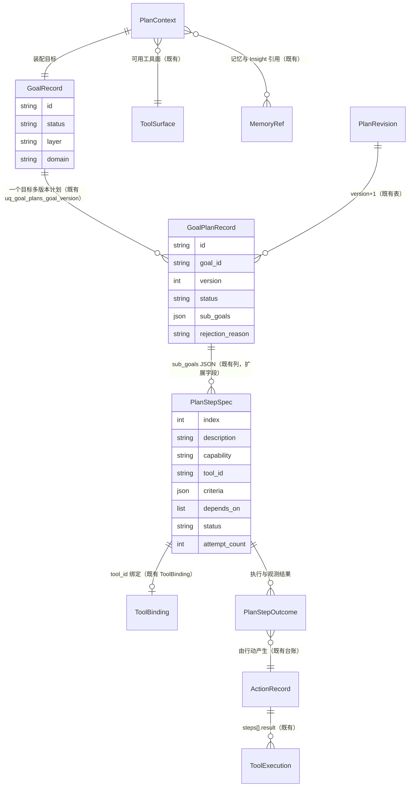

# V2.5.0 Planning System Architecture

> **状态**：已实现（PLAN-001 ~ PLAN-012 全部完成；Flag 默认全 off，回滚即 V2.4.0）
> **前置**：V2.0.0 Memory V2 / Reflection / Life Loop；V2.1.0 Agent Runtime / Goal Stack / Decision Pipeline / Action Engine；V2.2.0 Character Experience；V2.3.0 World Simulation；V2.4.0 Tool System
> **定位**：Planning System = **计划编排层（Plan Orchestration Layer）**。它**不是**第二套 Goal 系统，**不是**第二套 Action 引擎。它把已经存在但彼此断线的两半——「目标分解」（`goal_planning` + `GoalPlanRecord` + `SubGoalSpec`）与「工具执行」（`ToolRegistry` + `ToolExecutor`）——用一层**可观测、可失败、可修订的多步计划**焊起来。
> **铁律**：零新建 Agent / Memory / Session / Event 系统；零新建表、零迁移；Goal 仍是"想要什么"的唯一权威；Autonomy 仍决定"此刻做什么"；Tool 仍是唯一执行面；世界仍由 `world_engine` 唯一写入；记忆仍由 `memory_policy` R1~R8 唯一裁决。

---

## 1. 背景

### 1.1 为什么要做

前七个版本把角色的**内部器官**和**外部的手**都造齐了：

| 版本 | 能力 | 现状 |
|---|---|---|
| V2.0.0 | 长期记忆 + 反思 + 生命循环 | 角色记得住、想得通、有节拍 |
| V2.1.0 | Agent Runtime / Goal Stack / Decision Pipeline / Action Engine | 角色能决策、能自主、能执行单个动作 |
| V2.2.0 | 情绪 / 人格 / 习惯 / 关系体验 | 角色有表达质感 |
| V2.3.0 | 世界模拟（时间 / 日程 / 事件 / 场景） | 角色活在一个持续运行的世界里 |
| V2.4.0 | Tool System（注册 / 权限 / 校验 / 归一 / 扩展） | 角色有了一张可治理、可扩展的手 |

但**"想做的事"与"做的手"之间，缺一根骨头**：

- **有目标分解，但分解产物接不到工具**。`goal_planning.plan_goal` 已经会调 LLM 把目标拆成 `SubGoalSpec` 列表并落 `goal_plans`，`SubGoalSpec.capability` 是一个**裸能力名**（如 `"world_action"`），`REASON_CAPABILITY_UNALIGNED` 只校验它与 `ACTION_TYPES` 对齐。而 V2.4.0 的工具世界是按 `tool_id`（如 `world.object.move`）组织面、权限、健康度与工具面投影的——**计划看不见工具**。
- **有执行编排，但只能走一步**。`planner.assemble_plan` 的两条分支（V9 表查 / V2.4.0 工具解析）**恒产出恰好一个** `ActionStep(index=0, ...)`；`action_plan_max_steps` 默认 1，且全仓**无任何消费点**（仅 settings 声明/校验与测试断言）。多步只能靠计划层，而计划层恰恰没有执行纪律。
- **有失败与重试，但是两份**。`SubGoalSpec.attempt_count` / `failure_note` 与 `action_records.attempt` / `next_retry_at`（`action_retry_max_attempts=2`、`action_retry_backoff_seconds=30`）各自计数，二者之间没有对齐契约。
- **有观测判据，但看不到工具做成了什么**。`goal_observation.evaluate_criteria` 的事实源是三值 `CRITERION_FACT_SOURCES = ("world", "state", "memory")`——`ToolResult.effects` / `observations` 不在其中，计划无法从"工具到底产出了什么"推进。
- **有反思，但反思碰不到计划**。`services/reflection/` 全包 grep `plan` / `strateg` **零命中**；`reflection_lifecycle.notify_insight_created_listeners` 的既有消费者只有 `development/policy.py`、`relationship_narrative.py`、`world/event_bridge.py` 三处，**没有 Planning 消费者**。执行结果 → 反思 → 计划优化这条闭环是断的。
- **有约束，但计划生成不看可用面**。`builtin.search.query` 在 V2.4.0 被刻意保留为 `unavailable` 并从工具面剔除（`TOOL_UNAVAILABLE_TOOL_IDS`），`channel.feishu.send` 在通道未启用时状态为 `disabled`——LLM 规划器对这些一无所知，可能规划出永远无法执行的步骤。

一句话：**角色有了目标（Goal）、有了决策（Autonomy）、有了手（Tool），但"这件事分几步、每步用哪只手、做不成怎么办"无人负责。**

### 1.2 已有的计划资产盘点（本版本的地基，一律复用）

**这是本版本最重要的一个前提判断：计划系统不是从零开始——`goal_plans` 表与 `SubGoalSpec` 已经是"计划 + 步骤"的完整雏形，只是没接上工具与执行纪律。**

```text
app/models/goal.py                    # 计划域值对象：GoalPlanRecord / SubGoalSpec / 判据白名单
app/services/
├── goal_planning.py                  # AUT-002 规划执行器：collect_candidates / plan_goal /
│                                      # enqueue_planning / run_planning_jobs / PlanningProposal
├── goal_observation.py               # AUT-003 观测推进：evaluate_criteria / advance_goal /
│                                      # advance_user_goals / _execution_order / _current_step
├── goal_execution.py                 # AUT-003 步骤执行：attempt_current_step（SubGoal → ActionIntent）
├── goal_arbitration.py               # AUT-004 优先级/冲突/放弃：compute_priority / record_goal_lifecycle
├── goal_stack.py                     # AGENT-003 四层栈：evaluate_stack → GoalStack
├── goal_alignment.py                 # AGENT-003 候选↔栈对齐：score
├── goal_service.py                   # V6 目标选择与生命周期：select / review / SelectedGoal
└── evaluation_rules/goal.py          # 六条 Goal 一致性规则（含 GoalPlanningBudgetRule）
app/repositories/goal_repository.py    # character_goals + goal_plans 两表唯一访问面
app/application/
├── life_loop.py                       # 唯一调度器：goal_supply / goal_advance 维护步
└── action_engine.py                   # V9 行动唯一编排器：run_action_planning 六闸门 + 执行
```

**关键事实盘点**：

- `GoalPlanRecord` 已有 `goal_id` / `version` / `status` / `sub_goals` / `rejection_reason`，`goal_plans` 表已有 `uq_goal_plans_goal_version` 唯一约束与 `ck_goal_plans_status` 五态 CHECK——**版本化多步计划已有落点，不需要新表**。
- `SubGoalSpec` 已有 `index` / `description` / `capability` / `params` / `criteria` / `depends_on` / `parent_index` / `status` / `attempt_count` / `last_observed_at` / `last_attempt_at` / `failure_note`——**步骤级执行态与依赖关系已具备**。
- `goal_observation._execution_order`（叶子优先）/ `_current_step` / `_all_done` / `_has_executable` **已经是一套 DAG 调度器**，只是以私有函数形态散落在观测模块里。
- `goal_execution.attempt_current_step` 已用 `dedupe_key=f"goal:{goal.id}:{plan.version}:{current.index}"` 把步骤映射成 `ActionIntent`——**幂等键已经是"计划步级"的，接 `ToolInvocation.dedupe_key` 天然对齐**。
- `goal_planning.enqueue_planning(goal_id, trigger)` 已有三个触发源常量 `TRIGGER_CREATED="goal_created"` / `TRIGGER_BLOCKED="goal_blocked"` / `TRIGGER_REPLAN="goal_replan"`——**"重规划"这个动作早就存在，缺的只是触发它的新来源**。
- `goal_repository.set_status(goal_id, target, arbitration_state)` 是分层目标的唯一状态变更入口（迁移表守卫 + 仲裁轨迹原子写入）——**计划的终态必然经此落 Character 域，不需要新写面**。
- `services/tool/memory_policy.py` + `services/action/memory_bridge.py` 已构成"执行 → 记忆候选"的唯一通道，`memory2.ingest.ingest_from_goal_completion(user_id, goal_id, description)` 已经存在——**计划结果进记忆不需要新机制**。
- `reflection.evidence` 已有 `ToolEvidenceWindow` 与三个工具窗口（`GROUP_KIND_TOOL` / `GROUP_KIND_ACTION` / `GROUP_KIND_FAILURE`）——**"计划执行效果"证据窗是它的同构扩展**。
- `decision_records.kind` 是五值 CHECK；V2.4.0 `post_process._persist_tool_decision` 的既有先例是**复用 `DecisionKind.TURN_INTENTION` + `decision="tool_surface"` 而不新增 kind**——**本版本照抄该先例，从而保住零迁移**。

### 1.3 现有断层（本版本要补的洞）

| # | 断层 | 代码证据 | 影响 |
|---|---|---|---|
| B1 | 执行层没有多步计划 | `ActionSettings.action_plan_max_steps = 1`，全仓仅命中 settings 声明/校验与测试断言；`planner.assemble_plan` 两条分支恒产 `ActionStep(index=0, ...)` | "多步"无处承载，只能靠计划层的 `sub_goals`，而计划层没有执行纪律 |
| B2 | 计划与工具互不相识 | `SubGoalSpec.capability` 是裸能力名；`goal_execution.attempt_current_step` 直构 `ActionIntent`，**不经 `ToolSelector` / `ToolSurface`** | 计划步骤不知道自己要落到哪个 `tool_id`，也不受工具面/权限/健康度约束 |
| B3 | 计划校验只因 `ACTION_TYPES` 对齐 | `REASON_CAPABILITY_UNALIGNED`、`GoalPlanningBudgetRule`（capabilities aligned to `ACTION_TYPES`） | 工具被熔断、被禁用、被工具面裁剪（如 `late_night` 剔除 `channel` 命名空间）时，计划仍会装配该步骤 |
| B4 | 规划器看不见可用工具面 | `goal_planning._build_messages` 的供给不含 `ToolSurface`；`plan_goal` 无面感知校验 | LLM 可能规划出 `builtin.search.query`（恒 `unavailable`、已从工具面剔除）这类死步骤 |
| B5 | 重试语义双份且不对齐 | `SubGoalSpec.attempt_count` vs `action_records.attempt` / `next_retry_at` | 同一个失败被两处计数，"重试几次算尽力"没有唯一答案 |
| B6 | 计划终点无反思闭环 | `services/reflection/` 全包 grep `plan`/`strateg` 零命中；`notify_insight_created_listeners` 三个消费者中无 Planning | 执行结果 → 反思 → 计划优化断链；同一类计划反复失败无人学到 |
| B7 | 判据事实源缺第四类 | `CRITERION_FACT_SOURCES = ("world", "state", "memory")`，无 `tool` | 计划无法用 `ToolResult.effects` / `observations` 判定步骤是否达成 |
| B8 | 无计划可观测面 | `goal_plans` 只有当前态（`status` / `rejection_reason`），无转移审计投影；`decision_records.kind` 五值 CHECK | 无法回答"这个计划为什么走到这一步、每次修订是谁触发的" |
| B9 | Autonomy 侧对计划无感知 | `PolicySnapshot` 有 `world_facts` / `action_facts` / `tool_facts` / `tool_insights`，无 `plan_facts` | 自治策略不知道"用户身上还有一个进行中的两步计划"，可能与计划抢同一动作（额度被重复消耗） |

### 1.4 既有资产与本文档的对应关系

| 你要的设计 | 既有承载物 | 本版本动作 |
|---|---|---|
| Goal Model / Lifecycle / Priority / Status | `models/goal.py` + `goal_repository` + `goal_arbitration` + `goal_service` | **复用（零改动）**，见 §3.2 |
| Plan Model | `GoalPlanRecord` + `goal_plans` | **扩展**（加 `trigger` / `context_digest` / `revision_of` / `evidence_refs`） |
| Task / Step Model | `SubGoalSpec` | **扩展**（加 `tool_id` / `kind` / `retry_policy` / `on_failure` / `expected_effects` / `observation_keys`） |
| Planning Engine | `goal_planning.plan_goal` / `run_planning_jobs` | **强化**（输入换 `PlanContext`，输出带工具绑定；签名与 job 形态不变） |
| Task Decomposition | `goal_planning.PlanningProposal` / `validate_sub_goals` | **强化**（新增面感知与工具绑定校验） |
| Plan Scheduler | `goal_observation._execution_order` / `_current_step` | **抽取为独立纯函数模块**（零行为变更，先搬后改） |
| Plan Execution | `goal_execution.attempt_current_step` + `action_engine.run_action_planning` | **接线**（步骤带 `tool_id` 与步级 `dedupe_key`） |
| Plan Failure / Retry | `action_engine._process_due_retries` + 退避数学 | **复用**，计划侧只做"要不要放弃/重规划"的裁决 |
| Plan Observation | `goal_observation.evaluate_criteria` / `advance_goal` | **扩事实源**（`CRITERION_FACT_SOURCES` 加 `"tool"`） |
| Plan Revision | `goal_planning.enqueue_planning(trigger=TRIGGER_REPLAN)` | **接新触发源**（Reflection Insight 监听器） |
| Plan 证据窗 | `reflection.evidence.ToolEvidenceWindow` | **同构扩源**（新增计划通道） |
| Plan 结果记忆 | `services/tool/memory_policy.py` + `memory2.ingest.ingest_from_goal_completion` | **接边界表** |
| Plan 观测面 | `decision_records`（复用既有 kind）+ `loop_runs.steps` | **复用**（零新表） |
| Plan 调度入口 | `life_loop._step_goal_supply` / `_step_goal_advance` | **复用**（计划引擎挂进既有维护步） |

---

## 2. 架构目标

### 2.1 目标

| # | 目标 | 判定标准 |
|---|---|---|
| G1 | **Goal 可被拆成可执行计划** | 任一 active Goal 可产出 `GoalPlanRecord`，其中每个 `PlanStep` 都有明确的 `tool_id` 绑定与达成判据 |
| G2 | **Planning Engine 输入完整** | 规划输入装配 `PlanContext`：Goal + Context + World State + Memory（+ Reflection + ToolSurface）六源，且每源可独立降级 |
| G3 | **Goal → Tasks → Actions 拆解可校验** | 拆解产物穿过形状闸 + 工具面闸 + 预算闸，非法产物被拒且理由可读（对齐既有 `REASON_*` 常量范式） |
| G4 | **Plan 执行有纪律** | 步骤执行经既有 `action_engine` 六闸门与 `ToolExecutor` 五段短路；失败分类、退避、幂等全部复用 V9/V2.4.0 既有语义 |
| G5 | **Autonomy / Planning / Tool 三者职责不重叠** | 三者各有唯一权威函数与唯一输出契约，"决定做什么 / 决定怎么做 / 负责执行"可逐条举证（§7.3） |
| G6 | **计划执行可影响世界与事件** | 计划对世界的写入经 `deferred_world_op` → outbox → `world_engine` 唯一路径；计划终态经既有 `event_bridge` 广播 |
| G7 | **记忆分层有判据** | 计划本体/中间步骤不进 `memories`；计划终态按边界表沉淀且 `memory_policy` R1~R8 零豁免（§7.5） |
| G8 | **Reflection → Planning 闭环成立** | 计划执行结果进证据窗；达门槛的 Insight 可触发 `TRIGGER_REPLAN`；反思不直接改写计划 |
| G9 | **零新建基础设施** | 零新表、零迁移；执行台账复用 `action_records.steps`，计划台账复用 `goal_plans`，审计复用 `decision_records` + `loop_runs.steps`（§4.9） |

### 2.2 与 V2.4.0 定位的对照

V2.4.0 的定位是"给手装权限锁"，本版本的定位是**"给手接上大脑的意图链，并让这条链可观测、可失败、可修订"**。

| 维度 | V2.4.0 Tool System | V2.5.0 Planning System |
|---|---|---|
| 层次 | Capability Governance Layer | Plan Orchestration Layer |
| 加在哪 | Action 引擎的能力接线面（内层加固） | Goal 与 Action 之间的编排面（**补一层**，不是加固） |
| 产出 | `ToolExecution`（执行台账）+ `ToolResult`（结果契约） | `GoalPlanRecord`（计划）+ `PlanStepOutcome`（步骤结果） |
| 回答的问题 | "用什么手段、能不能用、该不该用" | "分几步、每步用什么、做不成怎么办" |
| 铁律 | 工具只执行，世界由世界侧唯一写入 | 计划只编排，执行仍由 Action 唯一编排器负责 |

### 2.3 边界不变量（评审红线清单，任何 Task 不得违反）

1. **不新建表、不加迁移**。计划、步骤、审计、证据全部落在 `goal_plans` / `action_records` / `decision_records` / `loop_runs` 四张既有表上。
2. **不新建 Goal 系统**。`character_goals` 与 `GoalRecord` 的语义、`GOAL_TRANSITIONS` 迁移表、`goal_repository.set_status` 唯一写面一律不动。
3. **不新建执行编排器**。步骤执行一律经 `action_engine.run_action_planning`；计划的"多步"由计划层编排，**不放开 `action_plan_max_steps`**（保持 1）。
4. **不绕过工具治理**。步骤的工具绑定必须经 `ToolRegistry.resolve` 与 `ToolSurface` 投影；被裁剪/禁用/熔断的工具不得进入计划。
5. **不直接写世界、不直接写 Character 域**。计划层禁止 import `world_repository`；禁止写 `character_state` / `personality_state` / `relationship_*`。
6. **不绕过记忆政策**。计划结果进记忆必须经 `memory_policy.apply_policy`（R1~R8 零豁免）。
7. **反思不直接改写计划**。Reflection 只能"产出 Insight + 投一个重规划触发"，改写动作由 `goal_planning` 在新的规划轮次里完成（与 V2.4.0"反思不自动熔断工具"同一纪律）。
8. **默认拒绝与降级放行沿用既有范式**。工具面不可得 → 计划不生成该步（宁缺毋滥）；上下文装配失败 → 逐段降级而非抛错。
9. **V2.4.0 的兼容承诺在本版本兑现**。V2.4.0 Architecture §5.5 写明"V9 既有读键一律保留到 V2.5.0"——本版本结束前旧读键（`world_event_id` / `memory_id` / `failure_kind` / `deferred_world_op`）继续双写；正式退役窗口推到 V2.6.0。
10. **Flag 全 off 时与 V2.4.0 逐字节一致**。计划引擎不注册、`goal_planning` 走原路径、`evaluate_criteria` 三事实源不变、prompt 零差异。

---

## 3. 核心模块

### 3.1 层图

```text
        ┌──────────────────────────────────────────────────────────────────┐
        │                          Goal System (既有)                       │
        │  GoalRecord / GoalStatus / GoalLayer / GoalDomain / GoalHorizon   │
        │  goal_service.select → SelectedGoal   goal_stack.evaluate_stack    │
        │  goal_arbitration.compute_priority → 优先级唯一算法               │
        └───────────────────────────────┬──────────────────────────────────┘
                                        │ 目标（想要什么）
                                        ▼
        ┌──────────────────────────────────────────────────────────────────┐
        │                  Planning System (V2.5.0 新增)                     │
        │                                                                   │
        │  ┌────────────────────┐   六源装配（可逐段降级）                    │
        │  │ PlanContextAssembler│◄── Goal / World / Memory / Reflection      │
        │  └─────────┬──────────┘    / ToolSurface / Runtime                 │
        │            │ PlanContext                                          │
        │            ▼                                                      │
        │  ┌────────────────┐   ┌─────────────────┐   ┌──────────────────┐  │
        │  │ PlanningEngine │──►│ TaskDecomposer  │──►│  PlanValidator   │  │
        │  │ 生成 / 修订     │   │ Goal→Tasks+工具  │   │ 形状/面/预算三闸  │  │
        │  └────────────────┘   └─────────────────┘   └──────────────────┘  │
        │            │ GoalPlanRecord + PlanStepSpec[]（落 goal_plans）      │
        │            ▼                                                      │
        │  ┌────────────────┐   ┌─────────────────────────────────────────┐ │
        │  │ PlanScheduler  │──►│ PlanExecutorBridge                      │ │
        │  │ 就绪/排序/当前步│   │ PlanStep → ActionIntent → Action Engine │ │
        │  └────────────────┘   └─────────────────────────────────────────┘ │
        │            ▲                          │ PlanStepOutcome           │
        │            │                          ▼                           │
        │  ┌────────────────┐   ┌─────────────────────────────────────────┐ │
        │  │ PlanRevision   │◄──│ PlanObserver（判据 + 推进 + 终态）        │ │
        │  │ 重规划裁决      │   │ 事实源：world / state / memory / tool     │ │
        │  └────────────────┘   └─────────────────────────────────────────┘ │
        └───────────────┬───────────────────────────┬──────────────────────┘
                        │                           │
        ④ 触发（Autonomy）│                           │ ⑤ 执行（Tool）
                        ▼                           ▼
        ┌───────────────────────────┐   ┌──────────────────────────────────┐
        │ Autonomy / Decision (既有) │   │ Tool System (V2.4.0)              │
        │ autonomy_policy.evaluate   │   │ ToolRegistry / ToolSurfaceResolver │
        │ decision_pipeline.run_     │   │ ToolSelector / ToolExecutor        │
        │   pipeline                 │   │ PermissionGate / ParamValidator    │
        └───────────────────────────┘   └────────────────┬─────────────────┘
                                                         │ ToolResult.effects
                                                         ▼
        ┌──────────────────────────────────────────────────────────────────┐
        │ World State（world_engine 唯一写面）/ Memory2（R1~R8）/ Reflection │
        └──────────────────────────────────────────────────────────────────┘
```

**五层职责**

| 层 | 职责 | 不做什么 | 实现形态 |
|---|---|---|---|
| **Goal System** | 声明"想要什么"与优先级；维护 `GoalStatus` 生命周期 | 不拆步骤、不选工具、不执行 | V6/V2.0/V2.1 既有（零改动） |
| **Planning System** | 装配规划上下文；把 Goal 拆成带工具绑定的 Steps；调度就绪步骤；观测推进；裁决是否重规划 | 不判断"此刻该不该主动"；不执行工具；不写世界/记忆 | 既有 `goal_planning` / `goal_observation` / `goal_execution` **强化 + 抽出** |
| **Autonomy / Decision** | 决定"此刻做什么"：act/wait/ignore 与获胜意图 | 不拆步骤、不管参数、不管工具细节 | V2.1 既有（增量接线） |
| **Tool System** | 解析、授权、校验、执行、归一；产出 `ToolResult` | 不做重试决策（在 Action 层）、不做业务判断 | V2.4.0 既有（零改动） |
| **World / Memory / Reflection** | 世界唯一写面；记忆唯一政策闸；认知证据与 Insight | 不被计划层绕过 | 既有（只读暴露 + 既有回写通道） |

### 3.2 Goal System 契约（Goal Model / Goal Lifecycle / Goal Priority / Goal Status）

Planning System 对 Goal System 是**纯只读消费者 + 单一状态写回者**。四项契约逐条钉死：

#### 3.2.1 Goal Model（复用，零改动）

| 模型 | 字段（节选，全部来自 `apps/backend/app/models/goal.py`） | Planning 的用法 |
|---|---|---|
| `GoalRecord` | `id` / `user_id` / `character_id` / `type` / `description` / `priority` / `status` / `horizon` / `source` / `created_turn` / `expires_at_turn` / `parent_goal_id` / `layer` / `domain` / `origin` / `failure_reason` / `arbitration_state` | 规划的输入主体；不新增字段 |
| `GoalPlanRecord` | `id` / `goal_id` / `version` / `status` / `sub_goals` / `rejection_reason` / `created_at` / `updated_at` | 计划本体（**扩展，见 §4.3**） |
| `SubGoalSpec` | `index` / `description` / `capability` / `params` / `criteria` / `depends_on` / `parent_index` / `status` / `attempt_count` / `last_observed_at` / `last_attempt_at` / `failure_note` | 计划步骤（**扩展，见 §4.4**） |

**类型域（既有 Literal 值集，一律不改）**：`GoalType`（4 值）、`GoalStatus`（7 值）、`GoalSource`（3 值）、`GoalHorizon`（2 值）、`GoalLayer`（3 值）、`GoalDomain`（3 值）、`GoalPlanStatus`（5 值）、`SubGoalStatus`（4 值）。

#### 3.2.2 Goal Lifecycle（复用既有唯一写面）

```text
目标生命周期（既有，Planning 只负责"在哪一步调用"）
  创建 ──► active ──► completed / failed / abandoned / expired / cancelled
              ▲   │
              │   └──► suspended ──► active（revive）/ abandoned
              └──────── failed ──► active（单次 replan 成功边，reactivate_goal）

唯一写面：
  goal_repository.set_status(goal_id, target, arbitration_state=None)   # 分层目标唯一入口
  goal_repository.finish_goal / complete_goal / fail_goal / reactivate_goal
  goal_arbitration.record_goal_lifecycle(record, decision, reason, snapshot)  # 归因行
```

**Planning 的生命周期介入点（仅三处）**：

| 介入点 | 时机 | 调用 | 约束 |
|---|---|---|---|
| 目标创建后 | `goal_planning.materialize` 之后 | `enqueue_planning(trigger=TRIGGER_CREATED)` | 既有行为，不变 |
| 步骤执行被阻塞 | `PlanObserver` 判定不可推进 | `enqueue_planning(trigger=TRIGGER_BLOCKED)` | 既有常量，新增判定来源 |
| 重规划 | `PlanRevision` 裁决通过 | `enqueue_planning(trigger=TRIGGER_REPLAN)` | 既有常量，**新增 Reflection 触发源**（§7.6） |
| 计划终态 | 全部步骤终态且目标可闭 | `goal_observation._complete` → `finish_goal` | 既有路径，不新增 |

#### 3.2.3 Goal Priority（复用，Planning 不重算）

优先级算法**唯一归属 `goal_arbitration.compute_priority(goal, overlay, relationship_params, settings)`**（显式 priority + 发展/关系调制），分层排序由 `goal_arbitration._rank` 与 `goal_service.select` 的 tier 提升完成。

**Planning 侧纪律**：Planning **不引入第二套优先级**。计划内的步骤顺序由 `depends_on` DAG 与 `index` 决定（结构序），**不按 Goal priority 重排**——Goal priority 只决定"先规划哪个目标"，不决定"先做哪一步"。

| 层级 | 排序依据 | 权威函数 |
|---|---|---|
| 目标间 | `GoalType` tier（`GOAL_TIER`）+ 调制分 | `goal_service.select` / `goal_arbitration.compute_priority` |
| 四层栈内 | `_LAYER_WEIGHT`（short_term 1.0 / medium 0.6 / long_term 0.3） | `goal_alignment.score` / `goal_stack.evaluate_stack` |
| 计划版本间 | `version` 降序（最新有效） | `goal_repository.get_latest_plan` |
| **计划步骤间** | **`depends_on` DAG + `index` 升序（结构序）** | **`PlanScheduler.order`（本版本新增纯函数）** |

#### 3.2.4 Goal Status（复用迁移表，不新增状态）

`GOAL_TRANSITIONS` 与分层 `goal_transitions(layer, current)` 是唯一迁移权威。**本版本不新增任何 `GoalStatus` 值**：

- 计划被拒（`GoalPlanStatus.rejected`）**不改变** `GoalStatus`（目标仍是 `active`，只是尚无有效计划）——与既有语义一致。
- 计划全部步骤失败且达放弃阈值 → `GoalStatus.failed`（`failure_reason` 记 `plan_exhausted`）。
- 计划被判"不值得继续" → `GoalStatus.abandoned`（经 `goal_arbitration.check_abandonment` 双信号）。
- 计划全部步骤达成 → `GoalStatus.completed`（经 `goal_observation._complete`）。

> **约束**：`GoalStatus` 的新增语义一律通过 `failure_reason` 字符串承载（既有 `timeout` / `exec_period_exceeded` / `goal_completed` 已是此形态），**不扩 CHECK 约束、不加迁移**。

### 3.3 PlanContextAssembler（规划上下文装配）

**Responsibility**：回答"规划这一刻，Agent 能看见什么"。输出 `PlanContext`，供 `PlanningEngine` 与 `TaskDecomposer` 消费。

**六源装配（逐源可降级，任一源失败不阻塞规划）**

| 源 | 读取物 | 既有入口 | 降级形态 |
|---|---|---|---|
| **Goal** | 目标本身 + 祖先链 + 兄弟目标 | `goal_repository.get_goal` / `list_children` / `list_tree` | 缺失 → 规划中止（唯一硬依赖） |
| **Context（对话/场景/关系）** | `SceneProfile` / `UserSituation` / 关系阶段 | `scene_profiles.scene_profile_for`、`world_simulation_repository.get_active_situation` | 空包 |
| **World State** | 时间 / 地点 / 环境 / 库存 / 显著事件 | `world_engine.collect_facts`、`world_engine.build_context`（`WorldContext` + `WorldBrief`） | 空包（`world_enabled=False` 时亦为空包） |
| **Memory** | 相关长期记忆 / 共同经历 / 关系模式 | `memory2.retriever.retrieve`、`reflection_lifecycle.list_active_insights` | 空列表 |
| **Reflection** | 活跃 Insight（含工具效能类） | `reflection_lifecycle.list_user_active_insights`、`reflection.tool_feed.interest_signal` | 空列表 |
| **ToolSurface** | 当前语境下的可用工具面 | `ToolSurfaceResolver(registry, settings).resolve(RUN_KIND_AUTONOMOUS_TICK, tool_ctx)` | **面不可得 → 不生成新计划**（宁缺毋滥） |

**关键约束**：与 `planner.GateSnapshot` / `ToolContext` 同一工程标准——**只读、零 IO 于消费侧、调用方预读**。`PlanContextAssembler.assemble` 是唯一允许读仓储的入口。

**为什么 ToolSurface 是"硬依赖之一"而不是可选源**：B4 断层（LLM 规划出不可执行的死步骤）无法靠事后校验根治——必须在**规划输入**里就把面给出去。装配不到面时，宁可这一轮不规划（沿用 `goal_observation.evaluate_criteria` 的 `None` = "不可判定"的同款哲学）。

### 3.4 PlanningEngine（计划生成与修订）

**Responsibility**：把 Goal 变成 Plan。**它强化既有 `goal_planning.plan_goal`，不新建规划器**。

```text
PlanningEngine（`app/services/planning/engine.py`，包装既有 goal_planning）
├── plan(goal, ctx, *, trigger) -> PlanOutcome        # 首次生成
├── revise(plan, ctx, *, reason) -> PlanOutcome       # 重规划（version+1）
├── enqueue(user_id, goal_id, trigger, ctx) -> bool    # 委托 goal_planning.enqueue_planning
└── run_jobs() -> int                                  # 委托 goal_planning.run_planning_jobs
```

**规划闸门（在既有 AUT-002 闸门基础上加两道，共七道，短路）**

| # | 闸门 | 既有 / 新增 | 拒绝理由（沿用 `REASON_*` 常量范式） |
|---|---|---|---|
| 1 | 总闸与尝试次数 | 既有 | `REASON_ATTEMPT_CAP = "attempt_cap"` |
| 2 | 步骤数上限 | 既有（`v2_autonomy_subgoal_max_count`） | `REASON_COUNT_EXCEEDED = "subgoal_count_exceeded"` |
| 3 | 形状合法（序号连续、无前向依赖、深度 ≤ 上限） | 既有（`validate_sub_goals`） | `REASON_INVALID_SHAPE = "invalid_sub_goal_shape"` |
| 4 | 能力对齐 | 既有 | `REASON_CAPABILITY_UNALIGNED = "capability_unaligned"` |
| 5 | **工具可解析**（每个 step 的 `tool_id` 能经 `ToolRegistry.resolve` 解析） | **新增** | `plan_tool_unresolvable` |
| 6 | **工具在面上**（每个 step 的 `tool_id` ∈ `ctx.tool_surface.tool_ids`） | **新增** | `plan_tool_off_surface` |
| 7 | LLM 失败 | 既有 | `REASON_LLM_FAILED = "llm_failed"` |

闸门 5/6 是本版本关闭 B3/B4 的核心。二者区别：**闸门 5 是"这个工具存在吗"（声明面）**，**闸门 6 是"这一刻它能用吗"（运行时面）**。一个工具可能 `enabled` 但被 `late_night` 剔除（如 `channel.feishu.send`），此时闸门 5 过、闸门 6 拒——计划的**步数与内容不变**，只是暂不装配该步，等面恢复。

**修订语义（`revise`）**：

```text
revise(plan, ctx, reason)
   ├─ plan.status == "rejected"  → 等价于 plan(goal, ctx, trigger=TRIGGER_REPLAN)
   ├─ plan.status == "active"    → 新版本（version+1），旧版本置 "superseded"
   ├─ 已终态步骤的处置：保留 done 的 index 与 depends_on 语义，不重做（幂等复用）
   └─ 修订预算：版本数 ≤ v25_plan_revision_budget（默认 3，对齐既有 planning_max_attempts）
```

### 3.5 TaskDecomposer（Goal → Tasks 的拆解）

**Responsibility**：把 `PlanningProposal`（LLM 的 `sub_goals` 原始输出）转成合法的 `PlanStepSpec[]`，并完成**工具绑定**。

**拆解四阶段**

```text
① 结构解析（复用既有）
   PlanningProposal.sub_goals → SubGoalSpec.model_validate（index 连续 / 依赖合法 / 判据白名单）
   · criteria 白名单：CRITERION_TYPES / CRITERION_FACT_SOURCES / CRITERION_METRIC_PATHS / CRITERION_OPS
   · 深度封顶：v2_autonomy_subgoal_max_depth = 2

② 工具绑定（本版本新增，B2 关闭点）
   SubGoalSpec.capability（裸能力名） + LLM 建议的 tool_id 提示
        │  经 ACTION_TOOL_MAP（角色资产，9 → 10 映射）与 ACTIONS 反查
        ▼
   ToolBinding(tool_id, capability, action, definition)   ← 既有 models/tool.py 值对象
   · 一能力多工具时（如 send_notification → builtin.notification.send / channel.feishu.send）
     由 ToolSelector.select_with_reason 的确定性规则裁决（priority + tool_id 字典序）
   · 绑定失败 → 该步标记 capability_binding_missing，进入闸门 5/6 的拒绝路径

③ 判据补全（本版本新增，B7 关闭点）
   criteria.fact_source 允许新增 "tool"：
     · action_succeeded → 以 action_records.steps[].status 判定
     · field_equals    → 以 ToolResult.observations 的键判定（按 step.observation_keys 白名单）
   · 未声明判据的步骤 → 视为不可判定，不参与自动推进（沿用 evaluate_criteria 返回 None 的语义）

④ 预算校验（复用既有）
   步数 / 深度 / 每步尝试上限 / 计划 TTL 四项过闸
```

**拆解产物对照（Goal → Task → Action 三级）**

| 层级 | 单位 | 模型 | 谁产生 | 谁消费 | 粒度判据 |
|---|---|---|---|---|---|
| L1 | Goal（想要什么） | `GoalRecord` | `goal_planning.materialize` / `goal_service.review` | Planning / Autonomy | 一句话可陈述，短期不可直接执行 |
| L2 | **Task**（怎么做的一步） | `PlanStepSpec`（扩展 `SubGoalSpec`） | `TaskDecomposer` | `PlanScheduler` / `PlanExecutorBridge` | **有独立达成判据 + 独立工具绑定 + 可在一次 Action 内完成** |
| L3 | Action（这一次执行） | `ActionIntent` / `ActionRecord` | `PlanExecutorBridge` | `action_engine` | 一次六闸门 + 单步 `ActionStep` 装配 |
| L4 | Tool（动手） | `ToolBinding` / `ToolExecution` | `ToolSelector` | `ToolExecutor` | 一次原子外部调用 |

**粒度裁决（为什么 L2 就是 Task，而不是再细分）**：细于 L2 无判据可观测，粗于 L1 无法执行。既有 `SubGoalSpec` 的 `criteria` + `capability` + `params` 三件套恰好构成这个粒度，**这正是不新建 Task 模型的原因**。

### 3.6 PlanScheduler（就绪判定与排序）

**Responsibility**：回答"下一步该做哪个"。**从 `goal_observation` 抽出既有私有函数为独立纯函数模块**（先搬运、后扩展，行为零变更）。

```text
PlanScheduler（`app/services/planning/scheduler.py`，纯函数、零 IO、零 LLM）
├── order(plan) -> list[int]               # 拓扑序（叶子优先，继承 _execution_order 语义）
├── ready_steps(plan) -> list[PlanStepSpec] # 前驱全 done 且自身 pending
├── current_step(plan) -> PlanStepSpec|None # 下一个待执行步（继承 _current_step）
├── all_done(plan) -> bool                 # 继承 _all_done
├── has_executable(plan) -> bool           # 继承 _has_executable
└── blocked_reason(plan, ctx) -> str|None   # 新增：为何无可执行步（工具被裁/前置失败/冷却中）
```

**调度规则（确定性，可复现）**

| 规则 | 说明 |
|---|---|
| 依赖优先 | `depends_on` 必须全为 `done`；前驱 `failed` 且 `on_failure=abort` → 后继标 `skipped` |
| 叶子优先 | 父步（`parent_index` 非空）不作为执行单元，只在子步全 `done` 后由 `advance_goal` 结算 |
| 结构序 | 同一层就绪步按 `index` 升序；**不按 Goal priority 重排**（§3.2.3） |
| 单步并发上限 | 每 tick 每目标最多推进一步（对齐 `v2_autonomy_subgoal_execute_cooldown_minutes` 节流） |
| 面感知 | `ready` 但 `tool_id` 不在当前工具面 → 不进"可执行"，记 `blocked_reason=off_surface` |
| 幂等锚点 | 步骤幂等键沿用既有形态 `goal:{goal_id}:{plan.version}:{step.index}`（`goal_execution` 既有公式） |

### 3.7 PlanExecutorBridge（Task → Action → Tool 的桥）

**Responsibility**：把一步 Task 变成一次 Action，并回收结果。**它只做翻译与回收，不做执行，不做重试决策**。

```text
PlanExecutorBridge（`app/services/planning/executor_bridge.py`）
├── to_intent(goal, plan, step, ctx) -> ActionIntent
│       · action_type 由 (capability, action) 经既有映射反查
│       · params 由 step.params 规范化（normalize_core_params）
│       · dedupe_key = plan:{goal.id}:{plan.version}:{step.index}   ← 步级幂等
│       · confidence = "confident"（判据与工具绑定已在拆解期校验，此处不再犹豫）
├── execute_step(...) -> PlanStepOutcome
│       · 委托 action_engine.run_action_planning(user_id, intent, session_id, goal_id, source="autonomy")
│       · 从 record.steps[0] 读 ToolResult（V2.4.0 契约）→ 归一为 PlanStepOutcome
└── reconcile(outcome, step) -> PlanStepSpec   # 回填 status / attempt_count / last_attempt_at / failure_note
```

**执行链（一次步骤执行的完整路径，零新建环节）**

```text
PlanScheduler.current_step(plan)
        │ PlanStepSpec
        ▼
PlanExecutorBridge.to_intent  ──► ActionIntent{action_type, params, dedupe_key, source="autonomy"}
        ▼
action_engine.run_action_planning
        ├─ new_record（ActionRecord，status=created）
        ├─ planner.evaluate_gates（六闸门：disabled / ambiguous_params / capability_unavailable
        │                          / duplicate / quota_exceeded / effect_already_satisfied）
        ├─ planner.assemble_plan（v24 总闸 on → _assemble_plan_via_tools → ToolSurface → ToolSelector）
        ├─ action_engine.execute_plan → ToolExecutor.run（五段短路：resolve → permission → validate → invoke → normalize）
        └─ integrate_result（四通道：world / memory / relationship / note）
        ▼
ActionRecord{status, steps[0].result=ToolResult, attempt, next_retry_at}
        ▼
PlanExecutorBridge.reconcile ──► PlanStepSpec{status, attempt_count, failure_note}
        ▼
goal_repository.update_plan_progress(plan.id, sub_goals)   # 落 goal_plans，零新表
```

**双重幂等的对齐（B5 关闭点）**

| 层 | 计数器 / 键 | 既有设置 | 职责 |
|---|---|---|---|
| Action 层 | `ActionRecord.attempt` / `next_retry_at` / `dedupe_key` | `action_retry_max_attempts=2`、`action_retry_backoff_seconds=30`、`action_dedupe_window_hours=24` | **技术性重试**（瞬时故障、超时）——不问业务 |
| Plan 层 | `PlanStepSpec.attempt_count` / `failure_note` | **新增** `v25_plan_step_max_attempts`（默认 2，对齐 action 侧） | **业务性放弃/改道**（同一工具连续失败 → 换工具或重规划） |

**纪律**：Plan 层**不实现退避**（退避数学只有一份，在 `action_engine`）；Plan 层只消费 Action 的终态做"要不要放弃/重规划"的裁决。`attempt_count` 的写入时机是步骤**达到 Action 终态**时（而非每次尝试），从而与 V9 的 `executing` 中间态解耦。

### 3.8 PlanObserver（观测、推进与终态）

**Responsibility**：用事实判定步骤是否达成，推进计划，结算终态。**强化既有 `goal_observation`**。

```text
PlanObserver（`app/services/planning/observer.py`，包装既有 goal_observation）
├── observe(goal, plan, facts, now) -> PlanAdvance      # 委托 advance_goal
├── evaluate(criteria, facts) -> bool | None            # 委托 evaluate_criteria（扩展事实源）
├── collect_facts(user_id, ctx) -> dict                 # 四源事实包（新增 tool 源）
└── settle(goal, plan, outcome) -> None                 # 终态：completed / failed / blocked
```

**事实源扩展（B7 关闭点）**

```text
CRITERION_FACT_SOURCES（既有三值 → 四值）
  world   ← world_engine.collect_facts（既有）
  state   ← character_state / relationship_state（既有）
  memory  ← 活跃长期记忆（既有）
  tool    ← 【新增】action_records.steps[].result（ToolResult）
              · action_succeeded ：以 steps[].status 判定
              · field_equals     ：以 ToolResult.observations[<key>] 判定，key 受 step.observation_keys 白名单约束
              · 未在 observation_keys 声明的键一律不可见（防"偶发字段"变成隐式契约）
```

**推进结果值集（沿用既有 `advance_goal` 返回值，不新增）**：

| 结果 | 含义 | 后续 |
|---|---|---|
| `advanced` | 当前步达成，指针前移 | 下一 tick 继续 |
| `completed` | 全部步骤达成 | `finish_goal(completed)` + 终态广播 |
| `retrying` | 当前步失败但未达 Plan 层尝试上限 | 等 `next_retry_at` |
| `failed` | 达上限或 `on_failure=abort` | `finish_goal(failed, failure_reason="plan_exhausted")` |
| `replanning` | 判据不可达 / 工具长期不可用 | `enqueue_planning(TRIGGER_BLOCKED)` |
| `skipped` / `skipped_ahead` | 前置失败导致跳过 | 记录 `failure_note`，不写记忆 |
| `error` | 观测自身异常 | 只 log，不改变计划状态（与 V9"投递失败不回滚执行"同款纪律） |

**终态结算与既有路径的对齐**：计划终态不新增写面，一律经 `goal_repository.set_status` / `finish_goal`，并调 `goal_arbitration.record_goal_lifecycle` 落归因行（`decision_records` 复用 `DecisionKind.GOAL_LIFECYCLE` + 差异化 `decision` 值，**不新增 kind**，见 §4.9）。

### 3.9 PlanRevision（重规划裁决）

**Responsibility**：回答"这个计划还值得继续吗，要不要换一种做法"。**它是纯函数策略，不是执行者**。

```text
PlanRevisionPolicy（`app/services/planning/revision.py`，纯函数）
├── should_replan(outcome, plan, ctx) -> str | None     # 返回重规划理由，None = 不重规划
├── policy_for(step) -> RetryPolicy                      # 由 step.retry_policy 声明
└── explain(plan, reason) -> dict                        # 可读裁决（进决策审计）
```

**重规划触发判据（四条，任一成立）**

| # | 判据 | 理由码 | 动作 |
|---|---|---|---|
| 1 | 步骤达 Plan 层尝试上限且 `on_failure=replan` | `step_attempt_exhausted` | `TRIGGER_REPLAN` |
| 2 | 工具在连续 N 个 tick 内始终不在面上（`off_surface`） | `tool_persistently_unavailable` | 换工具重规划 |
| 3 | 判据不可判定（`evaluate_criteria` 连续返回 `None` ） | `criteria_undecidable` | 重规划（判据不可达） |
| 4 | Reflection Insight 达门槛并指向该目标 | `insight_driven` | `TRIGGER_REPLAN`（§7.6） |

**修订预算与终止**：版本数受 `v25_plan_revision_budget`（默认 3）约束；达上限后计划置 `rejected`（`rejection_reason` 记原因），目标转 `failed`（`failure_reason="plan_exhausted"`）或交 `goal_arbitration.check_abandonment` 裁决放弃。**避免"无限重规划"是本模块存在的首要理由**——既有 `goal_planning` 的 `_LLM_RETRY_ATTEMPTS=2` 只管 LLM 调用失败，管不了"计划本身行不通"。

### 3.10 明确不做（Non-Goals）

| 不做 | 理由 |
|---|---|
| 新建 Plan / Task 表 | `goal_plans` + `SubGoalSpec` 已完备（§1.2）；建表会引入"库与代码双源"并破坏零迁移断言 |
| 新建第二个 Goal 系统或第二套优先级 | `goal_arbitration.compute_priority` 是唯一优先级算法（§3.2.3） |
| 新建执行编排器 | `action_engine.run_action_planning` 是唯一编排器（§3.7） |
| 放开 `action_plan_max_steps` > 1 | 多步由**计划层**编排；V9 单步不变式保持（§2.3 红线 3）。此裁决同时回答了 V2.4.0 遗留问题 Q1 |
| 让计划层直接调工具 | 必经 Action 的六闸门与幂等、重试、投递纪律 |
| 让计划层直接写世界 / Character 域 | 世界唯一写面 + V8 铁律（§7.4） |
| 让 Reflection 直接改写计划 | 反思管认知，Planning 管编排（§7.6） |
| 引入新的调度循环 / Worker | 挂进既有 `life_loop` 维护步与 `background_jobs`（§7.8） |
| 引入并行步骤执行 | 依赖 DAG + 单步并发上限；并行涉及 V9 状态机与部分失败语义，超出本版本 |
| 计划的可视化编辑器 / 人工编排 UI | 超出 Agent 运行时范畴 |

---

## 4. 数据模型

### 4.1 模型总览与归属



**分层归属表**

| 模型 | 层次 | 是否落库 | 落点 | 说明 |
|---|---|---|---|---|
| `GoalRecord` | 声明+实例 | ✅ | `character_goals` | 既有，零改动 |
| `GoalPlanRecord` | 实例 | ✅ | `goal_plans` | 既有表，**扩展模型字段**（JSON 列内） |
| `PlanStepSpec` | 实例 | ✅ | `goal_plans.sub_goals`（JSON） | 既有 `SubGoalSpec` 扩展 |
| `PlanContext` | 运行期 | ❌ | 进 `loop_runs.steps` / `decision_records.input_snapshot` | 内存值对象 |
| `ToolBinding` | 运行期 | ❌ | — | 既有 `models/tool.py` |
| `PlanStepOutcome` | 运行期 | ✅ | `action_records.steps` + `goal_plans.sub_goals` | 双落点（执行态 + 计划态） |
| `PlanAdvance` | 运行期 | ✅ | `decision_records`（复用 kind） | 推进审计 |
| `PlanRevision` | 运行期 | ✅ | `goal_plans`（新 version 行） | 修订即新版本 |

> **零新建表的结论**：计划本体 → `goal_plans`（既有，`sub_goals` JSON 已承载步骤）；步骤执行台账 → `action_records.steps`（V9 既有 + V2.4.0 已扩 `tool_id/permission/validation`）；计划审计 → `decision_records`（复用 `kind='goal_lifecycle'`，`decision` 承载计划迁移名）；运行态序列 → `loop_runs.steps`（既有）。**这是本版本最重要的边界裁决——不为计划系统新建第二张执行表，也不为它新建审计表。**

### 4.2 PlanContext（规划输入契约）

| 字段 | 类型 | 必填 | 来源 | 说明 |
|---|---|---|---|---|
| `goal` | `GoalRecord` | ✅ | `goal_repository.get_goal` | 唯一硬依赖 |
| `ancestors` | `list[GoalRef]` | ⭕ | `goal_repository.list_children` / 逐级上溯 | 父目标链（层级语义） |
| `siblings` | `list[GoalRef]` | ⭕ | `goal_repository.list_top_level_layered` | 同层同域目标（避免重复规划） |
| `world` | `dict` | ⭕ | `world_engine.collect_facts` | 天气 / 时段 / 地点 / 显著事件 |
| `world_brief` | `WorldBrief` | ⭕ | `world_brief.build_world_brief` | prompt 级简报（≤ `world_brief_char_budget`） |
| `world_context` | `WorldContext` | ⭕ | `world_engine.build_context` | 完整世界切片（含库存/附近物） |
| `situations` | `list[UserSituation]` | ⭕ | `world_simulation_repository.get_active_situation` | 用户处境 |
| `scene` | `SceneProfile` | ⭕ | `scene_profiles.scene_profile_for` | 场景画像（tone / affordances） |
| `relationship` | `dict` | ⭕ | `state_service`（stage / tension） | 关系阶段（工具面裁剪亦依赖） |
| `memories` | `list[MemoryRef]` | ⭕ | `memory2.retriever.retrieve` | 相关长期记忆（有界） |
| `insights` | `list[InsightSummary]` | ⭕ | `reflection_lifecycle.list_user_active_insights` | 活跃反思结论 |
| `tool_surface` | `ToolSurface` | ✅ | `ToolSurfaceResolver.resolve(RUN_KIND_AUTONOMOUS_TICK, ctx)` | **硬依赖**（见 §3.3） |
| `run` | `dict` | ⭕ | `RunContext` 投影 | run_id / run_kind / trigger_type |
| `budget` | `dict` | ✅ | settings 投影 | 步数 / 深度 / 修订 / 尝试 四项上限 |
| `degraded` | `list[str]` | ⭕ | 装配器 | 降级源清单（可观测） |

**`degraded` 字段的意义**：装配失败的源逐条登记，进 `loop_runs.steps`。这让"计划为什么规划成这样"事后可解释——对齐 `runtime_traces` / `loop_runs` 的既有可观测范式。

### 4.3 GoalPlanRecord（扩展，落 `goal_plans`）

既有字段全部保留，**新增字段全部落在 JSON `sub_goals` 之外的模型层或 `input_snapshot` 侧**；本表**不新增列**。

| 字段 | 类型 | 状态 | 说明 |
|---|---|---|---|
| `id` / `goal_id` / `version` / `status` / `sub_goals` / `rejection_reason` / `created_at` / `updated_at` | — | 既有 | 一律不改语义 |
| `trigger` | str | **新增** | 生成/修订触发源：`goal_created` / `goal_blocked` / `goal_replan`（取值即既有 `PLANNING_TRIGGERS` 三常量，无新值） |
| `context_digest` | str | **新增** | `PlanContext` 的哈希摘要（可复现锚点，对齐 `ToolSurface.surface_hash` 的工程标准） |
| `revision_of` | int \| None | **新增** | 上一版本号（修订链可追溯） |
| `evidence_refs` | list[str] | **新增** | 触发本次规划的 Insight / 记忆 id 列表（"这个计划凭什么这么改"） |

> **落点裁决**：`trigger` / `context_digest` / `revision_of` / `evidence_refs` 属于 `GoalPlanRecord` 的模型字段。若实现阶段发现 `GoalPlanRow` 无对应列，**优先落 `decision_records.input_snapshot`**（既有 JSON 列）而非加列——见 §9.7 遗留问题 Q2 的实现期裁决点。

### 4.4 PlanStepSpec（扩展 `SubGoalSpec`，落 `goal_plans.sub_goals`）

| 字段 | 类型 | 状态 | 说明 |
|---|---|---|---|
| `index` | int | 既有 | 序号（连续，从 1 起） |
| `description` | str | 既有 | ≤ 40 字 |
| `capability` | str | 既有 | 裸能力名（保留可追溯） |
| `params` | dict | 既有 | 工具参数 |
| `criteria` | dict | 既有 | 判据树（`CRITERION_TYPES` 白名单） |
| `depends_on` | list[int] | 既有 | 前驱序号（禁前向引用） |
| `parent_index` | int \| None | 既有 | 父步（深度 ≤ 2） |
| `status` | `SubGoalStatus` | 既有 | `pending` / `in_progress` / `done` / `failed` |
| `attempt_count` | int | 既有 | 业务性尝试计数（语义见 §3.7） |
| `last_observed_at` | datetime \| None | 既有 | 上次观测时刻 |
| `last_attempt_at` | datetime \| None | 既有 | 上次执行时刻 |
| `failure_note` | str \| None | 既有 | 失败说明 |
| **`tool_id`** | str | **新增** | 工具绑定 id（`builtin.reminder.create` 等 10 个内置之一或注册工具） |
| **`kind`** | str | **新增** | 步骤类型：`tool`（工具调用）/ `observe`（纯观测，不执行）/ `composite`（仅作为子步容器） |
| **`retry_policy`** | str | **新增** | `none` / `once` / `until_budget`（默认 `once`） |
| **`on_failure`** | str | **新增** | `abort`（计划失败）/ `skip`（跳过后继）/ `replan`（触发重规划）/ `continue`（忽略继续） |
| **`expected_effects`** | tuple[str, ...] | **新增** | 预期效果种类（取值即既有 `TOOL_EFFECT_KINDS`：`world`/`memory`/`relationship`/`note`/`external`） |
| **`observation_keys`** | tuple[str, ...] | **新增** | 允许进入判据的 `ToolResult.observations` 键白名单（防止隐式契约） |
| **`binding_reason`** | str \| None | **新增** | 工具绑定理由（`tool_selector` / `capability_map` / `fallback`），进审计 |

**判据的第四事实源（扩展既有值集）**

```text
CRITERION_TYPES（既有 5 值，不改）        : action_succeeded / field_equals / threshold_reached / all_of / any_of
CRITERION_FACT_SOURCES（既有 3 → 4 值）   : world / state / memory / 【tool】
CRITERION_METRIC_PATHS（既有 4 值，不改）  : tension / intimacy / mood / salient_memory_count
CRITERION_OPS（既有 2 值，不改）           : >= / <=
```

`fact_source="tool"` 的语义：

| `type` | 判定 | 数据来源 |
|---|---|---|
| `action_succeeded` | `action_records.steps[0].status ∈ ("succeeded",)` | 既有台账 |
| `field_equals` | `ToolResult.observations[key] == value`，`key ∈ step.observation_keys` | V2.4.0 结果契约 |
| `threshold_reached` | 不支持（`fact_source="tool"` 下拒绝，保持值集最小） | — |

> **`extra` 策略提醒**：`SubGoalSpec` 是 Pydantic 模型且未声明 `extra="forbid"`——**未知键会被静默丢弃**。因此新增字段必须**显式加入 `SubGoalSpec` 定义**（代码变更，无 DDL），不能靠"JSON 里多塞字段"绕过。这是 §9.7 遗留问题 Q3 的裁决依据。

### 4.5 PlanStepOutcome（步骤结果契约）

| 字段 | 类型 | 说明 |
|---|---|---|
| `step_index` | int | 步骤序号 |
| `status` | str | `succeeded` / `failed` / `timeout` / `blocked` / `skipped`（映射见 §5.6） |
| `action_id` | str \| None | 对应 `ActionRecord.id`（可追溯） |
| `tool_id` | str | 实际执行的工具（可能与计划绑定不同——回填差异进审计） |
| `failure_kind` | str \| None | 取值即既有 `TOOL_FAILURE_KINDS`（6 值），**不新增** |
| `attempt` | int | Action 层尝试次数（既有 `ActionRecord.attempt`） |
| `effects` | list[dict] | `ToolResult.effects` 投影（`kind` / `ref` / `reversible`） |
| `observations` | dict | 受 `observation_keys` 白名单裁剪后的键值 |
| `criteria_result` | bool \| None | 判据判定（`None` = 不可判定） |
| `duration_ms` | int \| None | 既有 usage |
| `at` | datetime | 时刻 |

### 4.6 PlanAdvance（推进裁决，落 `decision_records`）

| 字段 | 类型 | 说明 |
|---|---|---|
| `goal_id` / `plan_id` / `plan_version` | str / str / int | 主体 |
| `decision` | str | `advanced` / `completed` / `failed` / `replannning` / `skipped` / `hold`（对应 §3.8 值集） |
| `reason` | str | ≤ 60 字 |
| `step_index` | int \| None | 涉及的步骤 |
| `facts_digest` | dict | 判据所用事实的摘要（不含敏感内容） |
| `at` | datetime | 时刻 |

**落点裁决**：写 `decision_records` 时复用 `kind='goal_lifecycle'`（既有 CHECK 五值之一），`decision` 承载上表取值，`input_snapshot` 承载 `PlanAdvance`。**理由**：V2.4.0 `_persist_tool_decision` 已建立"复用 kind + 差异化 decision"的先例；新增 kind 需要改 `ck_decision_records_kind` CHECK，即需要迁移——违反红线 1。

### 4.7 PlanRevision（修订记录）

| 字段 | 类型 | 说明 |
|---|---|---|
| `from_version` / `to_version` | int / int | 修订链 |
| `reason` | str | §3.9 四个理由码之一 |
| `trigger_source` | str | `step_attempt_exhausted` / `tool_persistently_unavailable` / `criteria_undecidable` / `insight_driven` |
| `evidence_refs` | list[str] | 触发它的 Insight / 记忆 id |
| `kept_steps` | list[int] | 从旧版本保留（已 `done`）的步骤序号 |
| `at` | datetime | 时刻 |

落点：新 `GoalPlanRecord`（`version+1`，`revision_of` 指回旧版）+ 旧版置 `superseded`（既有 `set_plan_status`）。

### 4.8 运行期值对象（不落库）

| 模型 | 结构 | 用途 |
|---|---|---|
| `PlanContext` | §4.2 | 规划输入 |
| `ToolBinding` | 既有（`tool_id` / `capability` / `action` / `definition`） | 工具绑定 |
| `PlanStepBinding` | `step_index` + `ToolBinding` + `binding_reason` | 拆解产物 |
| `ToolSurface` | 既有（`run_kind` / `tool_ids` / `excluded` / `surface_hash`） | 工具面 |
| `PlanValidationReport` | `passed` + `shape_errors` + `surface_errors` + `budget_errors` | 三闸校验报告 |
| `RetryPolicy` | `mode`（`none`/`once`/`until_budget`）+ `max_attempts` | 重试策略（引用 settings，不自建退避） |

### 4.9 落库归属与零迁移裁决

| 数据 | 落点 | 表/列 | 是否新列 |
|---|---|---|---|
| 目标 | `character_goals` | 既有全部列 | ❌ |
| 计划本体 + 步骤 | `goal_plans` | `sub_goals`（JSON） | ❌（JSON 内扩展） |
| 计划状态 | `goal_plans` | `status`（既有 CHECK 五值） | ❌ |
| 计划拒绝理由 | `goal_plans` | `rejection_reason` | ❌ |
| 步骤执行台账 | `action_records` | `steps`（JSON，V2.4.0 已含 `tool_id`/`permission`/`validation`） | ❌ |
| 计划推进审计 | `decision_records` | `kind='goal_lifecycle'` + `decision` + `input_snapshot` | ❌（复用既有 CHECK 值） |
| 运行态步骤序列 | `loop_runs` | `steps`（JSON） | ❌ |
| 计划生成 job | `background_jobs` | `job_type='goal_planning'`（既有常量） | ❌ |
| 计划证据 | 投影自 `goal_plans` + `action_records` | — | ❌（不建表） |

> **零迁移是本设计的强断言**：全版本**不新增任何列，不新增任何 CHECK 值，不新增任何表**。若实现阶段出现建列/建表需求，说明设计已被违背，应回到 §3.1 与 §4.1 的"计划本体复用 `goal_plans`、审计复用 `decision_records`"两条裁决重新审视。
>
> 已知的唯一接缝：`goal_plans.sub_goals` 是 JSON 列，模型字段新增不触发 DDL，但**旧版本代码读取新 JSON 时应容忍未知键**（Pydantic 默认 ignore，天然安全）。回滚时置 Flag 全 off 即可。

---

## 5. 状态机

### 5.1 Goal 状态机（既有，零改动）

```text
                            ┌──────────────────────────────────────┐
                            │           GOAL_TRANSITIONS           │
                            └──────────────────────────────────────┘

        created ──► ┌────────┐ ──completed──► ┌───────────┐
                    │ active │ ──failed─────► │ completed │
                    └───┬────┘ ──abandoned─► │ failed    │  （终态，出度 0）
                        │      ──suspended─► │ abandoned │
                        │                   │ expired   │
                        │                   │ cancelled │
                        ▼                   └───────────┘
                   ┌───────────┐ ──active──► (revive)
                   │ suspended │ ──abandoned──► abandoned
                   └───────────┘

        failed ──► active     （单次 replan 成功边，reactivate_goal）
```

| 状态 | 语义 | 进 Planning 输入 | Planning 可写 |
|---|---|---|---|
| `active` | 有效目标 | ✅ | ✅（经 `finish_goal` 转终态） |
| `suspended` | 被他目标压制 | ❌（不规划） | ✅（revive 后恢复规划） |
| `completed` / `failed` / `abandoned` / `expired` / `cancelled` | 终态 | ❌ | ❌ |

### 5.2 Plan 状态机（`GoalPlanStatus` 五态，语义强化不改值集）

```text
                             plan_goal / revise
                                     │
                                     ▼
                              ┌────────────┐
                              │   draft    │  拆解中（形状闸未过）
                              └──────┬─────┘
                       三闸通过      │     三闸拒绝
                    ┌────────────────┴────────────────┐
                    ▼                                 ▼
             ┌────────────┐                    ┌────────────┐
             │ validated  │                    │  rejected  │
             └──────┬─────┘                    └─────┬──────┘
                    │ 计划被激活（目标 active）          │
                    ▼                                 │ 达修订预算
             ┌────────────┐                           ▼
             │   active   │                     （目标转 failed）
             └──────┬─────┘
        ┌───────────┼───────────────┐
        │           │               │
   全部步骤done   修订产生新版     目标被 suspend/abandon
        │           │               │
        ▼           ▼               ▼
   ┌───────────┐ ┌────────────┐  （计划保留 active，
   │ completed │ │ superseded │    随目标暂停/终止）
   └───────────┘ └────────────┘
```

| 状态 | 进执行 | 可修订 | 触发方式 | 语义 |
|---|---|---|---|---|
| `draft` | ❌ | — | `plan_goal` 中间态 | 拆解中 |
| `validated` | ✅ | ✅ | 三闸通过 | 结构合法、工具可绑、在预算内 |
| `active` | ✅ | ✅ | 目标 `active` | 当前生效版本（`get_latest_plan` 唯一命中） |
| `rejected` | ❌ | ✅ | 任一闸门拒绝 | `rejection_reason` 记原因；**不改变目标状态** |
| `superseded` | ❌ | ❌ | 新版产生 | 历史版本，保留可追溯 |

> **不新增 `GoalPlanStatus` 值**：五态已完备（`ck_goal_plans_status` CHECK 亦为五值）。"执行中"的语义由**步骤状态**承载，不由计划状态承载——计划是静态产物，步骤是动态进度。

### 5.3 Task 状态机（`SubGoalStatus` 四态，语义强化不改值集）

```text
                    ┌─────────┐
                    │ pending │◄────────────┐
                    └────┬────┘             │ 前置失败 → 重置
        ready（前驱全done）│                 │
                         ▼                 │
                  ┌─────────────┐          │
                  │ in_progress │──────────┘
                  └──────┬──────┘
        ┌────────────────┼────────────────┬──────────────┐
        │                │                │              │
   判据达成          执行失败           前置失败      计划被修订
        │           （未达上限）        （on_failure）   （被丢弃）
        ▼                ▼                ▼              ▼
   ┌──────┐     （留在 in_progress）  ┌────────┐    （不在新版中）
   │ done │       等 next_retry_at    │ failed │
   └──────┘                           └────────┘
```

| 状态 | 进就绪集 | 计 attempt | 语义 |
|---|---|---|---|
| `pending` | ✅（前驱全 `done` 时） | ❌ | 待执行 |
| `in_progress` | ✅（等冷却 / 等重试） | ✅ | 已发出 Action，等终态 |
| `done` | ❌ | ✅ | 判据达成（**唯一推进后继的状态**） |
| `failed` | ❌ | ✅ | 达 Plan 层尝试上限或 `on_failure=abort` |

**与 `on_failure` 的矩阵（本版本新增字段的组合语义）**

| `on_failure` | 本步终态 | 后继步骤 | 计划终态 |
|---|---|---|---|
| `abort` | `failed` | 全部置 `failed` | `failed`（目标 `failed`，`plan_exhausted`） |
| `skip` | `failed` | 直接后继 `failed`，旁支继续 | 视剩余步骤判定 |
| `replan` | `failed` | 暂停 | 触发 `TRIGGER_REPLAN` |
| `continue` | `failed` | 全部继续（`depends_on` 语义被显式放宽） | 视其余步骤判定 |

### 5.4 三者联动（Goal × Plan × Task）

```text
GoalStatus        GoalPlanStatus        SubGoalStatus         谁驱动
──────────────────────────────────────────────────────────────────────────────
active       ┌──  validated       ┌──  pending          goal_planning
             │                     │
             │    active         ◄──┘  in_progress       PlanExecutorBridge
             │      │                    │                （经 action_engine）
             │      │                    ▼
             │      │                 done ──► 后继 pending  PlanObserver
             │      │                    │
             │      └── completed ◄──────┘（全 done）       PlanObserver.settle
             │
             ├──  rejected（不改变 Goal）                    PlanningEngine 闸门
             │
             ├──  superseded（新版产生）                      PlanRevision
             │
suspended  ◄─┴──  计划冻结（不推进）                          goal_arbitration
failed     ◄────  达修订预算 / on_failure=abort              PlanRevisionPolicy
abandoned  ◄────  check_abandonment 双信号                   goal_arbitration
```

**联动不变量（评审红线）**

1. 计划状态**不得**单独改写 `GoalStatus`——必须经 `goal_repository.set_status` 且符合 `GOAL_TRANSITIONS`。
2. `GoalStatus` 终态时，其 active 计划**必须**同时进终态（`superseded`）或标记冻结，不得留下"目标已终、计划仍在跑"的悬空态。
3. 同一 `(goal_id)` 同一时刻**最多一个** `active` 计划（由 `get_latest_plan` + `set_plan_status` 保证）。
4. 同一 `(layer, domain)` 顶层 `active` 目标 ≤ 1（既有 `GoalArbitrationRule` 强制）。

### 5.5 失败与重试状态迁移（双层计数）

```text
Step 执行失败（ActionRecord.status = failed）
        │
        ▼
① Action 层重试（既有，技术性）
   failure_kind ∈ {transient, timeout} 且 attempt < action_retry_max_attempts(2)
        ├─ 是 → ActionRecord.status = executing，next_retry_at = now + 30 * 2^(attempt-1)
        │        （由 action_engine._process_due_retries 消费）
        └─ 否 → ActionRecord 终态 failed
        │
        ▼
② Plan 层裁决（本版本，业务性）
   PlanExecutorBridge.reconcile(step, action_record)
        ├─ step.attempt_count += 1（仅在此刻，与 Action 中间态解耦）
        ├─ step.status = in_progress（若 attempt_count < v25_plan_step_max_attempts）
        │    或 failed（若达上限）
        └─ 达上限 → PlanRevisionPolicy.should_replan(outcome, plan, ctx)
              ├─ on_failure=replan → TRIGGER_REPLAN（新版本）
              ├─ on_failure=skip   → 后继按 §5.3 矩阵处置
              ├─ on_failure=abort  → 计划 failed
              └─ on_failure=continue → 忽略本步，继续旁支
```

**双层计数的职责边界（B5 关闭点）**

| 关注 | 层 | 设置 | 回答的问题 |
|---|---|---|---|
| 技术性重试 | Action | `action_retry_max_attempts=2` / `action_retry_backoff_seconds=30` | "是不是网络抖了一下？" |
| 业务性放弃 | Plan | `v25_plan_step_max_attempts`（默认 2） | "这个做法是不是不行了？" |

**退避数学只有一份**（Action 层）。Plan 层**不等待、不退避**——它只在 Action 落终态后做一次裁决。

### 5.6 与 V9 ActionStatus 的映射

| PlanStepOutcome.status | 映射到 `ActionRecord.status` | `gate_reason` | 说明 |
|---|---|---|---|
| `succeeded` | `succeeded` | — | 一致 |
| `failed` | `failed` | — | `failure_kind=permanent` |
| `timeout` | `failed` | — | `failure_kind=timeout`（可重试） |
| `blocked` | `cancelled` | `capability_unavailable` / `permission_denied` / `invalid_params` / `pending_confirmation` | 均属"未执行"，复用 V9 cancelled 语义（同 V2.4.0 §6.2 裁决） |
| `skipped` | —（无 ActionRecord） | — | 前置失败导致，不产生行动 |
| `hold` | `planned`（等 `next_retry_at`） | — | 留在计划中等待 |

> **不新增 `ActionStatus` 值，不新增 `GATE_REASONS` 值**。V9 六态 + V2.4.0 已扩的十值 `GATE_REASONS` 已完备；计划视角的差异用 `decision_records.decision` 承载。

---

## 6. 流程设计

### 6.1 规划全链路（Goal 生成 → Plan 生成 → 执行 → 观测 → 修订）

```text
① 目标供给（既有，不改）
   life_loop._step_goal_supply / agent_runtime 的 goal_supply 阶段
     · goal_planning.collect_candidates(user_id, world_facts)  三源候选（发展/关系模式/世界事实）
     · goal_planning.materialize(...)                          去重落 character_goals + 入队规划
     · goal_planning.enqueue_planning(trigger=TRIGGER_CREATED)  background_jobs 幂等入队
        │
        ▼
② 上下文装配（本版本新增）
   PlanContextAssembler.assemble(goal, run, now=now)
     ├─ Goal      ← goal_repository
     ├─ World     ← world_engine.collect_facts / build_context + world_brief
     ├─ Context   ← scene_profile_for + get_active_situation + relationship
     ├─ Memory    ← memory2.retriever.retrieve
     ├─ Reflection← list_user_active_insights + tool_feed.interest_signal
     └─ ToolSurface ← ToolSurfaceResolver.resolve("autonomous_tick", tool_ctx)  ★ 硬依赖
        │ 逐段降级，degraded 清单登记
        ▼
③ 计划生成（强化既有）
   PlanningEngine.plan(goal, ctx, trigger)
     · 复用 goal_planning.plan_goal 的 LLM 调用与 PlanningProposal 契约
     · 七道闸（§3.4）：attempt_cap → count → shape → capability → ★tool_resolvable
                        → ★tool_on_surface → llm_failed
     · 过闸 → GoalPlanRecord(status=validated) + PlanStepSpec[]（含 tool_id / criteria / on_failure）
     · 不过 → GoalPlanRecord(status=rejected, rejection_reason=<闸门理由>)
        │
        ▼
④ 计划激活与调度（本版本新增 Scheduler）
   PlanObserver.settle / PlanScheduler
     ├─ plan.status: validated → active
     ├─ order(plan) → 拓扑序（叶子优先）
     ├─ ready_steps(plan) → 前驱全 done 的 pending 步
     └─ current_step(plan) → 唯一下一步（受冷却节流）
        │
        ▼
⑤ 步骤执行（桥接既有 Action Engine）
   PlanExecutorBridge.to_intent → action_engine.run_action_planning
     · 六闸门 → assemble_plan（v24 on → ToolSelector）→ execute_plan → integrate_result
     · 落 action_records（steps[].result = ToolResult）
        │
        ▼
⑥ 观测推进（强化既有）
   PlanObserver.observe(goal, plan, facts, now)
     · facts 四源：world / state / memory / ★tool
     · evaluate_criteria(step.criteria, facts) → True/False/None
     · advance_goal 语义：advanced / completed / retrying / failed / replanning / skipped
     · goal_repository.update_plan_progress(plan.id, sub_goals)   落 goal_plans
        │
        ▼
⑦ 修订与终态
   ├─ 需修订 → PlanRevisionPolicy.should_replan → TRIGGER_REPLAN → 回 ②（version+1）
   ├─ 全 done → finish_goal(completed) + event_bridge 广播
   └─ 达预算 → plan rejected + goal failed("plan_exhausted")
```

### 6.2 一次完整的多步计划（用户举的例子）

```text
用户："后天有个面试，帮我准备一下"
        │
        ▼
① 前台对话（既有，不变）
   chat_pipeline → post_process 第 9 步 run_action_planning（本次无单步动作）
   post_process 第 3 步 goal_service.review → 可能创建/命中 user_care 目标
        │
        ▼
② 目标成熟（life_loop 节拍）
   goal_planning.collect_candidates → materialize → character_goals
   （origin 可为 "user" 或 "insight"；layer=short_term，domain=personal）
        │
        ▼
③ PlanContext 装配
   world      : 今天周二 / 晚上 / 阴天 / 地点 home.bedroom
   situations : ["明天要面试"（work_pressure，intensity 4）]   ← V2.3.0 情感/处境信号
   memories   : "用户上次面试前很焦虑"（salient）
   insights   : "用户偏好我提前一晚提醒"（pattern）
   tool_surface: {builtin.reminder.create, builtin.memory.save, world.env.query,
                  world.object.move, ...}（不含 channel.*：当前 late_night）
        │
        ▼
④ 拆解（TaskDecomposer）
   Task 1  tool=builtin.memory.save        "记下后天面试的事"     criteria{tool, action_succeeded}
   Task 2  tool=world.env.query            "查一下后天的天气"     criteria{tool, field_equals, condition}
   Task 3  tool=builtin.reminder.create    "提前一晚提醒准备"     depends_on=[1]  criteria{tool, action_succeeded}
   Task 4  tool=builtin.reminder.create    "面试当天早上提醒"     depends_on=[1]  criteria{tool, action_succeeded}
   · 闸门 5/6：四个 tool_id 全部 resolve 成功且在面上 → validated
        │
        ▼
⑤ 执行（逐 tick 单步推进，cooldown 节流）
   Task 1 → ActionIntent{remember_fact} → 六闸门 → ToolExecutor
        → action_records.steps[0].result = ToolResult{status:succeeded, effects:[{kind:memory}]}
        → PlanObserver: criteria(tool, action_succeeded)=True → step.done
   Task 2 → 同理（读类工具，不沉淀记忆，见 §7.5）
   Task 3 / Task 4 → 产出 deferred_world_op={create_event,...} → outbox → world_engine.create_event
        │
        ▼
⑥ 终态与广播
   全 4 步 done → finish_goal(completed) → record_goal_lifecycle
   → event_bridge.register_goal_event(outcome="completed")
   → outbox → world_events{type: goal_completed, source: character}
        │
        ▼
⑦ 记忆沉淀（§7.5 边界表）
   计划本体与中间步骤：不落 memories
   计划完成事件：MemoryCandidate{type: important_event, importance: 0.7,
                                  content: "帮用户把后天的面试准备好了"}
                 → memory_policy.apply_policy（R1~R8 零豁免）→ memories
        │
        ▼
⑧ 反思与回环（异步，§7.6）
   计划执行结果进证据窗 → 达门槛 → Insight
   {"user 面试类计划普遍需要 2 条提醒，一条不够", type: pattern}
        → notify_insight_created_listeners
        → PlanningRevisionListener → 同类目标下次规划时作为 evidence_refs 注入
```

### 6.3 输入装配流程（PlanContext）

```text
assemble(goal, run, now)
    │
    ├─ 1) Goal（硬依赖）
    │     get_goal → None ⇒ 直接返回 PlanUnavailable("goal_missing")，不进入 LLM
    │
    ├─ 2) World（可降级）
    │     world_enabled ?
    │       ├─ True  → collect_facts + build_context（asyncio.to_thread，与 chat_pipeline 同款）
    │       │           build_world_brief(budget=world_brief_char_budget)
    │       └─ False → world = {}，degraded += ["world_disabled"]
    │
    ├─ 3) Context（可降级）
    │     scene_profile_for(world.location_id) → SceneProfile
    │     get_active_situation(user_id)        → UserSituation | None
    │
    ├─ 4) Memory（可降级，有界）
    │     retrieve(user_id, query=goal.description, top_k=memory_top_k)
    │     · 复用既有打分（semantic/structured/affinity）与拒绝冷却过滤器
    │     · 预算：v2_memory_retrieval_budget
    │
    ├─ 5) Reflection（可降级，有界）
    │     list_user_active_insights(user_id) → 受 v2_reflection_context_max_items 截断
    │     tool_feed.interest_signal(user_id) → 工具效能倾向
    │
    └─ 6) ToolSurface（硬依赖）
          × 总闸 v24_tool_system_enabled off ⇒ surface = 空 ⇒ PlanUnavailable("tool_system_disabled")
          × registry 为 None              ⇒ PlanUnavailable("registry_unavailable")
          ✓ resolve(RUN_KIND_AUTONOMOUS_TICK, tool_ctx)
              · tool_ctx 由 build_tool_context(base, settings, now) 装配（TOOL-007 既有）
              · 复用 world_context.WorldContextBuilder 的八段装配与逐段降级
```

**为什么规划用 `RUN_KIND_AUTONOMOUS_TICK` 而不是 `foreground_chat`**：计划的执行发生在后台节拍（`life_loop` / `autonomy`），而非用户在场的一轮对话。用自治面意味着 `channel.*` 类"必须用户在线"的工具被自然剔除（`Run Profile` 维度），从而**规划层不可能规划出"趁用户不在时发消息"的步骤**——这是权限边界的结构化解法，而非运行时补丁。

### 6.4 执行流程（Task → Tool）

```text
PlanExecutorBridge.execute_step(goal, plan, step, ctx)
        │
        ├─ ① 就绪复核（防御）
        │     PlanScheduler.ready_steps(plan) 包含 step ？ 否 ⇒ outcome=skipped
        │
        ├─ ② 面复核（防御，双保险）
        │     step.tool_id ∈ ToolSurfaceResolver.resolve(...).tool_ids ？ 否 ⇒ outcome=blocked
        │     （规划期已过闸，此处防"规划到执行之间世界/关系/时段变化"）
        │
        ├─ ③ 意图构造
        │     to_intent(...) → ActionIntent{
        │        action_type, confidence="confident",
        │        params=normalize_core_params(step.params),
        │        dedupe_key=f"plan:{goal.id}:{plan.version}:{step.index}",
        │        trigger_source="lexicon"}
        │
        ├─ ④ 委托既有编排器（唯一执行入口）
        │     action_engine.run_action_planning(user_id, intent, session_id, goal_id=goal.id,
        │                                       source="autonomy")
        │       ├─ new_record → evaluate_gates（六闸门）
        │       ├─ assemble_plan → ToolSelector.select(intent, surface) → ToolBinding
        │       ├─ execute_plan → ToolExecutor.run（五段短路）
        │       └─ integrate_result（world via outbox / memory / relationship / note）
        │
        └─ ⑤ 结果归一
              PlanStepOutcome{status, action_id, tool_id, failure_kind, effects,
                              observations（白名单裁剪）, criteria_result, duration_ms, at}
```

**执行期不重复决策**：`to_intent` 不再做"要不要用这个工具"的判断——那已在规划期（闸门 5/6）与决策期（Autonomy）完成。执行期的 `②` 面复核只是**防御性断言**，不是第二次决策。

### 6.5 失败处理与 Retry（完整判定树）

```text
步骤执行返回
    │
    ├─ status = succeeded
    │     ├─ criteria 判定 = True   → step.done → 推进后继
    │     ├─ criteria 判定 = False  → step.in_progress（attempt_count+1）
    │     │      └─ 达上限 → PlanRevisionPolicy（§6.6）
    │     └─ criteria 判定 = None   → step.in_progress，登记 criteria_undecidable
    │            └─ 连续 N 轮仍 None → 触发重规划（判据不可达）
    │
    ├─ status = blocked（未执行：denied / invalid / pending_confirmation / unavailable）
    │     ├─ permission_denied  → step.failed，on_failure 语义生效；★ 不重试（授权拒绝非瞬时）
    │     ├─ invalid_params     → step.failed（permanent），on_failure 语义生效
    │     ├─ pending_confirmation → step.in_progress，等既有确认流（run_confirmation_round）
    │     │      · 用户批准 → action_engine 续跑 → 回 succeeded 分支
    │     │      · 用户否定 / TTL 过期 → step.failed
    │     └─ capability_unavailable → step.in_progress，等下一 tick 复面
    │            └─ 持续 off_surface → 触发重规划（换工具）
    │
    ├─ status = failed / timeout
    │     └─ 交 Action 层重试（§5.5 ①）→ 终态后回 Plan 层裁决（§5.5 ②）
    │
    └─ 观测自身 error
          → 只 log，step 状态不变（不把观测故障误判成执行故障）
```

**失败分类与处置对照**

| `failure_kind` | 是否重试 | Plan 层动作 | 记忆沉淀 |
|---|---|---|---|
| `transient` | ✅ Action 层退避重试 | 达上限后按 `on_failure` | 达上限且 `abort`/`replan` → 沉淀（未完成语义） |
| `timeout` | ✅ Action 层退避重试 | 同上 | 同上 |
| `permanent` | ❌ | 直接按 `on_failure` | 仅 `abort` 时沉淀 |
| `unavailable` | ❌（等面恢复） | 持续不可用 → 重规划 | ❌ |
| `denied`（权限） | ❌ | 按 `on_failure`；**不得**自动绕过 | ❌ |
| `invalid`（参数） | ❌ | 按 `on_failure`；可重规划换参数 | ❌ |

**三条总原则（承 V9 / V2.4.0 纪律）**

1. **失败永不静默假成功**——判据未达成即未达成，禁止"看起来差不多就算完成"。
2. **失败永不阻塞用户回复**——计划失败不影响本轮对话质量。
3. **所有失败必有台账**——落 `action_records` + `decision_records`，否则反思无从下手。

### 6.6 重规划流程

```text
PlanRevisionPolicy.should_replan(outcome, plan, ctx) → reason | None
        │ reason ≠ None
        ▼
① 预算检查
   plan.version < v25_plan_revision_budget ？
     ├─ 否 → plan.set_plan_status("rejected", rejection_reason=reason)
     │        → finish_goal(failed, failure_reason="plan_exhausted")
     │        → （可选）goal_arbitration.check_abandonment 裁决放弃
     └─ 是 ↓
② 保留与丢弃
   kept_steps    = [s.index for s in plan.steps if s.status == "done"]
   dropped_steps = 其余
   · 保留步在新版本中复用同 index / 同 criteria（不重做，不重复副作用）
   · 依赖保留步的新步，其 depends_on 语义不变
        ▼
③ 新版本生成
   PlanningEngine.revise(plan, ctx, reason)
     · PlanContext 装配（★ evidence_refs 携带触发它的 Insight / 记忆）
     · prompt 注入历史：上一次失败步骤的 failure_note + failure_kind + 保留步清单
     · 七道闸重新过（工具面可能已变化）
        ▼
④ 落库与切换
   新 GoalPlanRecord{version=plan.version+1, revision_of=plan.version,
                     trigger="goal_replan", evidence_refs=[...]}
   旧版本 set_plan_status("superseded")
   goal_repository.update_plan_progress（保留步原样搬入）
        ▼
⑤ 审计
   decision_records{kind="goal_lifecycle", decision="plan_revised",
                    input_snapshot={from_version, to_version, reason, evidence_refs}}
```

**为什么修订必须"保留已完成步骤"**：`dedupe_key` 是 `plan:{goal_id}:{version}:{index}`，版本号变化会让所有步骤的幂等键改变——若不保留已完成步骤，重规划会把已经产生世界副作用（如已创建的提醒）的步骤**再做一遍**。保留步 + 版本号进键，二者共同保证"重规划不重复副作用"。这是本设计里最容易写错的一处，单列为 §9.6 的验收 Gate `G-RETRY`。

### 6.7 数据流落库表（逐步）

| 步 | 输入 | 输出 | 落库 |
|---|---|---|---|
| ① 目标供给 | `world_facts` | `GoalRecord` | ✅ `character_goals`（既有） |
| ② 上下文装配 | `goal` + 六源 | `PlanContext` | ❌（进 `loop_runs.steps`） |
| ③ 计划生成 | `PlanContext` + LLM | `GoalPlanRecord` + `PlanStepSpec[]` | ✅ `goal_plans`（既有表 / JSON 扩展） |
| ④ 调度 | `plan` | `PlanStepSpec`（当前步） | ❌ |
| ⑤ 步骤执行 | `ActionIntent` | `ActionRecord` + `ToolResult` | ✅ `action_records.steps`（既有） |
| ⑥ 观测推进 | `facts` 四源 | `PlanAdvance` + 回填 `sub_goals` | ✅ `goal_plans.sub_goals` + `decision_records`（复用 kind） |
| ⑦ 修订 | `PlanRevision` | 新 `GoalPlanRecord` | ✅ `goal_plans`（新 version 行） |
| ⑧ 终态 | 全部步骤终态 | `GoalStatus` 终态 | ✅ `character_goals` + `decision_records` |
| ⑨ 世界广播 | 终态 | `world_events` | ✅ 经 outbox → `world_engine.create_event`（既有） |
| ⑩ 记忆沉淀 | 终态 | `MemoryCandidate` | ✅ `memories`（经 R1~R8，见 §7.5） |
| ⑪ 反思证据 | `goal_plans` + `action_records` 投影 | `PlanEvidenceWindow` | ❌（不建表，投影） |
| ⑫ 回环 | `Insight` | `TRIGGER_REPLAN` 入队 | ✅ `background_jobs`（既有） |

---

## 7. 与已有系统关系

### 7.1 集成总则

> **计划只编排，不裁决；结果只回填，不直写。**

- Planning **不**直接写世界（必须经 `deferred_world_op` → outbox → `world_engine`）。
- Planning **不**直接写 Character 域（`character_state` / `personality_state` / `relationship_*` / `character_goals` 的列），`character_goals` 只经 `goal_repository.set_status` / `finish_goal`。
- Planning **不**直接写记忆（必须经 `memory_policy` R1~R8）。
- Planning **不**新增 chat_pipeline 步骤（挂在既有 `life_loop` 维护步与 `post_process` 第 9 步内部）。
- Planning **不**新建调度循环（挂既有 `life_loop` / `background_jobs`）。

### 7.2 与 Goal System 集成

| 关注点 | Goal System 提供 | Planning 消费方式 | Planning 回写 |
|---|---|---|---|
| Model | `GoalRecord` / `GoalPlanRecord` / `SubGoalSpec` | 只读 + 扩展字段 | 只写 `GoalPlanRecord.status` / `sub_goals` |
| Lifecycle | `goal_repository.set_status` / `finish_goal` / `reactivate_goal` | 读当前态 | 经此转运终态，附 `failure_reason` |
| Priority | `goal_arbitration.compute_priority` / `goal_service.select` / `goal_stack.evaluate_stack` | 只读优先级排序结果，**不重算** | 不改 |
| Status | `GOAL_TRANSITIONS` / `goal_transitions(layer, current)` | 只读迁移表 | 只提交合法迁移请求 |
| Attribution | `goal_arbitration.record_goal_lifecycle` | — | 每次计划终态调一次 |

**契约表**

| Goal System → Planning | Planning → Goal System |
|---|---|
| `GoalStack`（四层当前目标） | `GoalPlanRecord`（该目标的计划） |
| `SelectedGoal`（本轮选中目标） | `PlanAdvance`（推进裁决） |
| `compute_priority` 分数 | `GoalStatus` 终态请求（经唯一写面） |
| `GOAL_ORIGINS`（含 `"insight"`）用于标注目标来源 | `failure_reason` 字符串（`plan_exhausted` / `criteria_undecidable` 等） |

### 7.3 与 Autonomy 2.0 集成（职责边界）

**核心裁决：Autonomy 决定做什么 / Planning 决定怎么做 / Tool 负责执行。三者是串联关系，任一层不得越位。**

```text
        ┌─────────────────────────────────────────────────────────────┐
        │  ① Autonomy：决定"此刻做什么"                                 │
        │     autonomy_engine.tick                                    │
        │       trigger_evaluator（三类触发源）                        │
        │       autonomy_policy.evaluate（八步裁决）→ AutonomyVerdict   │
        │       decision_pipeline.run_pipeline（五段 + 六维 + 四闸）    │
        │     ⇒ 输出：act/wait/ignore + intention（"要不要主动、做哪件事"）│
        └───────────────────────────┬─────────────────────────────────┘
                                    │ intention（做什么）
                                    ▼
        ┌─────────────────────────────────────────────────────────────┐
        │  ② Planning：决定"怎么做、分几步、每步用什么工具"              │
        │     PlanContextAssembler（六源装配）                          │
        │     PlanningEngine.plan（七道闸）                             │
        │     TaskDecomposer（Goal → Tasks + tool_id 绑定）             │
        │     PlanScheduler（就绪/排序/当前步）                          │
        │     ⇒ 输出：GoalPlanRecord + PlanStepSpec[]（"分几步、每步用谁"）│
        └───────────────────────────┬─────────────────────────────────┘
                                    │ PlanStep（怎么做）
                                    ▼
        ┌─────────────────────────────────────────────────────────────┐
        │  ③ Tool：负责"真正动手"                                       │
        │     ToolRegistry.resolve → ToolSurfaceResolver               │
        │     ToolSelector.select → ToolExecutor.run                   │
        │       PermissionGate → ParamValidator → Invoker → Normalizer │
        │     ⇒ 输出：ToolResult{status, effects, observations, usage}  │
        └─────────────────────────────────────────────────────────────┘
```

**三者分工逐项对照**

| 关注点 | Autonomy（决定做什么） | Planning（决定怎么做） | Tool（负责执行） |
|---|---|---|---|
| 问题 | 此刻该不该主动？做哪件事？ | 这件事分几步？每步用什么？ | 这一步真的动手 |
| 权威函数 | `autonomy_policy.evaluate` + `decision_pipeline.run_pipeline` | `goal_planning.plan_goal`（强化版） | `ToolRegistry` + `ToolExecutor` |
| 输入契约 | `PolicySnapshot` + `GoalStack` + `TriggerSignal` | `PlanContext` + `GoalRecord` | `ToolInvocation` + `ToolContext` |
| 输出契约 | `AutonomyVerdict`（`act`/`wait`/`ignore`）+ intention | `GoalPlanRecord` + `PlanStepSpec[]` | `ToolResult` |
| 决策粒度 | 一轮一次（单意图） | 一目标一份（多步） | 一步一次（单调用） |
| 触发频度 | tick / 触发源驱动（分钟级） | 事件驱动（创建 / 阻塞 / 重规划） | 步骤驱动（秒级） |
| 额度与预算 | `autonomy_max_attempts_per_episode=2`、`autonomy_action_daily_limit=1`、`autonomy_min_interval_minutes=240` | `v2_autonomy_planning_max_attempts=3`、`v2_autonomy_subgoal_max_count=5`、`v25_plan_revision_budget` | `action_max_active_per_user=5`、`action_retry_max_attempts=2`、工具 `rate_limit` |
| **不做什么** | 不拆步骤、不选工具、不管参数细节 | 不判断"该不该主动"、不直接执行、不做退避 | 不做重试决策、不写世界、不管计划 |
| 既有断层闭合 | B9（`plan_facts` 进 `PolicySnapshot`） | B1~B8 | — |

**Autonomy 侧的三条接线**

1. **计划事实进策略快照**（B9 关闭点）。`PolicySnapshot` 已有 `world_facts` / `action_facts` / `tool_facts` / `tool_insights` 四段，新增有界第五段：

   ```text
   plan_facts = {
     "active_goal_id": "g_xxx",             # 有进行中计划的目标
     "plan_version": 2,
     "current_step": 3,
     "current_action_type": "create_reminder",  # 当前步的动作身份（实现期新增，见 PLAN-007 留痕）
     "steps_total": 4,
     "blocked_steps": 0,
     "last_advanced_at": "2026-09-15T20:10:00"
   }
   ```
   用途：自治策略避免"在计划正在推进时抢同一动作"（额度被重复消耗）。装配失败降级为空包，**不阻塞 tick**（与 `tool_facts` 同款纪律）。

2. **计划态参与决策候选**。`decision_pipeline.collect_candidates` 已有 `capability` / `goal_compile` / `world_affordance` 等候选源，其中 `goal_compile` 的优先级是 P2。计划推进产生的意图经**既有 `goal_compile` 候选面**进入（不新增候选源、不改 `_SOURCE_PRIORITY` 数学）。这样计划的"该做下一步了"与自治的"要不要主动"在同一张评分表上竞争——**权重数学不变**。

3. **额度不绕过**。计划触发的执行仍走 `action_engine.run_action_planning(source="autonomy")`，因此 `action_max_active_per_user` / `autonomy_action_daily_limit` / 冷却窗口原样生效。**计划不得成为绕过额度的后门**，这是评审红线。

**不做什么**

- ❌ 不新建自治执行器（`autonomy_engine._produce_autonomy_action` 原样复用）。
- ❌ 不让 Planning 决定"该不该主动"（那是 `autonomy_policy` 八步裁决的独占职责）。
- ❌ 不让 Autonomy 决定步骤顺序（那是 `PlanScheduler` 的独占职责）。
- ❌ 不新建 LLM 决策循环（`llm_gateway` 预算不变；规划走既有 `v2_autonomy_planning_llm_profile`）。

### 7.4 与 World Simulation 集成

**核心裁决：计划永不直接修改世界状态；世界事实只经预读注入规划。**

**正向（Plan → World）：唯一合法路径（三条，与 V2.4.0 §7.3 同构）**

| 形态 | 场景 | 路径 |
|---|---|---|
| **只读世界** | Task 5 可能是"查天气"（`world.env.query`） | 直接调 `world_engine.get_*`（只读，无副作用） |
| **延迟写世界** | Task 3/4 创建提醒（`builtin.reminder.create`） | 产出 `deferred_world_op={op:"create_event", args:[...]}` → `action_repository.save_record_with_outbox`（幂等键 = `record.id`，同一事务）→ `outbox_consumer._apply_world_op` → `world_engine.create_event` |
| **提交世界意图（供世界侧裁决）** | 计划想"整理房间"但世界侧需按日程/场景裁决 | `services/tool/world_intent.py::WorldIntentSubmitter`（TOOL-007 冻结形状，`WIRED=False`）。**本版本仍不接线**，见 §9.7 Q5 |

**合法世界操作（白名单，均出自 `world_engine`）**：`create_event` / `cancel_events_by_type` / `create_object` / `move_object` / `apply_object_action` / `set_environment` / `set_location`（后两者经既有能力，不新增）。

**反向（World → Plan）：预读装配**

| 世界事实 | 读取入口 | 进 PlanContext 的字段 |
|---|---|---|
| 时间 / 日时段 | `world_engine.build_time_context` | `world.part_of_day` / `budget` 中的时段约束 |
| 天气 / 环境 | `world_engine.collect_facts` | `world.weather` |
| 地点 / 可用动作 | `world_engine.get_location_context` | `world.location`（并进 `ToolContext.world` 供语义校验） |
| 库存 / 附近物 | `world_engine.get_objects_by_location` | `world_context.inventory` |
| 显著事件 | `world_engine.list_active_events` + `event_impact.evaluate_batch` | `world.active_events` + `EventImpact.goal_opportunity`（规划素材） |
| 用户处境 | `world_simulation_repository.get_active_situation` | `situations` |
| 场景画像 | `scene_profiles.scene_profile_for` | `scene`（`tone_bias` / `topic_affordances`） |
| 世界简报 | `world_brief.build_world_brief` | `world_brief`（prompt 素材，≤ `world_brief_char_budget`） |

**Character State 的边界（铁律）**

| 域 | Planning 可否写 | 实际写法 |
|---|---|---|
| `character_goals` | ✅ 仅状态 | `goal_repository.set_status` / `finish_goal`（迁移表守卫） |
| `character_state` | ❌ | — |
| `personality_state` | ❌ | — |
| `relationship_state` / `relationship_events` | ❌ | 经工具效果 `effects(kind=relationship)` → `relationship_bridge`（既有通道） |
| `worlds` / `world_entities` / `world_events` | ❌ | deferred_world_op → outbox → `world_engine` |

**Event System 集成**

| 事件 | 产生方式 | 类型 / 来源 |
|---|---|---|
| 计划达成 | `world/event_bridge.register_goal_event(user_id, goal_id, description, outcome="completed")` | `world_events`（`EventSource.CHARACTER`，既有） |
| 计划放弃 | 同上（`outcome="abandoned"`） | 同上 |
| 计划修订 | **不广播**（内部结构变化，非世界事件） | — |
| 计划步骤产生世界副作用 | 由工具效果自动产生（`create_event` / `move_object` 等） | 既有 |
| 计划需要世界裁决 | `WorldIntentSubmitter`（预留） | 未接线 |

> **不新增 `world_events.type`**：终态广播复用既有 `goal_completed` 类型（`v23_event_escalation_types` 默认值已含 `goal_completed`），从而自动获得既有的重要事件升级链路（`trigger_router.evaluate_event_escalation`）。

### 7.5 与 Memory 2.0 集成（保存判据）

**核心裁决：计划本体与中间步骤不进记忆；只有"计划终态"这一类事件性事实进候选。**

#### 7.5.1 判据 A：计划本体是否落库（`goal_plans`）

**判据（三条，全满足才落计划；任一不满足走 action 直通）**

| 条件 | 说明 |
|---|---|
| 步骤数 ≥ 2 **或** 需要跨 tick 观测 | 单步且当场可判定 → 不需要计划结构 |
| 每步有独立达成判据 | 无判据 → 不可观测 → 不构成 Task（§3.5 粒度裁决） |
| 需要幂等/重试/失败恢复 | 一次性、无副作用、失败即弃的操作不需要计划 |

| 场景 | 落计划 | 理由 |
|---|---|---|
| "把杯子放桌上"（单步、当场可验） | ❌ | 走 `post_process` 第 9 步 → `action_engine` 直通 |
| "帮我准备后天的面试"（多步、跨天） | ✅ | 4 步 + 跨 tick 观测 |
| "提醒我明早八点开会"（单步但需跨天确认送达） | ❌ | 单步，`builtin.reminder.create` 自带 `pending_confirmation` 与 `action_records` 重试 |
| "周末陪我看部电影"（需先查日程再定时间） | ✅ | 2 步且第 2 步依赖第 1 步结果 |
| 纯查询（"今天天气怎么样"） | ❌ | 无副作用、无判据 |

#### 7.5.2 判据 B：计划结果是否进 `memories`

**边界表（`PlanMemoryPolicy`，纯数据资产，形态对齐 `services/tool/memory_policy.py`）**

| 事件 | deposit | `type` | `importance` | `source` | 判据 |
|---|---|---|---|---|---|
| 计划完成（全部步骤 done） | ✅ | `important_event` | 0.7 | `user_derived` | 用户可感知的结果，值得记住 |
| 计划失败（达预算 / `on_failure=abort`） | ✅ | `important_event` | ≥ 0.6 | `ai_inferred` ※ | 内容带未完成语义；**与 V9 失败纪律一致** |
| 计划被放弃（`abandonment` 双信号） | ✅ | `important_event` | ≥ 0.6 | `ai_inferred` ※ | 同上 |
| 计划创建 | ❌ | — | — | — | 计划本体是内部结构，进记忆 = 噪声 |
| 计划修订 | ❌ | — | — | — | 内部结构变化 |
| 单个步骤成功（中间态） | ❌ | — | — | — | 除非该步**自身的工具**按 §7.5.3 沉淀 |
| 单个步骤失败（未达 Plan 层上限） | ❌ | — | — | — | 未达失败阈值 |
| 涉及用户隐私的步骤参数 | privacy | — | — | — | 经 `memory_policy` R3（`action="forget"` 分支）转隐私执行 |

※ `ai_inferred` 会被 `memory_policy` **R1 直接丢弃**（"AI 推测不入库"）。因此失败/放弃类沉淀必须走**加权重路径**：提升 `importance` 并把 `source` 定为 `user_derived`（内容锚定在用户委托的目标描述上），或复用既有 `ingest_from_goal_completion(user_id, goal_id, description)`（其 `source` 取自目标本身）。**这条容易写错，列入 §9.6 验收 Gate `G-MEMORY`。**

#### 7.5.3 判据 C：步骤级沉淀（复用既有工具边界表）

中间步骤是否沉淀，**不由 Planning 决定**，而是由该步**调用的工具**按 V2.4.0 的 `TOOL_MEMORY_TEMPLATES` 与 `services/tool/memory_policy.py` 边界表决定：

| 工具 | deposit | 结果 |
|---|---|---|
| `builtin.reminder.create` | ✅ `important_event` / 0.7 | 步骤成功 → 沉淀一条（无论它在不在计划里） |
| `world.env.query` | ❌ | 读类工具强制不沉淀 |
| `builtin.memory.save` | skip | 直通（避免二次投递） |

**纪律**：Planning **不新增**工具记忆边界表，**不覆盖**工具侧的 deposit 决策。两层判据是**正交**的：Planning 判"计划这个整体值不值得记住"，Tool 判"这次调用值不值得记住"。

#### 7.5.4 判据 D：进 Reflection 证据窗

| 条件 | 门槛（复用既有 settings） |
|---|---|
| 样本数 | ≥ `v2_reflection_min_evidence`（3） |
| 时间跨度 | ≥ `v2_reflection_min_span_hours`（24.0） |
| 主题一致性 | ≥ `v2_reflection_min_coherence`（0.5） |
| 或工具窗口门槛 | `TOOL_GATE_SAMPLES` / `TOOL_GATE_FAILURES` / `TOOL_GATE_SPAN` |

#### 7.5.5 记忆通道（零新建）

```text
计划终态
    │
    ▼
① 分类（PlanMemoryPolicy，纯函数）
   deposit=True ⇒ 构造候选
        │
        ▼
② 候选构造（复用既有）
   ├─ 优先：memory2.ingest.ingest_from_goal_completion(user_id, goal_id, description)  ← 既有函数
   └─ 补充：按计划终态调整 importance / content 模板
        │
        ▼
③ 政策闸（零豁免）
   memory_policy.apply_policy([candidate], active_contents) → R1~R8
   · R1 拦 ai_inferred；R4 拦一次性表述；R5/R6 拦低置信/低重要度；
     R7 拦完全重复；R8 拦未消解指代
   未通过 → 丢弃（不回滚计划执行，与 V9 同款纪律）
        │
        ▼
④ 落库与幂等
   memories（既有表，零新列）
   effects 里登记 kind=memory → 重复投递检测（既有 has_memory_effect 泛化）
```

### 7.6 与 Reflection 集成（执行结果 → Reflection → Planning 闭环）

**核心裁决：Reflection 分析计划效能，但不改写计划。**

**B6 关闭点：三个新增证据窗（复用 `reflection.evidence` 既有聚合器与 `ToolEvidenceWindow` 同构机制，零新表）**

| 证据窗 | 数据源（投影） | 窗口分组 | 产出 Insight 类型 | 示例 |
|---|---|---|---|---|
| **计划成功率** | `goal_plans` 按 `status` × `goal.type` 聚合 | 按目标类型 | `capability_note` | "面试类计划 4 步做不完，实际两步就够" |
| **步骤失败模式** | `action_records.steps` 按 `tool_id` × `failure_kind` 聚合 | 按工具 × 失败类 | `capability_note` / `usage_preference` | "查天气这一步总是超时，先别排它" |
| **判据可判定性** | `goal_plans.sub_goals` 中 `criteria_result=None` 的步占比 | 按判据类型 | `pattern` | "我给自己定的判据太虚，常判不出来" |

**闭环链路**

```text
Plan 执行与终态
    │  （数据已在 action_records.steps 与 goal_plans.sub_goals，零新表）
    ▼
① 证据聚合（扩源）
   reflection.evidence.aggregate_evidence_windows 扩一路：
     · 新证据通道常量（与既有 EVIDENCE_CHANNEL_MEMORY="memory" / EVIDENCE_CHANNEL_TOOL="tool" 并列）
       EVIDENCE_CHANNEL_PLAN = "plan"
     · 窗口分组键沿用既有 GROUP_KIND_* 范式（按 plan_kind / step_kind / failure_kind）
     · 证据 id 命名沿用既有形态：plan:<goal_id>:<version>:<step_index>
        │  门槛：passes_gate（evidence_count / span / coherence）或 passes_tool_gate（samples/failures/span）
        ▼
② 三道闸（零豁免，完全复用 trigger_for_user）
   ├─ 闸一：证据门槛（passes_gate）
   ├─ 闸二：当日额度（_quota_used）
   └─ 闸三：幂等入队（background_job_repository.has_job(idempotency_key)）
        │
        ▼
③ Reflection 产出 Insight（既有 reflector：证据窗 → LLM → 置信度校准 → review 闸）
   Insight{type ∈ {capability_note, pattern, usage_preference}, scope ∈ {user, world}, confidence}
        │
        ▼
④ 事件通知（复用既有监听器机制）
   reflection_lifecycle.notify_insight_created_listeners(user_id, created)
     · 既有消费者：development/policy.py:on_insight_created
     ·              relationship_narrative.py:on_insight_created
     ·              world/event_bridge.py:on_insight_created
     · ★ 新增消费者：planning/revision_listener.py:on_insight_created     ← 本版本唯一的 Planning 侧接线
        │
        ▼
⑤ 重规划触发（唯一动作，且极窄）
   PlanningRevisionListener
     · 门槛一：insight.type ∈ PLAN_INFLUENCE_INSIGHT_TYPES（默认取 capability_note / pattern）
     · 门槛二：insight.confidence ≥ v25_plan_replan_min_confidence（默认 0.7）
     · 门槛三：存在可映射的 active 目标（按 scope 与目标 domain/layer 匹配）
     · 幂等键：plan_replan:{goal_id}:{insight_id}
     · 动作：goal_planning.enqueue_planning(goal_id, trigger=TRIGGER_REPLAN)
     · ✗ 不允许：直接改 plan.sub_goals、直接改 GoalStatus、直接写 goal_plans
        │
        ▼
⑥ 新规划轮次（回 §6.1 ②）
   PlanContext.evidence_refs = [insight_id, ...]  → 进 prompt 与 GoalPlanRecord.evidence_refs
   ⇒ "我上一次这么做没成，这次换个做法" —— 闭环成立
```

**Reflection 不做的事（明确边界）**

- ❌ 不直接改写 `sub_goals` / `GoalPlanStatus`（规划改写只发生在 `goal_planning` 的新轮次里）。
- ❌ 不因计划失败产出"性格类"Insight（计划失败不改变人格）。
- ❌ 不绕过三道闸（计划证据与用户证据走**完全相同**的闸门，与 V2.4.0 §7.5 同一纪律）。
- ❌ 不直接终止计划、不自动把工具下线（健康度与运维另有通道）。
- ❌ 不在 `foreground` 关键路径里做计划反思（reflection 仍在 `memory_extract` 步与后台节拍里）。

### 7.7 与 Tool System 集成

| 关注点 | Tool System（V2.4.0，不动） | Planning（本版本） |
|---|---|---|
| 工具身份 | `ToolDefinition.id`（点分命名空间，10 个内置） | `PlanStepSpec.tool_id` 指向它 |
| 可用性 | `ToolSurfaceResolver.resolve(run_kind, ctx)` → `ToolSurface{tool_ids, excluded, surface_hash}` | **规划期消费**：闸门 6 校验每步的工具在面上 |
| 解析 | `ToolRegistry.resolve(tool_id)` → `ToolBinding` | **规划期消费**：闸门 5 校验可解析 |
| 选择 | `ToolSelector.select_with_reason(intent, surface)` | **执行期消费**：由 `assemble_plan` 内部调用（Planning 不重复选择） |
| 授权 | `ToolPermissionGate.evaluate` → `allow` / `confirm_required` / `deny` | 步骤遇 `confirm_required` → 等既有 `run_confirmation_round` |
| 校验 | `ParamValidator.validate`（结构 + 语义） | 步骤参数在规划期做**弱校验**（必填齐备），强校验留给执行期（唯一权威） |
| 执行 | `ToolExecutor.run` 五段短路 | 经 `action_engine` 间接调用 |
| 结果 | `ToolResult{status, effects, observations, failure_kind, usage}` | 归一为 `PlanStepOutcome`；`effects` 进判据事实源 |
| 健康度 | `ToolHealthTracker`（熔断） | 熔断工具经 `tool_status:tripped` 被工具面剔除 → 规划闸门 6 自动拒 |
| 扩展 | `ext.api.*` / `user.*` 命名空间 | **规划器对扩展工具一视同仁**（只要在面上、可解析即可规划） |

**关键裁决：Planning 不新增任何工具相关的选择逻辑。** 计划期的"选哪个工具"是**绑定**（`TaskDecomposer`，确定性，一能力多工具时按 `ToolSelector` 的确定性规则），执行期的"选哪个工具"是**决策**（`ToolSelector` 在真实 intent 与真实面上）。二者用同一套规则、同一个函数，因此不会产生分歧。

### 7.8 与 Agent Runtime / Life Loop 集成

**挂载点：零新增循环，挂既有维护步。**

```text
life_loop._run_user_cycle（既有九步，不改顺序）
  perception → state_update → goal_check → goal_supply → goal_advance
                                              ▲              ▲
                                              │              │
                              ┌───────────────┘              └───────────────┐
                              │                                              │
                     计划生成（本版本强化）                        计划观测推进（本版本强化）
                     goal_supply 步内：                          goal_advance 步内：
                       plan_goal → PlanContext 装配               collect_facts（四源）
                       → 七道闸 → GoalPlanRecord                  → evaluate_criteria
                       → 落 goal_plans                             → advance_goal → 回填
                                                                   → 修订裁决 / 终态
  memory_retrieval → reflection_check → decision → world_experience
                        ▲                                              ▲
                        │                                              │
                 计划证据窗（扩源）                            计划触发的行动（经 decision 步）
```

| Runtime 组件 | 既有形态 | Planning 的接线 |
|---|---|---|
| `life_loop._step_goal_supply` | 调 `goal_planning.collect_candidates` / `materialize` / `enqueue_planning` | **不改签名**；内部改走 `PlanningEngine.enqueue(ctx)` |
| `life_loop._step_goal_advance` | 调 `goal_observation.advance_user_goals` | **不改签名**；内部改走 `PlanObserver.collect_facts` + `observe` |
| `agent_runtime/profiles.py` 的 `autonomous_tick` stages | `... goal_supply, goal_advance ...` | **阶段序列不变**（计划是这两步的增强，不新增 stage） |
| `background_jobs` | `JOB_TYPE_PLANNING = "goal_planning"` | **复用**（规划 job 类型不变）；重规划走同一 job_type，用 `idempotency_key` 区分 |
| `loop_runs` | `steps` JSON + `mark_step` | 计划阶段以子步骤记入（`plan_assemble` / `plan_execute` / `plan_observe`），受既有 `budget_state` 约束 |
| `llm_gateway` | `reflection` / `judge` / `proactive` 等能力位 | 规划沿用 `v2_autonomy_planning_llm_profile`（既有）；**不新增 capability 位**，因此 `v2_life_loop_cycle_llm_budget` 数学不变 |
| `autonomy_engine.tick` | tick 序列 20 步 | **零改动**（`plan_facts` 由 `_collect_action_facts` 同源扩展，一处装配） |

**预算纪律**：计划生成是 LLM 调用，必须受既有 `llm_gateway` 与 `life_loop_budget` 双重约束。`v25_plan_revision_budget` 只管"计划版本数"，**不绕过**日额度与周期预算。这是防止"重规划风暴"的关键——与既有 `v2_life_loop_storm_daily_limit` 同一防线。

### 7.9 逐系统契约表

| 系统 | 提供给 Planning | 从 Planning 接收 | 永不改变 |
|---|---|---|---|
| **Goal（V6/V2.0/V2.1）** | `GoalRecord`、`GoalStack`、`SelectedGoal`、`compute_priority`、`GOAL_TRANSITIONS`、`set_status` / `finish_goal` 写面 | `GoalPlanRecord`、`PlanAdvance`、终态请求（经唯一写面）、`failure_reason` 字符串 | 目标模型字段；迁移表数学；优先级算法唯一性；`character_goals` 表结构 |
| **Autonomy（V2.1/V7）** | `autonomy_policy` 八步裁决、`decision_pipeline` 五段管线与六维权重、额度数学 | `plan_facts`（`PolicySnapshot` 新增一段）、计划推进意图（经既有 `goal_compile` 候选面） | 八步顺序；权重数学；候选优先级表；`_produce_autonomy_action` 形态 |
| **Action Engine（V9/V2.4.0）** | `run_action_planning`、六闸门、退避数学、`integrate_result` 四通道、outbox 投递 | `ActionIntent`（步级 `dedupe_key`）；执行态经既有台账回流 | 六态状态机；`GATE_REASONS` 值集；`action_plan_max_steps` 保持 1；outbox 一致性模型 |
| **Tool（V2.4.0）** | `ToolRegistry.resolve`、`ToolSurfaceResolver`、`ToolSelector`、`ToolExecutor`、`ToolResult` 契约、健康度 | 步级 `tool_id` 绑定（规划期查询，不改状态） | 五段短路顺序；权限默认拒绝；工具面投影八维；`action_records.steps` 形状 |
| **World（V8/V2.3.0）** | `world_engine` 读写函数、`collect_facts`、`WorldContext` / `WorldBrief`、`EventImpact`、`TimeProvider` | `deferred_world_op`（经 outbox）；计划终态经 `event_bridge` 广播 | 世界四表唯一写面；幂等键机制；`world_events` 类型域；世界不写 Character 域 |
| **Memory（V2.0）** | `memory_policy` R1~R8、`memory2.retriever`、`ingest_from_goal_completion` | 计划终态记忆候选（边界表） | R1~R8 零豁免；`memories` 表结构；类型域；检索打分数学 |
| **Reflection（V2.0/V2.4.0）** | `aggregate_evidence_windows`、`ToolEvidenceWindow`、三道闸、`Insight` 生命周期、`notify_insight_created_listeners` | 计划证据窗（新通道）；重规划消费者（新监听器） | 三道闸；防幻觉纪律；`insights` 表；证据 id 命名范式 |
| **Agent Runtime（V2.1）** | `RunContext`、Profile 阶段序列、`llm_gateway` 预算、`loop_runs` 台账 | 计划阶段子步骤记入 `loop_runs.steps` | 三 Profile 形态；阶段序列；预算数学；`RunKind` 值集 |
| **Life Loop（V2.0）** | 九步用户周期、五个维护步、`background_jobs` | 计划生成/推进挂在既有 `goal_supply` / `goal_advance` 步内 | 步骤序列与顺序；间隔设置；`run_worker_loop` 语义 |

### 7.10 Flag 设计

沿用 V2.3.0 / V2.4.0 的"总闸 + 子闸 + 串行链校验"范式：

| Flag | 控制面 | 依赖 | 默认 |
|---|---|---|---|
| `v25_planning_enabled` | **总闸**：计划编排层启用（PlanContext 装配、七道闸、Scheduler、Observer、Revision） | — | off |
| `v25_plan_context_enabled` | `PlanContextAssembler` 六源装配（含量化 `degraded`） | 总闸 | off |
| `v25_plan_step_binding_enabled` | Step 的 `tool_id` 绑定与闸门 5/6（工具可解析 + 在面上） | 总闸 | off |
| `v25_plan_scheduler_enabled` | `PlanScheduler` 就绪判定与拓扑排序 | 总闸 | off |
| `v25_plan_execution_enabled` | `PlanExecutorBridge` 步骤执行接线（接 `goal_execution` / `action_engine`） | 总闸 + `action_enabled` | off |
| `v25_plan_observation_enabled` | 判据第四事实源 `tool` 与 `PlanObserver` 推进 | 总闸 | off |
| `v25_plan_revision_enabled` | `PlanRevisionPolicy` 与重规划入队 | 总闸 | off |
| `v25_plan_memory_enabled` | 计划终态记忆边界表 | 总闸 + `v2_memory_enabled` | off |
| `v25_plan_reflection_enabled` | 计划证据窗 + `PlanningRevisionListener`（Insight 触发重规划） | 总闸 + `v2_reflection_enabled` | off |
| `v25_plan_world_feedback_enabled` | 世界事实进 `PlanContext` + 终态经 `event_bridge` 广播 | 总闸 | off |
| `v25_plan_autonomy_enabled` | `PolicySnapshot.plan_facts` 与自治侧计划感知 | 总闸 + `v21_agent_runtime_enabled` | off |
| `v25_plan_tool_required` | **强制**要求工具面可用（off 时允许无面规划，退化为 V2.4.0 行为） | 总闸 + `v24_tool_system_enabled` | on |
| `v25_plan_debug_enabled` | 调试端点与管理面 | 总闸 | off |

**串行链校验（并入 `core/settings/enablement.py::validate_enablement_chain`）**

```text
任一 v25_* 子闸开启          ⇒ 必须 v25_planning_enabled
v25_planning_enabled         ⇒ v2_autonomy_advanced_enabled AND v2_life_loop_enabled
v25_plan_execution_enabled   ⇒ v25_plan_scheduler_enabled AND action_enabled
v25_plan_step_binding_enabled ⇒ v25_planning_enabled AND v24_tool_system_enabled
v25_plan_tool_required        ⇒ v25_plan_step_binding_enabled AND v24_tool_system_enabled
v25_plan_reflection_enabled  ⇒ v25_planning_enabled AND v2_reflection_enabled
v25_plan_memory_enabled      ⇒ v25_planning_enabled AND v2_memory_enabled
v25_plan_autonomy_enabled    ⇒ v25_planning_enabled AND v21_agent_runtime_enabled
```

违规时启动 fail-fast，理由中文可读（与 v23 / v24 同款）。

**参数（settings 域 `plan.py`）**

| 参数 | 默认 | 对齐来源 | 说明 |
|---|---|---|---|
| `v25_plan_max_steps` | 5 | `v2_autonomy_subgoal_max_count` | 单计划步骤数上限 |
| `v25_plan_max_depth` | 2 | `v2_autonomy_subgoal_max_depth` | 步骤嵌套深度上限 |
| `v25_plan_step_max_attempts` | 2 | `action_retry_max_attempts` | Plan 层业务性尝试上限（§5.5） |
| `v25_plan_revision_budget` | 3 | `v2_autonomy_planning_max_attempts` | 计划版本数上限 |
| `v25_plan_ttl_hours` | 168 | `v2_autonomy_goal_max_active_hours` | 计划有效期 |
| `v25_plan_step_cooldown_minutes` | 30 | `v2_autonomy_subgoal_execute_cooldown_minutes` | 单目标步骤推进节流 |
| `v25_plan_observation_window_minutes` | 120 | `v2_autonomy_observation_window_minutes` | 判据观测窗 |
| `v25_plan_context_memory_limit` | 5 | `memory_top_k` | 进 PlanContext 的记忆条数 |
| `v25_plan_context_insight_limit` | 5 | `v2_reflection_context_max_items` | 进 PlanContext 的 Insight 条数 |
| `v25_plan_llm_profile` | `""` | `v2_autonomy_planning_llm_profile` | 规划用 LLM profile（空 = 默认） |
| `v25_plan_replan_min_confidence` | 0.7 | `v23_interest_confidence_threshold` | Insight 触发重规划的置信度下限 |
| `v25_plan_reflection_min_samples` | 3 | `v2_reflection_min_evidence` | 计划证据窗样本门槛 |
| `v25_plan_memory_importance_floor` | 0.6 | `memory_importance_threshold` | 计划终态记忆重要度下限 |
| `v25_plan_context_digest_enabled` | True | — | 是否计算 `context_digest`（可复现锚点） |

**关闭时的行为保证（逐字节一致）**

| Flag | off 时行为 |
|---|---|
| 总闸 off | `goal_planning` 走原路径（`world_facts` 直入，无 `PlanContext`）；`goal_observation` 三事实源不变；`goal_execution` 直构 `ActionIntent`；prompt 与 V2.4.0 逐字节一致 |
| Context off | 无六源装配；`degraded` 字段不存在 |
| Step Binding off | 无闸门 5/6；`SubGoalSpec.tool_id` 不写；绑定只在执行期由 `ToolSelector` 发生（V2.4.0 原状） |
| Observation off | `CRITERION_FACT_SOURCES` 三值；`fact_source="tool"` 的判据一律 `None` |
| Revision off | 无重规划裁决；`TRIGGER_REPLAN` 仅由既有代码路径触发（原状） |
| Reflection off | 证据窗只有 `memory` 与 `tool` 两通道；无 `planning/revision_listener` |
| Autonomy off | `PolicySnapshot.plan_facts` 不存在（`{}` 原状） |

### 7.11 迁移与回滚

| 迁移 | 内容 | 说明 |
|---|---|---|
| **无迁移** | — | 本版本**不新增任何表、列、索引与 CHECK 值**（§4.9） |
| 兼容窗口兑现 | V2.4.0 承诺"V9 既有读键保留到 V2.5.0" | 本版本继续双写 `world_event_id` / `memory_id` / `failure_kind` / `deferred_world_op`；正式退役推到 V2.6.0 并在 V2.6.0 文档中显式登记 |

**回滚**：全部 `v25_*` Flag 置 off 即回到 V2.4.0 行为（逐字节一致）；无数据回滚需求（无新表、无破坏性列变更、无值域扩张）。

**向后兼容的唯一接缝**：`goal_plans.sub_goals` 是 JSON 列——新代码写入的扩展字段（`tool_id` / `kind` / `on_failure` 等）对旧代码是未知键，Pydantic 默认 ignore 策略使其安全；反之旧代码写入的 `sub_goals`（无扩展字段）对新代码也可读（新字段取默认值）。**因此双向兼容成立。**

---

## 8. API Interface

以下为**接口设计**，不含实现。

### 8.1 PlanningEngine 接口

```text
interface PlanningEngine:
    plan(goal: GoalRecord, ctx: PlanContext, *, trigger: str) -> PlanOutcome
    revise(plan: GoalPlanRecord, ctx: PlanContext, *, reason: str) -> PlanOutcome
    enqueue(user_id: str, goal_id: str, trigger: str, *, ctx: PlanContext | None) -> bool
    run_jobs() -> int
    register_runtime() -> None

interface PlanOutcome:
    plan: GoalPlanRecord | None
    status: str                      # "validated" / "rejected"
    rejection_reason: str | None     # 取值即 §3.4 七道闸的理由码
    steps: list[PlanStepSpec]
    degraded: list[str]
```

**契约纪律**

- `plan` / `revise` **不直接落库**——落库由 `goal_repository.create_plan` / `set_plan_status` 完成，保证单一写面。
- `plan` 必须是 async（含 LLM 调用），受 `llm_gateway` 与 `life_loop_budget` 双重约束。
- `enqueue` 必须幂等（同 `idempotency_key` 重复调用不得产生第二个 job）。
- 拒绝路径**不得抛异常**——拒绝是正常业务结果（`status="rejected"`），异常仅用于实现缺陷。

### 8.2 PlanContextAssembler 接口

```text
interface PlanContextAssembler:
    assemble(goal: GoalRecord, *, run: RunContext | None, now: datetime | None) -> PlanContext

interface PlanContextProbe:                     # 只读探测，供 debug 与自治事实收集
    world_available(user_id: str) -> bool
    surface_size(user_id: str, *, run_kind: str) -> int
    degraded_sources(user_id: str) -> list[str]
```

**契约纪律**

- 除 `assemble` 外，组件内**零 IO**（与 `planner.GateSnapshot` / `ToolContext` 同一工程标准）。
- `assemble` 只读、不写任何表（`world_engine.build_context` 内部的 `run_turn_update` 等写路径**不得**被调用）。
- 任一源失败降级为空包并登记 `degraded`，**不抛错、不阻塞**。
- `goal` 与 `tool_surface` 是硬依赖：缺任一 → 返回 `PlanUnavailable`，调用方跳过本轮规划。

### 8.3 PlanRepository 接口（扩展既有 `goal_repository`）

```text
interface PlanRepository:                       # 全部为既有函数的扩展，不新建仓储模块
    # 既有（零改动）
    create_plan(record: GoalPlanRecord) -> GoalPlanRecord
    get_plan(plan_id: str) -> GoalPlanRecord | None
    get_latest_plan(goal_id: str) -> GoalPlanRecord | None
    list_plans(goal_id: str) -> list[GoalPlanRecord]
    count_plans(goal_id: str) -> int
    set_plan_status(plan_id: str, status: str) -> GoalPlanRecord | None
    set_plan_rejection(plan_id: str, reason: str) -> GoalPlanRecord | None
    update_plan_progress(plan_id: str, sub_goals: list[PlanStepSpec]) -> GoalPlanRecord | None
    list_active_plans(user_id: str) -> list[tuple[GoalRecord, GoalPlanRecord]]

    # 本版本新增（同一模块内的只读扩展）
    list_plans_by_status(user_id: str, statuses: tuple[str, ...]) -> list[GoalPlanRecord]
    count_plan_versions(goal_id: str) -> int
    list_terminal_plans_since(user_id: str, since: datetime) -> list[GoalPlanRecord]   # 供证据窗投影
```

### 8.4 PlanScheduler / PlanExecutorBridge 接口

```text
interface PlanScheduler:                       # 纯函数、零 IO、零 LLM
    order(plan: GoalPlanRecord) -> list[int]
    ready_steps(plan: GoalPlanRecord) -> list[PlanStepSpec]
    current_step(plan: GoalPlanRecord) -> PlanStepSpec | None
    all_done(plan: GoalPlanRecord) -> bool
    has_executable(plan: GoalPlanRecord) -> bool
    blocked_reason(plan: GoalPlanRecord, ctx: PlanContext) -> str | None

interface PlanExecutorBridge:
    to_intent(goal: GoalRecord, plan: GoalPlanRecord, step: PlanStepSpec, ctx: PlanContext) -> ActionIntent
    execute_step(goal: GoalRecord, plan: GoalPlanRecord, step: PlanStepSpec, ctx: PlanContext) -> PlanStepOutcome
    reconcile(outcome: PlanStepOutcome, step: PlanStepSpec) -> PlanStepSpec
```

**契约纪律**

- `PlanScheduler` 全部函数必须**同输入同输出**（可复现锚点，对齐 `ToolSurface.surface_hash` 的工程标准）。
- `to_intent` 必须产出**确定性** `dedupe_key`（`plan:{goal_id}:{version}:{index}`），且不得生成空 `action_type`。
- `execute_step` **只**经 `action_engine.run_action_planning` 执行，不得直接调 `Capability.execute` 或 `ToolExecutor.run`。
- `reconcile` 只写 `PlanStepSpec` 的内存副本；落库由调用方（`PlanObserver` / `life_loop` 步）统一完成。

### 8.5 PlanObserver / PlanRevisionPolicy 接口

```text
interface PlanObserver:
    collect_facts(user_id: str, ctx: PlanContext) -> dict          # 四源事实包
    observe(goal: GoalRecord, plan: GoalPlanRecord, facts: dict, *, now: datetime) -> PlanAdvance
    evaluate(criteria: dict, facts: dict) -> bool | None            # 委托既有 evaluate_criteria
    settle(goal: GoalRecord, plan: GoalPlanRecord, advance: PlanAdvance) -> PlanOutcome

interface PlanRevisionPolicy:                  # 纯函数
    should_replan(outcome: PlanStepOutcome, plan: GoalPlanRecord, ctx: PlanContext) -> str | None
    policy_for(step: PlanStepSpec) -> RetryPolicy
    explain(plan: GoalPlanRecord, reason: str) -> dict
```

**契约纪律**

- `observe` 的 `facts` 由调用方注入，组件内**零 IO**。
- `evaluate` 对**未声明**判据或无对应事实一律返回 `None`（不可判定），**绝不默认 `True`**。
- `settle` 是唯一改 `GoalStatus` 的入口，且必须经 `goal_repository.set_status` 并调 `record_goal_lifecycle`。
- `PlanRevisionPolicy` 不执行任何动作，只返回理由码；入队由调用方完成。

### 8.6 校验与规划事件接口

```text
interface PlanValidator:                       # 纯函数、零 IO
    validate_shape(steps: list[PlanStepSpec], *, max_depth: int) -> list[str]
    validate_binding(steps: list[PlanStepSpec], surface: ToolSurface) -> list[str]
    validate_budget(steps: list[PlanStepSpec], plan_versions: int, budget: dict) -> list[str]

interface PlanningRevisionListener:
    on_insight_created(user_id: str, created: list[dict]) -> None     # 注册进既有 notify_insight_created_listeners
    enqueue_replan(goal_id: str, insight_id: str) -> bool             # 幂等
```

**契约纪律**

- `PlanValidator` 三闸**全部为纯函数**，返回可读理由列表；空列表 = 通过（对齐既有 `ValidationReport` 的形态与语义）。
- `on_insight_created` 是**唯一的 Planning 侧反思接线**，其行为严格限制为"投一个幂等触发"，不得直接改计划。
- `enqueue_replan` 的幂等键固定为 `plan_replan:{goal_id}:{insight_id}`。

### 8.7 管理面（调试端点）

沿用 `api/v1/debug.py` 既有调试端点风格（与 V2.3.0 WS-018 world debug 面板、V2.4.0 tools 面板同构）：

```text
GET  /api/v1/debug/plans?user_id=&status=           计划清单（含版本链与状态）
GET  /api/v1/debug/plans/{plan_id}                  单计划详情（步骤 / 绑定 / 判据 / 推进历史）
GET  /api/v1/debug/plans/{plan_id}/steps            步骤视图（含 tool_id 绑定与 blocked_reason）
GET  /api/v1/debug/plans/context?user_id=&goal_id=  PlanContext 装配结果（六源 + degraded 清单）
GET  /api/v1/debug/plans/revisions?goal_id=         修订链（from/to version + reason + evidence_refs）
GET  /api/v1/debug/plans/pending?user_id=           待推进步骤（含 off_surface / 冷却中原因）
```

全部受 `v25_planning_enabled` + `v25_plan_debug_enabled` + 调试总闸门控；Flag off 时端点不可见（与 WS-018 / TOOL-012 同款）。

---

## 9. 后续 Tasks 拆分

### 9.1 拆分原则

- **依赖顺序**：模型 → 上下文 → 引擎 → 拆解 → 调度 → 执行 → 观测 → 修订 → 集成 → 验收。
- **先搬后改**：`PlanScheduler` 先搬运既有私有函数（行为零变更、测试可对照），再扩展。
- **每步可独立灰度**：完成一个 Task 就能开对应子闸验证，不需要等全链。
- **每个 Task 有可判定验收口径**（对齐 V2.4.0 tasks.md 的写法）。
- **Flag off 逐字节一致**贯穿每个 Task 的验收条目。

### 9.2 任务清单

| ID | Task Name | Priority | Dependencies | Phase | Goal | 验收口径 |
|---|---|---|---|---|---|---|
| **PLAN-001** | Plan Core Model & Settings | P0 | — | Phase 1 地基 | `app/models/plan.py`（`PlanContext` / `PlanStepBinding` / `PlanStepOutcome` / `PlanAdvance` / `PlanRevision` / `PlanValidationReport` / `RetryPolicy`）；扩展 `SubGoalSpec`（7 个新字段）与 `GoalPlanRecord`（4 个新字段）；`app/core/settings/plan.py`（13 Flag + 14 参数）；`CRITERION_FACT_SOURCES` 加 `"tool"`；`enablement` v25 串行链 | 全部值对象 `model_dump` / `model_validate` 往返测试通过；`SubGoalSpec` 扩展字段默认值不改变旧 JSON 解析结果（**向后兼容断言**）；Flag 全 off 时既有测试零修改通过；串行链违规启动 fail-fast 且中文可读；模型层零 `app.repositories` / `app.application` 依赖（静态断言） |
| **PLAN-002** | PlanContextAssembler（六源装配） | P0 | 001 | Phase 1 地基 | `app/services/planning/context.py`；六源装配（Goal / Context / World / Memory / Reflection / ToolSurface）；逐段降级与 `degraded` 登记 | 六源各有"可用 / 不可用"两态用例；`world_enabled=False` 时 world 为空包且 `degraded` 含 `world_disabled`；`tool_surface` 不可得时返回 `PlanUnavailable`（**不进入 LLM**）；装配过程零写库（打桩断言）；`assemble` 外组件零 IO |
| **PLAN-003** | PlanningEngine（生成与修订） | P0 | 002 | Phase 1 地基 | `app/services/planning/engine.py` 包装 `goal_planning.plan_goal`；七道闸（新增闸门 5/6）；`revise` 的版本语义 | 七道闸各有负例，拒绝理由码与 §3.4 表逐条一致；闸门 5/6 分别可独立关闭验证；`revise` 产生 `version+1` 且旧版置 `superseded`；修订预算达上限后计划置 `rejected` 且目标转 `failed("plan_exhausted")`；Flag off 时走 `goal_planning` 原路径（行为快照对照零差异） |
| **PLAN-004** | TaskDecomposer（Goal → Tasks + 工具绑定） | P0 | 001,003 | Phase 1 地基 | `app/services/planning/decompose.py`；结构解析 → 工具绑定 → 判据补全 → 预算校验四阶段；`PlanValidator` 三闸 | 一能力多工具（`send_notification` → `builtin.notification.send` / `channel.feishu.send`）的绑定确定性 tiebreak 可复现（重复运行完全一致）；绑定失败步进拒绝路径且 `binding_reason` 可读；`fact_source="tool"` 判据的 `observation_keys` 白名单生效（未声明键判据返回 `None`）；三闸全部为纯函数（零 IO 断言） |
| **PLAN-005** | PlanScheduler（就绪判定与拓扑排序） | P0 | 001 | Phase 1 地基 | `app/services/planning/scheduler.py`；从 `goal_observation` 搬运 `_execution_order` / `_current_step` / `_all_done` / `_has_executable` 为公开纯函数；新增 `ready_steps` / `blocked_reason` | **搬运等价性测试**：新旧实现对同一 plan 输出逐条一致（含深层嵌套与 `depends_on` 用例）；拓扑序确定性（同输入同输出）；`on_failure` 四种取值下的后继状态矩阵逐条测试；`blocked_reason` 覆盖 off_surface / 冷却 / 前置失败三类 |
| **PLAN-006** | PlanExecutorBridge（步骤执行接线） | P0 | 002,004,005 | Phase 2 执行链 | `app/services/planning/executor_bridge.py`；`to_intent` / `execute_step` / `reconcile`；接 `goal_execution.attempt_current_step` 与 `action_engine.run_action_planning` | 步级 `dedupe_key = plan:{goal_id}:{version}:{index}` 唯一且可复现；执行经六闸门与五段短路（链路断言，不得绕过）；`pending_confirmation` 步骤经既有 `run_confirmation_round` 恢复（批准续跑 / 否定转 failed / TTL 过期转 failed 三条路径）；`reconcile` 只在 Action 终态时递增 `attempt_count`（中间态不递增断言）；`goal_plans.sub_goals` 落库形状快照 |
| **PLAN-007** | PlanObserver（判据四源与推进） | P0 | 005,006 | Phase 2 执行链 | `app/services/planning/observer.py`；`collect_facts` 四源；`evaluate_criteria` 扩展 `fact_source="tool"`；`advance` / `settle` | `fact_source="tool"` 的 `action_succeeded` 与 `field_equals` 各有端到端用例；`evaluate_criteria` 不可判定返回 `None`（**绝不默认 True** 断言）；终态结算经 `goal_repository.set_status` 且调 `record_goal_lifecycle`（零旁路断言）；Flag off 时三事实源与 V2.4.0 逐字节一致 |
| **PLAN-008** | PlanRevision（重规划裁决） | P0 | 003,007 | Phase 2 执行链 | `app/services/planning/revision.py`；四个理由码判定；保留已完成步骤策略 | 四类触发判据各有用例；**保留步不重做断言**：重规划后已完成步骤的 `tool_id` / `criteria` 不变，且不产生第二条世界副作用（用 `deferred_world_op` 计数验证）；修订预算达上限的终止路径可判定 |
| **PLAN-009** | Memory 集成（计划终态边界表） | P1 | 006,007 | Phase 3 系统集成 | `app/services/planning/memory_policy.py`；计划终态候选构造（复用 `memory2.ingest.ingest_from_goal_completion`） | 计划本体与中间步骤**零写入 `memories`**（断言）；计划完成/失败/放弃三类终态各沉淀一条；`memory_policy` R1~R8 零豁免（**R1 不误杀**：终态候选的 `source` 必须能过 R1，否则用例失败）；重复投递不产生第二条记忆 |
| **PLAN-010** | Reflection 集成（计划证据窗与回环） | P1 | 007,008 | Phase 3 系统集成 | `reflection/evidence.py` 扩计划通道；`app/services/planning/revision_listener.py` 注册进 `notify_insight_created_listeners` | 三个计划证据窗各有场景用例；证据不足时不产 Insight（零 LLM 断言）；计划证据与用户证据走**完全相同**的三道闸（零豁免）；**隔离断言**：`on_insight_created` 不改变任何 `GoalPlanRecord` / `GoalStatus` / 工具注册表状态；幂等键 `plan_replan:{goal_id}:{insight_id}` 重复触发只入队一次 |
| **PLAN-011** | World 集成（终态广播与世界事实回灌） | P1 | 002,007 | Phase 3 系统集成 | 终态经 `event_bridge.register_goal_event` 广播；世界事实进 `PlanContext` 全量装配 | 静态扫描断言：`services/planning/` 目录零 `world_repository` 导入；计划写世界全部经 outbox（消费幂等与崩溃重放与 V9 一致）；终态广播落 `world_events`（`source=character`）且可被既有升级链路消费；`world.intent.submit` 仍为 `WIRED=False`（未接线断言）；世界侧既有测试零失败 |
| **PLAN-012** | Autonomy 集成（计划事实与候选面） | P1 | 007,011 | Phase 3 系统集成 | `PolicySnapshot.plan_facts`（有界第五段）；计划推进意图经既有 `goal_compile` 候选面进入决策 | 自治 tick 的 `plan_facts` 有界且在预算内；装配失败降级为空包且不阻塞 tick；既有额度（`action_max_active_per_user` / `autonomy_action_daily_limit`）与冷却**未放宽**；六维权重数学未改（快照对照）；行为差异只在 Flag on 时出现 |
| **PLAN-013** | 调试端点与管理面 | P2 | 001~012 | Phase 4 验收 | `api/v1/debug.py` 扩 6 个端点；计划 / 步骤 / 上下文 / 修订链 / 待推进投影 | 全部受总闸 + 调试子闸门控；Flag off 时端点不可见；`PlanContext` 投影含六源与 `degraded` 清单；修订链可从 `goal_plans` + `decision_records` 正确重建 |
| **PLAN-014** | 系统验收与回归清单 | P0 | 001~013 | Phase 4 验收 | `docs/version/v2.5.0/planning-system/regression-checklist.md`；端到端场景集；Flag 矩阵一致性测试；§9.6 十个 Gate 的可执行判定 | Flag 全 off 时与 V2.4.0 逐字节一致（prompt + 行为快照 + 维护步骤序列）；既有测试零修改通过；十个 Gate 各有可判定条目并可追溯到 §9.6；**零迁移断言成立**（无新表、无新列、无新 CHECK 值；若实现阶段出现建表/建列需求必须回退重审 §4.9 并留痕） |

### 9.3 依赖关系

```text
PLAN-001 Plan Core Model & Settings
    │
    ├──────────────────────────────┬──────────────────────────┐
    ▼                              ▼                          ▼
PLAN-002 PlanContext         PLAN-005 PlanScheduler      （001 直接供 004/005/013）
    │                              │
    ▼                              │
PLAN-003 PlanningEngine            │
    │                              │
    ├──────────────┐               │
    ▼              │               │
PLAN-004 TaskDecomposer            │
    │              │               │
    └──────┬───────┴───────────────┘
           ▼
    PLAN-006 PlanExecutorBridge
           │
           ▼
    PLAN-007 PlanObserver
           │
           ├──────────────┬──────────────┬──────────────┐
           ▼              ▼              ▼              ▼
    PLAN-008        PLAN-009        PLAN-010        PLAN-011
    PlanRevision    Memory          Reflection      World
           │              │              │              │
           └──────────────┴──────┬───────┴──────────────┘
                                 ▼
                          PLAN-012 Autonomy
                                 │
                                 ├──────────────► PLAN-013 调试端点（任意时点）
                                 ▼
                          PLAN-014 系统验收（最后）
```

### 9.4 关键路径与并行建议

**关键路径**

```text
PLAN-001 → PLAN-002 → PLAN-003 → PLAN-004 → PLAN-006 → PLAN-007 → PLAN-008 → PLAN-011 → PLAN-012 → PLAN-014
```

（10 个任务，为本版本最长依赖链。）

| 可并行组 | 任务 | 前提 |
|---|---|---|
| A | PLAN-005 可与 PLAN-002 / 003 / 004 并行 | PLAN-001 完成（Scheduler 只依赖模型与既有 `goal_observation` 代码） |
| B | PLAN-009 ‖ PLAN-010 ‖ PLAN-011 | PLAN-007 完成 |
| C | PLAN-013 任意时点 | PLAN-001 完成即可启动骨架 |

**关键风险点**：PLAN-005 的"搬运等价性"必须先于 PLAN-006/007（若搬运引入行为变更，后续全部观测语义被污染）。因此 PLAN-005 列为 P0 且要求等价性对照测试。

### 9.5 里程碑

| 里程碑 | 含任务 | 出口判定 |
|---|---|---|
| **M1 地基可用** | 001, 002, 003, 004, 005 | 计划可被生成、校验、绑定工具、调度；Flag off 与 V2.4.0 逐字节一致 |
| **M2 执行闭环** | 006, 007, 008 | 步骤可执行、可观测、可推进、可修订；失败与重试语义双层对齐 |
| **M3 四系统集成** | 009, 010, 011, 012 | Memory / Reflection / World / Autonomy 四系统接线完成且各自验收通过 |
| **M4 验收** | 013, 014 | 管理面可用；十个 Gate 全绿；零迁移断言成立 |

### 9.6 版本验收 Gate

| Gate | 判定 |
|---|---|
| **G-COMPAT** | Flag 全 off：prompt 与 V2.4.0 逐字节一致；既有测试零修改通过；`goal_planning` / `goal_observation` / `goal_execution` 原路径生效 |
| **G-PLAN** | 任一 active Goal 可产出含工具绑定的多步计划；七道闸各有可复现拒绝用例 |
| **G-DECOMPOSE** | Goal → Tasks → Actions 三级映射可举证；Task 粒度判据（独立判据 + 独立工具 + 一次 Action 内可完成）逐条成立 |
| **G-BIND** | 每个步骤的 `tool_id` 可经 `ToolRegistry.resolve` 解析且 ∈ 当前工具面；一能力多工具时绑定确定性可复现 |
| **G-EXEC** | 步骤执行经 `action_engine` 六闸门与 `ToolExecutor` 五段短路（链路断言）；Planning 目录零直调 `ToolExecutor` / `Capability.execute` |
| **G-RETRY** | 双层计数职责清晰（Action 退避 / Plan 放弃）；**重规划不重做已完成步骤、不产生重复世界副作用**（`deferred_world_op` 计数验证） |
| **G-WORLD** | 静态扫描断言：`services/planning/` 零 `world_repository` 导入；计划写世界全部经 outbox；终态经 `event_bridge` 广播 |
| **G-MEMORY** | 计划本体与中间步骤零写入 `memories`；终态三类事件各沉淀一条且 R1~R8 零豁免；重复投递不产生第二条 |
| **G-REFLECT** | 计划证据窗达门槛才产 Insight；三道闸零豁免；**Insight 不直接改写计划**（隔离断言）；`TRIGGER_REPLAN` 幂等 |
| **G-BOUNDARY** | 三者职责不重叠：Autonomy 只出 intention、Planning 只出 plan、Tool 只出 result（各自输出契约的静态与运行时断言） |
| **G-ZERO-MIGRATION** | 无新表、无新列、无新索引、无新 CHECK 值；迁移链保持 0046；`decision_records.kind` 仍为五值 |

### 9.7 遗留问题登记

| # | 问题 | 登记理由 | 挂载任务 / 裁决时点 |
|---|---|---|---|
| **Q1** | 多步工具编排语义（并行步骤 / 部分失败回滚） | 本版本只做**串行 + DAG 依赖**的步骤编排；并行涉及 V9 单步状态机扩展与部分失败语义，超出范围。此裁决同时回答 V2.4.0 遗留问题 Q1（`action_plan_max_steps` 保持 1） | 后续版本 |
| **Q2** | `GoalPlanRecord` 新增字段（`trigger` / `context_digest` / `revision_of` / `evidence_refs`）的落点 | 若 `GoalPlanRow` 无对应列，优先落 `decision_records.input_snapshot`（既有 JSON 列）而非加列——**加列会使零迁移断言失效** | PLAN-001 启动前裁决；若必须加列须回写 §4.9 并在验收记录留痕 |
| **Q3** | `SubGoalSpec` 的 Pydantic `extra` 策略 | 默认 `ignore` 会静默丢弃未知键，因此新字段必须**显式加入模型**；需同时确认旧版本代码读新 JSON 的行为（预期：安全忽略） | PLAN-001 内裁决并补双向兼容测试 |
| **Q4** | 计划判据的第四事实源 `tool` 与既有 `threshold_reached` 的组合语义 | `threshold_reached` 依赖 `CRITERION_METRIC_PATHS`（`tension`/`intimacy`/`mood`/`salient_memory_count`），与工具观测无自然对应。当前裁决：`fact_source="tool"` 下**拒绝** `threshold_reached`（保持值集最小） | PLAN-004 内冻结；若后续需要，须先定义工具侧指标路径词表 |
| **Q5** | `services/tool/world_intent.py::WorldIntentSubmitter`（TOOL-007 冻结，`WIRED=False`）的接线 | 它是"角色想改变世界，但世界侧需按日程/场景裁决"的正确解耦点。本版本计划对世界的改动可由 `deferred_world_op` 覆盖，故**仍不接线** | PLAN-011 内记录；接线评估推后续版本 |
| **Q6** | `PlanContext` 装配的 LLM 成本与延迟 | 六源装配中 Memory 检索可能触发嵌入调用（`memory2.embeddings.embed_query`）；规划本身是 LLM 调用。二者叠加对 `v2_life_loop_cycle_llm_budget=1` 的压力需压测 | PLAN-002 内记录，压测后决定是否给规划单独的预算位（若新增 capability 位则须同步 §7.8 的预算数学说明） |
| **Q7** | 计划与 `daily_plans`（V2.3.0 日程）的语义收敛 | 二者都在做"未来一段时间做什么"：`daily_plans` 是**角色**的日日程（世界侧），`goal_plans` 是**目标**的步骤分解（角色侧）。当前裁决：**互不引用**（日程是世界的，计划是目标的） | 独立评估，不进本版本 |
| **Q8** | Reflection Insight 与 `PlanRevisionPolicy` 优先级 | 现有四条重规划判据（§3.9）中，`insight_driven` 与其他三条的优先关系未定；若同时命中应只产生**一个**重规划触发 | PLAN-010 内裁决（须保证只入队一次） |
| **Q9** | 计划完成对 Character State 的间接影响路径 | 计划完成 → `goal_completed` 事件 → `event_bridge` → 世界事件。是否应同时产生关系域信号（如"陪用户完成了一件事"）涉及 `relationship_*` 写入面扩张 | PLAN-011 内记录（涉及关系域，需与 V8.5 / V2.2 一并评估） |
| **Q10** | 计划的可观测面是否需要纳入前端调试控制台 | 当前仅设计后端调试端点（§8.7）；前端 `apps/frontend/` 是否需要计划视图未定 | PLAN-013 内记录 |

---

## 附：设计依据（真实源码路径清单）

本文档全部引用均取自下列真实文件，路径为仓库相对路径：

**Goal 域**
`apps/backend/app/models/goal.py`、`app/services/goal_service.py`、`app/services/goal_planning.py`、`app/services/goal_stack.py`、`app/services/goal_arbitration.py`、`app/services/goal_alignment.py`、`app/services/goal_execution.py`、`app/services/goal_observation.py`、`app/repositories/goal_repository.py`、`app/core/settings/goal.py`、`app/core/settings/autonomy_advanced.py`、`app/core/settings/agent_runtime.py`、`app/services/evaluation_rules/goal.py`、`app/character/asuna/goals.py`

**Autonomy / Decision 域**
`app/application/autonomy_engine.py`、`app/application/autonomy_worker.py`、`app/services/autonomy_policy.py`、`app/services/decision_pipeline.py`、`app/services/trigger_evaluator.py`、`app/models/autonomy.py`、`app/core/settings/autonomy.py`

**Action / Tool 域**
`app/models/action.py`、`app/models/tool.py`、`app/services/action/planner.py`、`app/services/action/executor.py`、`app/services/action/registry.py`、`app/services/action/detector.py`、`app/services/action/memory_bridge.py`、`app/services/action/relationship_bridge.py`、`app/services/action/context.py`、`app/application/action_engine.py`、`app/services/tool/registry.py`、`app/services/tool/builtin.py`、`app/services/tool/surface.py`、`app/services/tool/executor.py`、`app/services/tool/permission.py`、`app/services/tool/validator.py`、`app/services/tool/normalizer.py`、`app/services/tool/health.py`、`app/services/tool/context.py`、`app/services/tool/world_context.py`、`app/services/tool/world_intent.py`、`app/services/tool/confirmation.py`、`app/services/tool/memory_policy.py`、`app/services/tool/dsl.py`、`app/services/tool/ext_api.py`、`app/services/tool/channel_tools.py`、`app/core/settings/tool.py`、`app/core/settings/action.py`、`app/character/asuna/action.py`、`app/character/asuna/tool.py`

**World 域**
`app/application/world_engine.py`、`app/application/life_loop.py`、`app/application/outbox_consumer.py`、`app/services/world/*`、`app/models/world.py`、`app/models/world_simulation.py`、`app/repositories/world_repository.py`、`app/repositories/world_simulation_repository.py`、`app/core/settings/world.py`、`app/core/settings/world_simulation.py`、`app/character/asuna/scene_profiles.py`

**Memory / Reflection 域**
`app/models/memory.py`、`app/models/memory2.py`、`app/models/reflection.py`、`app/services/memory_policy.py`、`app/services/memory2/*`、`app/services/reflection/*`、`app/prompts/reflection.py`、`app/core/settings/memory.py`、`app/core/settings/reflection_development.py`、`app/character/asuna/evaluation.py`

**Runtime / 观测域**
`app/application/chat_pipeline.py`、`app/application/post_process.py`、`app/application/observability.py`、`app/application/agent_runtime/*`、`app/services/context_builder.py`、`app/services/life_loop_budget.py`、`app/models/observability.py`、`app/repositories/loop_run_repository.py`、`app/repositories/background_job_repository.py`、`app/core/settings/life_loop.py`、`app/core/settings/enablement.py`、`app/core/db.py`、`apps/backend/migrations/versions/`（链至 0046）

**上游设计文档**
`docs/version/v2.4.0/tool-system/architecture.md`、`docs/version/v2.4.0/tool-system/tasks.md`、`docs/version/v2.3.0/architecture.md`、`docs/version/v2.2.0/architecture.md`
