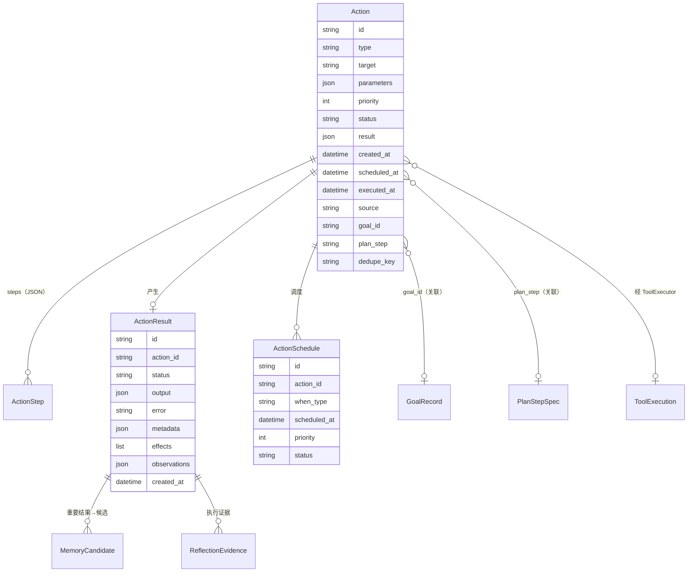

# V2.6.0 Action Execution System Architecture

> **状态**：架构设计稿（仅设计，未排期、未实现）
> **前置**：V2.0.0 Memory V2 / Reflection / Life Loop；V2.1.0 Agent Runtime / Goal Stack / Decision Pipeline / Action Engine；V2.2.0 Character Experience；V2.3.0 World Simulation；V2.4.0 Tool System（能力治理层）；V2.5.0 Planning System（计划编排层，已实现）
> **定位**：Action Execution System = **行动执行层（Action Execution Layer）**。它把 V9 遗留的"单次动作执行"（`action_engine.run_action_planning`）升级为一个**统一 Action 抽象 + 执行引擎 + 调度器 + 结果系统**，让 Agent 从"能制定计划"升级为"能制定计划 + 能执行行动 + 能根据结果调整行为"，形成完整的行动闭环：
>
> ```
> Plan → Action → Execution → Result → State Update → Feedback
> ```
>
> **铁律**：零新建 Agent / Memory / Session / Event 系统；Planning 不负责执行、Executor 不负责决策、Tool 是 Action 的扩展能力；Action 是独立抽象层；所有执行必须产生 Result；Result 必须支持反馈闭环；世界仍由 `world_engine` 唯一写入；记忆仍由 `memory_policy` R1~R8 唯一裁决。

---

## 1. Overview

### 1.1 一句话定位

前九个版本把角色的**大脑**（记忆 / 反思 / 决策 / 计划）和**手**（工具）都造齐了，但"决定要做一件事"到"这件事真的做完并反馈回来"之间，缺一层**统一、可观测、可失败、可恢复的执行纪律**。

V2.6.0 建立的就是这层纪律：**Action Execution Layer**。

### 1.2 版本脉络

| 版本 | 主题 | 已有能力 |
|---|---|---|
| V2.0.0 | Memory & Reflection | Memory V2（候选→转正→衰减）、Reflection（每日+事件双触发三道闸）、Life Loop（唯一调度器 + outbox 一致性） |
| V2.1.0 | Agent Autonomy | Agent Runtime（三种 Run Profile）、Goal Stack（L3~L0）、Decision Pipeline（九源候选 / 六维评分 / 四风险闸）、Action Engine（九能力）、LLM Gateway |
| V2.2.0 | Character Experience | Emotion / Personality / Habit / Relationship Experience / Response Style |
| V2.3.0 | World Simulation | 时间流逝 / 日程 / 世界事件 / 场景（Context + Trigger Layer） |
| V2.4.0 | Tool System | 工具注册 / 权限 / 校验 / 归一 / 扩展（Capability Governance Layer） |
| V2.5.0 | Planning System | Goal → Plan → Task 拆解 / 调度 / 观测 / 重规划（Plan Orchestration Layer） |

当前能力链：

```text
Autonomy（决定此刻做什么）
    ↓
World Understanding（世界此刻在发生什么）
    ↓
Relationship Modeling（关系如何影响表达）
    ↓
Planning（目标 → 可执行计划）
    ↓
??? ← 缺：统一的行动执行层
```

V2.6.0 补上最后一环，形成完整闭环：

```text
Plan → Action → Execution → Result → State Update → Feedback
```

### 1.3 与后续版本的衔接

```text
V2.6 Action Execution（本版本）
    ↓ 承接 Action 抽象 + 执行引擎 + 调度器
V2.7 Tool Capability System（承接 §8 预留的 Tool Adapter 扩展面）
    ↓
V2.8 Reflection & Learning（承接 §7.4 的执行结果反馈闭环）
    ↓
V3.0 Autonomous Agent
```

本版本是**飞书机器人主动行为**的基础层：没有统一的 Action 抽象与调度能力，"主动发消息 / 定时提醒 / 延迟执行"都无法落地。

---

## 2. Background

### 2.1 为什么要做

前九个版本已经交付了"决定"与"计划"的全链路，但**执行层仍停留在 V9 的"单次动作"形态**：

| 版本 | 能力 | 现状 |
|---|---|---|
| V9 | Action Engine | 六闸门 + 单步 `ActionStep(index=0)` + `assemble_plan` 恒产一步 |
| V2.1 | Agent Runtime / Decision | 决策产出 `ActionIntent`，交给 action_engine 执行 |
| V2.4 | Tool System | 工具治理（注册/权限/校验/归一），但状态为"仅设计未实现" |
| V2.5 | Planning | 计划编排已实现，但明确把"多步执行"留给后续版本 |

**具体断层（承 V2.5.0 §1.3 与遗留问题）**：

| # | 断层 | 证据 | 影响 |
|---|---|---|---|
| B1 | **Action 抽象不统一** | `ActionIntent`（决策产物）/ `ActionRecord`（台账）/ `ActionStep`（执行步骤）/ `ToolExecution`（工具执行）四个概念散落，无统一 `Action` 模型 | 无法回答"一个 Action 从创建到终态的完整生命周期是什么" |
| B2 | **执行只有单步** | V2.5.0 §3.10 明确"放开 `action_plan_max_steps` > 1"留给后续版本；`ActionSettings.action_plan_max_steps = 1` | 一个计划的多步无法在一次执行编排内完成 |
| B3 | **执行态与计划态双份不对齐** | V2.5.0 B5：`SubGoalSpec.attempt_count` vs `ActionRecord.attempt` 各自计数 | 同一个失败两处计数，"重试几次算尽力"无唯一答案 |
| B4 | **无统一调度能力** | 延迟执行 / 定时执行 / 优先级排序 / 队列管理散落在 `trigger_registry` / `background_jobs` / `outbox` 三处，无 Action 级调度语义 | "明天早上提醒我"这类需求无法以 Action 为单元编排 |
| B5 | **结果无统一契约** | `CapabilityResult.payload`（V9 自由 dict）/ `ToolResult`（V2.4.0 契约）/ `PlanStepOutcome`（V2.5.0 契约）三份结果语义并存 | 下游 Memory / Reflection / Autonomy 无法按统一契约消费执行结果 |
| B6 | **反馈闭环断链** | 执行结果 → 状态更新 → 反馈（调整后续行为）的闭环，只在 Memory（`memory_bridge`）与 Reflection（证据窗）有单向通道，无统一"执行结果回写决策面"的机制 | 角色"能执行"但"不能根据结果系统性地调整行为" |
| B7 | **V2.4.0 兼容承诺到期** | V2.4.0 §5.5 写明"V9 既有读键保留到 V2.5.0，正式退役窗口推到 V2.6.0" | 本版本需兑现"旧读键退役"，统一结果契约 |

一句话：**角色有了目标（Goal）、有了决策（Autonomy）、有了计划（Planning）、有了手（Tool），但"把一件事真正执行完、并把结果喂回去"这层纪律是散的、单步的、双份的、没有统一契约的。**

### 2.2 已有的执行资产盘点（本版本的地基，一律复用）

**这是本版本最重要的前提判断：执行层不是从零开始——`action_records` / `ActionRecord` / `action_engine` / `ToolExecutor` 已经是"执行"的完整雏形，只是单步、散落、缺统一抽象。**

```text
app/application/
├── action_engine.py          # V9 行动域唯一编排器（create → gates → plan → execute → integrate）
├── life_loop.py              # 唯一调度器（维护步骤序列）
├── outbox_consumer.py        # 跨域延迟投递消费器
├── autonomy_engine.py        # V7 自治 tick（TriggerEvaluator → Policy → Executor）
└── post_process.py           # 十步后处理（第 9 步 = 行动规划）

app/services/action/
├── registry.py               # CapabilityRegistry（模块级单例，代码注册）
├── planner.py                # 六闸门 + 计划装配（恒单步）
├── executor.py               # CapabilityExecutor（超时 + 异常归一 + usage）
├── detector.py               # 确定性意图检出（词表 + 参数抽取，零 LLM）
├── memory_bridge.py          # 行动 → 记忆候选（policy R1~R8）
├── relationship_bridge.py    # 行动 → 关系信号
└── capabilities/             # 6 个内置能力实现

app/services/tool/
├── registry.py               # ToolRegistry（V2.4.0 治理外壳，代码注册）
├── surface.py                # ToolSurfaceResolver / ToolSelector
├── permission.py             # ToolPermissionGate + ConfirmationService
├── validator.py              # ParamValidator（双层校验）
├── normalizer.py             # ObservationNormalizer
├── executor.py               # ToolExecutor（闸 → 校验 → 调用 → 归一）
└── memory_policy.py          # ToolMemoryPolicy 边界表

app/services/planning/
├── engine.py                 # PlanningEngine（包装 goal_planning）
├── scheduler.py              # PlanScheduler（纯函数 DAG 调度）
├── executor_bridge.py        # PlanExecutorBridge（Task → Action → Tool）
├── observer.py               # PlanObserver（判据 + 推进 + 终态）
└── revision.py               # PlanRevisionPolicy（重规划裁决）
```

**关键事实盘点**：

- `ActionRecord` 已有 `id` / `user_id` / `action_type` / `status`（六态）/ `steps`（JSON，含每步 capability/action/params/status/result）/ `attempt` / `next_retry_at` / `dedupe_key`——**执行台账已有落点，不需要新表承接执行态**。
- `action_engine.run_action_planning` 已是"创建 → 六闸门 → 计划装配 → 执行 → 四通道投递"的完整编排器——**本版本是它的"多步化 + 调度化 + 结果统一化"，不是替换**。
- `ToolExecutor.run`（V2.4.0）已定义五段短路（resolve → permission → validate → invoke → normalize），产出 `ToolResult`——**执行结果契约已有，缺的是统一提升**。
- `trigger_registry`（action_due 类触发）、`background_jobs`（两类台账）、`outbox_events`（事务投递）三者已构成"延迟 / 定时 / 队列"的散落设施——**本版本把它们统一到 Action 级调度语义下**。
- `ActionRecord.status` 六态 `created/planned/executing/succeeded/failed/cancelled` 已完备——**Action 生命周期已有骨架**。
- `CapabilityExecutor.run` 已做超时包裹 / 异常归一 / usage 计时——**执行引擎已有雏形**。

### 2.3 既有资产与本文档的对应关系

| 你要的设计 | 既有承载物 | 本版本动作 |
|---|---|---|
| Action Model / Type / Lifecycle / Status | `ActionIntent` + `ActionRecord` + `ACTION_TYPES` | **统一抽象**（新增 `Action` 值对象，六态 + 完整生命周期） |
| Action Execution 架构 | `action_engine.run_action_planning` | **多步化 + 调度化**（保持唯一编排器地位） |
| Action Manager | `action_engine` + `action_repository` | **强化**（create/execute/cancel/retry/get_status 统一入口） |
| Action Executor | `CapabilityExecutor` + `ToolExecutor` | **复用 + 分层**（Internal / Tool / External 三执行方式） |
| Action Scheduler | `trigger_registry` + `background_jobs` + `outbox` | **统一**（Action 级调度语义：延迟/定时/优先级/队列） |
| Action Result | `ToolResult`（V2.4.0）+ `PlanStepOutcome`（V2.5.0） | **统一契约**（`ActionResult` 唯一结果） |
| 反馈闭环 | `memory_bridge` + `reflection` 证据窗 | **补执行结果回写决策面** |
| 数据模型 | `action_records`（既有表） | **扩展 steps + 新增调度表**（见 §9 裁决） |

---

## 3. Goals

### 3.1 设计目标

| # | 目标 | 判定标准 |
|---|---|---|
| G1 | **Action 是独立抽象层** | 一个 `Action` 可回答"是什么 / 做什么 / 什么状态 / 什么结果 / 什么时候创建 / 什么时候执行"六问，且不依赖任何上层系统语义 |
| G2 | **Planning 不负责执行** | Planning 只产出计划步骤，执行一律经 Action Manager / Executor；`planning/` 包内 grep `execute` 零命中（除 `executor_bridge` 翻译层） |
| G3 | **Executor 不负责决策** | Executor 只"接收 Action → 选执行方式 → 执行 → 捕获异常 → 返回结果"，不做"要不要做 / 做哪个"的判断 |
| G4 | **Tool 是 Action 的扩展能力** | 新增外部能力（飞书 / 日历 / 搜索 / API）= 声明 Tool Adapter，不改 Action 抽象、不改 Executor |
| G5 | **所有执行必须产生 Result** | 成功 / 失败 / 超时 / 取消 / 部分完成，任一终态都有结构化 `ActionResult`，无台账的执行视为缺陷 |
| G6 | **Result 支持反馈闭环** | 执行结果能回写世界状态、记忆、关系、并进入决策面（Autonomy）与反思面（Reflection），形成调整行为的闭环 |
| G7 | **执行可调度** | 延迟执行 / 定时执行 / 优先级排序 / 队列管理以 Action 为单元，复用既有调度设施 |
| G8 | **零新建基础设施** | 零新 Agent / Memory / Session / Event 系统；执行台账复用 `action_records`；调度复用既有三设施（见 §9 零迁移裁决） |
| G9 | **兑现 V2.4.0 兼容承诺** | 本版本统一结果契约，退役 V9 旧读键（`world_event_id` / `memory_id` / `failure_kind` 旧位置），Flag off 时行为逐字节一致 |

### 3.2 设计原则（硬约束）

1. **Action 是独立抽象层**——不依赖 Goal / Plan / Tool 的语义即可完整表达一次行动。
2. **Planning 不负责执行**——计划层只管编排，执行层管动手。
3. **Executor 不负责决策**——执行器是"手"，不是"脑"。
4. **Tool 是 Action 的扩展能力**——工具通过 Adapter 挂载，Action 抽象不感知具体工具。
5. **所有执行必须产生 Result**——没有结果台账的执行不存在。
6. **Result 必须支持反馈闭环**——结果必须能驱动状态更新与行为调整。

### 3.3 与 V2.5.0 定位的对照

| 维度 | V2.5.0 Planning System | V2.6.0 Action Execution System |
|---|---|---|
| 层次 | Plan Orchestration Layer | Action Execution Layer |
| 加在哪 | Goal 与 Action 之间的编排面 | Action 内部（统一抽象 + 执行 + 调度 + 结果） |
| 产出 | `GoalPlanRecord` + `PlanStepOutcome` | `Action` + `ActionResult` + `ActionSchedule` |
| 回答的问题 | "分几步、每步用什么、做不成怎么办" | "这一步怎么执行、何时执行、结果怎么反馈" |
| 铁律 | 计划只编排，执行仍由 Action 唯一编排器负责 | 执行层只动手，决策仍由 Autonomy、编排仍由 Planning |

---

## 4. Non-Goals

| 不做 | 理由 |
|---|---|
| 新建 Agent / Memory / Session / Event 系统 | 用户硬约束 + 与既有设施重复（§9） |
| 新建第二套执行编排器 | `action_engine.run_action_planning` 是唯一编排器（V2.5.0 红线 3 延续） |
| 让 Planning 层直接调工具 / 执行 | Planning 只编排，执行一律经 Action 层（G2） |
| 让 Executor 做决策 | Executor 不做"要不要做 / 做哪个"的判断（G3） |
| 实现具体 Tool（飞书 / 日历 / 搜索 / API） | 本版本只预留 Tool Adapter 扩展面，不实现具体工具（留给 V2.7.0） |
| 引入并行步骤执行 | 依赖 DAG + 单步并发上限；并行涉及部分失败回滚语义，超出本版本（V2.5.0 §3.10 延续） |
| 引入新的调度循环 / Worker | 挂进既有 `life_loop` 维护步与 `background_jobs`（§7.8） |
| 让 Reflection 直接改写 Action / 计划 | 反思管认知，执行层管动手（V2.5.0 §7.6 延续） |
| Action 的可视化编辑器 / 人工编排 UI | 超出 Agent 运行时范畴 |

---

## 5. System Architecture

### 5.1 层图

```text
        ┌──────────────────────────────────────────────────────────────────┐
        │                          Agent Core（既有）                        │
        │  chat_pipeline（前台）/ life_loop（后台）/ autonomy_engine         │
        │  Run Profile 加载 → 阶段编排（V2.1 既有）                          │
        └───────────────────────────────┬──────────────────────────────────┘
                                        │ 需要行动（ActionIntent / PlanStep）
                                        ▼
        ┌──────────────────────────────────────────────────────────────────┐
        │              Action Execution Layer（V2.6.0 新增）                 │
        │                                                                   │
        │  ┌─────────────────────────────────────────────────────────────┐ │
        │  │              Action Manager（行动管理中心）                   │ │
        │  │  create / execute / cancel / retry / get_status              │ │
        │  └──────────────────────────────┬──────────────────────────────┘ │
        │                                 │ Action（统一抽象）              │
        │                ┌────────────────┼────────────────┐               │
        │                ▼                ▼                ▼               │
        │  ┌──────────────────┐ ┌──────────────────┐ ┌────────────────┐   │
        │  │ Action Scheduler │ │ Action Executor  │ │ Result System  │   │
        │  │ 延迟/定时/优先级  │ │ 分派执行方式      │ │ ActionResult    │   │
        │  │ 队列管理         │ │ 异常捕获/超时     │ │ 成功/失败/部分  │   │
        │  └──────────────────┘ └───────┬──────────┘ └───────┬────────┘   │
        │                               │                    │            │
        │              ┌────────────────┼────────────────┐   │            │
        │              ▼                ▼                ▼   │            │
        │      ┌────────────┐  ┌────────────┐  ┌──────────────┐          │
        │      │  Internal  │  │    Tool    │  │   External   │          │
        │      │   Action   │  │    Call    │  │   Service    │          │
        │      └────────────┘  └────────────┘  └──────────────┘          │
        └───────────────────────────────┬──────────────────────────────────┘
                                        │ ActionResult（统一结果契约）
                                        ▼
        ┌──────────────────────────────────────────────────────────────────┐
        │         World / Memory / Relationship / State Update（反馈闭环）    │
        │  world_engine 唯一写面 / memory_policy R1~R8 / relationship_bridge  │
        │  → Autonomy（tool_facts / action_facts）/ Reflection（证据窗）      │
        └──────────────────────────────────────────────────────────────────┘
```

### 5.2 模块职责

| 模块 | 职责 | 不做什么 | 实现形态 |
|---|---|---|---|
| **Agent Core** | 决定"这一轮要不要行动"；加载 Run Profile；编排阶段 | 不选执行方式、不执行、不管调度细节 | V2.1 既有（零改动） |
| **Action Manager** | Action 的**唯一生命周期管理者**：create / execute / cancel / retry / get_status | 不判断"该不该做"（决策层）；不拆步骤（计划层） | 强化 `action_engine` + `action_repository` |
| **Action Scheduler** | Action 的**调度**：延迟执行 / 定时执行 / 优先级排序 / 队列管理 | 不执行（只排期）；不决策 | 统一既有三设施 + 纯函数 |
| **Action Executor** | 接收 Action → 选执行方式 → 执行 → 捕获异常 → 返回结果 | 不做重试决策（Action 层做）；不做业务判断 | 复用 `CapabilityExecutor` + `ToolExecutor` |
| **Result System** | 执行结果的**统一契约与处理**：成功/失败/部分完成/重试 | 不直接写世界/记忆（经既有通道） | 统一 `ToolResult` → `ActionResult` |
| **Internal / Tool / External** | 三种执行方式的真正动手：内部动作 / 工具调用 / 外部服务 | 不知道自己被谁调用（ExecutionContext 隔离） | 复用既有 + 预留扩展 |

### 5.3 数据流全景（一次 Action 的完整路径）

```text
① 触发
   ├─ 前台：chat_pipeline → post_process 第 9 步 run_action_planning
   ├─ 后台：autonomy_engine tick → _produce_autonomy_action
   └─ 计划：PlanExecutorBridge.execute_step → action_engine
                    │
② 创建（Action Manager）
   ActionManager.create(intent / plan_step) → Action
        │ 统一抽象：id / type / target / params / priority / status / result
        │ status = CREATED
        ▼
③ 调度（Action Scheduler，可选）
   ActionScheduler.schedule(action, when, priority)
        │ 立即执行 → 跳过调度
        │ 延迟/定时 → 落调度（trigger_registry / background_jobs）
        ▼
④ 执行（Action Executor）
   ActionManager.execute(action)
        │ status: CREATED → PENDING → RUNNING
        │ 按 action.type 分派执行方式：
        │   Internal Action（内部动作，直接执行）
        │   Tool Call（经 ToolExecutor 五段短路）
        │   External Service（经 Tool Adapter → 外部能力）
        ▼
⑤ 结果（Result System）
   ActionExecutor 捕获异常 / 超时 → ActionResult
        │ {id, action_id, status, output, error, metadata}
        │ status: SUCCESS / FAILED / PARTIAL / TIMEOUT
        ▼
⑥ 状态更新（反馈闭环）
   ActionResult → 四通道回写（复用既有 integrate_result）
        ├─ World  ：deferred_world_op → outbox → world_engine（唯一写面）
        ├─ Memory ：memory_bridge（policy R1~R8）
        ├─ Relationship：relationship_bridge
        └─ Note   ：行动 note → 回复素材
        ▼
⑦ 反馈（下游拉取）
   ├─ Autonomy：action_facts / tool_facts → 决策面
   ├─ Reflection：执行证据窗 → Insight
   └─ Planning：PlanStepOutcome → 计划推进 / 重规划
```

### 5.4 调用关系（权威函数唯一化）

| 关注点 | 唯一权威 | 说明 |
|---|---|---|
| Action 生命周期 | `ActionManager` | 唯一写面（create / execute / cancel / retry / get_status） |
| Action 状态机 | `Action` 六态 + `ActionStatus` 迁移表 | 唯一迁移权威 |
| 执行方式分派 | `ActionExecutor.dispatch(action)` | 按 type 选 Internal / Tool / External |
| 执行编排 | `action_engine.run_action_planning` | 保持唯一编排器（V2.5.0 红线延续） |
| 调度 | `ActionScheduler` | 统一延迟/定时/优先级/队列语义 |
| 结果契约 | `ActionResult` | 唯一结果结构 |
| 世界写入 | `world_engine` | 唯一写面 |
| 记忆裁决 | `memory_policy` R1~R8 | 零豁免 |
| 决策 | `decision_pipeline` | Action 层不决策 |
| 计划编排 | `goal_planning` / `planning` | Action 层不编排 |

---

## 6. Action Model

### 6.1 Action 统一抽象

这是本版本的核心交付物：**一个独立于 Goal / Plan / Tool 语义的 Action 值对象**。

```text
Action
├── id           : str           # 唯一 id（uuid）
├── type         : ActionType    # 动作类型（见 6.2）
├── target       : str | None    # 动作目标（user_id / object_id / channel / ...）
├── parameters   : dict          # 动作参数（规范化后）
├── priority     : int           # 优先级（默认 100，调度排序用）
├── status       : ActionStatus  # 生命周期状态（见 6.4）
├── result       : ActionResult | None  # 结果（终态时必填）
├── created_at   : datetime      # 创建时刻
├── scheduled_at : datetime | None  # 计划执行时刻（调度用）
├── executed_at  : datetime | None  # 实际执行时刻
├── source       : str           # 来源：conversation / autonomy / plan / event_driven
├── goal_id      : str | None    # 关联目标（V2.1 Goal Stack）
├── plan_step    : str | None    # 关联计划步骤（V2.5.0）
├── dedupe_key   : str           # 幂等键（既有 make_dedupe_key）
└── run_id       : str | None    # 所属 Run（loop_runs.id）
```

### 6.2 Action Type

动作类型沿用既有 `ACTION_TYPES`（V9 九能力），**不新增值集**，但建立类型 → 执行方式的映射：

| Action Type | 语义 | 执行方式 | 说明 |
|---|---|---|---|
| `create_reminder` | 创建提醒 | Internal Action | 内部动作（写世界） |
| `cancel_reminder` | 取消提醒 | Internal Action | 内部动作 |
| `remember_fact` | 记住事实 | Internal Action | 内部动作（写记忆） |
| `world_action` | 世界动作 | Internal Action | 内部动作（写世界） |
| `query_environment` | 查询环境 | Tool Call | 只读工具 |
| `send_notification` | 发通知 | Tool Call / External Service | 工具调用（飞书等） |
| `search` | 搜索 | Tool Call | 工具调用（预留） |
| （未来） | 外部能力 | External Service | 经 Tool Adapter（§8） |

**类型 → 执行方式映射**（`ACTION_EXECUTION_MAP`，角色资产层，纯数据）：

```text
ACTION_EXECUTION_MAP = {
    "create_reminder":    ExecutionKind.INTERNAL,
    "cancel_reminder":    ExecutionKind.INTERNAL,
    "remember_fact":      ExecutionKind.INTERNAL,
    "world_action":       ExecutionKind.INTERNAL,
    "query_environment":  ExecutionKind.TOOL,
    "send_notification":  ExecutionKind.EXTERNAL,   # 经 Tool Adapter
    "search":             ExecutionKind.TOOL,
}
```

> **扩展点**：新增 Action Type = 在 `ACTION_EXECUTION_MAP` 加一行 + 注册对应执行方式，不改 Action 抽象、不改 Executor。

### 6.3 Action Lifecycle

```text
                 create
                    │
                    ▼
             ┌────────────┐
             │  CREATED   │  已创建，未调度
             └──────┬─────┘
                    │ schedule / execute
                    ▼
             ┌────────────┐
             │  PENDING   │  已排期 / 等待执行（调度队列中）
             └──────┬─────┘
                    │ execute（到期 / 立即）
                    ▼
             ┌────────────┐
             │  RUNNING   │  执行中（含 Tool / External 调用）
             └──────┬─────┘
        ┌───────────┼────────────┬───────────────┐
        │           │            │               │
    成功          失败         超时            取消
        │           │            │               │
        ▼           ▼            ▼               ▼
   ┌─────────┐ ┌────────┐ ┌─────────┐   ┌──────────┐
   │ SUCCESS │ │ FAILED │ │ FAILED  │   │ CANCELLED│
   └─────────┘ └────────┘ │(timeout)│   └──────────┘
                          └─────────┘
```

**终态（出度 0）**：`SUCCESS` / `FAILED` / `CANCELLED`。`FAILED` 可由 `retry` 回到 `PENDING`（重试），但受 `action_retry_max_attempts` 约束。

### 6.4 Action Status

```text
ActionStatus = CREATED | PENDING | RUNNING | SUCCESS | FAILED | CANCELLED
```

| 状态 | 语义 | 可迁移到 |
|---|---|---|
| `CREATED` | 已创建，未调度 | `PENDING` / `RUNNING` / `CANCELLED` |
| `PENDING` | 已排期，等待执行 | `RUNNING` / `CANCELLED` |
| `RUNNING` | 执行中 | `SUCCESS` / `FAILED` / `CANCELLED` |
| `SUCCESS` | 成功（终态） | — |
| `FAILED` | 失败（终态，可 retry 回 PENDING） | `PENDING`（retry） |
| `CANCELLED` | 已取消（终态） | — |

**与既有 `ActionRecord.status` 六态的对应**：

| ActionStatus（本版本） | ActionRecord.status（V9 既有） | 说明 |
|---|---|---|
| `CREATED` | `created` | 一致 |
| `PENDING` | `planned` | 语义强化（排期/等待） |
| `RUNNING` | `executing` | 一致 |
| `SUCCESS` | `succeeded` | 一致 |
| `FAILED` | `failed` | 一致 |
| `CANCELLED` | `cancelled` | 一致 |

> **不新增 ActionRecord.status 值**：六态已完备。本版本的 `ActionStatus` 是对既有六态的统一命名与语义强化，通过**映射**而非新增落库值对齐——`gate_reason` 已能承载细粒度原因（V2.4.0 §6.2 已扩展）。

---

## 7. Execution Flow

### 7.1 执行编排（多步化）

本版本**兑现 V2.5.0 遗留 Q1**：放开 `action_plan_max_steps` > 1，让一次执行编排能承载多步。

**关键裁决：多步由谁编排？**

- **单 Action 多步**：一个 `Action` 内部可以包含多个 `ActionStep`（`steps` JSON 列已支持），由 `action_engine` 顺序执行。
- **计划多步**：仍由 Planning 层编排（V2.5.0 红线 3 延续），每个 PlanStep 是一个独立的 Action。

**执行方式分派（Action Executor 核心）**：

```text
ActionExecutor.dispatch(action)
        │ 按 action.type 查 ACTION_EXECUTION_MAP
        ▼
   ┌──────────────┬──────────────┬──────────────┐
   │  INTERNAL    │    TOOL      │   EXTERNAL   │
   │  Action      │    Call      │   Service    │
   └──────┬───────┴──────┬───────┴──────┬───────┘
          │              │              │
          ▼              ▼              ▼
   CapabilityExecutor  ToolExecutor   Tool Adapter
   （内部动作直接执行） （五段短路）     （外部能力，预留）
          │              │              │
          └──────────────┴──────────────┘
                         │
                         ▼
                  ActionResult（统一结果）
```

### 7.2 同步 / 异步 / 长任务执行

| 执行模式 | 适用场景 | 实现方式 | 状态流转 |
|---|---|---|---|
| **同步执行** | 前台对话内的即时动作（查询、发消息） | `await ActionManager.execute()` 直接阻塞 | CREATED → RUNNING → 终态 |
| **异步执行** | 后台自治动作、不阻塞回复 | 挂 `background_jobs` / `outbox` 延迟消费 | CREATED → PENDING → RUNNING → 终态 |
| **长任务执行** | 外部服务调用（飞书 API、搜索）超时较长的动作 | `asyncio.wait_for(timeout)` + 超时归一 | RUNNING → FAILED(timeout) 或 SUCCESS |

**关键约束**：同步执行不得阻塞回复（V9 纪律"工具失败永不阻塞回复"延续）；异步执行经既有 outbox 一致性模型；长任务受 `action_execution_timeout_seconds` 约束。

### 7.3 失败重试

重试语义**唯一归属 Action 层**（`action_engine._process_due_retries` + 退避数学）：

| 层 | 计数器 / 键 | 既有设置 | 职责 |
|---|---|---|---|
| **Action 层** | `ActionRecord.attempt` / `next_retry_at` | `action_retry_max_attempts=2`、`action_retry_backoff_seconds=30` | 技术性重试（瞬时故障、超时）——不问业务 |
| **Plan 层** | `PlanStepSpec.attempt_count` | `v25_plan_step_max_attempts` | 业务性放弃/改道（V2.5.0 §3.7 已定） |

**本版本的对齐（B3 关闭点）**：`ActionResult.attempt` 与 `ActionRecord.attempt` 是同一字段的两个视角；Plan 层只消费 Action 终态做"要不要放弃/重规划"裁决，**不实现退避**。

---

## 8. Module Design

### 8.1 Action Manager（行动管理中心）

**Responsibility**：Action 的唯一生命周期管理者。

```text
ActionManager（强化 action_engine + action_repository）
├── create(intent | plan_step, *, source) -> Action
│       · 统一抽象：type / target / params / priority / dedupe_key
│       · 落 action_records（status=created）
├── execute(action_id | action) -> ActionResult
│       · 经 action_engine.run_action_planning（唯一编排器）
│       · 多步：按 steps 顺序执行（action_plan_max_steps > 1 放开）
├── cancel(action_id, *, reason) -> bool
│       · 仅 PENDING / RUNNING 可取消
│       · 落 action_records（status=cancelled，gate_reason=reason）
├── retry(action_id) -> ActionResult | None
│       · 仅 FAILED 可重试（受 max_attempts 约束）
│       · 复用原 dedupe_key（防重复副作用）
└── get_status(action_id) -> ActionStatus
        · 读 action_records 当前态
```

**关键约束**：

- `create` 不判断"该不该做"——那是 `decision_pipeline` 的职责（G3）。
- `execute` 不拆步骤——那是 Planning 的职责（G2）。
- `cancel` 不写世界/记忆——只改 Action 状态，副作用回滚由既有通道处理。
- `retry` 复用原 `dedupe_key`，防重复副作用（幂等纪律）。

### 8.2 Action Executor（执行引擎）

**Responsibility**：接收 Action → 选执行方式 → 执行 → 捕获异常 → 返回结果。

```text
ActionExecutor（复用 CapabilityExecutor + ToolExecutor）
├── dispatch(action) -> ExecutionKind        # 按 type 选执行方式（纯函数）
├── execute_internal(action, ctx) -> ActionResult   # 内部动作
├── execute_tool(action, ctx) -> ActionResult       # 工具调用（五段短路）
├── execute_external(action, ctx) -> ActionResult   # 外部服务（经 Adapter）
└── run(action, ctx) -> ActionResult
        · 捕获异常 / 超时 / 归一 → ActionResult
        · 不做重试决策（Action 层做）
```

**三种执行方式**：

| 执行方式 | 实现 | 复用 | 说明 |
|---|---|---|---|
| **Internal Action** | 内部动作（写世界/记忆） | `CapabilityExecutor` | 直接执行，不经过工具治理 |
| **Tool Call** | 工具调用 | `ToolExecutor`（五段短路：resolve → permission → validate → invoke → normalize） | 受工具治理约束 |
| **External Service** | 外部服务 | `Tool Adapter`（§8.4 预留） | 未来飞书 / 日历 / 搜索 / API |

**异常捕获纪律（承 V9 + V2.4.0）**：

1. 工具失败永不静默假成功。
2. 工具失败永不阻塞回复。
3. 所有异常必须落执行台账。
4. 异常归一为 `ActionResult.status ∈ {FAILED}`，`failure_kind` 由 `error_map` 决定，默认 `transient`。

### 8.3 Action Scheduler（调度器）

**Responsibility**：Action 的延迟 / 定时 / 优先级 / 队列管理。

```text
ActionScheduler（统一既有三设施 + 纯函数）
├── schedule(action, *, when, priority) -> ActionSchedule
│       · when = None（立即）/ delay（延迟）/ cron（定时）
├── sort_queue(actions) -> list[Action]
│       · 按 priority 降序 + scheduled_at 升序 + id 字典序（确定性 tiebreak）
├── due_actions(now) -> list[Action]
│       · 到期 Action 集（scheduled_at <= now）
└── next_action() -> Action | None
        · 队列头（最高优先级最早到期）
```

**调度语义统一（B4 关闭点）**：

| 调度需求 | 既有设施 | 本版本统一 |
|---|---|---|
| 延迟执行 | `trigger_registry`（action_due） | `ActionScheduler.schedule(when=delay)` |
| 定时执行 | `background_jobs` / `outbox` | `ActionScheduler.schedule(when=cron)` |
| 优先级排序 | 散落 | `ActionScheduler.sort_queue`（纯函数） |
| 队列管理 | 散落 | `ActionScheduler.due_actions` / `next_action` |

**示例（用户需求"明天早上提醒我学习"）**：

```text
用户："明天早上提醒我学习"
        ↓ Plan（V2.5.0）
Action{type: create_reminder, target: user, params: {content:"学习", due_at: 明早 8:00}}
        ↓ Schedule（V2.6.0）
ActionScheduler.schedule(action, when=明早 8:00, priority=100)
        ↓ 到期
ActionManager.execute(action) → ActionResult{status: SUCCESS}
        ↓ 反馈
世界事件（提醒到期）+ 记忆候选 + 决策面更新
```

### 8.4 Action Result System（结果系统）

**Responsibility**：执行结果的统一契约与处理。

```text
ActionResult
├── id           : str           # 结果 id（uuid）
├── action_id    : str           # 关联 Action
├── status       : ResultStatus  # SUCCESS / FAILED / PARTIAL / TIMEOUT
├── output       : dict          # 结构化输出（替代自由 payload）
├── error        : str | None    # 可读错误（≤ 80 字）
├── metadata     : dict          # usage / failure_kind / external_calls
├── effects      : list[Effect]  # 结构化效果清单（world / memory / relationship / note / external）
├── observations : dict          # 给下游消费的事实
└── created_at   : datetime      # 结果产生时刻
```

**结果处理**：

| 结果类型 | 处理 | 后续 |
|---|---|---|
| **成功结果** | `status=SUCCESS`，`output` 结构化，`effects` 回写四通道 | 反馈闭环（§9） |
| **失败结果** | `status=FAILED`，`failure_kind` 决定重试策略 | `retry`（受 max_attempts） |
| **部分完成** | `status=PARTIAL`，`effects` 含已完成部分 | 记录，不回滚（既有纪律） |
| **重试** | `retry` 复用原 dedupe_key | 防重复副作用 |

**与既有结果契约的统一（B5/B7 关闭点）**：

| 既有契约 | 本版本动作 |
|---|---|
| `CapabilityResult.payload`（V9 自由 dict） | **退役旧读键**（`world_event_id` / `memory_id` / `failure_kind` 旧位置），统一为 `ActionResult.output` + `effects` + `observations` |
| `ToolResult`（V2.4.0 契约） | **提升为唯一结果契约**，`ActionResult` 是它的 Action 级外壳 |
| `PlanStepOutcome`（V2.5.0 契约） | **映射到 ActionResult**（Plan 层只读投影） |

> **兑现 V2.4.0 兼容承诺**：V2.4.0 §5.5 写明"V9 既有读键保留到 V2.5.0，正式退役窗口推到 V2.6.0"——本版本完成退役，统一结果契约。

---

## 9. Data Model

### 9.1 模型总览与归属



### 9.2 分层归属表

| 模型 | 层次 | 是否落库 | 落点 | 说明 |
|---|---|---|---|---|
| `Action` | 实例 | ✅ | `action_records` | 既有表（V9），**扩展 steps + 新字段** |
| `ActionStep` | 实例 | ✅ | `action_records.steps`（JSON） | 既有列，已承载 capability/action/params/status/result |
| `ActionResult` | 运行期 | ✅ | `action_records.result` / `steps[].result` | 统一结果契约 |
| `ActionSchedule` | 实例 | ✅ | **新表 `action_schedules`** | 见 §9.3 裁决 |
| `ActionStatus` | 声明 | ❌ | — | 六态迁移表（纯函数） |
| `ActionType` | 声明 | ❌ | — | 既有 `ACTION_TYPES` |

### 9.3 数据表设计

**核心裁决：本版本需要一张新表 `action_schedules`，其余复用既有表。**

**理由**：V2.5.0 的"零迁移"强断言建立在"计划本体复用 `goal_plans`"之上；本版本的调度语义（延迟/定时/优先级/队列）**无法**用既有 `action_records` 单表承载——`action_records` 是执行台账，不是调度队列。但调度设施（`trigger_registry` / `background_jobs` / `outbox`）**已经存在**，本版本是**统一而非新建**。

**裁决结论**：

| 数据 | 落点 | 是否新表 |
|---|---|---|
| Action 本体 + 状态 | `action_records`（既有表） | ❌（扩展 JSON 字段） |
| Action 执行步骤 | `action_records.steps`（JSON） | ❌ |
| Action 结果 | `action_records.result`（JSON） | ❌ |
| Action 调度 | **`action_schedules`（新表）** | ✅（唯一新表） |
| 调度队列消费 | `trigger_registry` + `background_jobs` + `outbox`（既有） | ❌ |

**`action_schedules` 表设计**：

| 字段 | 类型 | 说明 |
|---|---|---|
| `id` | varchar PK | |
| `action_id` | varchar FK | 关联 `action_records.id` |
| `when_type` | varchar | `immediate` / `delay` / `cron` |
| `scheduled_at` | timestamptz | 计划执行时刻（`cron` 时为下一次） |
| `priority` | int | 优先级（默认 100） |
| `status` | varchar | `scheduled` / `due` / `executed` / `cancelled` |
| `created_at` / `updated_at` | timestamptz | |

约束：`uq_action_schedules_action (action_id)`（一 Action 一调度）；索引 `idx_action_schedules_due (status, scheduled_at, priority)`。

**其他表（复用，不新建）**：

| 表 | 用途 | 本版本动作 |
|---|---|---|
| `action_records` | 执行台账（既有） | 扩展 `steps` JSON + 新字段（`scheduled_at` / `priority`） |
| `trigger_registry` | 到期触发（既有） | 复用为调度队列消费通道 |
| `background_jobs` | 后台任务台账（既有） | 复用为异步执行通道 |
| `outbox_events` | 事务投递（既有） | 复用为跨域延迟投递 |
| `goal_plans` | 计划本体（既有） | 只读关联（`plan_step` 引用） |
| `memories` / `insights` | 记忆 / 反思（既有） | 反馈闭环消费 |

### 9.4 状态迁移

```text
ActionStatus 迁移表（纯函数，唯一权威）

CREATED  → PENDING    （schedule）
CREATED  → RUNNING    （立即 execute）
CREATED  → CANCELLED  （cancel）
PENDING  → RUNNING    （到期 execute）
PENDING  → CANCELLED  （cancel）
RUNNING  → SUCCESS    （执行成功）
RUNNING  → FAILED     （执行失败/超时）
RUNNING  → CANCELLED  （cancel，长任务中断）
FAILED   → PENDING    （retry，受 max_attempts 约束）
SUCCESS  → （终态）
FAILED   → （终态，除非 retry）
CANCELLED → （终态）
```

---

## 10. Integration

### 10.1 集成总则

> **Action 层只动手，不裁决；结果只投递，不直写。**

- Action 层**不**直接写 Memory（必须经 `memory_policy` R1~R8）。
- Action 层**不**直接写 Character 域（`character_state` / `personality_state` / `relationship_*` / `character_goals`）。
- Action 层**不**直接写世界（必须经 `world_engine` + outbox）。
- Action 层**不**新增 chat_pipeline 步骤（第 9 步内部增强）。

### 10.2 与 Planning System 集成

```text
Plan Step（V2.5.0）
        │
        ▼
Create Action（本版本）
   PlanExecutorBridge.to_intent → Action{type, params, dedupe_key, plan_step}
        │
        ▼
Execute Action
   ActionManager.execute → ActionResult
        │
        ▼
Return Result
   ActionResult → PlanStepOutcome → PlanObserver 推进 / 重规划
```

**核心裁决**：Planning 只编排，Action 层只执行（G2）。PlanStep 与 Action 是 1:1 关系（每个 PlanStep 是一次独立 Action），多步由 Planning 层编排。

### 10.3 与 World Simulation 集成

```text
Action: send_message（发消息）
        │
        ▼
ActionResult.effects(kind=world)
        ↓ deferred_world_op → outbox → world_engine
        ▼
World Update: last_interaction_time（世界状态更新）
```

**核心裁决**：Action 永不直接改世界，经 `deferred_world_op` → outbox → `world_engine` 唯一写面（V2.4.0 §7.3 延续）。

### 10.4 与 Relationship Dynamics 集成

```text
Action: help_user（帮助用户）
        │
        ▼
ActionResult.effects(kind=relationship)
        ↓ relationship_bridge
        ▼
Relationship Update: trust +1
```

**核心裁决**：行为如何影响关系由 `relationship_bridge`（V9 既有二格映射）裁决，Action 层只产出关系信号。

### 10.5 与 Memory System 集成

| 层级 | 内容举例 | 载体 | 机制 |
|---|---|---|---|
| **临时执行记录** | 查询天气、环境查询 | `action_records`（执行台账） | 不落 `memories` |
| **长期记忆** | 帮用户记的提醒、重要关怀送达 | `memories`（经 R1~R8） | `memory_bridge` + `ToolMemoryPolicy` 边界表 |

**核心裁决**：普通执行结果不进记忆，重要结果进候选（V2.4.0 §7.4 延续）。执行台账（`action_records`）与长期记忆（`memories`）严格分离。

### 10.6 反馈闭环（B6 关闭点）

```text
ActionResult
        │
        ├─ World  ：状态更新（经 outbox → world_engine）
        ├─ Memory ：记忆候选（经 memory_policy R1~R8）
        ├─ Relationship：关系信号（经 relationship_bridge）
        ├─ Autonomy：action_facts / tool_facts → 决策面（下次决策感知成败）
        ├─ Reflection：执行证据窗 → Insight（行为调整）
        └─ Planning：PlanStepOutcome → 计划推进 / 重规划
```

**核心裁决**：反馈闭环不新建机制，全部复用既有通道。Action 层新增的只是**统一的 `ActionResult` 作为反馈入口**，让下游各系统按统一契约消费。

### 10.7 逐系统契约表

| 系统 | 提供给 Action 层 | 从 Action 层接收 | 永不改变 |
|---|---|---|---|
| **Planning（V2.5.0）** | `PlanStepSpec`（计划步骤） | `ActionResult` → `PlanStepOutcome` | 计划编排权威；不执行 |
| **Tool（V2.4.0）** | `ToolExecutor`（五段短路）、`ToolResult` | `Action`（type → 执行方式） | 工具治理权威；不重试决策 |
| **World（V8/V2.3）** | `world_engine` 写函数 | `deferred_world_op`（经 outbox） | 世界唯一写面 |
| **Memory（V2.0）** | `memory_policy` R1~R8 | 执行结果记忆候选 | R1~R8 零豁免 |
| **Relationship（V2.0/V2.2）** | `relationship_bridge` | 关系信号 | 单向 boost 方向 |
| **Autonomy（V2.1）** | `decision_pipeline`（决策） | `action_facts` / `tool_facts`（反馈） | 决策权威；Action 层不决策 |
| **Reflection（V2.0）** | 三道闸、证据窗 | 执行证据窗（反馈） | 防幻觉纪律 |
| **Life Loop（V2.1）** | 维护步骤序列 | 调度消费（到期 Action） | 唯一调度器 |

### 10.8 Flag 设计

沿用"总闸 + 子闸 + 串行链校验"范式：

| Flag | 控制面 | 依赖 | 默认 |
|---|---|---|---|
| `v26_action_execution_enabled` | **总闸**：Action 统一抽象、执行层、调度器、结果系统 | — | off |
| `v26_action_abstraction_enabled` | Action 值对象 + 六态生命周期 | 总闸 | off |
| `v26_action_scheduler_enabled` | ActionScheduler（延迟/定时/优先级/队列） | 总闸 | off |
| `v26_action_multistep_enabled` | 多步执行（`action_plan_max_steps` > 1） | 总闸 | off |
| `v26_action_result_enabled` | ActionResult 统一契约 + 旧读键退役 | 总闸 | off |
| `v26_action_feedback_enabled` | 反馈闭环（执行结果回写决策面） | 总闸 | off |

**关闭时行为保证（逐字节一致）**：总闸 off 时，`action_engine.run_action_planning` 走 V9 原路径（单步、自由 payload、旧读键生效），行为与 V2.5.0 逐字节一致。

---

## 11. Error Handling

### 11.1 异常处理总则

| 异常类别 | 发生位置 | 处理 | 是否重试 | 是否影响回复 |
|---|---|---|---|---|
| **执行失败** | ActionExecutor | `ActionResult{status: FAILED, failure_kind}` | 视 `failure_kind`（`transient` → 重试） | 否 |
| **执行超时** | ActionExecutor | `ActionResult{status: FAILED, failure_kind: timeout}` | 是（`action_retry_backoff_seconds`） | 否 |
| **参数校验失败** | ToolExecutor.ParamValidator | `status=invalid`，回传可读错误 | 否（`permanent`） | 否 |
| **授权拒绝** | ToolExecutor.PermissionGate | `status=denied`，零外部调用 | 否 | 否 |
| **取消** | ActionManager.cancel | `status=CANCELLED`，记录 `gate_reason` | 否 | 否 |
| **下游投递失败** | memory_bridge / outbox | 只 log，不回滚执行 | outbox 自身退避 | 否 |

### 11.2 重试

重试语义唯一归属 Action 层（§7.3），退避数学只有一份（`action_engine._process_due_retries`）。

### 11.3 幂等

- `dedupe_key`（`make_dedupe_key`）唯一权威，重试 / 重放复用原键。
- `idempotency=none` 的工具（V2.4.0）禁止自动重试。
- 步级幂等键 `plan:{goal_id}:{plan.version}:{step.index}`（V2.5.0 §3.7 既有公式）。

### 11.4 状态恢复

| 场景 | 恢复策略 |
|---|---|
| 进程崩溃（RUNNING 中） | Life Loop 维护步扫描孤儿 `RUNNING` Action，超时置 `FAILED`（可 retry） |
| 调度丢失 | `action_schedules` 幂等重建（`uq_action_schedules_action`） |
| 重复执行 | `dedupe_key` 去重（`action_dedupe_window_hours`） |
| 长任务中断 | 超时归一 + `CANCELLED` 记录，副作用经 outbox 一致性保证 |

---

## 12. Observability

### 12.1 日志

```text
Action Created    {action_id, type, source, priority}
Action Scheduled  {action_id, scheduled_at, when_type}
Action Started    {action_id, execution_kind, started_at}
Action Completed  {action_id, status, duration_ms}
Action Failed     {action_id, failure_kind, error, attempt}
Action Cancelled  {action_id, reason}
Action Retried    {action_id, attempt, next_retry_at}
```

全部落 `loop_runs.steps`（既有可观测通道，不新建）。

### 12.2 指标

| 指标 | 计算 | 用途 |
|---|---|---|
| 执行次数 | `count(action_records)` 按 type / source 分组 | 行动量统计 |
| 成功率 | `success / total` 按 type / tool_id 分组 | 能力可靠性 |
| 平均耗时 | `avg(duration_ms)` 按 execution_kind 分组 | 性能基线 |
| 重试率 | `retry / total` | 稳定性 |
| 取消率 | `cancelled / total` | 用户/系统干预频率 |

---

## 13. Future Extension

### 13.1 Tool Adapter 扩展面（§8 预留，承接 V2.7.0）

```text
Action
    ↓
Tool Adapter（未来）
    ↓
External Capability（飞书 / 日历 / 搜索 / API）
```

**扩展方式**：新增外部能力 = 声明 `Tool Adapter`（实现 `execute` + 注册），不改 Action 抽象、不改 Executor、不改 ActionManager。

| 未来能力 | Adapter 形态 | 示例 |
|---|---|---|
| Feishu Tool | `channel.feishu.send`（V2.4.0 已预留） | 主动发消息 |
| Calendar Tool | `ext.api.calendar.*` | 日程读写 |
| Search Tool | `builtin.search.query`（V2.4.0 保留 unavailable） | 搜索 |
| API Tool | `ext.api.*` 声明式注册 | 第三方 API |

### 13.2 后续版本衔接

| 未来方向 | 本版本预留点 |
|---|---|
| **V2.7 Tool Capability System** | §8.4 Tool Adapter 扩展面；`ExecutionKind.EXTERNAL` 执行方式 |
| **V2.8 Reflection & Learning** | §10.6 反馈闭环（执行结果 → Reflection → Insight） |
| **V3.0 Autonomous Agent** | Action 独立抽象 + 调度能力 + 反馈闭环 = 自主行为的完整基础 |
| **飞书机器人主动行为** | `send_notification` Action + `ActionScheduler`（定时）+ `Tool Adapter`（飞书） |

---

## 14. Risks

| # | 风险 | 影响 | 缓解 |
|---|---|---|---|
| R1 | **多步执行的状态一致性** | `action_plan_max_steps` > 1 后，部分步骤成功、部分失败的回滚语义复杂 | 单 Action 多步仅顺序执行，部分失败不回滚（`PARTIAL` 结果记录）；多步编排仍由 Planning 层负责 |
| R2 | **旧读键退役的兼容性** | V9 下游（`post_process` / `autonomy_engine`）读旧键 `world_event_id` / `memory_id` 的代码若未同步更新会脆断 | 双写一个版本窗口（V2.6.0），退役在 Flag on 且全量测试通过后执行 |
| R3 | **调度与执行的一致性** | `action_schedules` 与 `trigger_registry` / `background_jobs` 双源，可能不一致 | `uq_action_schedules_action` 唯一约束 + 幂等重建；调度消费经既有 outbox 一致性模型 |
| R4 | **Action 抽象过度设计** | 统一抽象若引入不必要字段，增加复杂度 | `Action` 字段最小化（§6.1），可选项明确标注，不新增落库值 |
| R5 | **反馈闭环的预算竞争** | `action_facts` / `tool_facts` 进决策面，与既有候选源竞争预算 | 复用 `_collect_action_facts` 缓存形态（有界），`PolicySnapshot` 预算不变 |
| R6 | **新表 `action_schedules` 打破零迁移惯例** | 与 V2.5.0"零迁移强断言"的惯例不一致 | 明确裁决：调度语义无法用单表承载，新表是**最小必要**；其余全部复用（§9.3） |

---

## 附：遗留问题登记

| # | 问题 | 登记理由 |
|---|---|---|
| Q1 | 单 Action 多步的部分失败回滚语义（`PARTIAL` 结果下，已完成步骤的副作用是否回滚） | 涉及 V9 状态机与 outbox 一致性模型，本版本只记录不回滚，回滚语义留给后续 |
| Q2 | `action_schedules` 的 `cron` 语义（重复调度）是否需要独立的 cron 解析器 | 与 V2.7.0 Tool Capability 的日历工具联动，届时一并裁决 |
| Q3 | 反馈闭环中 `action_facts` 的预算上限（避免反馈淹没决策候选） | 需压测后决定是否纳入动态预算（对齐 V2.3.0 Q5） |
| Q4 | External Service 执行方式的超时上限与重试策略（飞书 API 等外部调用的特殊语义） | 与 V2.7.0 飞书主动行为一并裁决 |
| Q5 | Action 抽象是否需要在 V2.7.0 与 MCP / Function Calling 协议对齐 | 预留 `Action.type` → `ExecutionKind` 映射作为对接面 |
