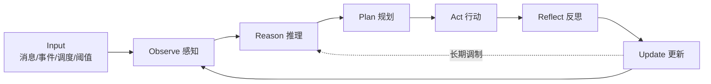

# V3.0 Agent Runtime Architecture

> **状态**：Implemented（RT-001 ~ RT-020 已落地并验收；实现期裁决见文末「附：实现期裁决登记」）
> **前置**：V2.0.0 Memory V2 / Reflection / Life Loop；V2.1.0 Agent Runtime / Goal Stack / Decision Pipeline；V2.2.0 Character Experience；V2.3.0 World Simulation；V2.4.0 Tool System；V2.5.0 Planning System；V2.6.0 Action Execution System（已设计）
> **定位**：V3.0 = **Agent Runtime Core（运行时内核）**。它把 V2.1.0 建成的「Run Controller（阶段调度器）」升级为**显式的认知闭环运行时**，使 Agent 从「按 Profile 线性执行阶段」升级为「具备 Observe → Reason → Plan → Act → Reflect → Update 完整认知循环的自治运行时」，并补齐 Session 生命周期、Context Manager、State Manager、事件总线、接口契约与 Run/Trace/Execution History 持久化模型。
> **铁律**：本文档只做架构裁决，不含 Task、不含代码实现（仅接口契约签名）、不改任何既有模块；基于 Current System Architecture Baseline 演进，明确 Runtime 与业务模块边界。

---

## 0. 版本定位与设计原则

### 0.1 核心判断

V2.0.0 ~ V2.6.0 已经把 Agent 的「器官」和「层」全部建齐：

| 能力 | 承载域/版本 | 状态 |
|---|---|---|
| 长期记忆 | Memory V2（候选→转正→衰减，R1~R8） | 已实现 |
| 经历→认知 | Reflection（Evidence→Insight 三闸） | 已实现 |
| 认知→行为演化 | Development（Belief/Preference/Pattern→DevPolicy） | 已实现 |
| 关系成长 | Relationship（V8.5 六维引擎 + 里程碑） | 已实现 |
| 统一行为入口 | Agent Runtime（Run Controller / Trigger Router / Profile） | 已实现 |
| 意识状态投影 | Character State（Agent State Snapshot） | 已实现 |
| 目标驱动 | Goal Stack（L3/L2/L1/L0）+ Planning | 已实现 |
| 统一决策 | Decision Pipeline（候选→评估→风险→选择） | 已实现 |
| 工具治理 | Tool System（注册/权限/校验/归一/Tool Surface） | 已实现 |
| 世界模拟 | World Simulation（时间/日程/事件/场景） | 已实现 |
| 行动执行 | Action Execution（统一 Action 抽象 + 调度 + 结果） | 已设计 |
| 观测 | runtime_traces / loop_runs / llm_capture | 已实现 |

但它们至今仍是**「被调度的一组阶段」而非「拥有显式认知循环的运行时」**：

1. **循环隐式**：`Observe → Reason → Plan → Act → Reflect → Update` 的认知闭环散落在 `chat_pipeline`、`life_loop`、`autonomy_engine`、`post_process` 四处的阶段序列里，没有一个显式的、可观测、可回放的 Loop 状态机。
2. **无 Session 生命周期**：`Run`（loop_runs）是行为单位，但「会话开始 → 会话上下文建立 → 会话结束」不是一等概念；Channel 的 `external_thread_id` 与 Run 生命周期没有统一对齐。
3. **组件未命名契约化**：Context 装配（context_builder）、状态组装（Agent State Assembler）、事件流转（outbox / world_events）各自存在，但没有「Context Manager / State Manager / Event System」这三个运行时组件的一等边界与接口契约。
4. **无统一接口**：Runtime 是一组函数（`open_run` / `run_autonomous_cycle` / `run_event_pregate`），不是 `AgentRuntime.run(input, context)` 这样的接口契约，Channel / 未来多角色无法以统一契约接入。

**V3.0 = 把这层「运行时内核」显式化，不是任何器官的重造**：

1. **Cognitive Loop**：把 V2.1 的线性阶段序列推广为显式的 `Observe → Reason → Plan → Act → Reflect → Update` 六段认知循环状态机。
2. **Session Lifecycle**：补 Session 为一等生命周期（Start → Context Build → … → Close），Run 作为 Session 内的行为单位。
3. **Runtime Components**：命名并契约化四个运行时组件——Context Manager / Agent Loop / State Manager / Event System。
4. **Interface Contract**：定义 `AgentRuntime.run` 与 Input / Output / Event / Error 四类契约，一切 Channel 与触发源以统一契约接入。
5. **Persistence Model**：以 Run / Trace / Execution History 三层持久化支撑 Debug / Replay / Evaluation。

### 0.2 四条铁律（对所有后续 Task 生效）

1. **不破坏 V2.x**：禁止重写 Memory / Reflection / Development / Relationship / Goal / Decision / Action / World / Tool / Planning 的域模型与数学；禁止创建第二套 Agent；一切复用/扩展以 §1 边界裁决表为准。
2. **Runtime 只调度、不持有业务语义**：延续 V2.1「Life Loop 只决定何时跑、跑什么、跑多少」的原则，Runtime Core 唯一职责是驱动认知循环、装配上下文、路由事件、记账；Reason/Plan/Act/Reflect/Update 的「业务语义」永远归各域。
3. **单一真相源 + 写入出链**：新增状态一律先问「SoT 在哪、谁可写」；Context / Snapshot / 事件均不落真相源；长期化写入只发生在后台，前台只读。
4. **循环可观测可回放**：每一次 Loop 的每一段都有 Trace 与执行历史落点，支持 Debug / Replay / Evaluation，不新增任何「不可观测的自治行为」。

### 0.3 Non-Goals（本版本明确不做）

- 多 Agent / 多角色并行（`character_id` 贯穿已预留，本版本不启用，见 §10）。
- World Simulation 升级（世界推演、NPC 自主行为——已是 V2.3.0 领域能力，本版本只消费）。
- 重写 Context Architect / LLM Gateway / 预算数学 / 关系数值引擎 / 行动检定。
- 前端控制台改版。
- 引入外部 Agent 框架（LangGraph / CrewAI 等）——Runtime Core 是自研轻量内核，不嫁接第三方编排引擎。

---

## 1. Problem Definition（问题定义）

基于 Current System Architecture Baseline 审计，识别四类结构性问题。

### 1.1 Channel 与 Agent 的解耦现状

**现状**（半解耦）：

- `channels/base.py` 已定义 `ChannelAdapter` Protocol（`send(OutboundMessage) -> SendResult`）与 `InboundMessage` / `OutboundMessage` / `ChannelIdentity` / `ChannelReply` 等通道无关契约，Feishu 有独立实现（`channels/feishu/`）。
- 但**入站路径未统一**：Web 前台走 `api/v1/chat.py`（HTTP 语义），Feishu 走 `api/v1/feishu.py`（webhook 语义），二者**各自独立触达**编排层，没有一个统一的「Inbound Gateway」把「任一渠道的消息」归一为同一种 Runtime 输入。

**问题**：

| # | 问题 | 影响 |
|---|---|---|
| C1 | 入站归一缺失 | 新增 Discord / Web 渠道需各自适配编排层，无法「注册即接入」 |
| C2 | Session/Thread 未对齐 | `external_thread_id` 是 Channel 局部概念，未与 Run/Session 生命周期统一 |
| C3 | 出站半直连 | 主动投递（proactive_delivery）与 Feishu delivery 有通道专属逻辑，未完全走统一 `ChannelAdapter.send` 出口 |

### 1.2 模块调用关系

**现状**：编排层（application）直接 import 并调用领域服务（services），依赖方向自上而下单向成立。但存在：

| # | 问题 | 影响 |
|---|---|---|
| M1 | 编排路径分裂残留 | V2.1 收编后 `chat_pipeline` / `life_loop` / `autonomy_engine` / `post_process` 四处的阶段序列仍各自维护「调用谁、按什么顺序」，认知循环没有唯一权威 |
| M2 | 点对点调用 | 领域间通过函数直调 + Outbox 混用，缺少统一的「模块通信」语义（何时用同步调用、何时发事件、何时落 Outbox） |
| M3 | 边界偶发泄漏 | 个别编排点绕过服务直接触达 repository / chain，V1 已确立「编排层不碰 SQL/prompt」的边界未 100% 收敛 |

### 1.3 状态管理问题

**现状**：状态真相源分散在各域（`character_state` / `relationship_state` / `development_state` / `goals` / `memories` / `world_*` / `personality_state`），V2.1 已引入 Agent State Assembler 做只读投影（Agent State Snapshot）。

**问题**：

| # | 问题 | 影响 |
|---|---|---|
| S1 | 无状态版本 | Snapshot 有 `snapshot_version`，但各域写入没有统一「状态版本/时点」对齐，跨域一致性靠「Run 开始时刻」约定，缺乏显式版本化 |
| S2 | 读时点散落 | 各阶段自行读取状态，Run 内「快照不变」靠约定维持，无 State Manager 强制 |
| S3 | 同步语义缺位 | 快变量（秒~分钟）与慢变量（天~月）的同步时机、冲突裁决没有统一规则 |

### 1.4 生命周期管理问题

**现状**：`Run`（loop_runs）是行为单位，三种 Run Profile（foreground_chat / autonomous_tick / event_driven）已建立；`close_run` 记终态 + 成本。

**问题**：

| # | 问题 | 影响 |
|---|---|---|
| L1 | 无 Session 概念 | 「会话开始/结束/上下文建立/会话内状态」没有一等生命周期；Session 与 Run 的关系未定义 |
| L2 | 生命周期状态不完整 | Run 有 open/close，但「中断恢复 / 孤儿 Run / 超时未终态」等中间态处理散落 |
| L3 | 触发源与生命周期割裂 | 四类触发源（Channel 消息 / World 事件 / 调度 / 阈值）只归一为 (run_kind, trigger_type)，没有统一的「触发 → 会话 → 循环」生命周期挂接 |

---

## 2. Agent Runtime Core Design（运行时核心）

### 2.1 认知闭环（版本主图）

V3.0 把 V2.1 的「Profile 阶段序列」推广为显式的**六段认知循环**。每个环节的「业务语义」由既有域承担，Runtime Core 只负责驱动与路由。



| 环节 | 语义 | 业务归属（Preserve） | Runtime Core 职责 |
|---|---|---|---|
| **Observe** | 收集触发增量，聚合为 Observation | Channel 消息 / World 事件 / State 阈值 / 调度 | 汇总、归一、去重，产出 Observation 值对象 |
| **Reason** | 决策「此刻做什么」 | Decision Pipeline（候选/评估/风险/选择）+ Goal Stack | 调决策管线，产出 Intention（值对象） |
| **Plan** | 把目标/意图展开为可执行步骤 | Planning System（Goal→Plan→Task） | 调规划引擎，产出 Plan |
| **Act** | 执行行动 | Action Execution（统一 Action + 调度 + 结果） | 调行动管理器，产出 ActionResult |
| **Reflect** | 从经历提炼认知 | Reflection（Evidence→Insight 三闸） | 触发反思窗口，收集 Insight |
| **Update** | 回写状态与长期变化 | State / Memory / Relationship / Development / Evolution | 路由回写事件到各域合法通道 |

**关键裁决**：Reason/Plan/Act/Reflect/Update 的**业务语义零改动**；V3.0 新增的是「把六段串成显式循环 + 每段契约化 + 全链可观测」的运行时骨架。循环的**快慢分离**沿用 V2.1：快时钟（Observe→Reason→Plan→Act，每 Run）与慢时钟（Reflect→Update，周期）在时间尺度上分离，慢时钟产物调制之后每一轮快时钟。

### 2.2 Runtime Lifecycle（运行时生命周期）

一等生命周期：Session 包裹 Run，Run 内驱动一次（或部分）认知循环。

```text
Session Start
    ↓
Context Build
    ↓
Observation
    ↓
Decision
    ↓
Execution
    ↓
Feedback
    ↓
State Update
    ↓
Session Close
```

每一步的**输入 / 输出 / 调用模块**：

| 步骤 | 输入 | 输出 | 调用模块（Preserve） | 是否 LLM |
|---|---|---|---|---|
| **Session Start** | Channel 会话标识（channel + external_user_id + external_thread_id）、触发源 | `SessionContext`（session_id、character_id、Run 挂接） | Channel 身份服务（channel_identity_service） | 否 |
| **Context Build** | SessionContext + 触发增量 | `RuntimeContext`（用户/世界/角色/记忆四类上下文，§3.1） | Context Manager → context_builder、Memory 检索、World 切片 | 否（规则） |
| **Observation** | RuntimeContext + 触发源事件 | `Observation`（归一化的感知事实集） | Event System（§6）→ Channel / World / State | 否 |
| **Decision** | Observation + Agent State Snapshot | `Intention`（值对象） | Decision Pipeline + Goal Stack（经 LLM Gateway 按预算） | 视歧义 |
| **Execution** | Intention + Plan | `ActionResult` | Planning → Action Execution | 视行动 |
| **Feedback** | ActionResult + Observation | `Feedback`（回写事件流） | Event System → outbox / world / memory / relationship | 否 |
| **State Update** | Feedback | 各域状态变更（后台） | State Manager → 各域合法写通道 | 否（后台异步） |
| **Session Close** | SessionContext + 台账 | 终态 + 成本汇总 | Run Controller（close_run 语义沿用） | 否 |

**要点**：

- **Session 是 Run 的宿主**：一个 Session 内可发生多个 Run（一轮对话 = 一个前台 Run；周期 tick = 一个后台 Run）；Run 是行为最小单位，Session 是生命周期单位。
- **每段可独立降级**：沿用 V2.1 降级总则——预算不足 → degraded（跳过可选段）；决策失败 → aborted；快照失败 → 最小快照继续。
- **前台/后台分叉点只在 Decision/Execution 候选构成**（前台「回复用户」优先），循环形状同一套。

---

## 3. Runtime Components（运行时组件）

四个运行时组件构成 Runtime Core 的主体。它们**只做装配、路由、调度、记账**，不承载业务语义。

### 3.1 Context Manager（上下文管理器）

**职责**：为一次认知循环装配**不可变的运行时上下文**，供 Reason/Plan/Act 消费。它是 V2.1 Context Architect + Agent State Assembler 的统一门面。

| 上下文段 | 内容 | 真相源（SoT） | 获取方式 |
|---|---|---|---|
| **用户上下文** | 当前用户、渠道身份、会话内历史、未读事件 | conversation / channel_identity | 只读检索 |
| **世界上下文** | 场景切片、时间、地点、天气、活跃事件 | world_* 域 | World 切片（只读） |
| **角色上下文** | Agent State Snapshot（mood/energy/emotion/goal 栈/interest/personality） | 各域投影 | Agent State Assembler（规则投影，0 LLM） |
| **记忆上下文** | 最近记忆摘要、高显著度记忆信号 | memories | Memory 检索（向量+结构化） |

**原则**：

- **只读投影、每 Run 重建**：Context 是 Runtime Context，非真相源，不落表、不写回（沿用 V2.0.0「Working Memory / Context 是 Runtime Context」裁决）。**所有权口径（R-4）**：允许持有域内容的只读投影，但不拥有写权；Run 结束必须 `reset`，不得把域 payload 当长期状态。
- **Run 内不变**：装配完成后冻结，防止决策中途状态漂移（沿用 V2.1 §3.3 一致性约定，升级为 State Manager 强制）。
- **超预算裁剪**：沿用 context_total_char_budget 与固定优先级裁剪（身份/场景/情绪/关系段不裁）。

### 3.2 Agent Loop（循环调度器）

**职责**：驱动六段认知循环的状态机。它是 V2.1 Run Controller + Profile Registry 的推广，把「阶段序列」升级为「循环状态机」。

```text
AgentLoop
├── observe()  → Observation      # 触发增量归一（§2.1 Observe）
├── reason()   → Intention        # 决策管线（§2.1 Reason）
├── plan()     → Plan | None      # 规划引擎（§2.1 Plan，可选段）
├── act()      → ActionResult     # 行动执行（§2.1 Act）
├── reflect()  → list[Insight]    # 反思窗口（§2.1 Reflect，慢时钟）
├── update()   → Feedback         # 状态回写路由（§2.1 Update）
└── run()      → RunResult        # 一次完整循环（见 §5 接口契约）
```

**关键裁决**：

- **Profile 仍是阶段组成唯一声明处**：`profiles.py` 的 `ProfileSpec` 继续定义「哪些段启用、哪些 critical、预算档」；Agent Loop 只按 Profile 编排，不另开第二套 Pipeline（延续 V2.1「无第二套 Agent Pipeline」红线）。
- **可选段显式化**：Plan / Reflect 是可选段，由 Profile 与预算裁决是否进入；Observe→Reason→Act 是前台 Run 的最小快路径。
- **循环不持有状态**：每次循环的中间值（Observation/Intention/Plan/ActionResult）是值对象，落 Trace 不落业务表。

### 3.3 State Manager（状态管理器）

**职责**：状态**同步 + 版本**的统一入口。它把 V2.1 Agent State Assembler 的「规则投影」升级为「带版本、带同步语义的状态门面」。

```text
StateManager
├── snapshot(character_id, now) → AgentStateSnapshot   # 统一投影（复用 Assembler）
├── version(domain, character_id) → StateVersion       # 各域当前版本号
├── observe(domain, event) → None                       # 接收域写事件，推进版本
└── reconcile(snapshot, writes) → None                  # 冲突/时点裁决（规则）
```

**状态版本模型**：

| 概念 | 语义 | 落点 |
|---|---|---|
| `StateVersion` | 每域单调递增的版本号（写入一次 +1） | 各域审计行已有（development_changes / relationship_events 等），State Manager 只读聚合 |
| `snapshot_version` | 一次 Snapshot 的时点对齐标记 | agent_state_snapshots（V2.1 既有表） |
| 时点一致性 | Run 内所有读对齐到 `run_started_at` 时点 | State Manager 强制，替代「约定」 |

**原则**：State Manager **不新增真相源、不写业务值**；它只提供「读哪一版、当前到哪一版、两版差什么」的版本化视角，写入永远回各域合法通道。

### 3.4 Event System（事件系统）

**职责**：模块间**通信总线**。把 V2.0/V2.6 的 Outbox（事务投递）+ world_events（世界广播）推广为**统一内部事件总线**，但**不替换**既有 Outbox 一致性模型。

**事件流示例**：

```text
UserMessageReceived → ObservationRecorded → PlanningStarted
    → ActionExecuted → ActionCompleted
    → MemoryUpdated → RelationshipUpdated → StateVersionBumped
```

**总线职责 vs 既有设施边界**：

| 能力 | 归属 | 说明 |
|---|---|---|
| 事务内可靠投递 | `outbox_events`（既有） | 跨域延迟投递的一致性模型，**不替换** |
| 世界事件广播 | `world_events`（既有） | 世界域对外广播，**不替换** |
| **进程内同步事件** | Event System（V3.0 新增） | 同进程、同 Run 内模块间的同步通信与生命周期通知（如 `RunOpened` / `StageCompleted`） |
| **事件订阅路由** | Event System（V3.0 新增） | 把「ActionCompleted → Memory Update → Relationship Update」这类编排订阅显式化 |

**关键裁决**：Event System 是**进程内**的发布/订阅与生命周期通知层，解决 M2 的「模块通信语义缺位」；**跨域、跨进程的可靠投递仍走 Outbox**，不引入 Event Sourcing / 消息队列（延续 V1 backend-refactor「不引入 Event Sourcing」裁决）。

---

## 4. Module Integration（模块集成）

明确 Runtime 与各业务模块的**边界**：Runtime 如何获取/读取/写入/调用，以及**永不改变**什么。

### 4.1 Character（人格）

| 方向 | 契约 |
|---|---|
| Runtime 如何获取人格 | 经 Context Manager 读 Agent State Snapshot 的 Personality State + Development 参数；Persona 静态资产只读 |
| Runtime 能否修改人格 | **否**。人格演化只经 Evolution Engine 编译（V2.1 铁律），Runtime 不写 personality_state |
| 永不改变 | Persona 文件本体、Personality 硬边界、Evolution 合法通道 |

### 4.2 World（世界）

| 方向 | 契约 |
|---|---|
| Runtime 如何读取世界 | 经 Context Manager 读 World 切片（场景/时间/地点/天气/活跃事件），只读 |
| Runtime 如何修改世界 | **不直写**。一切世界变更经 Action → `deferred_world_op` → outbox → world_engine（唯一写面） |
| 永不改变 | V8/V2.3 域模型、World 零入度铁律、world_engine 唯一写面 |

### 4.3 Relationship（关系）

| 方向 | 契约 |
|---|---|
| Runtime 如何影响关系 | 不直写。行动结果经 relationship_bridge 产关系信号 → 关系引擎自更新 |
| Runtime 如何读取关系 | 经 Context Manager 读关系阶段/边界投影（决策闸、快照组件） |
| 永不改变 | D1/D2/D3/D5 数值数学、账本即真相、单向 boost 方向 |

### 4.4 Planning（规划）

| 方向 | 契约 |
|---|---|
| Runtime 如何调用规划 | Agent Loop 的 `plan()` 段经 Planning Engine 把目标/意图展开为 Plan（Goal→Plan→Task） |
| 规划如何回到 Runtime | Plan 作为值对象交回 Agent Loop，Act 段消费 PlanStep |
| 永不改变 | Planning 只编排不执行（V2.6 G2）；Action 是独立抽象层 |

### 4.5 Action（行动）

| 方向 | 契约 |
|---|---|
| Runtime 如何执行动作 | Agent Loop 的 `act()` 段经 Action Manager 提交 Intention/PlanStep，由 Action Execution 层执行 |
| 行动结果如何回流 | `ActionResult`（统一结果契约）经 Feedback 段路由回写 + 进决策面（action_facts/tool_facts） |
| 永不改变 | Action 六态状态机、检定、唯一编排器 `run_action_planning`、Executor 不决策 |

### 4.6 Memory（记忆）

| 方向 | 契约 |
|---|---|
| Runtime 如何读取记忆 | 经 Context Manager 检索（向量+结构化混合，只读） |
| Runtime 如何写入记忆 | **不直写**。执行/对话产出经 Memory Candidate 摄取（R1~R8 唯一裁决），后台转正 |
| 永不改变 | 7 类封顶、生命周期数学、Memory 永不读 Relationship 数值（单向约束） |

### 4.7 边界裁决总表（对 V2.x 全模块）

裁决语义沿用版本惯例：**Preserve**（零改动）/ **Extend**（扩列不改变义）/ **New**（新增）/ **收编**（编排权转移，本体保留）。

| V2.x 模块 | 裁决 | V3.0 处置 |
|---|---|---|
| `application/agent_runtime/`（controller / profiles / trigger_router / models） | **收编 + Extend** | 收编为 Agent Loop + Session 生命周期底座；ProfileSpec 扩段（reflect 等可选段）；不改 Run 模型语义 |
| `application/agent_state_assembler.py` | **收编 + Extend** | 收编为 State Manager 的投影门面；新增版本化视角（§3.3） |
| `channels/base.py` + `channels/feishu/` | **Preserve + Extend** | ChannelAdapter 契约零改动；新增 Inbound Gateway 归一 + Web/Discord 适配器（§8） |
| Decision Pipeline / Goal Stack | **Preserve** | 零改动；只作为 Reason 段的业务本体被调用 |
| Planning System（V2.5） | **Preserve** | 零改动；只作为 Plan 段业务本体 |
| Action Execution（V2.6） | **Preserve** | 零改动；只作为 Act 段业务本体 |
| Tool System（V2.4） | **Preserve + Extend** | 治理零改动；新增 Tool Registry 统一执行面（§9） |
| World / Memory / Reflection / Development / Relationship / Evaluation | **Preserve** | 全部零改动；只作为各段的业务本体与读/写合法通道 |
| `outbox_events` / `world_events` / `loop_runs` / `runtime_traces` | **Preserve + Extend** | 一致性模型零改动；loop_runs 扩列 session_id（§7） |

---

## 5. Interface Design（接口设计）

> 本节只给**接口契约签名**（无实现体），是 Runtime Core 对外的唯一契约面。`...` 表示契约占位，不展开实现。

### 5.1 核心接口

```python
class AgentRuntime(Protocol):
    async def run(self, input: RuntimeInput, context: SessionContext) -> RunResult: ...
```

| 契约 | 语义 |
|---|---|
| `RuntimeInput` | 归一化输入：消息 / 事件 / 调度 / 阈值（§5.2） |
| `SessionContext` | 会话载体：session_id / character_id / channel 身份 / 触发源 |
| `RunResult` | 一次循环终态：status / intention / action_result / feedback / trace_ref / budget_account |

### 5.2 Input（输入契约）

```python
class RuntimeInput(Protocol):
    kind: TriggerKind          # channel_message | world_event | schedule | threshold
    payload: dict              # 归一化事实（消息文本 / 事件类型 / 阈值名）
    source: str                # channel 名 或 domain 名
    received_at: datetime
    channel_identity: ChannelIdentity | None   # 渠道身份（channel + external_user_id）
    thread_id: str | None      # 会话线程（对齐 Session）
```

**归一化铁律**：Web / Feishu / Discord / 事件 / 调度 / 阈值，最终都以 `RuntimeInput` 进入 Runtime；`kind` 沿用 V2.1 四类触发源，`source` 标识来源渠道或域。

### 5.3 Output（输出契约）

```python
class RunResult(Protocol):
    run_id: str
    status: RunStatus          # done | aborted | degraded
    intention: Intention | None
    action_result: ActionResult | None
    feedback: Feedback | None  # 回写事件流（§5.4）
    trace_ref: str             # 可观测锚点（§7）
    budget_account: dict
```

### 5.4 Event（事件契约）

```python
class RuntimeEvent(Protocol):
    event_type: str            # UserMessageReceived | ObservationRecorded | PlanningStarted
                                # | ActionExecuted | ActionCompleted | MemoryUpdated
                                # | RelationshipUpdated | StateVersionBumped | RunOpened | RunClosed
    run_id: str
    session_id: str
    occurred_at: datetime
    payload: dict
    correlation_id: str        # 关联同一因果链（如 action_id / plan_id）
```

**事件生命周期**：`emit → dispatch（同进程同步）→ subscribe（模块订阅）→ trace`。事件**不持久化为业务表**，只落 Trace（可观测）；跨域可靠投递仍走 Outbox。

### 5.5 Error（错误契约）

```python
class RuntimeError(Protocol):
    kind: ErrorKind            # perception | decision | planning | execution | feedback | state | session
    stage: str                 # 出错所在循环段
    run_id: str
    recoverable: bool          # 是否可降级继续
    detail: dict
```

**错误总则**：循环内单段失败不中断整个循环（沿用 V2.1「行动失败 ≠ Run 失败」）；`recoverable=True` → 该段降级跳过，Run 记 degraded；`recoverable=False`（决策/会话不可恢复）→ Run 记 aborted。一切错误落 Trace。

---

## 6. Event Driven Architecture（事件驱动架构）

### 6.1 事件分层

| 层 | 事件 | 机制 | 持久化 |
|---|---|---|---|
| **进程内生命周期** | `RunOpened` / `StageCompleted` / `RunClosed` / `StateVersionBumped` | Event System 同步发布/订阅 | 仅 Trace |
| **跨域事务投递** | `ActionCompleted` → Memory / Relationship 回写 | Outbox（既有，事务内） | outbox_events |
| **世界广播** | `WorldEvent` | world_events（既有） | world_events |

### 6.2 事件生命周期

```text
emit（某域/Runtime 段产生事件）
    ↓
dispatch（Event System 按 event_type 路由到订阅者）
    ↓
subscribe（Context Manager / State Manager / 各域消费）
    ↓
trace（trace_collector 记录，挂 run_id / correlation_id）
```

**示例链**：

```text
UserMessageReceived（Channel）
    → ObservationRecorded（Observe 段）
    → PlanningStarted（Plan 段，可选）
    → ActionExecuted（Act 段）
    → ActionCompleted（Act 段）
    → MemoryUpdated（Update 段，经 Outbox）
    → RelationshipUpdated（Update 段，经 relationship_bridge）
    → StateVersionBumped（State Manager）
    → RunClosed（Session）
```

### 6.3 订阅规则

| 订阅者 | 订阅事件 | 消费动作 |
|---|---|---|
| State Manager | `StateVersionBumped` | 推进各域版本视图 |
| Context Manager | `ObservationRecorded` | 刷新下次循环上下文候选 |
| 记忆摄取器 | `ActionCompleted` / `UserMessageReceived` | 生成 Memory Candidate（R1~R8） |
| 关系桥 | `ActionCompleted` | 关系信号（relationship_bridge） |
| 决策面 | `ActionCompleted` | action_facts / tool_facts（下次决策感知） |
| Reflection | `ActionCompleted` 聚集 | 证据窗 |

**原则**：订阅者**只读不改**事件；事件驱动的副作用一律回各域合法通道，Event System 不承载写语义。

---

## 7. Persistence Design（持久化设计）

### 7.1 三层执行记录

| 层 | 实体 | 落点（既有） | 用途 |
|---|---|---|---|
| **Run** | 一次循环的台账（open/close/终态/成本/阶段步骤） | `loop_runs` + `loop_runs.steps` | 行为审计、成本记账 |
| **Trace** | 循环内每段的结构化足迹（调用、取值、耗时、usage） | `runtime_traces` + `trace_collector` | Debug、排障 |
| **Execution History** | 决策/行动/记忆/状态的时序投影（审计链） | `decision_records` + `action_records` + `development_changes` + `relationship_events` + `agent_state_snapshots` | Replay、Evaluation |

### 7.2 三种消费场景

| 场景 | 依赖层 | 机制 |
|---|---|---|
| **Debug** | Trace + Run | 按 `run_id` / `correlation_id` 回溯每次循环每段的输入输出与耗时 |
| **Replay** | Execution History + agent_state_snapshots | 按 `snapshot_version` 对齐时点，重放「给定快照 → 决策 → 行动 → 结果」序列（复用 V2.1 回放 + V2.0 可重放审计） |
| **Evaluation** | 全部三层 | 指标（Decision Quality / Action Quality 等）取材；Evaluation 仍是只读旁路（V7.5 铁律） |

### 7.3 持久化边界

- **不建新「执行历史」表**：Run/Trace/History 均复用既有 `loop_runs` / `runtime_traces` / 各域审计表；V3.0 只新增「Session 挂接」的**扩展列**（见下），不建新表承载执行语义。
- **唯一扩展**：`loop_runs` 扩列 `session_id`（关联会话），`external_thread_id` 语义不变；`runtime_traces` 扩列 `correlation_id`（因果链关联）。
- **回放锚点**：`agent_state_snapshots`（V2.1 既有）作为 Replay 的时点对齐锚点，不新增快照表。

---

## 8. Multi Channel Compatibility（多渠道兼容）

### 8.1 目标形态

```text
Web ──────────┐
Feishu ───────┼──> Inbound Gateway ──> Agent Runtime ──> Outbound Gateway ──> 各 Channel Adapter
Discord ──────┘
```

### 8.2 兼容性验证

| 渠道 | 入站归一 | 出站投递 | 需要新增 |
|---|---|---|---|
| **Web** | `api/v1/chat.py` → `RuntimeInput(kind=channel_message)` | 经 `ChannelAdapter.send`（HTTP/SSE 回传） | Inbound Gateway 归一适配 |
| **Feishu** | `channels/feishu/` webhook → `RuntimeInput` | 经 Feishu `ChannelAdapter.send`（既有） | 无（既有） |
| **Discord** | 新增 Discord Adapter（webhook/gateway）→ `RuntimeInput` | 经 Discord `ChannelAdapter.send` | 新增 Discord Channel Adapter |

**裁决**：

- `ChannelAdapter` Protocol（`send(OutboundMessage) -> SendResult`）与 `InboundMessage` / `ChannelIdentity` 契约**零改动**——它是多渠道解耦的既有地基。
- V3.0 新增的只有 **Inbound Gateway**（把任意渠道入站归一为 `RuntimeInput`）与 **Outbound Gateway**（把统一 `OutboundMessage` 路由到正确 Adapter）；新增渠道 = 实现 `ChannelAdapter` + 注册，不改 Runtime。
- Session 挂接：`external_thread_id` → `session_id` 的映射统一在 Inbound Gateway 完成，Runtime 不感知渠道线程语义。

---

## 9. Tool / Function Calling Compatibility（工具 / 函数调用兼容）

### 9.1 目标形态

```text
Agent（决策/规划产出工具意图）
    ↓
Tool Registry（统一执行面）
    ↓
External Tool（内置 / 通道 / 外部 API / 未来 MCP）
```

### 9.2 三要素契约（沿用 V2.4/V2.6，零改动）

| 要素 | 契约 | 既有承载 |
|---|---|---|
| **Tool 定义** | `ToolDefinition`（id / namespace / capability / params / side_effects / priority） | `services/tool/registry.py` + `manifests/*.yaml` |
| **Tool 执行** | 五段短路（resolve → permission → validate → invoke → normalize） | `ToolExecutor` |
| **Tool 结果** | `ToolResult` → `ActionResult`（统一结果契约） | V2.4.0 ToolResult + V2.6.0 ActionResult |

### 9.3 扩展面

- **未来 Function Calling / MCP 对齐**（承接 V2.6 Q5 预留）：`Action.type → ExecutionKind` 映射 + `ToolRegistry` 的 `ExtTool` 执行方式是既有对接面；V3.0 只声明「Runtime 的 Tool 调用统一经 Tool Registry」，不实现 MCP。
- **Runtime 与 Tool 边界**：Runtime 不直接调工具；Reason/Plan 产出工具意图 → Act 段经 Action Execution → Tool Registry → 工具。工具面投影（Tool Surface）由既有八维规则裁决，Runtime 不干预工具选择语义。

---

## 10. Future Evolution（未来演进）

### 10.1 V3.1 Memory Evolution

- 目标：记忆从「被动检索」升级为「主动建构/遗忘/整合」的演化闭环。
- V3.0 预留点：Event System 的 `MemoryUpdated` 订阅面 + Execution History 的记忆时序投影，为 V3.1 的「记忆演化审计」提供地基；Memory 7 类封顶与 R1~R8 在 V3.1 前不松动。

### 10.2 V3.2 Reflection System

- 目标：反思从「周期 + 事件双触发」升级为「循环内嵌的持续反思 + 目标导向反思」。
- V3.0 预留点：Agent Loop 的 `reflect()` 已是显式慢时钟段，`ActionCompleted` 证据窗 + `agent_metric` 证据源已就绪；V3.2 只需在循环内调度反思窗口，不改循环形状。

### 10.3 V3.3 Self Improvement

- 目标：评估→演化反馈闭环（V2.1 已建 Evolution Engine）与认知循环深度融合，形成「越跑越准」的自治优化。
- V3.0 预留点：Execution History + Evaluation 三层持久化让「每个决策的长期后果」可追踪，State Manager 的版本化让「演化前后状态差异」可对齐；Evolution Engine 仍只经 Reflection→(Development/Personality) 合法通道编译，不直改行为。

### 10.4 更远（多角色 / 世界自治）

- `character_id` / `session_id` 贯穿使 Agent Runtime 可按角色实例化多份循环（每角色独立 Session/Context/State 版本）；World 零入度使世界侧模拟时钟可自行产事件，Runtime 无需改形（事件驱动触发源已是入口）。本版本不设计。

---

## 附：边界不变量清单（评审清单，任何 Task 不得违反）

1. Runtime Core 只调度、路由、装配、记账；Reason/Plan/Act/Reflect/Update 的业务语义归各域，零改动。
2. Context / Snapshot / RuntimeEvent 只读投影，不落真相源；写入回各域合法通道。
3. 一切长期变化可经 Execution History 指认来源并回放。
4. 循环内 LLM 调用四问（是否/何时/哪档/多少）只在 LLM Gateway 裁决（沿用 V2.1）。
5. 跨域可靠投递仍走 Outbox；Event System 只做进程内同步通信，不引入 Event Sourcing。
6. ChannelAdapter 契约零改动；新增渠道 = 实现 Adapter + 注册，不改 Runtime。
7. Tool 治理（注册/权限/校验/归一）零改动；Runtime 不干预工具选择语义。
8. 前后台共用同一认知循环；不得再出现平行编排路径。
9. 无第二套 Agent / 无第二套 Pipeline / 无新 Agent 框架嫁接。

---

## 附：遗留问题登记（进入 Task 拆分时逐项裁决）

| # | 问题 | 倾向 |
|---|---|---|
| Q1 | `session_id` 是扩列 `loop_runs` 还是新表 `sessions`（会话元数据 vs 仅挂接） | 倾向扩列起步（最小必要），会话独立表待多角色/多会话需求成熟再评估 |
| Q2 | Event System 的订阅注册是代码静态注册还是配置声明 | 倾向代码注册（沿用 ToolRegistry / Trigger Registry 模式），避免过度配置化 |
| Q3 | State Manager 的版本号是「各域审计行投影」还是「独立版本表」 | 倾向投影聚合（零新表），独立版本表待跨域事务写需求出现再评估 |
| Q4 | `reflect()` 慢时钟段挂接方式（Profile 内显式段 vs 独立周期任务） | 倾向 Profile 显式段 + 预算裁决（复用 V2.1 快慢分离），与 Reflection 既有周期任务并存 |
| Q5 | Inbound Gateway 归一层的 Web 迁移顺序（先归一、后切 HTTP 语义） | Flag 内逐渠道切，Feishu 先切、Web 后切、Discord 新增 |

---

## 附：实现期裁决登记

### D-1（2026-09-22）唯一认知循环 = Profile 阶段序列（H-1 裁决 B）

**背景**：RT-006 定义六段循环形状（Observe → Reason → Plan → Act → Reflect → Update），
RT-007 ~ RT-012 交付了六段段本体（`app/application/agent_runtime/stages/*.py`）；
RT-015 / RT-016 的「收编」则把**既有阶段**（`chat_pipeline` 22 步闭包 / `life_loop._step_*`）
包进 `AgentLoop` 驱动壳。结果：**两套完整实现并存**，而生产 `run()` 只按 `profiles.py`
的 Profile 阶段序列驱动（`loop.py::_run_stages`），六段方法从未被 `run()` 调用。

**裁决**：**B — 显式降级为影子实现，禁止长期并存两套完整实现。**

- **当前唯一循环** = `profiles.py` 声明的 **Profile 阶段序列**（段本体为既有阶段实现）。
- 六段方法（`AgentLoop.observe/reason/plan/act/reflect/update`）与 `stages/*` 段本体
  **登记为影子 / 测试实现**：标记 `loop.SHADOW_STAGE_METHODS = True`、
  `stages.SHADOW_STAGE_IMPLEMENTATION = True`；段函数**从生产导出面移除**
  （`agent_runtime/__init__.py` 不再 re-export `act` / `observe` / `reason` / `reflect` / `update`）。
- **禁止**在生产代码中调用影子段本体并假定其生效。
- 护栏：`tests/v30/test_runtime_lifecycle.py::TestSingleLoopDecision`（AST 断言 `run()` 不调用六段方法、
  标记存在、段函数不在 `__all__`）。

**后续（方案 A：真收编 / R-15 灰度）**：`runtime_six_stage_loop_enabled`（默认 `False`）打开后
`run()` 经 `_run_six_stage_loop` 驱动六段方法；默认仍走 Profile 阶段序列。待两态 e2e 对照
稳定后再切默认并收缩 Profile 包装。
生产实现。**前置条件（缺一不可）**：

1. C-2 补充 e2e 安全网建成：flags-off 全轮次 golden / 录制流逐字段对照、中段 LLM 失败、
   grounding 缓冲、post_process 失败（见 `reviews/RT-ALL-remediation.md` R-12）；
2. `runtime_foreground_loop_enabled` 可一键回退验证通过（已交付，提交 `787e215`）；
3. 明确 `stages/*.py` 与 Profile 包装的删留边界。

在此之前，不变量 8「前后台共用同一认知循环」与 9「无第二套 Agent / Pipeline」在**代码级**
按「单一在跑实现 + 显式标注的影子实现」口径成立；**方案 A 完成后按字面口径成立**。

> 相关评审：`docs/version/v3.0.0/reviews/RT-ALL-code-review.md`（H-1）
> 整改记录：`docs/version/v3.0.0/reviews/RT-ALL-remediation.md`
